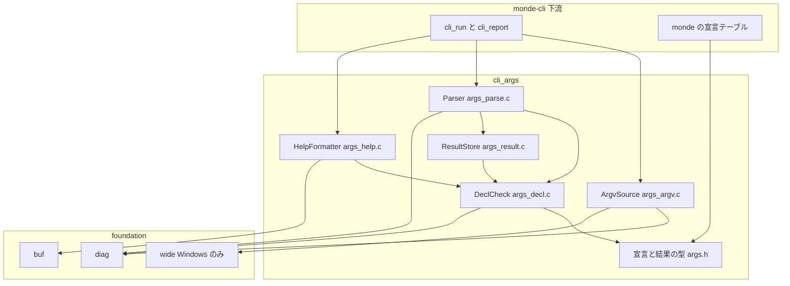
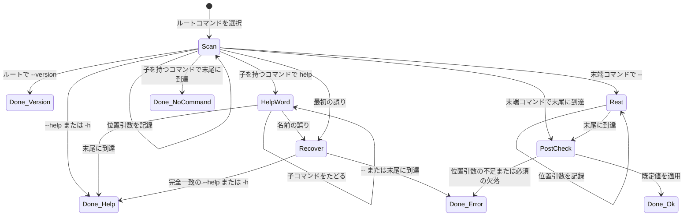
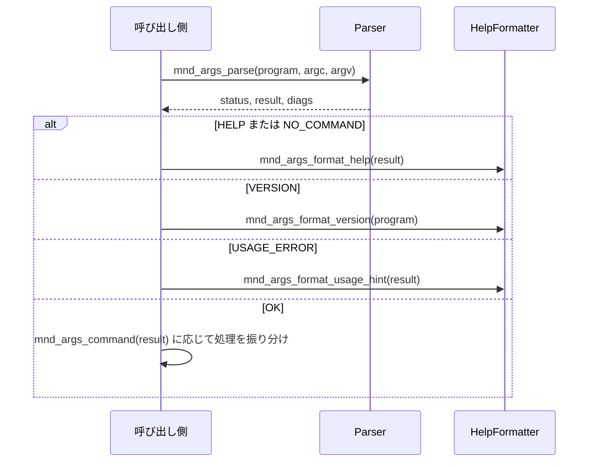
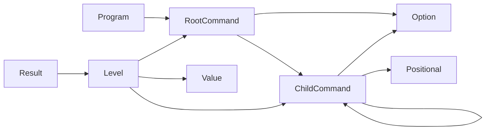
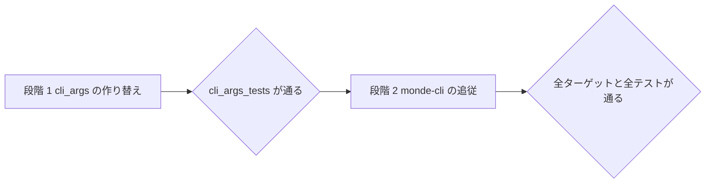

# 技術設計書: cli-args

## Overview

**Purpose**: cli-args は、コマンドとオプションを `static const` の宣言テーブルで定義し、その宣言に基づいてコマンドライン引数を解析する汎用の部品である。同じ宣言から英語のヘルプ、バージョン、使い方の案内を生成し、使い方のエラーを foundation の診断として返す。Windows では、非 ASCII を含む引数を UTF-8 で取得する機能も提供する。

**Users**: cli-args を使う開発者（現在は monde-cli の開発者）が、コマンドの体系をこの部品で宣言し、解析結果を受け取って各処理に振り分ける。本部品は Monde 固有の知識を持たないため、テストでは架空のプログラムの宣言だけで挙動を検証する。

**Impact**: 実装済みの cli-args（プログラムの直下にサブコマンドが 1 段だけ並ぶ構成）を、**ルートコマンドを起点とする再帰的なコマンドの木**に作り替える。サブコマンドのない形式は「子コマンドを持たないルートコマンド」として、同じ規則で扱う。公開 API（宣言の型、結果の型、ヘルプの関数）は互換性を保たずに置き換える。利用側の monde-cli は新しい API に書き換えるが、`monde` が受け付けるコマンドラインとヘルプの文面は変えない。引数の取得（`args_argv.*`）と foundation の `wide` は変更しない。

### Goals
- 1 つの宣言の形で、サブコマンドなし・1 段・入れ子の 3 つの構成を表し、同じ解析規則で扱う。
- 親コマンドのオプションを、宣言ごとに子孫へ引き継げる。
- 解析の結果を「成功」「ヘルプ」「バージョン」「子コマンドの未指定」「使い方のエラー」「宣言の誤り」「メモリ不足」で区別し、選択されたコマンドの経路とともに返す。
- コマンドごとのヘルプを 1 つの書式の規則で生成する。1 段の構成では、改訂前と同じ文面になる。
- `monde` の利用者から見た挙動を保つ（例外は要件 8.3 による 1 点だけ）。

### Non-Goals
- Monde のコマンドとオプションの定義の変更、`monde` のコマンド体系の変更（monde-cli）
- 診断とヘルプの表示先・表示形式の最終決定と、終了コードの決定（monde-cli）
- 子コマンドを持つコマンドの位置引数、既定の子コマンド、サブコマンドの別名、同時に指定できないオプションの組の検査
- 値の型変換と妥当性の検査、長いオプションの省略形、`--no-<name>`
- 端末の幅による折り返し、未知のオプション・サブコマンドに対する候補の提示
- 環境変数や設定ファイルからの読み込み
- 改訂前の API との互換の層

## Boundary Commitments

### This Spec Owns
- 宣言の型（`mnd_args_program_t`、`mnd_args_command_t`、`mnd_args_option_t`、`mnd_args_positional_t`）と、その妥当性の規則
- 引数列の解析規則（本書「解析規則」の節）と、解析結果の型 `mnd_args_result_t`、`mnd_args_level_t`、状態 `mnd_args_status_t`
- 予約名: 子コマンド名 `help`、オプションの長い名前 `help` と `version`、短い名前 `h`
- 使い方のエラーと宣言の誤りの英語のメッセージ（本書「メッセージ」の節）
- コマンドのヘルプ、バージョン、使い方の案内、コマンドの経路の文面の書式
- Windows でのコマンドライン引数の取得と UTF-8 への変換（`mnd_args_argv_t`）。今回の改訂では変更しない
- foundation の部品 `wide`（改訂前の本 spec が追加した）。今回の改訂では変更しない
- 新しい API に合わせた monde-cli の書き換え（`src/cli/` の宣言、解析結果の受け取り、ヘルプと案内の生成の呼び出し）。挙動は変えない

### Out of Boundary
- `monde` 固有の宣言の内容（サブコマンド名、オプション名、説明文、バージョン文字列）と、各サブコマンドの処理
- 診断とヘルプを `stdout` / `stderr` に書く処理、終了コード（monde-cli）
- `monde` の共通オプション（`--output`、`--quiet`、`--no-wrap`）を引き継ぐオプションへ移すこと。`monde --quiet extract` が通るようになり、ヘルプの文面も変わるため、要件 13 に反する。今回は各サブコマンドへの重複した宣言を保つ
- README と利用マニュアルの改訂（文面が変わらないので不要。`tests/docs/` が一致を検査する）
- オプション値の解釈（パスとしての検査、数値への変換、キー名の検査など）
- foundation の既存の公開 API の変更

### Allowed Dependencies
- 製品コード（`src/cli_args/`）: C 標準ライブラリ、`monde::foundation` の `buf.h`、`diag.h`、`wide.h`（Windows のみ）。Windows では Win32 API の `GetCommandLineW`、`CommandLineToArgvW`（shell32）、`LocalFree` のみ。
- テストコード（`tests/cli_args/`）: 上記に加えて Naos。
- モジュール間の依存は `foundation ← cli_args ← monde-cli` の一方向。cli_args は他の汎用パーサ（po、markdown、yaml）に依存しない。
- モジュール内の依存の方向は「Architecture」の節に従う。`args_help.c` と `args_argv.c` は `args_parse.c` / `args_result.c` の関数に依存しない。
- monde-cli（`src/cli/`）は、cli_args の公開ヘッダ（`args.h`、`args_help.h`、`args_argv.h`）だけを include する。`args_internal.h` を include しない。

### Revalidation Triggers
- 宣言の型のメンバーの追加・削除・意味の変更 → monde-cli の宣言テーブル
- 解析規則（コマンドの選択、有効なオプション、優先順位、`--` の扱い）の変更 → monde-cli のテストと利用マニュアル
- 予約名の追加・変更 → monde-cli の宣言
- `mnd_args_status_t` の値の追加・意味の変更 → monde-cli の終了コードの決定
- ヘルプ・メッセージ・案内の文面の書式の変更 → monde-cli のテストの期待値、README と `docs/commands.md` の引用（`tests/docs/`）
- 診断の接頭辞（コマンドの経路）の形の変更 → monde-cli の `cli_report.c`（接頭辞を取り除く）
- 値の寿命の約束（引数列と宣言を指すこと）の変更 → monde-cli の引数列の扱い
- `monde` が引き継ぐオプションを使い始める場合 → monde-cli の要件、README と利用マニュアル

## Architecture

### Existing Architecture Analysis

改訂前の実装は、宣言の検査（DeclCheck）、走査（Parser）、結果の保持（ResultStore）、文面の生成（HelpFormatter）、引数の取得（ArgvSource）をファイル単位で分けている。この分割は改訂後の要件にも合うため、そのまま保つ。変更は次の 4 点に集中する（詳細は `research.md` のギャップ分析）。

- **宣言の型**: プログラムがサブコマンドの配列だけを持つ形を、ルートコマンドを指す形に変える。コマンドは子コマンドの配列を持てる。
- **コマンドの選択**: 入口で `argv[1]` を振り分ける専用の処理をなくし、ルートコマンドから始まる 1 つの走査に統合する。
- **結果の保持**: 選択された 1 つのコマンドの値だけを持つ形を、経路の段ごとに値を持つ形に変える。
- **ヘルプ**: 全体用とサブコマンド用の 2 つの書式を、コマンドの種類（子を持つか、末端か、ルートか）で要素が決まる 1 つの書式にする。

末端コマンドの中の走査（長短のオプション、値の記録、位置引数、`--`、回復走査）と、ヘルプの行の整形は、オプションの検索を「有効なオプション」の検索に差し替えるだけで再利用する。

### Architecture Pattern & Boundary Map

宣言の木を入力とする単一パスの走査器である。



**Architecture Integration**:
- 採用したパターン: 再帰的な宣言テーブル + 単一パスの走査器。コマンドの選択は走査の中の 1 つの分岐であり、サブコマンドの有無で入口を分けない。
- 依存の方向（違反はレビューで誤りとして扱う）: `args.h`（型） ← `args_decl.c`（検査と検索） ← `args_result.c`（結果の保持） ← `args_parse.c`（走査）。`args_help.c` は `args.h` と `args_decl.c` の検索関数だけに依存する。`args_argv.c` は `args_argv.h` と foundation の `diag`、`wide` だけに依存する。
- 経路の持ち方: 宣言は `static const` で親へのポインタを持たない。経路は解析結果（`mnd_args_result_t` の `levels`）が持ち、DeclCheck の検索と HelpFormatter は結果を読んで経路を知る。
- 既存のパターンの踏襲: `monde_add_module`、接頭辞 `mnd_`、`_t` 付きの typedef、エラーは `mnd_diag_list_t` で返す、`stdout` / `stderr` に書かない、`exit` しない。
- steering との整合: 汎用部品として Monde を知らない（1.11）。部品の公開 API の互換性は保証しない方針（tech.md）に沿って、API を置き換える。

### Technology Stack

| Layer | Choice / Version | Role in Feature | Notes |
|-------|------------------|-----------------|-------|
| 言語 | C99（MSVC は `/std:c11`） | 実装 | VLA を使わない。宣言テーブルは指示付き初期化子（C99）で書く |
| 依存モジュール | `monde::foundation` | `mnd_buf_t`（文面の出力先）、`mnd_diag_list_t`（エラー） | 変更なし |
| テスト | Naos v0.4.0（CTest） | 単体テスト | ラベル `cli_args`、`cli`、`docs` |

新しい依存はない。

## File Structure Plan

### Directory Structure
```
src/cli_args/
├── CMakeLists.txt     # 変更なし
├── args.h             # 変更: 宣言の型（ルートコマンド、子コマンド、引き継ぐ属性）、結果の型（経路の段）、取得関数
├── args_help.h        # 変更: 解析結果を受け取るヘルプ・案内・経路の生成関数
├── args_internal.h    # 変更: 子コマンドと有効なオプションの検索、段を扱う結果の書き込み関数
├── args_decl.c        # 変更: 宣言の木の検査（再帰）、子コマンドの検索、有効なオプションの検索と列挙
├── args_result.c      # 変更: 経路の段ごとの値の保持、名前による取得、既定値の適用
├── args_parse.c       # 変更: ルートからの単一の走査、コマンドの選択、help の語、回復走査、事後の検査
├── args_help.c        # 変更: 一本化したコマンドのヘルプ、案内、経路
├── args_argv.h        # 変更なし
└── args_argv.c        # 変更なし

tests/cli_args/
├── CMakeLists.txt     # 変更: 新しいスイートのソースを加える
├── main.c             # 変更: 新しいスイートを登録する
├── test_decl.h        # 変更: 3 つの架空のプログラム（tool、single、nest）の宣言
├── test_decl.c        # 変更: 同上の定義（指示付き初期化子）
├── decl_test.c        # 変更: 新しい宣言の規則（1.6〜1.9）を加え、既存の検査を新しい型に合わせる
├── dispatch_test.c    # 変更: 1 段の構成でのコマンドの選択、help、--help、--version、子コマンドの未指定
├── long_test.c        # 変更: 新しい型と取得関数に合わせる（規則は同じ）
├── short_test.c       # 変更: 同上
├── values_test.c      # 変更: 同上
├── positional_test.c  # 変更: 同上
├── errors_test.c      # 変更: 経路を含む接頭辞、未知のサブコマンドの後ろのヘルプ（8.3）
├── help_test.c        # 変更: 結果を受け取る関数に合わせる。1 段の構成の文面は改訂前と同じ
├── single_test.c      # 新規: スイート single。サブコマンドのない構成（2.6、6.6、8.2、8.7、8.8、9.3、9.4）
├── nested_test.c      # 新規: スイート nested。2 段以上の構成（2.2〜2.5、2.8、7.2、7.3、8.4〜8.6、9.2）
├── inherit_test.c     # 新規: スイート inherit。引き継ぐオプション（12.1〜12.6、3.6、5.7、9.5）
└── argv_test.c        # 変更なし
```

### Modified Files（monde-cli）
- `src/cli/cli_commands.c` — 宣言テーブルを新しい型と指示付き初期化子に書き換える。ルートコマンド（説明と 4 つの子コマンド）を加える。オプションと位置引数の内容、順序は変えない。
- `src/cli/cli_run.c` — 状態ごとの振り分けを新しい API に合わせる（`mnd_args_command`、結果を受け取る `mnd_args_format_help`）。
- `src/cli/cli_report.c`、`cli_report.h` — `mnd_cli_report_usage_error` が解析結果を受け取り、`mnd_args_format_path` で得た経路を接頭辞として取り除く。
- `tests/cli/run_test.c` — 宣言の検証をルートコマンドの子コマンドをたどる形にする。8.3 と 8.6 で変わる期待値を直す。
- `tests/cli/report_test.c` — `mnd_cli_report_usage_error` の新しい引数に合わせる。
- `src/cli/cmd_*.c`、`cli_io.c` — 変更なし（`mnd_args_flag` などの取得関数の形は変わらない）。

### 変更しないファイル
- `README.md`、`docs/*.md` — ヘルプの文面が変わらないため。`tests/docs/` が変更なしで通ることを完了の条件とする（13.3）。
- `src/foundation/`、`src/monde/main.c`。

## 規約（本モジュール）

- モジュール名 `cli_args`、ターゲット `monde_cli_args`（別名 `monde::cli_args`）、テスト `cli_args_tests`、ラベル `cli_args`。短縮名は `args`。
- すべての公開関数は、明記したものを除いてポインタ引数に `NULL` を受け付けない。グローバルな状態を持たない。
- 文字列は UTF-8 の NUL 終端のバイト列として扱い、名前の照合はバイト単位の完全一致（大文字と小文字を区別）とする（2.7、3.7、10.1）。
- **宣言テーブルは指示付き初期化子で書く**（製品コードとテストの両方）。書かなかったメンバーは 0（`NULL`、`false`、`'\0'`）になるため、どのメンバーも 0 が「なし」を表すように型を定める。今後メンバーを加えても、既存の宣言は変えずに済む。GCC と Clang で、現在の警告の設定（`-Wall -Wextra -Wpedantic -Werror`、C99）のまま、入れ子の宣言が警告なしで通ることを確認済みである。

## 用語と記法

- **段**: 経路上の 1 つのコマンド。段 0 がルートコマンド、最後の段が選択中のコマンドである。
- **経路の文字列**: プログラム名に、段 1 以降のコマンド名を空白 1 つで区切って続けたもの（例: `tool`、`tool remote add`）。以下 `<path>` と書く。
- **子を持つコマンド**: `command_count > 0` のコマンド。**末端コマンド**: `command_count == 0` のコマンド。
- **有効なオプション**: 選択中のコマンドが宣言したオプションと、祖先が `inherited` を真として宣言したオプション。

## 解析規則

`argv[0]` はプログラムの起動名として読み飛ばし、メッセージとヘルプには宣言の `program->name` を使う。以下で「トークン」は `argv[1]` 以降の各要素を指す。

### 走査（2.x〜6.x、8.x、12.x）

宣言を検査した後、ルートコマンドを段 0 として選択し、トークンを左から 1 つずつ見る（2.1）。入口での特別な振り分けはない。`--` を見るまでは次の表に従う。「選択中」は最後の段のコマンドを指す。

| トークンの形 | 扱い |
|---|---|
| `--` | 末端コマンド: 終端とし、以降のトークンはすべて位置引数にする（6.3）。子を持つコマンド: 次のトークンがあれば、それを示す `unexpected argument` とする（2.5）。なければ走査を終える |
| `--help` | 選択中のコマンドのヘルプの要求（8.1、8.2）。走査を終えて `MND_ARGS_HELP` を返す |
| `--help=<x>` | 使い方のエラー `does not take a value`（3.5） |
| `--version` | 選択中のコマンドがルートコマンドなら、バージョンの要求（8.8）。走査を終えて `MND_ARGS_VERSION` を返す。そうでなければ `unknown option`（8.9） |
| `--version=<x>` | ルートコマンドなら `does not take a value`。そうでなければ `unknown option` |
| `--<name>` | `<name>` を有効なオプションの長い名前から検索する。フラグなら指定済みにする（3.1）。値・リスト値なら次のトークンを、`-` で始まる場合や子コマンド名と一致する場合も含めて値として消費する（3.2）。次のトークンがなければ `requires a value`（3.4） |
| `--<name>=<value>` | `<name>` は最初の `=` までとする。値・リスト値なら `=` の後ろ全体を値にする（3.3）。フラグなら `does not take a value`（3.5） |
| `-<c1><c2>...` | 2 文字目から 1 文字ずつ処理する（下記） |
| `-` 単独、または `-` で始まらない | オプションでない引数（4.7）。下の「オプションでない引数」に従う |

長い名前が有効なオプションに見つからない場合は `unknown option` とし、トークン（`=` 以降を除く）を示す（3.6）。前方一致、まだ選択されていない子コマンドのオプション、祖先の引き継がないオプションは、いずれも見つからない扱いになる。

短いオプションの各文字 `c` の処理（4.1〜4.6）:
1. `c == 'h'` なら選択中のコマンドのヘルプの要求とする（8.1）。
2. `c` が ASCII 以外のバイトなら、トークン全体を示す `unknown option` とする。
3. `c` を有効なオプションの短い名前から検索し、見つからなければ `-<c>` を示す `unknown option` とする（4.5）。
4. フラグなら指定済みにして次の文字へ進む（4.3）。
5. 値・リスト値なら、`c` より後ろに残りがあればそれを値とし（4.2、4.4）、なければ次のトークンを値として消費する（4.1、4.4）。次のトークンもなければ `-<c>` を示す `requires a value` とする（4.6）。このトークンの処理を終える。

オプションでない引数:

| 選択中のコマンド | トークン | 扱い |
|---|---|---|
| 末端コマンド | すべて（`help` を含む） | 位置引数として記録する（6.1、8.7）。個数が `max_positionals` を超えたら、そのトークンを示す `unexpected argument`（6.5） |
| 子を持つコマンド | `help` | 次節の「`help` の語」に従う（8.4〜8.6） |
| 子を持つコマンド | 子コマンド名と一致 | その子コマンドを新しい段として選択し、次のトークンから走査を続ける（2.2） |
| 子を持つコマンド | 上記以外 | そのトークンを示す `unknown command`（2.3） |

ルートコマンドが末端コマンドなら、表の 1 行目だけが当てはまる。どのトークンもサブコマンド名として解釈しない（2.6）。

値の記録（5.x、12.x）: 値は、そのオプションを**宣言した段**に記録する。引き継ぐオプションは、子コマンド名の前で指定しても後で指定しても同じ場所に記録されるため、解析結果は同じになり（12.4）、前後の両方で指定すれば同じオプションの繰り返しとして扱われる（12.3）。
- フラグ: 指定済みにする。繰り返してもエラーにしない（5.5）。
- 単一の値: 最後に指定した値で置き換える（5.4）。
- リスト値: 値を `,` で区切り、各項目を空白を含めてそのまま末尾に追加する（5.1、5.3）。空の項目（値が空、先頭・末尾の `,`、`,,`）があれば `empty item` とする（5.2）。

### `help` の語（8.4〜8.7）

子を持つコマンドの走査中に、オプションでない引数 `help` を見たら、その時点の段の数を記録して次のように進める。

1. 後続のトークンを順に、選択中のコマンドの子コマンド名として検索する。見つかれば、その子コマンドを新しい段として選択する（8.5）。
2. トークンが尽きたら、選択中のコマンドのヘルプの要求として `MND_ARGS_HELP` を返す（8.4、8.5）。
3. 選択中のコマンドが子を持ち、トークンがどの子コマンド名とも一致しなければ、`unknown command` とする。選択中のコマンドが末端コマンドで、まだトークンがあれば、`unexpected argument` とする（8.6）。どちらの場合も、段を `help` を見た時点まで戻してから誤りを保留する。接頭辞と案内は `help` を書いたコマンドの経路になる。

この間、トークンはすべて名前として扱う（`-` で始まるトークンをオプションとして解釈しない）。

### 走査の後の検査と優先順位（2.4、6.4、7.1、7.4、8.3）

1. 走査中に最初の誤りを検出したら、その診断を保留して回復走査に移る。回復走査では、誤りの原因となったトークン（消費した値を含む）の次から、`--` より前に残っているトークンのうち、完全に `--help` または `-h` と一致するものだけを探す。見つかれば保留した誤りを捨てて、誤りを検出した時点で選択中のコマンドの `MND_ARGS_HELP` を返す（8.3）。見つからなければ保留した誤りだけを報告して `MND_ARGS_USAGE_ERROR` を返す（7.4）。回復走査は誤りの種類を問わない（未知のサブコマンドを含む）。
2. 走査が誤りなしで終わり、選択中のコマンドが子を持つなら、`MND_ARGS_NO_COMMAND` を返す（2.4）。必須のオプションの検査と既定値の適用は行わない。
3. 選択中のコマンドが末端コマンドなら、位置引数の個数が `min_positionals` 未満かを検査する。不足していれば、最初に不足している位置引数の名前を示す `missing argument` とする（6.4）。
4. 次に、経路上のすべての段のオプションを、段 0 から順に、各段では宣言の順に見て、必須で明示的に指定されていない最初の 1 つを示す `missing required option` とする（7.1）。引き継ぐオプションは宣言した段に記録されるので、経路上のどこで指定されても指定済みになる（12.5）。
5. 最後に、経路上のすべての段で、明示的に指定されていないオプションに既定値を適用する（5.6、12.6）。

手順 3 と 4 の誤りも保留として扱うが、この時点で残りのトークンはないため、回復走査は何も見つけない。報告する使い方のエラーは常に 1 件である（7.4）。



### 改訂前の 1 段の構成との違い

1 段の構成（`monde`）で結果が変わるのは次の場合だけである。ほかは、状態・選択されるコマンド・値・メッセージが改訂前と一致する。

| コマンドライン | 改訂前 | 改訂後 | 根拠 |
|---|---|---|---|
| `monde bogus --help`、`monde --bogus -h` | 使い方のエラー | ルートコマンドのヘルプ | 8.3（13.4 の例外） |
| `monde help a b`（`a` が未知） | `too many arguments for 'help'` | `unknown command 'a'` | 8.6（エラーのまま。文面だけが変わる） |
| `monde help extract x` | `too many arguments for 'help'` | `unexpected argument 'x'` | 8.6（同上） |
| `monde --foo=bar` | `unknown option '--foo=bar'` | `unknown option '--foo'` | 3.6（同上） |
| `monde --version=1` | `unknown option '--version=1'` | `option '--version' does not take a value` | 3.5（同上） |

`monde --version extra` と `monde --help extra` は、改訂前と同じくバージョンとヘルプを返す（8.1、8.8）。

## メッセージ

診断はすべて `MND_SEVERITY_ERROR`、`path == NULL`、`line == 0` で追加する。使い方のエラーのメッセージは、誤りを検出した時点の経路の文字列を使って `<path>: ` で始める（7.2）。ルートコマンドが選択中なら `tool: `、子コマンドの選択後は `tool build: `、`tool remote add: ` のようになる。`<arg>` は利用者が書いた形（`--name` または `-c`、または問題のトークン）である。

| 場面 | メッセージ（`<prefix>` は `<path>: `） | 要件 |
|---|---|---|
| 未知のサブコマンド | `<prefix>unknown command '<token>'` | 2.3、8.6 |
| 未知のオプション | `<prefix>unknown option '<arg>'` | 3.6、4.5、8.9 |
| 値の欠落 | `<prefix>option '<arg>' requires a value` | 3.4、4.6 |
| フラグへの値 | `<prefix>option '--<name>' does not take a value` | 3.5 |
| リストの空の項目 | `<prefix>option '<arg>' has an empty item in '<value>'` | 5.2 |
| 位置引数の不足 | `<prefix>missing argument <NAME>` | 6.4 |
| 余分な引数 | `<prefix>unexpected argument '<token>'` | 2.5、6.5、8.6 |
| 必須のオプションの欠落 | `<prefix>missing required option '--<name>'` | 7.1 |
| 宣言の誤り | `invalid argument declaration: <理由>`（理由は DeclCheck の表） | 1.6〜1.10 |
| メモリ不足 | `out of memory while parsing arguments` | — |

詳しい使い方を確認する方法（7.3）は、メッセージには含めず、HelpFormatter の `mnd_args_format_usage_hint` で別に生成する。引数の取得（ArgvSource）のメッセージは変更しない。

## Requirements Traceability

| Requirement | Summary | Components | Interfaces | Flows |
|-------------|---------|------------|------------|-------|
| 1.1, 1.2, 1.3, 1.4, 1.5 | 宣言の内容（ルート、子コマンド、引き継ぐ属性） | 型（args.h） | `mnd_args_program_t`、`mnd_args_command_t`、`mnd_args_option_t` | — |
| 1.6, 1.7, 1.8, 1.9, 1.10 | 宣言の誤り | DeclCheck、Parser | `mnd_args_decl_check`、`MND_ARGS_DECL_ERROR` | 解析の最初 |
| 1.11 | Monde を知らない | 全体 | — | コードレビュー、テストの宣言 |
| 2.1, 2.2, 2.3, 2.5, 2.6, 2.7 | コマンドの選択 | Parser、DeclCheck | `mnd_args_parse`、`mnd_args_find_child` | 走査 |
| 2.4 | 子コマンドの未指定 | Parser、HelpFormatter | `MND_ARGS_NO_COMMAND`、`mnd_args_format_help` | 走査の後の検査 |
| 2.8 | 経路の特定 | ResultStore | `mnd_args_command`、`mnd_args_depth`、`mnd_args_command_at` | — |
| 3.1, 3.2, 3.3, 3.4, 3.5, 3.6, 3.7 | 長いオプション | Parser、DeclCheck、ResultStore | `mnd_args_find_long` | 走査 |
| 4.1, 4.2, 4.3, 4.4, 4.5, 4.6, 4.7 | 短いオプション | Parser、DeclCheck、ResultStore | `mnd_args_find_short` | 走査 |
| 5.1, 5.2, 5.3, 5.4, 5.5, 5.6 | リスト値、繰り返し、既定値 | ResultStore、Parser | `mnd_args_is_set`、`mnd_args_list_*` | 走査、事後の検査 |
| 5.7 | 経路上のどのオプションも取得できる | ResultStore | `mnd_args_flag`、`mnd_args_value` ほか | — |
| 6.1, 6.2, 6.3, 6.4, 6.5, 6.6 | 位置引数と終端 | Parser、ResultStore | `mnd_args_positional_*` | 走査、事後の検査 |
| 7.1, 7.2, 7.4 | 必須、メッセージ、最初の誤り | Parser | 診断 | 回復走査、事後の検査 |
| 7.3 | ヘルプの要求方法 | HelpFormatter | `mnd_args_format_usage_hint` | — |
| 7.5, 7.6 | 診断で返す、状態の区別 | Parser | `mnd_args_status_t` | — |
| 8.1, 8.2, 8.3 | `--help` と回復走査 | Parser | `MND_ARGS_HELP` | 走査、回復走査 |
| 8.4, 8.5, 8.6, 8.7 | `help` の語 | Parser | `MND_ARGS_HELP` | `help` の語 |
| 8.8, 8.9 | バージョン | Parser、HelpFormatter | `MND_ARGS_VERSION`、`mnd_args_format_version` | 走査 |
| 9.1, 9.2, 9.3, 9.4, 9.5, 9.6, 9.7, 9.8, 9.9 | 文面の生成 | HelpFormatter、DeclCheck | `mnd_args_format_help`、`mnd_args_effective_*` | — |
| 10.1, 10.5 | バイト列のまま、引数列を変えない | Parser、ResultStore | 値は引数列を指す | — |
| 10.2, 10.3, 10.4 | Windows での取得 | ArgvSource（変更なし） | `mnd_args_argv_get` | — |
| 11.1, 11.2, 11.3, 11.4 | 単体テスト | CliArgsTests | `cli_args_tests` | — |
| 12.1, 12.2 | 引き継ぐ・引き継がないオプションの有効範囲 | DeclCheck | `mnd_args_find_long`、`mnd_args_find_short` | 走査 |
| 12.3, 12.4, 12.5, 12.6 | 前後での指定、必須、既定値 | ResultStore、Parser | 宣言した段への記録 | 走査、事後の検査 |
| 13.1, 13.2, 13.3, 13.4 | monde-cli の追従 | MondeCliAdapter | `src/cli/` の宣言と振り分け | Migration Strategy |

## Components and Interfaces

| Component | Domain/Layer | Intent | Req Coverage | Key Dependencies (P0/P1) | Contracts |
|-----------|--------------|--------|--------------|--------------------------|-----------|
| 型（args.h） | 宣言 | 宣言・状態・結果の型 | 1.1〜1.5 | — | State |
| DeclCheck | 宣言 | 宣言の木の検査、子コマンドと有効なオプションの検索 | 1.6〜1.10, 2.7, 3.7, 12.1, 12.2 | Diag (P0) | Service |
| ResultStore | 解析 | 経路の段ごとの結果の保持と取得 | 2.8, 5.1, 5.3〜5.7, 6.1, 10.1, 10.5, 12.3〜12.6 | DeclCheck (P0) | Service, State |
| Parser | 解析 | 引数列の走査と状態の決定 | 2.1〜2.6, 3.x, 4.x, 5.2, 6.x, 7.1, 7.2, 7.4〜7.6, 8.1〜8.9 | DeclCheck (P0)、ResultStore (P0)、Diag (P0) | Service |
| HelpFormatter | 文面 | コマンドのヘルプ、バージョン、案内、経路の生成 | 2.4, 7.3, 8.8, 9.1〜9.9 | DeclCheck (P1)、Buf (P0) | Service |
| ArgvSource | 入力 | 引数列の UTF-8 での取得（変更なし） | 10.2〜10.4 | Diag (P0)、Wide (P0) | Service |
| CliArgsTests | テスト | 単体テスト | 11.1〜11.4 | Naos (P0) | — |
| MondeCliAdapter | monde-cli | `src/cli/` を新しい API に合わせる | 13.1〜13.4 | cli_args の公開 API (P0) | — |

### 宣言

#### 型（`src/cli_args/args.h`）

| Field | Detail |
|-------|--------|
| Intent | 呼び出し側が `static const` で書く宣言の型と、解析の状態・結果の型 |
| Requirements | 1.1, 1.2, 1.3, 1.4, 1.5 |

**Contracts**: State [x]

```c
typedef enum mnd_args_kind
{
    MND_ARGS_FLAG,   /* 値を取らない */
    MND_ARGS_VALUE,  /* 単一の値。繰り返すと後勝ち */
    MND_ARGS_LIST    /* カンマ区切りのリスト値。繰り返すと連結 */
} mnd_args_kind_t;

typedef struct mnd_args_option
{
    const char *long_name;      /* 必須。先頭の "--" を含まない（例: "output"） */
    char short_name;            /* 1 文字の ASCII 英数字。ないなら '\0' */
    mnd_args_kind_t kind;
    const char *value_name;     /* ヘルプ上の値の表示名（例: "FILE"）。NULL なら "VALUE"。フラグでは使わない */
    const char *help;           /* 説明（英語、1 行）。NULL 可 */
    bool required;              /* フラグでは false でなければならない */
    const char *default_value;  /* 既定値。NULL ならなし。リスト値はカンマ区切りで書く。フラグでは NULL */
    bool inherited;             /* true なら、宣言したコマンドの子孫でも有効（1.5） */
} mnd_args_option_t;

typedef struct mnd_args_positional
{
    const char *name;  /* ヘルプとメッセージ上の名前（例: "INPUT"）。山括弧を含まない */
    const char *help;  /* 説明。NULL 可 */
} mnd_args_positional_t;

#define MND_ARGS_UNLIMITED ((size_t)-1)

typedef struct mnd_args_command mnd_args_command_t;

struct mnd_args_command
{
    const char *name;                         /* 子コマンド名。ルートコマンドでは使わない（NULL 可） */
    const char *summary;                      /* 親のヘルプの一覧に出す 1 行の説明。ルートコマンドでは使わない */
    const char *description;                  /* このコマンドのヘルプの説明。NULL なら summary を使う */
    const mnd_args_option_t *options;         /* option_count == 0 なら NULL 可 */
    size_t option_count;
    const mnd_args_positional_t *positionals; /* 末端コマンドだけが持てる。positional_count == 0 なら NULL 可 */
    size_t positional_count;
    size_t min_positionals;
    size_t max_positionals;                   /* MND_ARGS_UNLIMITED なら上限なし */
    const mnd_args_command_t *commands;       /* 子コマンド。command_count == 0 なら末端コマンド（NULL 可） */
    size_t command_count;
};

typedef struct mnd_args_program
{
    const char *name;                /* プログラム名。ルートコマンドの名前として使う */
    const char *version;             /* バージョン文字列 */
    const mnd_args_command_t *root;  /* ルートコマンド。必須 */
} mnd_args_program_t;

typedef enum mnd_args_status
{
    MND_ARGS_OK,             /* 解析に成功。末端コマンドが選択されている */
    MND_ARGS_HELP,           /* ヘルプの要求。対象は結果の経路の最後のコマンド */
    MND_ARGS_VERSION,        /* バージョンの要求 */
    MND_ARGS_NO_COMMAND,     /* 子を持つコマンドで子コマンドが指定されなかった。対象は経路の最後のコマンド */
    MND_ARGS_USAGE_ERROR,    /* 利用者の入力の誤り。診断を 1 件追加済み */
    MND_ARGS_DECL_ERROR,     /* 宣言の誤り（プログラムの不具合）。診断を 1 件以上追加済み */
    MND_ARGS_OUT_OF_MEMORY   /* メモリ不足。診断を追加済み（記録できなければ dropped） */
} mnd_args_status_t;
```

- 3 つの構成の表し方: サブコマンドなしは `root->command_count == 0`（1.4）。1 段は、ルートコマンドの子コマンドがすべて末端コマンド。入れ子は、子コマンドがさらに `commands` を持つ（1.3）。
- 位置引数の名前の対応は改訂前と同じである。`i` 番目の位置引数の名前は `positionals[i]`、上限なしで `i >= positional_count` なら最後の要素の名前を使う。
- 利用側の識別子（ハンドラの対応付けのための整数など）は持たせない。利用側は `mnd_args_command` が返すポインタか名前で振り分ける。必要になれば、メンバーの追加で対応できる（指示付き初期化子のため、既存の宣言は壊れない）。

### DeclCheck（`src/cli_args/args_decl.c`、内部ヘッダ `args_internal.h`）

| Field | Detail |
|-------|--------|
| Intent | 宣言の木の妥当性の検査と、子コマンド・有効なオプションの検索と列挙 |
| Requirements | 1.6, 1.7, 1.8, 1.9, 1.10, 2.7, 3.7, 12.1, 12.2 |

**Responsibilities & Constraints**
- 検査は解析のたびに、引数列を見る前に行う。誤りはすべて診断に追加する（1 件で止めない）。
- ルートコマンドから木を深さ優先でたどる。たどる間、ルートから現在のコマンドまでの祖先の列を持ち、祖先との名前の重複（1.8）と循環の検出に使う。深さに上限を設けない（1.3）。
- 循環（あるコマンドの子孫に、そのコマンド自身と同じ宣言が現れる）は宣言の誤りとして報告し、その先をたどらない。検査が終わらなくなるのを防ぐ。
- 検索はバイト単位の完全一致で行う（2.7、3.7）。
- 有効なオプションの検索と列挙は、解析結果の段の列（`result->levels`）を読む。最後の段のオプションを宣言の順に、続いて親から祖先へ向かって、`inherited` が真のオプションを宣言の順に見る（12.1、12.2）。祖先との重複は宣言の誤りなので、名前は一意に決まる。

宣言の規則と、違反したときの理由（メッセージの `<理由>`）。`<path>` は検査中のコマンドの経路の文字列である。

| 規則 | 理由の文面 |
|---|---|
| `program->name`、`program->version` が `NULL` でも空でもない | `program name and version are required` |
| `program->root` が `NULL` でない | `root command is required` |
| 子を持つコマンドは位置引数を持たない（`positional_count`、`min_positionals`、`max_positionals` がすべて 0）（1.6） | `command '<path>' cannot have both subcommands and positional arguments` |
| 子コマンド名は `NULL` でも空でもなく、`-` で始まらない | `invalid command name '<name>' in command '<path>'` |
| 子コマンド名が `help` でない（1.7） | `command name 'help' is reserved in command '<path>'` |
| 同じ親の子コマンド名が重複しない（1.7） | `duplicate command '<name>' in command '<path>'` |
| コマンドが自分自身を子孫に持たない | `command '<path>' contains itself` |
| 長い名前は `NULL` でも空でもなく、`-` で始まらず、`=` を含まない | `invalid option name '<name>' in command '<path>'` |
| 長い名前が `help`、`version` でない、短い名前が `h` でない（1.9） | `option '--help' is reserved in command '<path>'` / `option '--version' is reserved in command '<path>'` / `option '-h' is reserved in command '<path>'` |
| 短い名前は `'\0'` または ASCII 英数字 | `invalid short option for '--<name>' in command '<path>'` |
| 同じコマンド内で長い名前・短い名前が重複しない（1.8） | `duplicate option '--<name>' in command '<path>'` / `duplicate option '-<c>' in command '<path>'` |
| 祖先のオプション（引き継ぐかどうかによらない）と長い名前・短い名前が重複しない（1.8） | `option '--<name>' in command '<path>' duplicates an option of command '<ancestor path>'` / `option '-<c>' in command '<path>' duplicates an option of command '<ancestor path>'` |
| フラグは `required == false` かつ `default_value == NULL` | `flag '--<name>' cannot be required or have a default in command '<path>'` |
| `required` と `default_value` を同時に持たない | `option '--<name>' cannot be both required and defaulted in command '<path>'` |
| リスト値の既定値に空の項目がない | `default of '--<name>' has an empty item in command '<path>'` |
| 末端コマンドで `min_positionals <= max_positionals` | `invalid positional range in command '<path>'` |
| 末端コマンドで、上限ありなら `positional_count == max_positionals`、上限なしなら `positional_count >= 1` | `positional names do not match the range in command '<path>'` |

**Contracts**: Service [x]

```c
/* args_internal.h（モジュール内部と tests/cli_args/ のみ） */

/* 経路上の 1 つのオプションの位置。level は段の添字、index はその段のコマンドの options の添字 */
typedef struct mnd_args_ref
{
    size_t level;
    size_t index;
} mnd_args_ref_t;

/* 宣言が妥当なら true。誤りごとに診断を追加して false を返す */
bool mnd_args_decl_check(const mnd_args_program_t *program, mnd_diag_list_t *diags);

/* parent の子コマンドを名前で探す。見つからなければ NULL */
const mnd_args_command_t *mnd_args_find_child(const mnd_args_command_t *parent,
                                              const char *name, size_t name_len);

/* 有効なオプションを名前で探す。見つかれば *ref に位置を入れて true（12.1、12.2） */
bool mnd_args_find_long(const mnd_args_result_t *result, const char *name, size_t name_len,
                        mnd_args_ref_t *ref);
bool mnd_args_find_short(const mnd_args_result_t *result, char short_name, mnd_args_ref_t *ref);

/* 有効なオプションの列挙。順序は「最後の段のオプション、親の引き継ぐオプション、…、ルートの引き継ぐオプション」 */
size_t mnd_args_effective_count(const mnd_args_result_t *result);
mnd_args_ref_t mnd_args_effective_at(const mnd_args_result_t *result, size_t i); /* i < count */

/* ref が指すオプションの宣言 */
const mnd_args_option_t *mnd_args_option_at(const mnd_args_result_t *result, mnd_args_ref_t ref);

/* option->value_name が NULL なら "VALUE" */
const char *mnd_args_value_name(const mnd_args_option_t *option);

/* min(index, positional_count - 1) 番目の名前 */
const char *mnd_args_positional_name(const mnd_args_command_t *command, size_t index);
```

### 解析

#### ResultStore（`src/cli_args/args_result.c`）

| Field | Detail |
|-------|--------|
| Intent | 解析結果（状態、経路、段ごとのオプションの値、位置引数）を保持し、長い名前で取り出せるようにする |
| Requirements | 2.8, 5.1, 5.3, 5.4, 5.5, 5.6, 5.7, 6.1, 10.1, 10.5, 12.3, 12.4, 12.5, 12.6 |

**Responsibilities & Constraints**
- 経路を段の配列で持つ。各段は、コマンドへのポインタと、そのコマンドの `options` と同じ添字の値の配列を持つ。値は宣言した段に記録する（12.3〜12.5）。
- 名前による取得は、最後の段から段 0 へ向かって、各段のコマンドが宣言したすべてのオプション（引き継ぐかどうかによらない）を探す（5.7）。経路上で名前は一意である（1.8）。
- 単一の値と位置引数は、引数列または宣言の文字列を指す（コピーしない）。引数列と宣言（`program` を含む）は結果より長く生存しなければならない。リスト値の項目だけを確保してコピーする。
- 引数列を書き換えない（10.5）。
- 既定値の適用（5.6、12.6）: 経路上のすべての段で、明示的に指定されていないオプションに `default_value` を設定する。`explicit_set` は `false` のままにする。

**Contracts**: Service [x] / State [x]

```c
/* args.h */
typedef struct mnd_args_value
{
    bool explicit_set;   /* 利用者が明示的に指定した */
    const char *value;   /* 単一の値: 引数列か既定値を指す。なければ NULL */
    char **items;        /* リスト値: 確保した項目の配列 */
    size_t item_count;
    size_t item_cap;
} mnd_args_value_t;

/* 経路上の 1 つの段 */
typedef struct mnd_args_level
{
    const mnd_args_command_t *command;
    mnd_args_value_t *values;   /* command->option_count 個。0 個なら NULL */
} mnd_args_level_t;

typedef struct mnd_args_result
{
    mnd_args_status_t status;
    const mnd_args_program_t *program;  /* 解析に使った宣言。解析前は NULL */
    mnd_args_level_t *levels;           /* levels[0] がルートコマンド、最後が選択中のコマンド */
    size_t level_count;
    size_t level_cap;
    const char **positionals;           /* 引数列を指す */
    size_t positional_count;
    size_t positional_cap;
} mnd_args_result_t;

#define MND_ARGS_RESULT_INIT { MND_ARGS_NO_COMMAND, NULL, NULL, 0, 0, NULL, 0, 0 }

void mnd_args_result_init(mnd_args_result_t *result);
/* 確保した領域を解放して初期状態に戻す。初期状態・解放済みに対しても安全 */
void mnd_args_result_free(mnd_args_result_t *result);

/* 経路（2.8）。level_count == 0（DECL_ERROR、OUT_OF_MEMORY、解析前）なら NULL / 0 */
const mnd_args_command_t *mnd_args_command(const mnd_args_result_t *result);   /* 選択されたコマンド（最後の段） */
size_t mnd_args_depth(const mnd_args_result_t *result);                        /* 段の数。ルートだけなら 1 */
const mnd_args_command_t *mnd_args_command_at(const mnd_args_result_t *result, size_t level); /* level < depth */

/* 以下、long_name が経路上のどのコマンドでも宣言されていない場合は false / NULL / 0 を返す（5.7） */
bool mnd_args_is_set(const mnd_args_result_t *result, const char *long_name);   /* 明示的な指定（5.6） */
bool mnd_args_flag(const mnd_args_result_t *result, const char *long_name);     /* フラグが指定された */
const char *mnd_args_value(const mnd_args_result_t *result, const char *long_name); /* 単一の値または既定値 */
size_t mnd_args_list_count(const mnd_args_result_t *result, const char *long_name);
const char *mnd_args_list_at(const mnd_args_result_t *result, const char *long_name, size_t index);
size_t mnd_args_positional_count(const mnd_args_result_t *result);
const char *mnd_args_positional_at(const mnd_args_result_t *result, size_t index); /* index < count */
```

```c
/* args_internal.h（Parser だけが使う） */
/* command を新しい段として加え、値の配列を確保する。失敗はメモリ不足 */
bool mnd_args_result_push(mnd_args_result_t *result, const mnd_args_command_t *command);
/* 段を level_count 個まで減らし、取り除いた段の値を解放する（help の語の誤りで使う） */
void mnd_args_result_truncate(mnd_args_result_t *result, size_t level_count);
void mnd_args_result_set_flag(mnd_args_result_t *result, mnd_args_ref_t ref);
void mnd_args_result_set_value(mnd_args_result_t *result, mnd_args_ref_t ref, const char *value);
/* value を ',' で区切って追加する。空の項目があれば何も追加せず MND_ARGS_USAGE_ERROR、確保の失敗は MND_ARGS_OUT_OF_MEMORY */
mnd_args_status_t mnd_args_result_append_list(mnd_args_result_t *result, mnd_args_ref_t ref,
                                              const char *value, bool explicit_set);
bool mnd_args_result_add_positional(mnd_args_result_t *result, const char *arg);
/* 経路上のすべての段で、明示的に指定されていないオプションに既定値を適用する */
mnd_args_status_t mnd_args_result_apply_defaults(mnd_args_result_t *result);
```

- 改訂前の `result->command` と `result->values` は廃止する。利用側は `mnd_args_command` を使う。
- 取得関数の名前と引数は改訂前と同じである。monde-cli のハンドラ（`cmd_*.c`）は変更なしで動く。

#### Parser（`src/cli_args/args_parse.c`）

| Field | Detail |
|-------|--------|
| Intent | 宣言に基づいて引数列を走査し、状態を決めて結果と診断を返す |
| Requirements | 2.1, 2.2, 2.3, 2.4, 2.5, 2.6, 3.1〜3.7, 4.1〜4.7, 5.2, 6.1〜6.6, 7.1, 7.2, 7.4, 7.5, 7.6, 8.1〜8.9 |

**Responsibilities & Constraints**
- 「解析規則」と「メッセージ」の節のとおりに動作する。
- 走査の状態は、解析結果（段の列）と、次に見るトークンの位置、終端を見たかどうか、保留した誤りからなる。選択中のコマンドは結果の最後の段から得る（走査の状態に別に持たない）。
- 診断の接頭辞は、誤りを保留した時点の段の列から作る（7.2）。
- `stdout` / `stderr` に書かず、`exit` / `abort` しない（7.5）。
- 状態 `MND_ARGS_USAGE_ERROR` のとき、追加する診断は 1 件だけである（7.4）。

**Contracts**: Service [x]

```c
/* args.h */
/*
 * argv[0] を読み飛ばし、argv[1]〜argv[argc - 1] を解析する。
 * result は初期化済みであること。以前の内容は解放してから書き込む。
 * 戻り値は result->status と同じ。
 */
mnd_args_status_t mnd_args_parse(const mnd_args_program_t *program, int argc, char *const *argv,
                                 mnd_args_result_t *result, mnd_diag_list_t *diags);
```
- 事前条件: `argc >= 0`、`argv[0]`〜`argv[argc - 1]` が NUL 終端の文字列（`argc == 0` のとき `argv` の要素は読まない）。
- 事後条件（「経路」は `result->levels`）:
  - `MND_ARGS_OK`: 経路の最後が末端コマンド。経路上のすべてのオプションに既定値が適用済み。位置引数の個数が `[min, max]` の範囲内。
  - `MND_ARGS_HELP`: 経路の最後がヘルプの対象のコマンド。診断なし。
  - `MND_ARGS_VERSION`: 経路はルートコマンドだけ。診断なし。
  - `MND_ARGS_NO_COMMAND`: 経路の最後が、子コマンドを指定されなかった子を持つコマンド。診断なし。
  - `MND_ARGS_USAGE_ERROR`: 診断 1 件。経路は誤りを検出した時点のもの（案内の生成に使う）。
  - `MND_ARGS_DECL_ERROR`: 引数列を読まない。診断 1 件以上。経路は空。
  - `MND_ARGS_OUT_OF_MEMORY`: 経路の内容は不定だが、`mnd_args_result_free` で解放できる。
- `MND_ARGS_DECL_ERROR` と `MND_ARGS_OUT_OF_MEMORY` 以外では `result->program == program` で、経路は 1 段以上ある。HelpFormatter の関数に渡せる。

呼び出し側の典型的な使い方:



**Implementation Notes**
- 回復走査は、最初の誤りの原因となったトークンの次から始める（値の欠落のように誤りが末尾で起きた場合は、残りがない）。
- `--help` / `-h` / `--version` を値として消費した場合（例: `-o -h`）は、ヘルプやバージョンにならない（3.2、4.1、8.1、8.8）。
- 改訂前の入口の振り分け（`argv[1]` の比較、`dispatch_help`、`select_command`）は削除し、走査に統合する。

### 文面

#### HelpFormatter（`src/cli_args/args_help.c`、`args_help.h`）

| Field | Detail |
|-------|--------|
| Intent | 解析結果の経路が指すコマンドのヘルプ、バージョン、使い方の案内、経路の文字列を決定的に生成する |
| Requirements | 2.4, 7.3, 8.8, 9.1, 9.2, 9.3, 9.4, 9.5, 9.6, 9.7, 9.8, 9.9 |

**Responsibilities & Constraints**
- 宣言の検査は行わない。`mnd_args_parse` が `MND_ARGS_DECL_ERROR`、`MND_ARGS_OUT_OF_MEMORY` 以外を返した結果を前提とする。
- 結果の型（`args.h`）のメンバーを読むだけで、`args_result.c` と `args_parse.c` の関数は呼ばない。
- 出力は `out` の末尾に追加する。改行は LF のみ。端末の幅や環境に依存しない（9.9）。
- 失敗はメモリ不足だけで、`false` を返す。

**Contracts**: Service [x]

```c
/* args_help.h */
/* 経路の最後のコマンドのヘルプ */
bool mnd_args_format_help(const mnd_args_result_t *result, mnd_buf_t *out);
/* "<program> <version>\n" */
bool mnd_args_format_version(const mnd_args_program_t *program, mnd_buf_t *out);
/* "Run '<path> --help' for usage.\n" */
bool mnd_args_format_usage_hint(const mnd_args_result_t *result, mnd_buf_t *out);
/* 経路の文字列 "<path>"（改行なし）。診断の接頭辞 "<path>: " と同じ形 */
bool mnd_args_format_path(const mnd_args_result_t *result, mnd_buf_t *out);
```

コマンドのヘルプの書式（9.1〜9.5）。`{...}` は宣言の値、`{pad}` は列を揃える空白である。説明が `NULL` または空なら、その段落と直後の空行を出さない。

子を持つコマンド:

```
Usage: {path}{ [<options>]} <command> [<options>] [<arguments>]

{command.description または command.summary}

Commands:
  {child.name}{pad}  {child.summary}
  help{pad}  Show help for a command

Options:
  {有効なオプションの左列}{pad}  {option.help}{注記}
  -h, --help{pad}  Show this help
      --version{pad}  Show version information

Run '{path} <command> --help' for help on a command.
```

末端コマンド:

```
Usage: {path} [<options>] {positional usage}

{command.description または command.summary}

Arguments:
  <{positional.name}>{pad}  {positional.help}

Options:
  {有効なオプションの左列}{pad}  {option.help}{注記}
  -h, --help{pad}  Show this help
      --version{pad}  Show version information
```

- 使い方の行: 子を持つコマンドでは、有効なオプションが 1 つ以上あるときだけ、経路の直後に ` [<options>]` を出す。末端コマンドでは常に ` [<options>]` を出す。
- `--version` の行は、ルートコマンドのヘルプにだけ出す（9.4）。
- `Arguments:` の段落は、位置引数がなければ出さない（9.3）。
- `Options:` の行の順序は、`mnd_args_effective_at` の順（そのコマンドのオプション、親の引き継ぐオプション、…、ルートの引き継ぐオプション）、`-h, --help`、`--version` とする。引き継いだオプションは、そのコマンドのオプションと同じ段落に同じ形で並べる（9.5）。
- 位置引数の使い方の行: `i < min_positionals` なら `<NAME>`、それ以外は `[<NAME>]`。上限なしの場合、最後の名前を `<NAME>...`（最後の添字が `min_positionals` 未満）または `[<NAME>...]` とする。要素は空白 1 つで区切る。
- オプションの左列: 短い名前があれば `-c, --name`、なければ `    --name`（短い名前の分の空白 4 つ）。値は ` <VALUE>`、リスト値は ` <VALUE>[,<VALUE>...]`（9.7）。
- 注記（9.6）: 必須なら ` (required)`、既定値があれば ` (default: {default_value})`。`help` が `NULL` の場合は、注記の先頭の空白を出さない。
- 列の揃え（9.8）: 段落ごとに左列の最大のバイト数を求め、各行で左列の後ろに空白を補って、説明の開始位置を `2 + 最大幅 + 2` バイト目に揃える。説明が空の行では、末尾に空白を出さない。

**改訂前の文面との一致**: 1 段の構成で、ルートコマンドがオプションを持たず、子コマンドが引き継いだオプションを持たない場合（`monde` の構成）、ルートコマンドのヘルプは改訂前の全体のヘルプと、子コマンドのヘルプは改訂前のサブコマンドのヘルプと、バイト単位で一致する。案内も `Run 'monde --help' for usage.`、`Run 'monde extract --help' for usage.` で一致する。`help_test.c` の既存の期待値と `tests/docs/` がこれを固定する（13.3）。

### 入力

#### ArgvSource（`src/cli_args/args_argv.c`、`args_argv.h`）

変更しない（10.2、10.3、10.4）。契約は改訂前のとおり、`mnd_args_argv_get`、`mnd_args_argv_free`、Windows での `mnd_args_argv_from_wide` である。

### monde-cli

#### MondeCliAdapter（`src/cli/cli_commands.c`、`cli_run.c`、`cli_report.c`、`cli_report.h`）

| Field | Detail |
|-------|--------|
| Intent | `monde` の宣言と、解析結果の受け取りを新しい API に合わせる。利用者から見た挙動は変えない |
| Requirements | 13.1, 13.2, 13.3, 13.4 |

**Responsibilities & Constraints**
- 宣言（13.1）: ルートコマンドは、説明（改訂前のプログラムの説明）と 4 つの子コマンドを持ち、オプションを持たない。子コマンドのオプションと位置引数は、内容と順序を改訂前のまま保つ。`inherited` は使わない。
- 振り分け（13.2）: `MND_ARGS_OK` では `mnd_args_command(&result)->name` でハンドラを引く。`MND_ARGS_HELP` は標準出力へ、`MND_ARGS_NO_COMMAND` は標準エラー出力へ `mnd_args_format_help(&result)` の文面を書く。終了コードは改訂前と同じである。
- 使い方のエラー（13.4）: `mnd_cli_report_usage_error` は解析結果を受け取る。`mnd_args_format_path` で得た経路に `": "` を続けた接頭辞を診断の本文から取り除き、`mnd_args_format_usage_hint` の案内を続ける。出力の形は改訂前と同じである。

```c
/* cli_report.h */
void mnd_cli_report_usage_error(FILE *err, const mnd_args_result_t *result, const mnd_diag_list_t *diags);
```

**Implementation Notes**
- `mnd_cli_program` は、改訂前と同じく宣言を複製して `version` だけを実行時の値に差し替える。ルートコマンドは `static const` のままで、`program.root` がそれを指す。
- 利用者から見て変わるのは、「改訂前の 1 段の構成との違い」の表の場合だけである。`tests/cli/run_test.c` の期待値のうち、この表に当たるものを直す。

## Data Models

### Domain Model



- **宣言**（不変、呼び出し側が所有）: プログラムが 1 つのルートコマンドを指す。コマンドは、オプションの配列と、子コマンドの配列または位置引数の配列を持つ。
- **結果**（解析ごとに作る、呼び出し側が所有して `mnd_args_result_free` で解放）: 段の配列が経路を表す。段は宣言のコマンドを指し、そのコマンドのオプションと同じ個数の値を持つ。
- **不変条件**:
  - `MND_ARGS_DECL_ERROR`、`MND_ARGS_OUT_OF_MEMORY`、解析前を除き、`levels[0].command == program->root`。
  - `levels[i + 1].command` は `levels[i].command` の子コマンドの 1 つである。
  - 位置引数は、経路の最後が末端コマンドのときだけ 1 個以上になる。

## Error Handling

### Error Strategy
- 利用者の入力の誤り: `MND_ARGS_USAGE_ERROR` と診断 1 件。表示、案内の併記、終了コードは呼び出し側が決める。
- 宣言の誤り（プログラムの不具合）: `MND_ARGS_DECL_ERROR` と、誤りごとの診断。利用者の入力の誤りと状態で区別する（1.10）。
- メモリ不足: `MND_ARGS_OUT_OF_MEMORY`。結果は解放可能な状態を保つ。HelpFormatter は `false` を返す。
- どの関数も `stdout` / `stderr` に書かず、プロセスを終了しない（7.5）。`assert` による契約違反の検出はデバッグビルドのみとする。

### Error Categories and Responses
- **使い方の誤り**: メッセージの表に従う。メッセージには問題の引数と、誤りを検出した時点の経路を含める（7.2）。
- **宣言の誤り**: DeclCheck の表に従う。メッセージにはコマンドの経路を含める。
- **子コマンドの未指定**: 誤りではなく独立した状態（`MND_ARGS_NO_COMMAND`）として返す（2.4、7.6）。エラーとして扱うかどうかは呼び出し側が決める（monde-cli は使い方を標準エラー出力に書き、終了コード 2 を返す）。

## Testing Strategy

すべて Naos で書き、`cli_args_tests` に 1 ファイル 1 スイートでまとめる（11.3）。宣言は `tests/cli_args/test_decl.c` の架空のプログラムだけを使い、Monde の宣言を使わない（11.1）。各テストは、解析の後に引数列が変わっていないことを確認できるよう、引数列を配列のリテラルで持つ。

テスト用の宣言（11.2）:

- **`tool`**（バージョン `1.2.3`、1 段）: 改訂前と同じ内容を、ルートコマンドの子コマンドとして宣言する。
  - `build`: `--output/-o <FILE>`（値、必須）、`--keys/-k <KEY>`（リスト、既定値 `a,b`）、`--level <N>`（値、既定値 `1`）、`--verbose/-v`（フラグ）、`--quiet/-q`（フラグ）。位置引数 `SOURCE`（1 個ちょうど）。
  - `copy`: オプションなし。位置引数 `SRC`、`DEST`（2 個ちょうど）。
  - `cat`: オプションなし。位置引数 `FILE`（0 個以上、上限なし）。
- **`single`**（バージョン `2.0`、サブコマンドなし）: ルートコマンドが末端コマンド。`--output/-o <FILE>`（値）、`--verbose/-v`（フラグ）、`--keys/-k <KEY>`（リスト）。位置引数 `FILE`（0 個以上、上限なし）。
- **`nest`**（バージョン `3.0`、入れ子）:
  - ルート: `--verbose/-v`（フラグ、引き継ぐ）、`--config/-c <FILE>`（値、引き継ぐ、既定値 `nest.cfg`）、`--dry-run`（フラグ、引き継がない）。
  - `remote`（子を持つ）: `--token/-t <TOKEN>`（値、引き継ぐ、必須）、`--tags <TAG>`（リスト、引き継ぐ）。
    - `remote add`: `--force/-f`（フラグ）。位置引数 `NAME`、`URL`（2 個ちょうど）。
    - `remote remove`: オプションなし。位置引数 `NAME`（1 個ちょうど）。
  - `status`: オプションなし。位置引数なし。

### Unit Tests
- **decl**: 改訂前の検査（名前の重複、予約名、必須のフラグ、リストの既定値、位置引数の範囲）を、経路を含む新しい文面で確認する。加えて、ルートコマンドが `NULL`、子を持つコマンドの位置引数（1.6）、同じ親の子コマンド名の重複と `help` という子コマンド名（1.7）、祖先のオプションとの長い名前・短い名前の重複（引き継ぐ場合と引き継がない場合の両方）（1.8）、`--version` という長い名前（1.9）、自分自身を子に持つコマンドで、それぞれ `MND_ARGS_DECL_ERROR` と名前を含む診断が返ること。2 段目のコマンドの誤りで、診断が `nest remote` のような経路を示すこと。誤りを 2 つ含む宣言で診断が 2 件になること（1.10）。
- **dispatch**（`tool`）: `tool build x -o y` で `build` が選択され、`mnd_args_depth` が 2 であること（2.2、2.8）。`tool bulid` が `tool: unknown command 'bulid'`、`tool --verbose build` が `tool: unknown option '--verbose'`、`tool Build` が未知のサブコマンドになること（2.3、2.7、3.6）。`tool` が `MND_ARGS_NO_COMMAND` で経路がルートだけであること（2.4）。`tool -- build` が `unexpected argument 'build'`、`tool --` が `MND_ARGS_NO_COMMAND`（2.5）。`tool --help`、`tool -h`、`tool --help build`、`tool help`、`tool help copy`、`tool help nope`、`tool help copy x`、`tool --version`、`tool --version x`、`tool build --version` の状態と経路（8.1、8.2、8.4〜8.6、8.8、8.9）。
- **long / short / values / positional**（`tool`）: 改訂前のテストを、新しい型と取得関数に合わせて保つ（3.1〜3.7、4.1〜4.7、5.1〜5.6、6.1〜6.5）。
- **errors**（`tool`）: `tool build x` が `missing required option '--output'`（7.1）。各メッセージが `tool build: ` で始まること（7.2）。`tool build --bad --worse x` の診断が 1 件であること（7.4）。`tool build --bad -h`、`tool build x --help` に加えて、`tool bogus --help` と `tool --bogus -h` がルートコマンドの `MND_ARGS_HELP` になること、`tool bogus -- --help` は使い方のエラーのままであること（8.3）。`tool build -o -h x` が `-h` を値として解析すること。各状態が区別されること（7.6）。
- **single**（`single`）: `single` が `MND_ARGS_OK` で位置引数 0 個、`mnd_args_depth` が 1 であること（2.6、6.6）。`single a -v b` と `single -v a b` の結果が同じであること（6.2）。`single help` と `single build` が位置引数になること（2.6、8.7）。`single --help` がルートコマンドのヘルプ、`single --version` と `single --version x` がバージョンであること（8.2、8.8）。`single --bad` が `single: unknown option '--bad'`、案内が `Run 'single --help' for usage.` であること（7.2、7.3）。ヘルプの文面（使い方の行、`Arguments:`、`Options:` に `--version` がある）をバイト単位で比較すること（9.1、9.3、9.4）。
- **nested**（`nest`）: `nest remote add n u -t x` で経路が `nest`、`remote`、`add` の 3 段になること（2.2、2.8）。`nest remote` が `MND_ARGS_NO_COMMAND` で経路の最後が `remote` であること、そのヘルプの文面（使い方の行に ` [<options>]`、`Commands:` に `add`、`remove`、`help`、末尾の案内が `Run 'nest remote <command> --help' ...`）（2.4、9.2）。`nest remote bogus` が `nest remote: unknown command 'bogus'`、案内が `Run 'nest remote --help' for usage.`（2.3、7.2、7.3）。`nest remote add n` が `nest remote add: missing argument <URL>`（6.4、7.2）。`nest help remote add`、`nest remote help add`、`nest remote add --help` が同じコマンドのヘルプになること（8.1、8.4、8.5）。`nest help remote bogus` が `nest: unknown command 'bogus'`、`nest help status x` が `nest: unexpected argument 'x'`（8.6）。`nest remote --version` が未知のオプションになること（8.9）。`nest status` が `MND_ARGS_OK`（必須の `--token` は経路にないので検査されない）（7.1）。
- **inherit**（`nest`）: `nest -v remote add n u -t x`、`nest remote -v add n u -t x`、`nest remote add -v n u -t x` で `mnd_args_flag(result, "verbose")` が真になり、ほかの値も同じであること（12.1、12.4）。`nest remote --dry-run add ...` が `nest remote: unknown option '--dry-run'`、`nest --dry-run remote add n u -t x` が成功して `mnd_args_flag(result, "dry-run")` が真であること（12.2、3.6、5.7）。`nest -c a remote add -c b n u -t x` で `config` が `b`、`nest remote --tags a add --tags b,c n u -t x` で `tags` が `a`、`b`、`c` になること（12.3）。`--token` を `remote` の直後と `add` の後のどちらで指定しても成功し、指定しなければ `nest remote add: missing required option '--token'` になること（12.5、7.1）。`config` を指定しないと `nest.cfg` が返り、`mnd_args_is_set` が偽であること（12.6）。`nest status --tags a` が未知のオプションになること（`remote` の子孫ではない）（12.1）。`nest remote add --help` のヘルプで、`Options:` が `--force`、`--token`、`--tags`、`--verbose`、`--config`、`-h, --help` の順に並ぶこと（9.5）。
- **help**（`tool`）: ルートコマンドと `build`・`copy`・`cat` のヘルプ、バージョン、案内、`mnd_args_format_path` を、期待する文面のリテラルとバイト単位で比較する（7.3、8.8、9.1〜9.9、11.4）。ルートコマンドと 3 つの子コマンドのヘルプの期待値は、改訂前の `help_test.c` の文面から変えない。同じ結果から 2 回生成した文面が一致すること（9.9）。
- **argv**: 変更なし（10.2〜10.4）。

### Integration Tests（monde-cli）
- `tests/cli/run_test.c`: 宣言の検証（4 つの子コマンド、オプション、位置引数）が新しい型で通ること（13.1）。既存のコマンドラインのテストが、「改訂前の 1 段の構成との違い」の表に当たるものを除いて、期待値を変えずに通ること（13.2、13.4）。`monde bogus --help` がルートコマンドのヘルプを標準出力に書いて終了コード 0 を返すことを加える（8.3）。
- `tests/cli/report_test.c`: 使い方のエラーの出力（接頭辞の除去と案内の行）が、改訂前と同じバイト列になること（13.4）。
- `tests/docs/`: 変更なしで通ること。README と `docs/commands.md` に引用した `monde --help`、`monde <sub> --help` の出力と一致する（13.3）。
- `tests/cli/` のほかのスイート（extract、init、update、translate、roundtrip）が変更なしで通ること（13.2）。

### 全体にかかわる確認
- 引数列を変えない（10.5）: 各スイートで、解析の前後で引数の文字列の内容が一致することを確認する。
- Monde を知らない（1.11）: `src/cli_args/` に `monde`、`extract` などの Monde 固有の語が現れないことをコードレビューで確認する。
- 値のバイト列の保持（10.1）: 非 ASCII の UTF-8（`"\xE6\x97\xA5"`）を値と位置引数に渡し、同じバイト列が返ること。
- 対応環境のすべて（MSVC、MinGW-w64、Apple Clang、GCC、Clang）で、指示付き初期化子の宣言が警告なしでビルドできること（CI）。

## Security Considerations
- 書式文字列を外部入力から作らない。利用者の引数とコマンド名は常に `%s` の引数として `mnd_diag_add` に渡す。
- 段の数、リスト値の項目数と長さ、位置引数の個数の計算は、確保の前にオーバーフローを検査する。
- 宣言の循環を DeclCheck が検出するため、誤った宣言で検査や解析が終わらなくなることはない。

## Migration Strategy

`cli_args` は 1 つの静的ライブラリなので、型（`args.h`）を変えると、モジュール内の 4 つの `.c` とテストが同時にビルドできなくなる。互換の層は作らず、次の 2 段階で進める。段階 1 の間は、`monde_cli` と `monde` のターゲットはビルドできない。



- **段階 1（cli_args）**: 型、DeclCheck、ResultStore、Parser、HelpFormatter と `tests/cli_args/` を新しい形にする。確認は、ターゲット `cli_args_tests` だけをビルドして `ctest -L cli_args` で行う。モジュール内では、依存の方向（型 → DeclCheck → ResultStore → Parser、HelpFormatter）の順に進める。既存の 1 段の構成（`tool`）のテストを先に通し、その後でサブコマンドなし（`single`）、入れ子（`nest`）、引き継ぐオプションのテストを加える。
- **段階 2（monde-cli）**: `src/cli/` と `tests/cli/` を書き換える。確認は、全ターゲットのビルドと `ctest` の全体（`cli`、`docs` を含む）で行う。`tests/docs/` が変更なしで通ることが、ヘルプの文面が変わっていないことの証拠になる。
- **戻し方**: 2 つの段階は同じブランチの連続した変更とし、段階 2 が通るまで main に入れない。途中で中止する場合は、ブランチを破棄すればよい（データの移行はない）。
