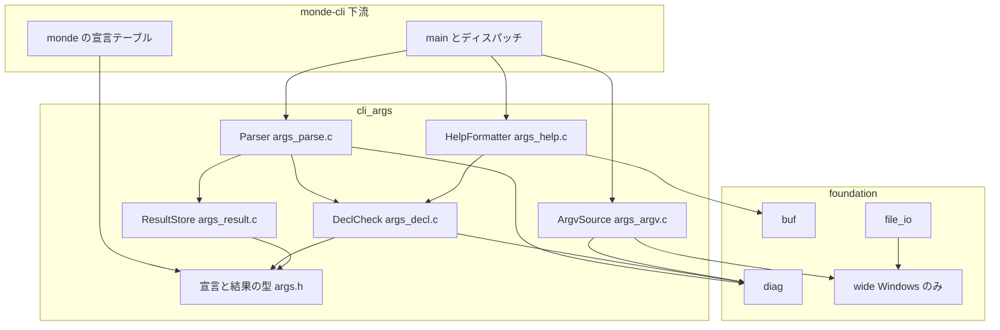
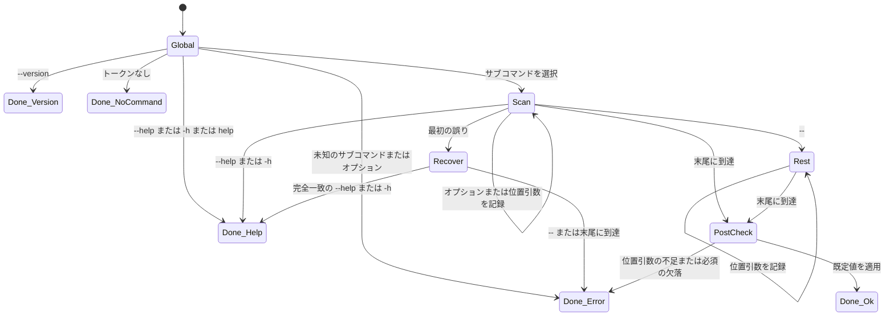
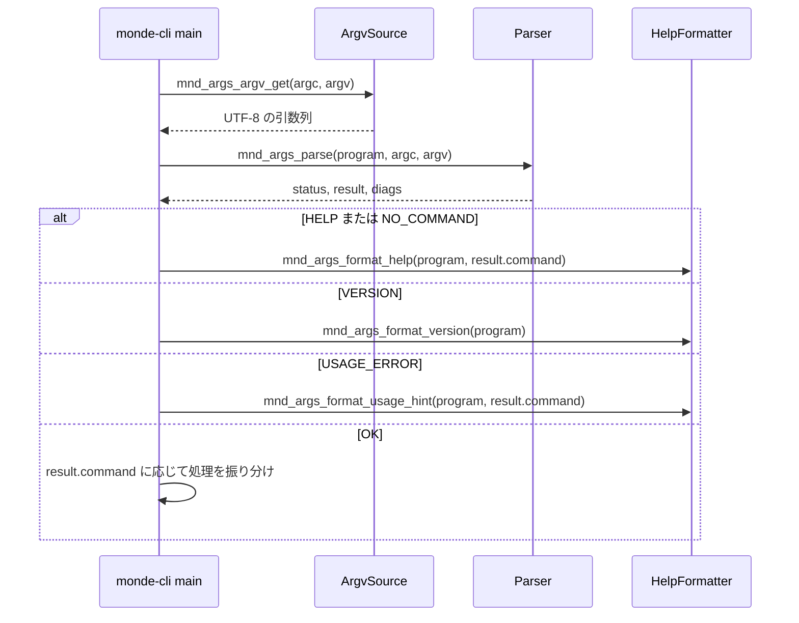

# 技術設計書: cli-args

## Overview

**Purpose**: cli-args は、サブコマンドとオプションを `static const` の宣言テーブルで定義し、その宣言に基づいてコマンドライン引数を解析する汎用の部品である。同じ宣言から英語のヘルプ、バージョン、使い方の案内を生成し、使い方のエラーを foundation の診断として返す。Windows では、非 ASCII を含む引数を UTF-8 で取得する機能も提供する。

**Users**: monde-cli の開発者が、`monde` の 4 つのサブコマンドとオプションをこの部品で宣言し、解析結果を受け取って各処理に振り分ける。本部品は Monde 固有の知識を持たないため、テストでは架空のプログラムの宣言だけで挙動を検証する。

**Impact**: 新しいモジュール `src/cli_args/`（ライブラリ `monde::cli_args`）とテスト `tests/cli_args/` を追加する。あわせて、foundation に Windows 専用の文字コード変換の部品 `wide`（UTF-8 と UTF-16 の相互変換）を追加し、`file_io.c` が内部に持っていた UTF-8 から UTF-16 への変換をそこへ移す。そのほかの既存のコードの変更は、`src/CMakeLists.txt` と `tests/CMakeLists.txt` への `add_subdirectory` の追加と、steering の予約済み短縮名への `args` と `wide` の追記だけである。

### Goals
- 宣言テーブルを渡すだけで、サブコマンドの振り分け、長い・短いオプション、値・リスト値・既定値、位置引数、`--`、必須チェックを解析できる。
- 解析の結果を「成功」「ヘルプ」「バージョン」「サブコマンドなし」「使い方のエラー」「宣言の誤り」「メモリ不足」で区別して返す。
- ヘルプとバージョンの文面を宣言から決定的に生成し、バイト単位で比較するテストで固定する。
- Windows で、非 ASCII を含む引数を UTF-8 で取得できる。

### Non-Goals
- Monde のサブコマンドとオプションの定義、各サブコマンドの処理（monde-cli）
- 診断とヘルプの表示先・表示形式の最終決定と、終了コードの決定（monde-cli）
- 値の型変換と妥当性の検査、長いオプションの省略形、`--no-<name>`、サブコマンドの入れ子、サブコマンドを持たない構成
- 端末の幅による折り返し、未知のオプションに対する候補の提示
- 環境変数や設定ファイルからの読み込み

## Boundary Commitments

### This Spec Owns
- 宣言の型（`mnd_args_program_t`、`mnd_args_command_t`、`mnd_args_option_t`、`mnd_args_positional_t`）と、その妥当性の規則
- 引数列の解析規則（本書「解析規則」の節）と、解析結果の型 `mnd_args_result_t`、状態 `mnd_args_status_t`
- 予約名: サブコマンド名 `help`、オプションの長い名前 `help`、短い名前 `h`。サブコマンドより前の `--help`、`-h`、`--version`
- 使い方のエラーと宣言の誤りの英語のメッセージ（本書「メッセージ」の節）
- 全体のヘルプ、サブコマンドのヘルプ、バージョン、使い方の案内の文面の書式
- Windows でのコマンドライン引数の取得と UTF-8 への変換（`mnd_args_argv_t`）
- foundation への部品 `wide` の追加（`mnd_wide_from_utf8`、`mnd_wide_to_utf8`）と、`file_io.c` の既存の変換をそれに置き換えるリファクタリング。`file_io` の公開 API と挙動（メッセージを含む）は変えない

### Out of Boundary
- `monde` 固有の宣言の内容（サブコマンド名、オプション名、説明文、バージョン文字列）
- 診断とヘルプを `stdout` / `stderr` に書く処理、終了コード（monde-cli）
- オプション値の解釈（パスとしての検査、数値への変換、キー名の検査など）
- foundation の既存の公開 API の変更（本 spec は `wide` を追加するだけで、既存の型と関数は変えない）

### Allowed Dependencies
- 製品コード（`src/cli_args/`）: C 標準ライブラリ、`monde::foundation` の `buf.h`、`diag.h`、`wide.h`（Windows のみ）。Windows では Win32 API の `GetCommandLineW`、`CommandLineToArgvW`（shell32）、`LocalFree` のみ。文字コードの変換は `wide.h` を通し、`WideCharToMultiByte` / `MultiByteToWideChar` を直接呼ばない。
- 製品コード（`src/foundation/wide.c`）: C 標準ライブラリと、Win32 API の `MultiByteToWideChar`、`WideCharToMultiByte` のみ。foundation の他の部品に依存しない。`file_io.c` は `wide` に依存してよい（foundation 内の依存は `file_io` から下位部品への一方向という既存の規則に従う）。
- テストコード（`tests/cli_args/`）: 上記に加えて Naos。
- モジュール間の依存は `foundation ← cli_args ← monde-cli` の一方向。cli_args は他の汎用パーサ（po、markdown、yaml）に依存しない。
- モジュール内の依存の方向は「Architecture」の図に従う。`args_help.c` と `args_argv.c` は `args_parse.c` / `args_result.c` に依存しない。

### Revalidation Triggers
- 解析規則（優先順位、値の取り方、混在、`--` の扱い）の変更 → monde-cli のテストと利用マニュアル
- 予約名の追加・変更 → monde-cli の宣言
- `mnd_args_status_t` の値の追加・意味の変更 → monde-cli の終了コードの決定
- ヘルプ・メッセージの文面の書式の変更 → monde-cli のテストの期待値、docs-and-release の利用マニュアル
- 値の寿命の約束（引数列を指すこと）の変更 → monde-cli の引数列の扱い
- Windows の引数の取得方法の変更 → monde-cli のエントリポイント、CI の Windows 環境
- `mnd_wide_*` の契約（所有権、失敗時の理由）の変更 → foundation の `file_io`、cli_args の ArgvSource

## Architecture

### Architecture Pattern & Boundary Map

宣言テーブルを入力とする単一パスの走査器である。宣言の検査、走査、結果の保持、文面の生成、引数の取得を、ファイル単位で分ける。



**Architecture Integration**:
- 採用したパターン: 宣言テーブル + 単一パスの走査器。宣言からヘルプも生成するため、宣言と挙動がずれない（9.x）。
- 依存の方向（違反はレビューで誤りとして扱う）: `args.h`（型） ← `args_decl.c`（検査と検索） ← `args_result.c`（結果の保持） ← `args_parse.c`（走査）。`args_help.c` は `args.h` と `args_decl.c` の検索関数だけに依存する。`args_argv.c` は `args_argv.h` と foundation の `diag`、`wide` だけに依存する。
- 既存のパターンの踏襲: `monde_add_module`、接頭辞 `mnd_`、`_t` 付きの typedef、エラーは `mnd_diag_list_t` で返す、`stdout` / `stderr` に書かない、`exit` しない。
- steering との整合: 汎用部品として Monde を知らない（1.7）。Windows の非 ASCII の扱いを部品に集約する。

### Technology Stack

| Layer | Choice / Version | Role in Feature | Notes |
|-------|------------------|-----------------|-------|
| 言語 | C99（MSVC は `/std:c11`） | 実装 | VLA を使わない |
| 依存モジュール | `monde::foundation` | `mnd_buf_t`（文面の出力先）、`mnd_diag_list_t`（エラー）、`mnd_wide_to_utf8`（Windows での変換） | `wide` は本 spec で追加する |
| OS API | Win32: kernel32、shell32 | Windows での引数の取得（cli_args）と文字コードの変換（foundation の wide） | `CommandLineToArgvW` のために shell32 をリンクする |
| テスト | Naos v0.4.0（CTest） | 単体テスト | ラベル `cli_args` |

## File Structure Plan

### Directory Structure
```
src/cli_args/
├── CMakeLists.txt     # monde_add_module(cli_args ... DEPENDS foundation)、Windows では shell32 をリンク
├── args.h             # 公開: 宣言の型、状態、結果の型、解析と結果の取得の関数
├── args_help.h        # 公開: ヘルプ、バージョン、使い方の案内の文面を生成する関数
├── args_argv.h        # 公開: 引数列を UTF-8 で取得する関数（Windows では変換関数も公開）
├── args_internal.h    # 内部: 宣言の検査と検索、結果を書き込む関数（モジュール内の .c と tests/cli_args/ だけが include する）
├── args_decl.c        # DeclCheck: 宣言の妥当性の検査、サブコマンドとオプションの検索、値の表示名の既定
├── args_result.c      # ResultStore: 結果の初期化・解放、値の記録（フラグ、単一、リスト）、既定値の適用、取得関数
├── args_parse.c       # Parser: 引数列の走査、ヘルプの優先と回復走査、事後の検査、メッセージの生成
├── args_help.c        # HelpFormatter: 全体とサブコマンドのヘルプ、バージョン、使い方の案内
└── args_argv.c        # ArgvSource: 引数列の取得（Windows では wide で UTF-8 に変換）

src/foundation/
├── wide.h             # 新規・公開: UTF-8 と UTF-16 の相互変換（_WIN32 のときだけ宣言する）
└── wide.c             # 新規: Wide の実装（Windows でだけビルドに加える）

tests/cli_args/
├── CMakeLists.txt     # monde_add_module_tests(cli_args SOURCES ...)
├── main.c             # NAOS_MAIN で全スイートを登録
├── test_decl.h        # 架空のプログラム "tool" の宣言（テスト専用、Monde を含まない）
├── test_decl.c        # 同上の定義
├── decl_test.c        # スイート decl: 宣言の誤りの検出（1.x）
├── dispatch_test.c    # スイート dispatch: サブコマンドの振り分け、help、--help、--version、引数なし（2.x、8.x）
├── long_test.c        # スイート long: 長いオプション（3.x）
├── short_test.c       # スイート short: 短いオプション、まとめ書き、連結値（4.x）
├── values_test.c      # スイート values: リスト値、繰り返し、既定値（5.x）
├── positional_test.c  # スイート positional: 位置引数、混在、--、個数（6.x）
├── errors_test.c      # スイート errors: 必須チェック、最初の誤り、ヘルプの優先、メッセージの内容（7.x、8.2）
├── help_test.c        # スイート help: 文面のバイト単位の比較（9.x、7.3、8.5）
└── argv_test.c        # スイート argv: 引数の取得、Windows での変換と不正なサロゲート（10.x）

tests/foundation/
└── wide_test.c        # 新規: スイート wide（Windows でだけビルドに加える）
```

### Modified Files
- `src/CMakeLists.txt` — `add_subdirectory(cli_args)` を追加する。
- `tests/CMakeLists.txt` — `add_subdirectory(cli_args)` を追加する。
- `src/foundation/file_io.c` — `static` の `mnd_file_path_to_wide` を削除し、`mnd_wide_from_utf8` を使う。失敗時のメッセージ（`file path is not valid UTF-8`、`out of memory`）は変えない。
- `src/foundation/CMakeLists.txt` — `if(WIN32)` のときだけ `wide.c` を `SOURCES` に加える（空の翻訳単位は `-Wpedantic` で警告になるため）。
- `tests/foundation/CMakeLists.txt`、`tests/foundation/main.c` — Windows のときだけ `wide_test.c` とスイート `wide` を加える。
- `.kiro/steering/structure.md` — 予約済みの短縮名に、cli_args が使う `args` と foundation が使う `wide` を追記する。

## 規約（本モジュール）

- モジュール名 `cli_args`、ターゲット `monde_cli_args`（別名 `monde::cli_args`）、テスト `cli_args_tests`、ラベル `cli_args`。
- 短縮名は `args` とする。公開シンボルは `mnd_args_`、マクロと列挙値は `MND_ARGS_` で始める。
- ヘッダガードは `MONDE_CLI_ARGS_ARGS_H`、`MONDE_CLI_ARGS_ARGS_HELP_H`、`MONDE_CLI_ARGS_ARGS_ARGV_H`、`MONDE_CLI_ARGS_ARGS_INTERNAL_H`。
- すべての公開関数は、明記したものを除いてポインタ引数に `NULL` を受け付けない。グローバルな状態を持たない。
- 文字列は UTF-8 の NUL 終端のバイト列として扱い、名前の照合はバイト単位の完全一致（大文字と小文字を区別）とする（2.4、3.7、10.1）。

## 解析規則

`argv[0]` はプログラムの起動名として読み飛ばし、メッセージとヘルプには宣言の `program->name` を使う。以下で「トークン」は `argv[1]` 以降の各要素を指す。

### サブコマンドより前（2.x、8.x）

| 最初のトークン | 結果 |
|---|---|
| なし（`argc <= 1`） | `MND_ARGS_NO_COMMAND`（診断なし）（8.6） |
| `--help` または `-h` | `MND_ARGS_HELP`、`command == NULL`。後続のトークンは見ない（8.1） |
| `--version` | `MND_ARGS_VERSION`。後続のトークンは見ない（8.5） |
| `help` | 後続が 0 個なら `MND_ARGS_HELP`（`command == NULL`）。1 個で宣言済みのサブコマンド名なら `MND_ARGS_HELP`（そのサブコマンド）。それ以外は使い方のエラー（8.1、8.3、8.4） |
| 宣言済みのサブコマンド名 | そのサブコマンドを選択し、残りのトークンを次節の規則で走査する（2.1） |
| `-` で始まる（`-` 単独を除く）上記以外 | 使い方のエラー `unknown option`（2.3） |
| 上記以外（`-` 単独を含む） | 使い方のエラー `unknown command`（2.2） |

### サブコマンドの後の走査（3.x〜6.x）

トークンを左から 1 つずつ見る。`--` を見るまでは次の表に従う。

| トークンの形 | 扱い |
|---|---|
| `--` | 終端。以降のトークンはすべて位置引数（6.3） |
| `--help` | ヘルプの要求（8.2）。走査を終えて `MND_ARGS_HELP` を返す |
| `--help=<x>` | 使い方のエラー `does not take a value`（3.5） |
| `--<name>` | `<name>` を長い名前で検索する。フラグなら指定済みにする（3.1）。値・リスト値なら次のトークンを、`-` で始まる場合も含めて値として消費する（3.2）。次のトークンがなければ `requires a value`（3.4） |
| `--<name>=<value>` | `<name>` は最初の `=` までとする。値・リスト値なら `=` の後ろ全体を値にする（3.3）。フラグなら `does not take a value`（3.5） |
| `-` 単独 | 位置引数（4.7） |
| `-<c1><c2>...` | 2 文字目から 1 文字ずつ処理する（下記） |
| `-` で始まらない | 位置引数（6.1） |

長い名前が見つからない場合（前方一致を含む）は `unknown option` とし、トークン全体（`=` 以降を除く）を示す（3.6）。

短いオプションの各文字 `c` の処理（4.1〜4.6）:
1. `c == 'h'` ならヘルプの要求とする（8.2）。
2. `c` が ASCII 以外のバイトなら、トークン全体を示す `unknown option` とする。
3. `c` を短い名前で検索し、見つからなければ `-<c>` を示す `unknown option` とする（4.5）。
4. フラグなら指定済みにして次の文字へ進む（4.3）。
5. 値・リスト値なら、`c` より後ろに残りがあればそれを値とし（4.2、4.4）、なければ次のトークンを値として消費する（4.1、4.4）。次のトークンもなければ `-<c>` を示す `requires a value` とする（4.6）。このトークンの処理を終える。

値の記録（5.x）:
- フラグ: 指定済みにする。繰り返してもエラーにしない（5.5）。
- 単一の値: 最後に指定した値で置き換える（5.4）。
- リスト値: 値を `,` で区切り、各項目を空白を含めてそのまま末尾に追加する（5.1、5.3）。空の項目（値が空、先頭・末尾の `,`、`,,`）があれば `empty item` とする（5.2）。

位置引数（6.x）: 記録した位置引数の個数が `max_positionals` を超えた時点で、そのトークンを示す `unexpected argument` とする（6.5）。

### 走査の後の検査と優先順位（6.4、7.1、7.4、8.2）

1. 走査中に最初の誤りを検出したら、その診断を保留して回復走査に移る。回復走査では、`--` より前に残っているトークンのうち、完全に `--help` または `-h` と一致するものだけを探す。見つかれば保留した誤りを捨てて `MND_ARGS_HELP` を返し、見つからなければ保留した誤りだけを報告して `MND_ARGS_USAGE_ERROR` を返す（7.4、8.2）。
2. 走査が誤りなしで終わったら、位置引数の個数が `min_positionals` 未満かを検査する。不足していれば、最初に不足している位置引数の名前を示す `missing argument` とする（6.4）。
3. 次に、必須のオプションのうち明示的に指定されていないものを宣言の順に探し、最初の 1 つを示す `missing required option` とする（7.1）。
4. 最後に、明示的に指定されていないオプションに既定値を適用する（5.6）。

報告する使い方のエラーは常に 1 件である（7.4）。



## メッセージ

診断はすべて `MND_SEVERITY_ERROR`、`path == NULL`、`line == 0` で追加する。使い方のエラーのメッセージは、サブコマンドの選択前は `<program>: `、選択後は `<program> <command>: ` で始める（7.2）。`<arg>` は利用者が書いた形（`--name` または `-c`、または問題のトークン）である。

| 場面 | メッセージ（`<prefix>` は上記の接頭辞） | 要件 |
|---|---|---|
| 未知のサブコマンド | `<prefix>unknown command '<token>'` | 2.2、8.4 |
| 未知のオプション | `<prefix>unknown option '<arg>'` | 2.3、3.6、4.5 |
| `help` の引数が多すぎる | `<prefix>too many arguments for 'help'` | 8.4 |
| 値の欠落 | `<prefix>option '<arg>' requires a value` | 3.4、4.6 |
| フラグへの値 | `<prefix>option '--<name>' does not take a value` | 3.5 |
| リストの空の項目 | `<prefix>option '<arg>' has an empty item in '<value>'` | 5.2 |
| 位置引数の不足 | `<prefix>missing argument <NAME>` | 6.4 |
| 余分な位置引数 | `<prefix>unexpected argument '<token>'` | 6.5 |
| 必須のオプションの欠落 | `<prefix>missing required option '--<name>'` | 7.1 |
| 宣言の誤り | `invalid argument declaration: <理由>`（理由は DeclCheck の表） | 1.4〜1.6 |
| メモリ不足 | `out of memory while parsing arguments` | — |
| Windows でコマンドラインを取得できない | `cannot read the command line` | 10.2 |
| Windows で UTF-8 に変換できない | `command-line argument <index> is not valid UTF-16` | 10.3 |

詳しい使い方を確認する方法（7.3）は、メッセージには含めず、HelpFormatter の `mnd_args_format_usage_hint` で別に生成する。

## Requirements Traceability

| Requirement | Summary | Components | Interfaces | Flows |
|-------------|---------|------------|------------|-------|
| 1.1, 1.2, 1.3 | 宣言の内容 | 型（args.h） | `mnd_args_program_t` ほか | — |
| 1.4, 1.5, 1.6 | 宣言の誤り | DeclCheck、Parser | `mnd_args_decl_check`、`MND_ARGS_DECL_ERROR` | 解析の最初 |
| 1.7 | Monde を知らない | 全体 | — | コードレビュー、テストの宣言 |
| 2.1〜2.4 | サブコマンドの振り分け | Parser、DeclCheck | `mnd_args_parse` | サブコマンドより前 |
| 3.1〜3.7 | 長いオプション | Parser、ResultStore | `mnd_args_parse` | 走査 |
| 4.1〜4.7 | 短いオプション | Parser、ResultStore | `mnd_args_parse` | 走査 |
| 5.1〜5.6 | リスト値、繰り返し、既定値 | ResultStore、Parser | `mnd_args_is_set`、`mnd_args_list_*` | 走査、事後の検査 |
| 6.1〜6.5 | 位置引数と終端 | Parser、ResultStore | `mnd_args_positional_*` | 走査、事後の検査 |
| 7.1, 7.2, 7.4 | 必須、メッセージ、最初の誤り | Parser | 診断 | 回復走査、事後の検査 |
| 7.3 | ヘルプの要求方法 | HelpFormatter | `mnd_args_format_usage_hint` | — |
| 7.5, 7.6 | 診断で返す、状態の区別 | Parser | `mnd_args_status_t` | — |
| 8.1〜8.6 | ヘルプとバージョン | Parser、HelpFormatter | `MND_ARGS_HELP` ほか、`mnd_args_format_version` | サブコマンドより前、回復走査 |
| 9.1〜9.6 | 文面の生成 | HelpFormatter | `mnd_args_format_help` | — |
| 10.1, 10.5 | バイト列のまま、引数列を変えない | Parser、ResultStore | 値は引数列を指す | — |
| 10.2〜10.4 | Windows での取得 | ArgvSource、Wide | `mnd_args_argv_get`、`mnd_args_argv_from_wide`、`mnd_wide_to_utf8` | — |
| 11.1〜11.3 | 単体テスト | テスト | `cli_args_tests` | — |

## Components and Interfaces

| Component | Domain/Layer | Intent | Req Coverage | Key Dependencies (P0/P1) | Contracts |
|-----------|--------------|--------|--------------|--------------------------|-----------|
| 型（args.h） | 宣言 | 宣言・状態・結果の型 | 1.1〜1.3 | — | State |
| DeclCheck | 宣言 | 宣言の検査と、名前による検索 | 1.4〜1.6, 2.4, 3.7 | Diag (P0) | Service |
| ResultStore | 解析 | 解析結果の保持と取得 | 5.1, 5.3〜5.6, 6.1, 10.1, 10.5 | DeclCheck (P0) | Service, State |
| Parser | 解析 | 引数列の走査と状態の決定 | 2.x, 3.x, 4.x, 5.2, 6.x, 7.1, 7.2, 7.4〜7.6, 8.1〜8.6 | DeclCheck (P0)、ResultStore (P0)、Diag (P0) | Service |
| HelpFormatter | 文面 | ヘルプ、バージョン、案内の生成 | 7.3, 8.5, 9.1〜9.6 | DeclCheck (P1)、Buf (P0) | Service |
| ArgvSource | 入力 | 引数列の UTF-8 での取得 | 10.2〜10.4 | Diag (P0)、Wide (P0)、Win32 (P0) | Service |
| Wide | foundation | UTF-8 と UTF-16 の相互変換（Windows のみ） | 10.2, 10.3 | Win32 (P0) | Service |
| CliArgsTests | テスト | 単体テスト | 11.1〜11.3 | Naos (P0) | — |

### 宣言

#### 型（`src/cli_args/args.h`）

| Field | Detail |
|-------|--------|
| Intent | 呼び出し側が `static const` で書く宣言の型と、解析の状態・結果の型 |
| Requirements | 1.1, 1.2, 1.3 |

**Contracts**: State [x]

```c
typedef enum mnd_args_kind
{
    MND_ARGS_FLAG,   /* 値を取らない */
    MND_ARGS_VALUE,  /* 単一の値。繰り返すと後勝ち */
    MND_ARGS_LIST    /* カンマ区切りのリスト値。繰り返すと連結 */
} mnd_args_kind_t;

typedef struct mnd_args_option
{
    const char *long_name;      /* 必須。先頭の "--" を含まない（例: "output"） */
    char short_name;            /* 1 文字の ASCII 英数字。ないなら '\0' */
    mnd_args_kind_t kind;
    const char *value_name;     /* ヘルプ上の値の表示名（例: "FILE"）。NULL なら "VALUE"。フラグでは使わない */
    const char *help;           /* 説明（英語、1 行）。NULL 可 */
    bool required;              /* フラグでは false でなければならない */
    const char *default_value;  /* 既定値。NULL ならなし。リスト値はカンマ区切りで書く。フラグでは NULL */
} mnd_args_option_t;

typedef struct mnd_args_positional
{
    const char *name;  /* ヘルプとメッセージ上の名前（例: "INPUT"）。山括弧を含まない */
    const char *help;  /* 説明。NULL 可 */
} mnd_args_positional_t;

#define MND_ARGS_UNLIMITED ((size_t)-1)

typedef struct mnd_args_command
{
    const char *name;                         /* サブコマンド名 */
    const char *summary;                      /* 全体のヘルプに出す 1 行の説明 */
    const char *description;                  /* サブコマンドのヘルプの説明。NULL なら summary を使う */
    const mnd_args_option_t *options;         /* option_count == 0 なら NULL 可 */
    size_t option_count;
    const mnd_args_positional_t *positionals; /* positional_count == 0 なら NULL 可 */
    size_t positional_count;
    size_t min_positionals;
    size_t max_positionals;                   /* MND_ARGS_UNLIMITED なら上限なし */
} mnd_args_command_t;

typedef struct mnd_args_program
{
    const char *name;         /* プログラム名（例: メッセージ上の "tool"） */
    const char *description;  /* 全体のヘルプの説明。NULL 可 */
    const char *version;      /* バージョン文字列 */
    const mnd_args_command_t *commands;
    size_t command_count;
} mnd_args_program_t;

typedef enum mnd_args_status
{
    MND_ARGS_OK,             /* 解析に成功。command は選択されたサブコマンド */
    MND_ARGS_HELP,           /* ヘルプの要求。command が NULL なら全体、そうでなければそのサブコマンド */
    MND_ARGS_VERSION,        /* バージョンの要求 */
    MND_ARGS_NO_COMMAND,     /* 引数がない。全体の使い方を示すべき状態 */
    MND_ARGS_USAGE_ERROR,    /* 利用者の入力の誤り。診断を 1 件追加済み */
    MND_ARGS_DECL_ERROR,     /* 宣言の誤り（プログラムの不具合）。診断を 1 件以上追加済み */
    MND_ARGS_OUT_OF_MEMORY   /* メモリ不足。診断を追加済み（記録できなければ dropped） */
} mnd_args_status_t;
```

- 位置引数の名前の対応: `i` 番目（0 起点）の位置引数の名前は `positionals[i]`。`max_positionals == MND_ARGS_UNLIMITED` のとき、`i >= positional_count` の位置引数は最後の要素の名前を使う。

### DeclCheck（`src/cli_args/args_decl.c`、内部ヘッダ `args_internal.h`）

| Field | Detail |
|-------|--------|
| Intent | 宣言の妥当性の検査と、サブコマンド・オプションの検索 |
| Requirements | 1.4, 1.5, 1.6, 2.4, 3.7 |

**Responsibilities & Constraints**
- 検査は解析のたびに、引数列を見る前に行う。誤りはすべて診断に追加する（1 件で止めない）。
- 検索はバイト単位の完全一致で行う（2.4、3.7）。

宣言の規則と、違反したときの理由（メッセージの `<理由>`）:

| 規則 | 理由の文面 |
|---|---|
| `program->name`、`program->version` が `NULL` でも空でもない | `program name and version are required` |
| サブコマンド名は空でなく、`-` で始まらず、`help` でない | `invalid command name '<name>'` / `command name 'help' is reserved` |
| サブコマンド名が重複しない | `duplicate command '<name>'` |
| 長い名前は `NULL` でも空でもなく、`-` で始まらず、`=` を含まない | `invalid option name '<name>' in command '<cmd>'` |
| 長い名前が `help` でない、短い名前が `h` でない | `option '--help' is reserved in command '<cmd>'` / `option '-h' is reserved in command '<cmd>'` |
| 短い名前は `'\0'` または ASCII 英数字 | `invalid short option for '--<name>' in command '<cmd>'` |
| 同じサブコマンド内で長い名前・短い名前が重複しない | `duplicate option '--<name>' in command '<cmd>'` / `duplicate option '-<c>' in command '<cmd>'` |
| フラグは `required == false` かつ `default_value == NULL` | `flag '--<name>' cannot be required or have a default in command '<cmd>'` |
| `required` と `default_value` を同時に持たない | `option '--<name>' cannot be both required and defaulted in command '<cmd>'` |
| リスト値の既定値に空の項目がない | `default of '--<name>' has an empty item in command '<cmd>'` |
| `min_positionals <= max_positionals` | `invalid positional range in command '<cmd>'` |
| 上限ありなら `positional_count == max_positionals`、上限なしなら `positional_count >= 1` | `positional names do not match the range in command '<cmd>'` |

**Contracts**: Service [x]

```c
/* args_internal.h（モジュール内部と tests/cli_args/ のみ） */
/* 宣言が妥当なら true。誤りごとに診断を追加して false を返す */
bool mnd_args_decl_check(const mnd_args_program_t *program, mnd_diag_list_t *diags);
const mnd_args_command_t *mnd_args_find_command(const mnd_args_program_t *program,
                                                const char *name, size_t name_len);
/* 見つからなければ (size_t)-1 */
size_t mnd_args_find_long(const mnd_args_command_t *command, const char *name, size_t name_len);
size_t mnd_args_find_short(const mnd_args_command_t *command, char short_name);
/* option->value_name が NULL なら "VALUE" */
const char *mnd_args_value_name(const mnd_args_option_t *option);
/* min(index, positional_count - 1) 番目の名前 */
const char *mnd_args_positional_name(const mnd_args_command_t *command, size_t index);
```

### 解析

#### ResultStore（`src/cli_args/args_result.c`）

| Field | Detail |
|-------|--------|
| Intent | 解析結果（状態、選択されたサブコマンド、オプションの値、位置引数）を保持し、長い名前で取り出せるようにする |
| Requirements | 5.1, 5.3, 5.4, 5.5, 5.6, 6.1, 10.1, 10.5 |

**Responsibilities & Constraints**
- オプションの値は、選択されたサブコマンドの `options` と同じ添字の配列で持つ。
- 単一の値と位置引数は、引数列または宣言の文字列を指す（コピーしない）。引数列と宣言は結果より長く生存しなければならない。リスト値の項目だけを確保してコピーする。
- 引数列を書き換えない（10.5）。
- 既定値の適用（5.6）: 明示的に指定されていないオプションに `default_value` を設定する。`explicit_set` は `false` のままにする。

**Contracts**: Service [x] / State [x]

```c
/* args.h */
typedef struct mnd_args_value
{
    bool explicit_set;   /* 利用者が明示的に指定した */
    const char *value;   /* 単一の値: 引数列か既定値を指す。なければ NULL */
    char **items;        /* リスト値: 確保した項目の配列 */
    size_t item_count;
    size_t item_cap;
} mnd_args_value_t;

typedef struct mnd_args_result
{
    mnd_args_status_t status;
    const mnd_args_command_t *command;  /* OK、HELP（サブコマンドのヘルプ）、選択後の USAGE_ERROR で非 NULL */
    mnd_args_value_t *values;           /* command->option_count 個。command が NULL なら NULL */
    const char **positionals;           /* 引数列を指す */
    size_t positional_count;
    size_t positional_cap;
} mnd_args_result_t;

#define MND_ARGS_RESULT_INIT { MND_ARGS_NO_COMMAND, NULL, NULL, NULL, 0, 0 }

void mnd_args_result_init(mnd_args_result_t *result);
/* 確保した領域を解放して初期状態に戻す。初期状態・解放済みに対しても安全 */
void mnd_args_result_free(mnd_args_result_t *result);

/* 以下、long_name が選択されたサブコマンドで宣言されていない場合は false / NULL / 0 を返す */
bool mnd_args_is_set(const mnd_args_result_t *result, const char *long_name);   /* 明示的な指定（5.6） */
bool mnd_args_flag(const mnd_args_result_t *result, const char *long_name);     /* フラグが指定された */
const char *mnd_args_value(const mnd_args_result_t *result, const char *long_name); /* 単一の値または既定値 */
size_t mnd_args_list_count(const mnd_args_result_t *result, const char *long_name);
const char *mnd_args_list_at(const mnd_args_result_t *result, const char *long_name, size_t index);
size_t mnd_args_positional_count(const mnd_args_result_t *result);
const char *mnd_args_positional_at(const mnd_args_result_t *result, size_t index); /* index < count */
```

```c
/* args_internal.h（Parser だけが使う） */
bool mnd_args_result_begin(mnd_args_result_t *result, const mnd_args_command_t *command); /* values を確保 */
void mnd_args_result_set_flag(mnd_args_result_t *result, size_t option_index);
void mnd_args_result_set_value(mnd_args_result_t *result, size_t option_index, const char *value);
/* value を ',' で区切って追加する。空の項目があれば何も追加せず MND_ARGS_USAGE_ERROR、確保の失敗は MND_ARGS_OUT_OF_MEMORY */
mnd_args_status_t mnd_args_result_append_list(mnd_args_result_t *result, size_t option_index,
                                              const char *value, bool explicit_set);
bool mnd_args_result_add_positional(mnd_args_result_t *result, const char *arg);
/* 明示的に指定されていないオプションに既定値を適用する */
mnd_args_status_t mnd_args_result_apply_defaults(mnd_args_result_t *result);
```

#### Parser（`src/cli_args/args_parse.c`）

| Field | Detail |
|-------|--------|
| Intent | 宣言に基づいて引数列を走査し、状態を決めて結果と診断を返す |
| Requirements | 2.1〜2.4, 3.1〜3.7, 4.1〜4.7, 5.2, 6.1〜6.5, 7.1, 7.2, 7.4, 7.5, 7.6, 8.1〜8.6 |

**Responsibilities & Constraints**
- 「解析規則」と「メッセージ」の節のとおりに動作する。
- `stdout` / `stderr` に書かず、`exit` / `abort` しない（7.5）。
- 状態 `MND_ARGS_USAGE_ERROR` のとき、追加する診断は 1 件だけである（7.4）。

**Contracts**: Service [x]

```c
/* args.h */
/*
 * argv[0] を読み飛ばし、argv[1]〜argv[argc - 1] を解析する。
 * result は初期化済みであること。以前の内容は解放してから書き込む。
 * 戻り値は result->status と同じ。
 */
mnd_args_status_t mnd_args_parse(const mnd_args_program_t *program, int argc, char *const *argv,
                                 mnd_args_result_t *result, mnd_diag_list_t *diags);
```
- 事前条件: `argc >= 0`、`argv[0]`〜`argv[argc - 1]` が NUL 終端の文字列（`argc == 0` のとき `argv` の要素は読まない）。
- 事後条件:
  - `MND_ARGS_OK`: `result->command` が選択されたサブコマンド。すべてのオプションの値に既定値が適用済み。位置引数の個数が `[min, max]` の範囲内。
  - `MND_ARGS_HELP`: `result->command` が `NULL`（全体）またはヘルプを求められたサブコマンド。診断なし。
  - `MND_ARGS_VERSION`、`MND_ARGS_NO_COMMAND`: `result->command == NULL`。診断なし。
  - `MND_ARGS_USAGE_ERROR`: 診断 1 件。サブコマンドを選択した後の誤りなら `result->command` はそのサブコマンド（案内の生成に使う）。
  - `MND_ARGS_DECL_ERROR`: 引数列を読まない。診断 1 件以上。
- 呼び出し側の典型的な使い方（monde-cli）:



**Implementation Notes**
- 回復走査は、最初の誤りの原因となったトークンの次から始める（値の欠落のように誤りが末尾で起きた場合は、残りがない）。
- `--help` / `-h` を値として消費した場合（例: `-o -h`）は、通常の走査ではヘルプにならない（3.2、4.1）。

### 文面

#### HelpFormatter（`src/cli_args/args_help.c`、`args_help.h`）

| Field | Detail |
|-------|--------|
| Intent | 宣言から全体のヘルプ、サブコマンドのヘルプ、バージョン、使い方の案内を決定的に生成する |
| Requirements | 7.3, 8.5, 9.1, 9.2, 9.3, 9.4, 9.5, 9.6 |

**Responsibilities & Constraints**
- 宣言の検査は行わない。妥当な宣言（`mnd_args_parse` が `MND_ARGS_DECL_ERROR` を返さないもの）を前提とする。
- 出力は `out` の末尾に追加する。改行は LF のみ。端末の幅や環境に依存しない（9.6）。
- 失敗はメモリ不足だけで、`false` を返す。

**Contracts**: Service [x]

```c
/* args_help.h */
/* command が NULL なら全体のヘルプ、そうでなければそのサブコマンドのヘルプ */
bool mnd_args_format_help(const mnd_args_program_t *program, const mnd_args_command_t *command,
                          mnd_buf_t *out);
/* "<program> <version>\n" */
bool mnd_args_format_version(const mnd_args_program_t *program, mnd_buf_t *out);
/* command が NULL なら "Run '<program> --help' for usage.\n"、そうでなければ "Run '<program> <command> --help' for usage.\n" */
bool mnd_args_format_usage_hint(const mnd_args_program_t *program, const mnd_args_command_t *command,
                                mnd_buf_t *out);
```

全体のヘルプの書式（9.1）。`{...}` は宣言の値、`{pad}` は列を揃える空白である。説明が `NULL` または空なら、その段落と直後の空行を出さない。

```
Usage: {program} <command> [<options>] [<arguments>]

{program.description}

Commands:
  {command.name}{pad}  {command.summary}
  help{pad}  Show help for a command

Options:
  -h, --help{pad}  Show this help
      --version{pad}  Show version information

Run '{program} <command> --help' for help on a command.
```

サブコマンドのヘルプの書式（9.2〜9.4）。位置引数がなければ `Arguments:` の段落を出さない。

```
Usage: {program} {command} [<options>] {positional usage}

{command.description または command.summary}

Arguments:
  <{positional.name}>{pad}  {positional.help}

Options:
  {option の左列}{pad}  {option.help}{注記}
  -h, --help{pad}  Show this help
```

- 位置引数の使い方の行: `i < min_positionals` なら `<NAME>`、それ以外は `[<NAME>]`。上限なしの場合、最後の名前を `<NAME>...`（最後の添字が `min_positionals` 未満）または `[<NAME>...]` とする。要素は空白 1 つで区切る。
- オプションの左列: 短い名前があれば `-c, --name`、なければ `    --name`（短い名前の分の空白 4 つ）。値は ` <VALUE>`、リスト値は ` <VALUE>[,<VALUE>...]`（9.4）。
- 注記（9.3）: 必須なら ` (required)`、既定値があれば ` (default: {default_value})`。`help` が `NULL` の場合は、注記の先頭の空白を出さない。
- 列の揃え（9.5）: 段落ごとに左列の最大のバイト数を求め、各行で左列の後ろに空白を補って、説明の開始位置を `2 + 最大幅 + 2` バイト目に揃える。説明が空の行では、末尾に空白を出さない。

### 入力

#### ArgvSource（`src/cli_args/args_argv.c`、`args_argv.h`）

| Field | Detail |
|-------|--------|
| Intent | プロセスのコマンドライン引数を UTF-8 の文字列の列として取得する |
| Requirements | 10.2, 10.3, 10.4 |

**Responsibilities & Constraints**
- Windows 以外: `main` の `argc` と `argv` をそのまま使う（コピーも変換もしない）（10.4）。
- Windows: `main` の引数を使わず、`GetCommandLineW` と `CommandLineToArgvW` で取得し、各要素を foundation の `mnd_wide_to_utf8` で変換する。変換結果の文字列と配列は `mnd_args_argv_t` が所有する（10.2）。
- 変換に失敗した要素があれば、その添字（0 起点）を示す診断を追加し、それまでに確保した領域を解放して `false` を返す（10.3）。

**Contracts**: Service [x]

```c
/* args_argv.h */
typedef struct mnd_args_argv
{
    int argc;
    char **argv;   /* argv[argc] == NULL */
    bool owned;    /* argv とその文字列を本構造体が所有する（Windows） */
} mnd_args_argv_t;

#define MND_ARGS_ARGV_INIT { 0, NULL, false }

bool mnd_args_argv_get(int argc, char **argv, mnd_args_argv_t *out, mnd_diag_list_t *diags);
/* owned なら解放する。初期状態に戻す。初期状態・解放済みに対しても安全 */
void mnd_args_argv_free(mnd_args_argv_t *args);

#ifdef _WIN32
#include <wchar.h>
/* UTF-16 の引数列を UTF-8 に変換する。mnd_args_argv_get の内部処理で、テストのために公開する */
bool mnd_args_argv_from_wide(int argc, wchar_t *const *wargv, mnd_args_argv_t *out,
                             mnd_diag_list_t *diags);
#endif
```

**Implementation Notes**
- `CommandLineToArgvW` の結果は、変換の後に `LocalFree` で解放する。
- `src/cli_args/CMakeLists.txt` で、`if(WIN32)` のときだけ `target_link_libraries(monde_cli_args PUBLIC shell32)` を追加する。MinGW-w64 の静的リンク（`-static`）でもインポートライブラリとして解決される。
- リスク: `CommandLineToArgvW` の分割規則は CRT とごく一部（引用符内の連続する `""`）で異なる。ファイルパスやキー名の受け渡しには影響しない。

### foundation への追加

#### Wide（`src/foundation/wide.h`、`wide.c`）

| Field | Detail |
|-------|--------|
| Intent | Windows の API との境界で、UTF-8 と UTF-16 を相互に変換する |
| Requirements | 10.2, 10.3（あわせて既存の foundation 4.6、5.4 の実現手段を置き換える） |

**Responsibilities & Constraints**
- Windows（`_WIN32`）でだけ宣言・ビルドする。他の OS では `wide.h` は何も宣言しない。
- 不正な入力（不正な UTF-8、対になっていないサロゲート）は置換文字に変えずに失敗とする（`MB_ERR_INVALID_CHARS`、`WC_ERR_INVALID_CHARS`）。
- 診断は追加しない。失敗の理由を固定の英語の文字列で返し、文脈（パスか、何番目の引数か）を付けた診断は呼び出し側が作る。
- 長さの計算は `int` の範囲を超えないことを確認してから API に渡す。

**Contracts**: Service [x]

```c
/* wide.h */
#ifdef _WIN32
#include <wchar.h>

/*
 * NUL 終端の UTF-8 を、確保した NUL 終端の UTF-16 に変換する。呼び出し側が free で解放する。
 * 失敗時は NULL を返し、*reason に "invalid UTF-8" または "out of memory" を入れる
 */
wchar_t *mnd_wide_from_utf8(const char *utf8, const char **reason);

/*
 * NUL 終端の UTF-16 を、確保した NUL 終端の UTF-8 に変換する。呼び出し側が free で解放する。
 * 失敗時は NULL を返し、*reason に "invalid UTF-16" または "out of memory" を入れる
 */
char *mnd_wide_to_utf8(const wchar_t *wide, const char **reason);
#endif
```

**Implementation Notes**
- `file_io.c` は `mnd_wide_from_utf8` の `reason` を見て、既存のメッセージ（`file path is not valid UTF-8`、`out of memory`）に対応付ける。foundation の既存テスト（`file_io` スイートの非 ASCII パス）が変更なしで通ることを確認する。

## Error Handling

### Error Strategy
- 利用者の入力の誤り: `MND_ARGS_USAGE_ERROR` と診断 1 件。表示、案内の併記、終了コードは呼び出し側が決める。
- 宣言の誤り（プログラムの不具合）: `MND_ARGS_DECL_ERROR` と、誤りごとの診断。利用者の入力の誤りと状態で区別する（1.6）。
- メモリ不足: `MND_ARGS_OUT_OF_MEMORY`。結果は解放可能な状態を保つ。HelpFormatter は `false`、ArgvSource は診断を追加して `false`。
- どの関数も `stdout` / `stderr` に書かず、プロセスを終了しない（7.5）。`assert` による契約違反の検出はデバッグビルドのみとする。

### Error Categories and Responses
- **使い方の誤り**: メッセージの表に従う。メッセージには問題の引数とサブコマンド名を含める（7.2）。
- **宣言の誤り**: DeclCheck の表に従う。
- **環境の誤り**（Windows でコマンドラインを取得・変換できない）: ArgvSource の診断。

## Testing Strategy

すべて Naos で書き、`cli_args_tests` に 1 ファイル 1 スイートでまとめる（11.2）。宣言は `tests/cli_args/test_decl.c` の架空のプログラム `tool` だけを使い、Monde の宣言を使わない（11.1）。各テストは解析の後に、渡した引数列が変わっていないことを確認できるよう、引数列を配列のリテラルで持つ。

テスト用の宣言 `tool`（バージョン `1.2.3`）:
- `build`: `--output/-o <FILE>`（値、必須）、`--keys/-k <KEY>`（リスト、既定値 `a,b`）、`--level <N>`（値、既定値 `1`）、`--verbose/-v`（フラグ）、`--quiet/-q`（フラグ）。位置引数 `SOURCE`（1 個ちょうど）。
- `copy`: オプションなし。位置引数 `SRC`、`DEST`（2 個ちょうど）。
- `cat`: オプションなし。位置引数 `FILE`（0 個以上、上限なし）。

### Unit Tests
- **decl**: 重複したサブコマンド名、同じサブコマンド内の長い名前・短い名前の重複、`help` という名前のサブコマンドとオプション、`-h` の短い名前、必須のフラグ、空の項目を含むリストの既定値、位置引数の範囲の不整合で、それぞれ `MND_ARGS_DECL_ERROR` と、名前を含む診断が返ること。誤りを 2 つ含む宣言で診断が 2 件になること（1.4、1.5、1.6）。
- **dispatch**: `tool build x -o y` で `build` が選択されること（2.1）。`tool bulid` が `unknown command 'bulid'`、`tool --verbose build` が `unknown option '--verbose'`（2.2、2.3）。`tool Build` が未知のサブコマンドになること（2.4）。`tool`、`tool --help`、`tool -h`、`tool help`、`tool help copy`、`tool help nope`、`tool help a b`、`tool --version` の状態と `command`（8.1、8.3〜8.6）。
- **long**: フラグ、`--output y`、`--output -y`（値として消費）、`--output=`（空の値）、`--output=a=b`、末尾の `--output`、`--verbose=1`、`--out`（前方一致を受け付けない）、`--Output`（3.1〜3.7）。
- **short**: `-o y`、`-oy`、`-vq`、`-vo y`、`-voy`、`-vx` が `unknown option '-x'`、末尾の `-o`、`-` 単独が位置引数（4.1〜4.7）。
- **values**: `-k a,b` と `-k " a , b"` の項目と空白の保持、`-k a,,b`・`-k ,a`・`-k a,`・`--keys=` が空の項目のエラー、`-k a -k b,c` の連結、`--level 2 --level 3` の後勝ち、`-v -v`、指定なしで既定値が返り `mnd_args_is_set` が偽、指定ありで真（5.1〜5.6）。
- **positional**: `tool build -v x -o y` と `tool build -o y x -v` の結果が同じ（6.1、6.2）。`tool build -o y -- -v` で `-v` が位置引数、`tool cat -- a -- b` で `a`、`--`、`b`（6.3）。`tool copy a` が `missing argument <DEST>`、`tool copy a b c` が `unexpected argument 'c'`（6.4、6.5）。
- **errors**: `tool build x` が `missing required option '--output'`（7.1）。各メッセージが `tool build: ` で始まり、問題の引数を含むこと（7.2）。`tool build --bad --worse x` の診断が 1 件で `--bad` を示すこと（7.4）。`tool build --bad -h` と `tool build x --help`（必須の欠落を含む）が `MND_ARGS_HELP`、`tool build -o -h x` が `-h` を値として解析すること（8.2）。診断の重大度がエラーで、`path == NULL` であること（7.5）。各状態が区別されること（7.6）。
- **help**: `tool` の全体のヘルプ、`build`・`copy`・`cat` のヘルプ、バージョン、案内（サブコマンドあり・なし）を、期待する文面のリテラルとバイト単位で比較する（7.3、8.5、9.1〜9.6、11.3）。同じ宣言で 2 回生成した文面が一致すること（9.6）。
- **wide**（Windows のみ、`foundation_tests`）: `"\xE6\x97\xA5\xE6\x9C\xAC"` と `L"\u65E5\u672C"` の相互変換、U+1F600 のようなサロゲートペアの往復、空文字列、不正な UTF-8（`"\xC0\x80"`）で `invalid UTF-8`、対になっていないサロゲートで `invalid UTF-16` が返ること。
- **argv**: Windows 以外で `mnd_args_argv_get` が渡した `argv` を返し `owned` が偽であること（10.4）。Windows で `mnd_args_argv_from_wide` が `L"日本"` を UTF-8 のバイト列に変換すること、対になっていないサロゲート（`0xD800`）を含む 2 番目の要素で `false` と添字 `1` を含む診断が返ること（10.2、10.3）。Windows で `mnd_args_argv_get` が 1 個以上の要素を返すこと。

### 全体にかかわる確認
- 引数列を変えない（10.5）: 各スイートで、解析の前後で引数の文字列の内容が一致することを確認する。
- Monde を知らない（1.7）: `src/cli_args/` に `monde`、`extract` などの Monde 固有の語が現れないことをコードレビューで確認する。
- 値のバイト列の保持（10.1）: 非 ASCII の UTF-8（`"\xE6\x97\xA5"`）を値と位置引数に渡し、同じバイト列が返ること。

## Security Considerations
- 書式文字列を外部入力から作らない。利用者の引数は常に `%s` の引数として `mnd_diag_add` に渡す。
- リスト値の項目数と長さ、位置引数の個数の計算は、確保の前にオーバーフローを検査する。
