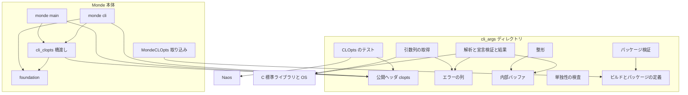
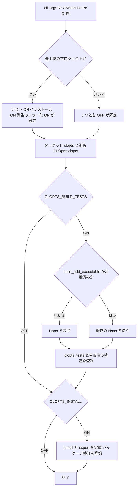
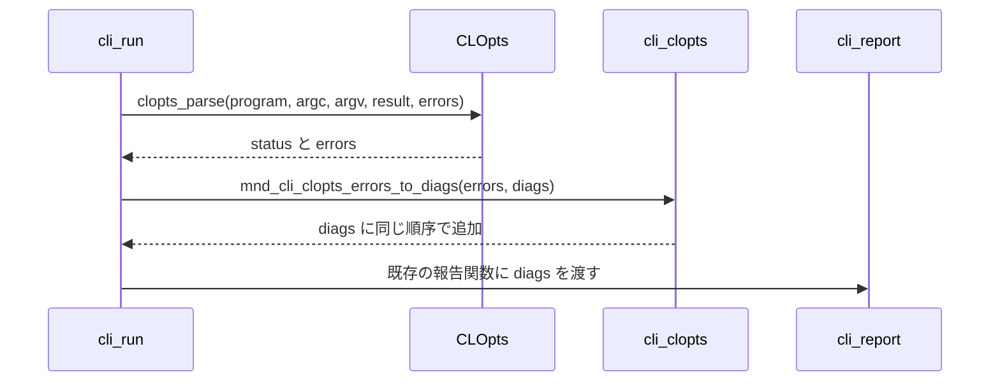

# Design Document: clopts-standalone

## Overview

**Purpose**: コマンドライン引数パーサ（cli-args）を、リポジトリのルートの `cli_args/` に置いた独立ライブラリ「CLOpts」にする。`cli_args/` だけで構成・ビルド・テスト・インストールができ、将来はこのディレクトリを別リポジトリへ移すだけで切り離せる。

**Users**: CLOpts を自分のプログラムに組み込む開発者、Monde の開発者、CLOpts を切り離す保守者。

**Impact**: `src/cli_args/` と `tests/cli_args/` がなくなり、`cli_args/` に移る。公開名が `mnd_args_*` から `clopts_*` に変わり、foundation の型（`mnd_diag_list_t`、`mnd_buf_t`）が公開 API から消える。Monde は `CLOpts::clopts` にリンクし、CLOpts のエラーを Monde の診断に変換する。`monde` の外から見える動作は変わらない。

### Goals
- `cli_args/` の複製だけで、構成・ビルド・テスト・インストールが完了する。
- CLOpts は C の標準ライブラリと OS の標準ライブラリだけに依存する。
- 取り込み構成と `find_package(CLOpts)` の両方で、`CLOpts::clopts` にリンクできる。
- 引数パーサの挙動（解析規則、メッセージ、ヘルプの文面）と `monde` の出力・終了コードをバイト単位で保つ。

### Non-Goals
- 別リポジトリへの実際の切り離しと、Monde 側の `FetchContent` / `find_package` への差し替え
- 引数パーサの機能追加と挙動の変更
- 共有ライブラリ対応、パッケージマネージャーへの登録、CLOpts 単体のリリース運用
- cli-args spec の文書の書き換え（対応は本書の「名前の対応」で示す）

## Boundary Commitments

### This Spec Owns
- `cli_args/` の下のすべてのファイル（ライブラリ、公開ヘッダ、テスト、ビルド定義、パッケージ定義、README、LICENSE）
- CLOpts の公開インターフェース（`clopts_*` / `CLOPTS_*`、`<clopts/...>` のヘッダ、ターゲット `CLOpts::clopts`、CMake のオプション `CLOPTS_*`）
- Monde 側の取り込みの定義（`cmake/MondeCLOpts.cmake`）と、CLOpts のエラーから Monde の診断への変換（`src/cli/cli_clopts.[ch]`）
- Monde 側の利用箇所の改名への追従（`src/cli/`、`src/monde/`、`tests/cli/`）
- CI の単独構成の検証ジョブ、steering の該当箇所の更新

### Out of Boundary
- foundation の公開インターフェースと実装（変更しない）
- `monde` のコマンドとオプションの宣言内容、各サブコマンドの処理（monde-cli）
- Monde の配布物の定義 `cmake/MondePackage.cmake` とリリースのワークフロー `release.yml`（変更しない）
- Naos のバージョンの変更
- 引数パーサの挙動の要件（cli-args が持ち続ける）

### Allowed Dependencies
- CLOpts のライブラリ: C99 の標準ライブラリ、Windows では `windows.h` と `shell32`。**それ以外には依存しない**。
- CLOpts のテスト: Naos（Monde と同じ固定版 `v0.4.0`）、CMake、CTest。
- CLOpts のビルド定義: CMake 3.21 以上の標準モジュール（`GNUInstallDirs`、`CMakePackageConfigHelpers`、`FetchContent`）。`cli_args/` の外のファイルは参照しない。
- Monde → CLOpts の一方向。`cli_args/` の中から `src/`、`tests/`、`cmake/`（ルート）を参照しない。
- Monde 側は CLOpts の公開ヘッダだけを取り込む。`cli_args/src/` のヘッダは取り込まない。

### Revalidation Triggers
- CLOpts の公開名、公開ヘッダのパス、関数のシグネチャ、エラー型の形が変わったとき → monde-cli（`src/cli/`、`tests/cli/`）を再確認する。
- CLOpts のエラーメッセージ、ヘルプの文面が変わったとき → `tests/cli/` と `tests/docs/`、`docs/commands.md` を再確認する。
- ターゲット名、CMake のオプション名、インストール先の配置が変わったとき → `cmake/MondeCLOpts.cmake`、CI、CLOpts の README を再確認する。
- Naos の固定版を変えるとき → `cmake/MondeNaos.cmake` と `cli_args/cmake/CLOptsNaos.cmake` を同時に変える。
- CLOpts が `cli_args/` の外のファイルや新しい外部ライブラリを必要とするようになったとき → 本 spec の境界を見直す。

## Architecture

### Existing Architecture Analysis
- 引数パーサは `monde_add_module(cli_args ... DEPENDS foundation)` で作る静的ライブラリ `monde_cli_args` である。include の基点は `src/`。
- foundation の使い方は 3 つに限られる（詳細は `research.md`）。
  - 診断: 追加はすべて「エラー、パスなし、行番号なし」。メモリ不足で追加できないと `dropped` を立てる。
  - バッファ: 文字列の組み立て。整形の公開 API 4 つが `mnd_buf_t *out` に追記する。
  - UTF-16 変換: Windows の引数列の取得で 1 か所。
- 利用側で診断を受け取るのは `src/cli/cli_run.c`（解析）と `src/monde/main.c`（引数列の取得）の 2 か所。整形 API を使うのは `cli_run.c` と `cli_report.c`。
- テストは Naos を使い、3 つのテストファイルが内部ヘッダを取り込む。

### Architecture Pattern & Boundary Map



**Architecture Integration**:
- **Selected pattern**: 自己完結のライブラリ + 利用側の橋渡し。CLOpts は Monde を知らず、Monde が CLOpts の型を自分の型に変換する。
- **Domain boundaries**: `cli_args/` の中が CLOpts、外が Monde。境界をまたぐのは、公開ヘッダ、ターゲット `CLOpts::clopts`、CMake のオプション `CLOPTS_*` だけである。
- **Existing patterns preserved**: 部品は直接 `stderr` に書かず `exit` しない。I/O を持たない。C99。Naos と CTest によるテスト。
- **New components rationale**: エラーの列（診断の代替）、内部バッファ（文字列の組み立て）、橋渡し（Monde の診断への変換）、取り込みの定義（入手方法を 1 か所に集める）、パッケージ検証と単独性の検査（独立性を保つ）。
- **Steering compliance**: 依存は一方向。CLOpts は「リポジトリ内にある独立ライブラリ」として、`src/<module>/` の配置と `mnd_` の接頭辞の規約の例外になる。例外は steering に記述する（要件 9.5）。

### 依存の向き
`C 標準ライブラリ / OS` ← `CLOpts` ← `monde::cli（橋渡しを含む）` ← `monde`。`foundation` と `CLOpts` の間に依存はない。

### Technology Stack

| Layer | Choice / Version | Role in Feature | Notes |
|-------|------------------|-----------------|-------|
| 言語 | C99（MSVC は `/std:c11` で C99 の範囲） | CLOpts のライブラリとテスト | 公開ヘッダは `extern "C"` で C++ からも取り込める |
| ビルド | CMake 3.21 以上 | 独立プロジェクト `CLOpts`、取り込み、パッケージ | `PROJECT_IS_TOP_LEVEL` を使う |
| パッケージ | `GNUInstallDirs`、`CMakePackageConfigHelpers` | `install` と `find_package(CLOpts)` | 追加の依存なし |
| テスト | Naos `v0.4.0`、CTest、`cmake -P` のスクリプト | 単体テスト、パッケージ検証、単独性の検査 | Naos は FetchContent で取得する |
| CI | GitHub Actions（`ci.yml`） | 単独構成の検証ジョブを追加する | 既存のジョブは変えない |

## File Structure Plan

### Directory Structure
```
cli_args/                          # CLOpts（独立プロジェクト）。この下だけで完結する
├── CMakeLists.txt                 # project(CLOpts)、オプション、ターゲット clopts、install / export
├── LICENSE                        # Monde と同じ MIT ライセンスの全文
├── README.md                      # 概要、対応環境、ビルド、取り込み、find_package、使用例
├── cmake/
│   ├── CLOptsCompilerOptions.cmake  # clopts_apply_compile_options(target)
│   ├── CLOptsNaos.cmake             # Naos の取得（すでにあれば何もしない）
│   └── CLOptsConfig.cmake.in        # パッケージ構成ファイルの雛形（CLOptsTargets.cmake の読み込みと check_required_components）
├── include/clopts/                # 公開ヘッダ（インストールの対象）
│   ├── clopts.h                   # 宣言の型、解析、結果の参照（旧 args.h）
│   ├── errors.h                   # clopts_errors_t（新規）
│   ├── argv.h                     # UTF-8 の引数列の取得（旧 args_argv.h）
│   └── help.h                     # ヘルプなどの整形（旧 args_help.h）
├── src/                           # 実装と内部ヘッダ（インストールしない）
│   ├── clopts_internal.h          # 内部の宣言（旧 args_internal.h）+ clopts_errors_add
│   ├── clopts_buf.h               # 内部バッファの宣言（新規）
│   ├── clopts_buf.c               # 内部バッファの実装（新規）
│   ├── clopts_errors.c            # エラーの列の実装（新規）
│   ├── clopts_decl.c              # 宣言の検証（旧 args_decl.c）
│   ├── clopts_result.c            # 解析結果（旧 args_result.c）
│   ├── clopts_parse.c             # 解析（旧 args_parse.c）
│   ├── clopts_help.c              # 整形（旧 args_help.c）
│   └── clopts_argv.c              # 引数列の取得と UTF-16 変換（旧 args_argv.c）
└── tests/
    ├── CMakeLists.txt             # clopts_tests、パッケージ検証、単独性の検査の登録
    ├── main.c, test_decl.[ch], *_test.c   # 旧 tests/cli_args/ の 14 ファイル（同じファイル名）
    ├── errors_api_test.c          # clopts_errors_t の単体テスト（新規）
    ├── isolation_check.cmake      # 単独性の検査（cmake -P）
    ├── package_test.cmake         # インストールして find_package で使う検証（cmake -P）
    └── package/                   # 検証用の利用側プロジェクト
        ├── CMakeLists.txt         # find_package(CLOpts) して CLOpts::clopts にリンクする
        ├── consumer.c             # 引数を解析してヘルプを生成する小さなプログラム
        └── consumer_cxx.cpp       # 公開ヘッダを C++ から取り込む確認
```

### New Files（Monde 側）
- `cmake/MondeCLOpts.cmake` — CLOpts の入手方法の唯一の定義。オプションを設定して `cli_args/` を取り込む。
- `src/cli/cli_clopts.h`、`src/cli/cli_clopts.c` — `clopts_errors_t` から `mnd_diag_list_t` への変換。
- `tests/cli/clopts_bridge_test.c` — 橋渡しの単体テスト。

### Modified Files
- `CMakeLists.txt`（ルート）— Naos の取得を `add_subdirectory(src)` の前に移し、`include(MondeCLOpts)` を加える。
- `src/CMakeLists.txt`、`tests/CMakeLists.txt` — `add_subdirectory(cli_args)` の行を削除する。
- `src/cli/CMakeLists.txt` — `DEPENDS` から `cli_args` を外し、`CLOpts::clopts` を PUBLIC でリンクする。`cli_clopts.c` を加える。
- `src/monde/CMakeLists.txt` — `monde::cli_args` を `CLOpts::clopts` に変える。
- `src/cli/*.h`、`src/cli/*.c`（`cli_args/args*.h` を取り込む 12 ファイル）— include と名前の追従。`cli_run.c` と `cli_report.c` は整形 API の受け取り方も変える。
- `src/monde/main.c` — 引数列の取得のエラーを橋渡しして報告する。
- `tests/cli/io_test.c`、`run_test.c`、`report_test.c`、`main.c`、`CMakeLists.txt` — 名前の追従と、橋渡しのテストの追加。
- `.github/workflows/ci.yml` — ジョブ `clopts-standalone` を追加する。
- `.kiro/steering/structure.md`、`.kiro/steering/tech.md`、`.kiro/steering/roadmap.md` — CLOpts の配置と例外の記述、完了の記録。

### Deleted
- `src/cli_args/`、`tests/cli_args/`（`git mv` で `cli_args/` へ移した結果、なくなる）

## System Flows

### 構成の分岐



- 利用側が `CLOPTS_BUILD_TESTS` などを先に設定していれば、その値が既定より優先される。Monde は `CLOPTS_BUILD_TESTS=${BUILD_TESTING}`、`CLOPTS_INSTALL=OFF`、`CLOPTS_WARNINGS_AS_ERRORS=ON` を設定する。
- パッケージ検証はインストールの規則が必要なので、`CLOPTS_BUILD_TESTS` と `CLOPTS_INSTALL` の両方が ON のときだけ登録する。

### エラーの橋渡し（Monde）



- 変換は解析の直後に 1 回だけ行う。以降の処理（報告、終了コードの決定）は現在のまま `mnd_diag_list_t` を使う。
- `src/monde/main.c` の引数列の取得も同じ関数で変換する。

## Requirements Traceability

| Requirement | Summary | Components | Interfaces / Verification |
|-------------|---------|------------|---------------------------|
| 1.1 | 必要なファイルを `cli_args/` に含む | ディレクトリ構成 | File Structure Plan |
| 1.2 | 外のファイルを参照しない | BuildDef、IsolationCheck | `isolation_check.cmake` |
| 1.3 | 複製だけで構成・ビルド・テスト | BuildDef、CI | ジョブ `clopts-standalone` |
| 1.4 | 元の場所に残さない | 移行 | Migration Strategy の段階 1 |
| 1.5 | 変更履歴をたどれる | 移行 | 移動だけのコミット、`git log --follow` |
| 2.1 | 静的ライブラリを生成 | BuildDef | ターゲット `clopts`（STATIC） |
| 2.2 | 単独構成で既定でテスト | BuildDef | `CLOPTS_BUILD_TESTS` の既定 |
| 2.3 | 移す前のテストをすべて検証 | CLOptsTests | 14 ファイルを移す。テスト数を移行の前後で照合 |
| 2.4 | テスト無効で Naos を取得しない | BuildDef、CLOptsNaos | `CLOPTS_BUILD_TESTS=OFF` |
| 2.5 | Naos のソースの場所を指定できる | CLOptsNaos | `FETCHCONTENT_SOURCE_DIR_NAOS` |
| 2.6 | 5 環境で単独構成 | CI | ジョブのマトリクス |
| 2.7 | Monde と同じ警告水準でエラー化 | CLOptsCompilerOptions | `clopts_apply_compile_options`、`CLOPTS_WARNINGS_AS_ERRORS` |
| 2.8 | C99 の範囲 | CLOptsCompilerOptions | `C_STANDARD`、`-Werror=vla` |
| 3.1 | Monde のヘッダを取り込まない | Core、Help、Argv、IsolationCheck | `isolation_check.cmake` |
| 3.2 | 標準ライブラリと OS だけにリンク | BuildDef | `target_link_libraries`（Windows の `shell32` のみ） |
| 3.3 | エラーを自前の手段で返す | Errors | `clopts_errors_t` |
| 3.4 | 文言と順序を保つ | Core、Argv | 書式文字列を変えない。既存テスト |
| 3.5 | 記録できなかったことを判別できる | Errors | `dropped`、`clopts_errors_dropped` |
| 3.6 | 文字列を自前の手段で渡す | Help | `char *clopts_format_*`、`clopts_text_free` |
| 3.7 | 文字列がバイト単位で同じ | Help | `help_test.c`（期待値は変えない） |
| 3.8 | `stderr` に書かず終了しない | Core、Help、Argv | 既存の方針を保つ |
| 3.9 | 機能をすべて提供 | 公開ヘッダ | 名前の対応 |
| 4.1 | 接頭辞 `clopts_` / `CLOPTS_` | 公開ヘッダ | 名前の対応 |
| 4.2 | `mnd_` / `MND_` を使わない | 全ファイル、IsolationCheck | `isolation_check.cmake` |
| 4.3 | `clopts/` で始まるパス | 公開ヘッダ、BuildDef | `include/clopts/` |
| 4.4 | 内部ヘッダをインストールしない | BuildDef、PackageCheck | `package_test.cmake` のファイル検査 |
| 4.5 | foundation と同時にリンクできる | 名前の規則 | Monde のビルド（`monde`、`cli_tests`） |
| 4.6 | C++ から取り込める | 公開ヘッダ、PackageCheck | `extern "C"`、`consumer_cxx.cpp` |
| 5.1 | 取り込みで `CLOpts::clopts` を提供 | BuildDef | `add_library(CLOpts::clopts ALIAS clopts)` |
| 5.2 | ヘッダの場所と OS のライブラリを伝える | BuildDef | PUBLIC の include と `shell32` |
| 5.3 | 取り込みでは既定でテストなし | BuildDef | 既定値は `PROJECT_IS_TOP_LEVEL` |
| 5.4 | 取り込みでは既定でインストールなし | BuildDef | `CLOPTS_INSTALL` の既定 |
| 5.5 | 警告と規格の指定を利用側に適用しない | CLOptsCompilerOptions | PRIVATE とターゲットのプロパティだけを使う |
| 5.6 | 全体に効く設定を変えない | BuildDef | `CMAKE_*` の変数を設定しない |
| 5.7 | 取り込みでもテストを有効にできる | BuildDef | `CLOPTS_BUILD_TESTS=ON` |
| 5.8 | Naos を重ねて取得しない | CLOptsNaos | `if(NOT COMMAND naos_add_executable)` |
| 6.1 | インストールするもの | BuildDef | install の規則 |
| 6.2 | `find_package` で `CLOpts::clopts` | BuildDef | `CLOptsConfig.cmake`、`CLOptsTargets.cmake` |
| 6.3 | インストール後もヘッダと OS のライブラリを伝える | BuildDef | `INSTALL_INTERFACE`、エクスポートしたリンク先 |
| 6.4 | バージョンの照合 | BuildDef、PackageCheck | `CLOptsConfigVersion.cmake`（SameMinorVersion） |
| 6.5 | 再配置できる | BuildDef、PackageCheck | `configure_package_config_file`、移動後に検証 |
| 6.6 | テストなどをインストールしない | BuildDef、PackageCheck | ファイル検査 |
| 6.7 | インストール後の利用を検証 | PackageCheck | `package_test.cmake`、`tests/package/` |
| 6.8 | バージョンを 1 か所で定義 | BuildDef | `project(CLOpts VERSION ...)` |
| 7.1 | Monde が取り込んでリンク | MondeCLOpts、`src/cli`、`src/monde` | `CLOpts::clopts` |
| 7.2 | 取り込みは 1 か所 | MondeCLOpts | `cmake/MondeCLOpts.cmake` |
| 7.3 | 公開ヘッダと公開名だけ | `src/cli`、`src/monde` | include は `clopts/...` のみ |
| 7.4 | エラーを診断に変換 | Bridge | `mnd_cli_clopts_errors_to_diags` |
| 7.5 | `monde` の出力と終了コードが同じ | `src/cli`、`src/monde` | `tests/cli/`、`tests/docs/` |
| 7.6 | Monde の構成で CLOpts のテストも登録 | MondeCLOpts | `CLOPTS_BUILD_TESTS=${BUILD_TESTING}` |
| 7.7 | Monde の全テストが成功 | 全体 | CTest の全件 |
| 7.8 | 配布物が同じ | MondeCLOpts | `CLOPTS_INSTALL=OFF`、`verify_package.cmake` |
| 7.9 | Naos は 1 回だけ取得 | MondeCLOpts、CLOptsNaos | ルートで先に `MondeNaos` を読む |
| 8.1 | CI で単独構成を全環境 | CI | ジョブ `clopts-standalone` |
| 8.2 | CI でインストール後の利用 | CI、PackageCheck | CTest に含まれるため全環境で実行 |
| 8.3 | 外のファイルなしで成功 | CI | `cli_args/` を作業ツリーの外へ複製して構成 |
| 8.4 | 失敗を報告 | CI | 各ステップの終了コード |
| 8.5 | 既存の検証を続ける | CI | ジョブ `build-and-test` は変えない |
| 9.1 | README の内容 | README | `cli_args/README.md` |
| 9.2 | README が外を参照しない | README、IsolationCheck | `../` を含むリンクの検査 |
| 9.3 | ライセンスの全文 | ディレクトリ構成 | `cli_args/LICENSE` |
| 9.4 | Monde のドキュメントの追従 | ドキュメント | 全文検索で旧名を洗い出して直す |
| 9.5 | steering に例外を記述 | steering | `structure.md`、`tech.md` |
| 9.6 | 名前の対応を示す | 本書 | 「名前の対応」 |

## Components and Interfaces

| Component | Domain/Layer | Intent | Req Coverage | Key Dependencies | Contracts |
|-----------|--------------|--------|--------------|------------------|-----------|
| Errors | CLOpts / ライブラリ | エラーメッセージの列 | 3.3, 3.4, 3.5 | C 標準ライブラリ (P0) | Service, State |
| Buf | CLOpts / 内部 | 文字列の組み立て | 3.1, 3.6 | C 標準ライブラリ (P0) | Service |
| Core（Decl / Parse / Result） | CLOpts / ライブラリ | 宣言の検証、解析、結果の参照 | 3.1, 3.4, 3.8, 3.9, 4.1 | Errors (P0), Buf (P0) | Service |
| Help | CLOpts / ライブラリ | ヘルプなどの文字列の生成 | 3.6, 3.7, 3.9 | Buf (P0) | Service |
| Argv | CLOpts / ライブラリ | UTF-8 の引数列の取得 | 3.2, 3.4, 3.9 | Errors (P0), `shell32` (P0, Windows) | Service |
| BuildDef | CLOpts / ビルド | 独立プロジェクト、取り込み、パッケージ | 1.2, 2.1, 2.2, 2.4, 3.2, 5.1〜5.7, 6.1〜6.6, 6.8 | CMake (P0) | Batch |
| CLOptsCompilerOptions | CLOpts / ビルド | 警告と規格の指定 | 2.7, 2.8, 5.5 | — | Batch |
| CLOptsNaos | CLOpts / ビルド | Naos の取得 | 2.4, 2.5, 5.8 | Naos (P0) | Batch |
| CLOptsTests | CLOpts / テスト | 挙動の単体テスト | 2.3 | Naos (P0) | — |
| PackageCheck | CLOpts / テスト | インストール後の利用の検証 | 4.4, 4.6, 6.4〜6.7 | BuildDef (P0) | Batch |
| IsolationCheck | CLOpts / テスト | 単独性の検査 | 1.2, 3.1, 4.2, 9.2 | — | Batch |
| MondeCLOpts | Monde / ビルド | CLOpts の入手方法の唯一の定義 | 7.1, 7.2, 7.6, 7.8, 7.9 | BuildDef (P0) | Batch |
| Bridge（cli_clopts） | Monde / CLI | エラーを診断に変換 | 7.4, 7.5 | Errors (P0), foundation (P0) | Service |
| CI ジョブ | 運用 | 単独構成の継続的な検証 | 1.3, 2.6, 8.1〜8.5 | BuildDef (P0) | Batch |

### CLOpts / ライブラリ

#### Errors

| Field | Detail |
|-------|--------|
| Intent | 解析・宣言の検証・引数列の取得で起きたエラーを、メッセージの列として保持する |
| Requirements | 3.3, 3.4, 3.5 |

**Responsibilities & Constraints**
- メッセージ（英語、UTF-8、NUL 終端）を追加した順に保持する。重大度、パス、行番号は持たない。
- メモリ不足でメッセージを記録できなかったら `dropped` を立て、ほかの内容は変えない。
- 追加の関数（`clopts_errors_add`）は内部ヘッダで宣言し、公開しない。利用側は読み取りと解放だけを行う。

**Contracts**: Service [x] / State [x]

##### Service Interface（`include/clopts/errors.h`）
```c
typedef struct clopts_errors
{
    char **messages;  /* count 個のメッセージ */
    size_t count;
    size_t cap;
    bool dropped;     /* メモリ不足で記録できなかったエラーがある */
} clopts_errors_t;

#define CLOPTS_ERRORS_INIT { NULL, 0, 0, false }

void clopts_errors_init(clopts_errors_t *errors);
void clopts_errors_free(clopts_errors_t *errors);   /* 初期状態・解放済みに対しても安全 */
size_t clopts_errors_count(const clopts_errors_t *errors);
const char *clopts_errors_at(const clopts_errors_t *errors, size_t index);  /* index >= count なら NULL */
bool clopts_errors_dropped(const clopts_errors_t *errors);
```
内部（`src/clopts_internal.h`）:
```c
/* printf 形式でメッセージを組み立てて末尾に追加する。失敗したら dropped を立てる */
void clopts_errors_add(clopts_errors_t *errors, const char *format, ...) CLOPTS_PRINTF_LIKE(2, 3);
```
- Preconditions: `errors` は NULL でなく、初期化済みである。
- Postconditions: `clopts_errors_free` の後は初期状態に戻る。
- Invariants: `count <= cap`。`messages[i]`（`i < count`）は NULL でない。

**Implementation Notes**
- `mnd_diag_add(diags, MND_SEVERITY_ERROR, NULL, 0, fmt, ...)` を `clopts_errors_add(errors, fmt, ...)` に置き換える。書式文字列は変えない（3.4）。
- `CLOPTS_PRINTF_LIKE` は `MND_PRINTF_LIKE` と同じ定義を内部ヘッダに置く。

#### Buf（内部）

| Field | Detail |
|-------|--------|
| Intent | 文字列を連結する可変長バッファ。ライブラリの内部だけで使う |
| Requirements | 3.1, 3.6 |

**Contracts**: Service [x]

##### Service Interface（`src/clopts_buf.h`、公開しない）
```c
typedef struct clopts_buf { char *data; size_t len; size_t cap; } clopts_buf_t;
#define CLOPTS_BUF_INIT { NULL, 0, 0 }

bool clopts_buf_append_str(clopts_buf_t *buf, const char *str);
bool clopts_buf_append_byte(clopts_buf_t *buf, unsigned char byte);
const char *clopts_buf_cstr(const clopts_buf_t *buf);   /* data == NULL なら "" */
char *clopts_buf_take(clopts_buf_t *buf);               /* 内容の所有権を呼び出し側へ移す。空なら "" の複製。失敗は NULL */
void clopts_buf_free(clopts_buf_t *buf);
```
- 引数パーサが実際に使っている操作だけを持つ。`clopts_buf_take` は整形 API の戻り値を作るための追加である。

#### Core（Decl / Parse / Result）

| Field | Detail |
|-------|--------|
| Intent | 宣言の検証、引数列の解析、解析結果の保持と参照 |
| Requirements | 3.1, 3.4, 3.8, 3.9, 4.1 |

**Responsibilities & Constraints**
- 処理の内容は変えない。変えるのは、名前、include、エラーの渡し先、内部バッファの型だけである。
- 構造体のメンバー、列挙値の順序、初期化マクロの内容は現在と同じにする。

##### Service Interface（`include/clopts/clopts.h`、変更点のみ）
```c
#include "clopts/errors.h"

clopts_status_t clopts_parse(const clopts_program_t *program, int argc, char *const *argv,
                             clopts_result_t *result, clopts_errors_t *errors);
```
- ほかの型と関数は、「名前の対応」の規則で改名するだけで、形は変えない。
- `CLOPTS_USAGE_ERROR` はエラーを 1 件、`CLOPTS_DECL_ERROR` は 1 件以上、`CLOPTS_OUT_OF_MEMORY` は 1 件（記録できなければ `dropped`）を `errors` に追加する。現在の診断の件数と同じである。

#### Help

| Field | Detail |
|-------|--------|
| Intent | ヘルプ、バージョン、使い方の案内、コマンドの経路の文字列を生成する |
| Requirements | 3.6, 3.7, 3.9 |

**Contracts**: Service [x]

##### Service Interface（`include/clopts/help.h`）
```c
char *clopts_format_help(const clopts_result_t *result);        /* 経路の最後のコマンドのヘルプ */
char *clopts_format_version(const clopts_program_t *program);   /* "<program> <version>\n" */
char *clopts_format_usage_hint(const clopts_result_t *result);  /* "Run '<path> --help' for usage.\n" */
char *clopts_format_path(const clopts_result_t *result);        /* "<path>"（改行なし） */

void clopts_text_free(char *text);   /* 上の 4 関数の戻り値を解放する。NULL 可 */
```
- Preconditions: `result` は `clopts_parse` が `CLOPTS_DECL_ERROR`、`CLOPTS_OUT_OF_MEMORY` 以外を返したものである。
- Postconditions: 成功なら、確保した NUL 終端の文字列を返す。内容は現在 `mnd_buf_t` に追記している内容と同じである。失敗（メモリ不足だけ）なら NULL を返す。
- 戻り値は `clopts_text_free` で解放する。

#### Argv

| Field | Detail |
|-------|--------|
| Intent | プロセスの引数列を UTF-8 で取得する |
| Requirements | 3.2, 3.4, 3.9 |

##### Service Interface（`include/clopts/argv.h`、変更点のみ）
```c
bool clopts_argv_get(int argc, char **argv, clopts_argv_t *out, clopts_errors_t *errors);
void clopts_argv_free(clopts_argv_t *args);
#ifdef _WIN32
bool clopts_argv_from_wide(int argc, wchar_t *const *wargv, clopts_argv_t *out, clopts_errors_t *errors);
#endif
```

**Implementation Notes**
- UTF-16 から UTF-8 への変換は `clopts_argv.c` の中の静的関数にする。`WideCharToMultiByte(CP_UTF8, WC_ERR_INVALID_CHARS, ...)` を使い、失敗をメモリ不足と不正な UTF-16 に分ける。メッセージは現在と同じ（`out of memory while parsing arguments`、`command-line argument %d is not valid UTF-16`）。
- Windows では `shell32` を PUBLIC でリンクする。

### 公開ヘッダの共通の約束
- ヘッダガードは `CLOPTS_<FILE>_H`（`CLOPTS_CLOPTS_H`、`CLOPTS_ERRORS_H`、`CLOPTS_ARGV_H`、`CLOPTS_HELP_H`）。
- 宣言の全体を `#ifdef __cplusplus` / `extern "C" {` で囲む（4.6）。
- 取り込みは `#include "clopts/clopts.h"` の形にする。内部ヘッダは `#include "clopts_internal.h"` の形で、`src/` を PRIVATE の include にする。
- ライブラリが外部に公開するシンボルは、内部のものも含めてすべて `clopts_` で始める。ファイル内だけで使う関数は `static` にする。

### 名前の対応

| 種類 | 移す前 | 移した後 |
|------|--------|----------|
| 関数・型 | `mnd_args_<x>`（例: `mnd_args_parse`、`mnd_args_option_t`、`mnd_args_value`） | `clopts_<x>`（`clopts_parse`、`clopts_option_t`、`clopts_value`） |
| マクロ・列挙値 | `MND_ARGS_<X>`（例: `MND_ARGS_FLAG`、`MND_ARGS_RESULT_INIT`、`MND_ARGS_UNLIMITED`） | `CLOPTS_<X>`（`CLOPTS_FLAG`、`CLOPTS_RESULT_INIT`、`CLOPTS_UNLIMITED`） |
| 診断の引数 | `mnd_diag_list_t *diags` | `clopts_errors_t *errors` |
| 整形の関数 | `bool mnd_args_format_<x>(..., mnd_buf_t *out)` | `char *clopts_format_<x>(...)` と `clopts_text_free` |
| ヘッダ | `cli_args/args.h` | `clopts/clopts.h` |
| ヘッダ | `cli_args/args_argv.h` | `clopts/argv.h` |
| ヘッダ | `cli_args/args_help.h` | `clopts/help.h` |
| ヘッダ | （foundation の `diag.h`） | `clopts/errors.h` |
| 内部ヘッダ | `cli_args/args_internal.h` | `clopts_internal.h`（`cli_args/src/`） |
| ソース | `src/cli_args/args_<x>.c` | `cli_args/src/clopts_<x>.c` |
| テスト | `tests/cli_args/<file>` | `cli_args/tests/<file>` |
| ターゲット | `monde_cli_args` / `monde::cli_args` | `clopts` / `CLOpts::clopts` |
| テスト実行ファイル | `cli_args_tests` | `clopts_tests` |
| CTest の名前とラベル | `cli_args_tests.<suite>.<test>`、ラベル `cli_args` | `clopts_tests.<suite>.<test>`、ラベル `clopts` |
| 内部のマクロ | （foundation の `MND_PRINTF_LIKE`） | `CLOPTS_PRINTF_LIKE`（`clopts_internal.h`、公開しない） |

規則は機械的で、例外は「診断の引数」と「整形の関数」の 2 つだけである。表の名前・ヘッダ・ターゲットは、実装（`cli_args/include/clopts/`、`cli_args/src/`、`cli_args/CMakeLists.txt`、`cli_args/tests/CMakeLists.txt`）と一致することをタスク 5.3 で確かめた。

### CLOpts / ビルド

#### BuildDef（`cli_args/CMakeLists.txt`）

| Field | Detail |
|-------|--------|
| Intent | 独立プロジェクトとしての構成、取り込み、インストールとパッケージ |
| Requirements | 1.2, 2.1, 2.2, 2.4, 3.2, 5.1, 5.2, 5.3, 5.4, 5.6, 5.7, 6.1, 6.2, 6.3, 6.4, 6.5, 6.6, 6.8 |

**Contracts**: Batch [x]

##### 構成の約束
- `cmake_minimum_required(VERSION 3.21)`、`project(CLOpts VERSION 0.1.0 LANGUAGES C)`。バージョンを書く場所はここだけ（6.8）。
- オプション（既定値は `${PROJECT_IS_TOP_LEVEL}`）:

  | オプション | 意味 |
  |-----------|------|
  | `CLOPTS_BUILD_TESTS` | テストをビルドして CTest に登録する |
  | `CLOPTS_INSTALL` | `install` と `export` の規則を定義する |
  | `CLOPTS_WARNINGS_AS_ERRORS` | 警告をエラーにする |

- ターゲット: `add_library(clopts STATIC ...)`、`add_library(CLOpts::clopts ALIAS clopts)`。エクスポート名も `clopts`、名前空間は `CLOpts::`。
- include: PUBLIC に `$<BUILD_INTERFACE:.../include>` と `$<INSTALL_INTERFACE:${CMAKE_INSTALL_INCLUDEDIR}>`、PRIVATE に `src/`。
- リンク: Windows だけ `shell32` を PUBLIC で付ける。ほかのライブラリにはリンクしない（3.2）。
- 取り込み構成で変えないもの（5.6）: `CMAKE_C_FLAGS`、`CMAKE_BUILD_TYPE`、`CMAKE_MSVC_RUNTIME_LIBRARY`、`CMAKE_MODULE_PATH` などの全体に効く変数。自分のモジュールは `include("${CMAKE_CURRENT_SOURCE_DIR}/cmake/<name>.cmake")` で読む。
- 最上位のときだけ `enable_testing()` を呼ぶ。取り込み構成では利用側が CTest を有効にしている前提でテストを登録する。

##### インストールの配置（`CLOPTS_INSTALL=ON` のとき）

| 対象 | インストール先 |
|------|----------------|
| 静的ライブラリ | `${CMAKE_INSTALL_LIBDIR}` |
| `include/clopts/*.h` | `${CMAKE_INSTALL_INCLUDEDIR}/clopts` |
| `CLOptsConfig.cmake`、`CLOptsConfigVersion.cmake`、`CLOptsTargets*.cmake` | `${CMAKE_INSTALL_LIBDIR}/cmake/CLOpts` |
| `LICENSE` | `${CMAKE_INSTALL_DATADIR}/licenses/CLOpts` |

- `CLOptsConfig.cmake` は `configure_package_config_file` で作り、`CLOptsTargets.cmake` を読み込んで `check_required_components(CLOpts)` を呼ぶ（`CMakePackageConfigHelpers` の標準の形。実装時に加えた）。絶対パスを埋め込まない（6.5）。
- `CLOptsConfigVersion.cmake` は `write_basic_package_version_file(... COMPATIBILITY SameMinorVersion)` で作る（1.0 より前のため、マイナーが違えば互換なしとする）。
- テスト、`src/` のヘッダ、Naos はインストールしない（6.6）。

#### CLOptsCompilerOptions（`cli_args/cmake/CLOptsCompilerOptions.cmake`）

| Field | Detail |
|-------|--------|
| Intent | `clopts` と CLOpts のテストに、Monde と同じ警告水準と言語規格を付ける |
| Requirements | 2.7, 2.8, 5.5 |

- 関数 `clopts_apply_compile_options(<target>)`。内容は `monde_apply_compile_options` と同じで、次の点だけが違う。
  - 警告のエラー化（`-Werror`、`/WX`）は `CLOPTS_WARNINGS_AS_ERRORS` が ON のときだけ付ける。`-Werror=vla` は常に付ける。
- すべて PRIVATE のオプションとターゲットのプロパティ（`C_STANDARD` など）で指定する。INTERFACE や PUBLIC では何も伝えない（5.5）。

#### CLOptsNaos（`cli_args/cmake/CLOptsNaos.cmake`）

| Field | Detail |
|-------|--------|
| Intent | テストのために Naos を用意する |
| Requirements | 2.4, 2.5, 5.8 |

- `CLOPTS_BUILD_TESTS` が ON のときだけ読み込む（2.4）。
- `naos_add_executable` がすでに定義されていれば何もしない（5.8）。なければ `FetchContent` で `v0.4.0` を取得する。宣言の内容は `cmake/MondeNaos.cmake` と同じにする。
- `FETCHCONTENT_SOURCE_DIR_NAOS` によるローカルのソースの指定がそのまま使える（2.5）。

### CLOpts / テスト

#### CLOptsTests（`cli_args/tests/CMakeLists.txt`）
- `naos_add_executable(clopts_tests SOURCES ... LIBRARIES CLOpts::clopts PREFIX "clopts_tests." LABELS clopts)`。`src/` を PRIVATE の include に加える（内部ヘッダを取り込むテストがあるため）。`clopts_apply_compile_options(clopts_tests)` を適用する。
- 移した 14 ファイルは、名前と、エラーと整形結果の受け取り方だけを変える。期待する文字列は変えない（2.3、3.4、3.7）。
- `errors_api_test.c`（新規）: 初期化、解放の冪等性、範囲外の添字、`dropped` の読み取り。

#### PackageCheck（`cli_args/tests/package_test.cmake`、`cli_args/tests/package/`）

| Field | Detail |
|-------|--------|
| Intent | インストールした CLOpts を `find_package` で使えることを検証する |
| Requirements | 4.4, 4.6, 6.4, 6.5, 6.6, 6.7 |

**Contracts**: Batch [x]

- **Trigger**: CTest のテスト `clopts_package.find_package`（ラベル `clopts`）。`cmake -P` で起動する。インストールの規則がある（`CLOPTS_INSTALL` が ON の）ときだけ登録するので、単独構成では登録され、Monde の構成では登録されない。
- **Input**: `BUILD_DIR`（CLOpts のビルドディレクトリ）、`CONFIG`（構成名）、`SOURCE_DIR`（`tests/package`）、`WORK_DIR`（作業用）、`GENERATOR`、`C_COMPILER`、`VERSION`。
  - 実装では、利用側のビルドを外側と同じ道具で行い、インストール先のファイルを正確に検査するために、次の入力も受け取る: `MULTI_CONFIG`（複数構成のジェネレータか）、`GENERATOR_PLATFORM`、`GENERATOR_TOOLSET`、`MAKE_PROGRAM`、`TOOLCHAIN_FILE`、`CXX_COMPILER`、`INCLUDEDIR` / `LIBDIR` / `DATADIR`（`GNUInstallDirs` の値）、`LIBRARY_FILE`（静的ライブラリのファイル名）。
- **手順**:
  1. `WORK_DIR` を空にする。
  2. `cmake --install BUILD_DIR --config CONFIG --prefix WORK_DIR/prefix` を実行する。
  3. インストール先のファイルを検査する。公開ヘッダ 4 つ、ライブラリ、構成ファイル、LICENSE があること。`clopts_internal.h`、`clopts_buf.h`、Naos のファイル、テストの実行ファイルがないこと（4.4、6.1、6.6）。
  4. `WORK_DIR/prefix` を `WORK_DIR/moved` に改名する（6.5）。
  5. `tests/package` を `CMAKE_PREFIX_PATH=WORK_DIR/moved` で構成し、ビルドして、`consumer` を実行する。終了コード 0 を確かめる（6.2、6.3、6.7）。C++ のコンパイラがあれば `consumer_cxx` もビルドする（4.6）。
  6. 同じプロジェクトを `-DCLOPTS_REQUIRED_VERSION=99.0` で構成し、失敗することを確かめる（6.4）。
- **Idempotency**: 毎回 `WORK_DIR` を作り直す。CLOpts のビルドディレクトリは変更しない。ただし、`cmake --install` が自身の動作としてビルドディレクトリに `install_manifest.txt` を書くことだけは避けられない（毎回上書きされ、ビルドの結果には影響しない）。
- `tests/package/CMakeLists.txt` は `find_package(CLOpts ${CLOPTS_REQUIRED_VERSION} CONFIG REQUIRED)` を呼び、`CLOpts::clopts` だけをリンクする。include のパスや `shell32` を自分では指定しない。

#### IsolationCheck（`cli_args/tests/isolation_check.cmake`）

| Field | Detail |
|-------|--------|
| Intent | `cli_args/` の中に、外への依存を示す記述がないことを検査する |
| Requirements | 1.2, 3.1, 4.2, 9.2 |

- **Trigger**: CTest のテスト `clopts_check.isolation`（ラベル `clopts`）。`cmake -DROOT=<cli_args> -P` で起動する。
- **検査**: `ROOT` の下の `.c`、`.h`、`.cpp`、`.cmake`、`.in`、`CMakeLists.txt`、`README.md` を走査する（このスクリプト自身は除く）。次のいずれかがあれば失敗とし、ファイル名と行を報告する。
  - `mnd_`、`MND_`、`MONDE_`、`monde_`、`monde::`
  - `foundation/`
  - `../` を含む `#include`、および CMake と README の中の `../`
- コメントの中の語も検出する。CLOpts の中では、これらの語を使わない。
- `CMakeCache.txt` を含むディレクトリ（`cli_args/` の中に置いたビルドディレクトリ）は、生成物（取得した Naos のソースなど）による誤検出を避けるため走査しない（実装時に加えた除外）。

### Monde / ビルド

#### MondeCLOpts（`cmake/MondeCLOpts.cmake`）

| Field | Detail |
|-------|--------|
| Intent | CLOpts の入手方法を 1 か所に集める |
| Requirements | 7.1, 7.2, 7.6, 7.8, 7.9 |

- 内容: `CLOPTS_BUILD_TESTS` を `${BUILD_TESTING}` に、`CLOPTS_INSTALL` を `OFF` に、`CLOPTS_WARNINGS_AS_ERRORS` を `ON` に設定し、`add_subdirectory("${PROJECT_SOURCE_DIR}/cli_args" "${PROJECT_BINARY_DIR}/cli_args")` を呼ぶ。
- 切り離しの後は、このファイルの `add_subdirectory` を `FetchContent` または `find_package(CLOpts)` に差し替える（7.2）。ほかのファイルは `CLOpts::clopts` という名前だけに依存する。
- ルートの `CMakeLists.txt` の順序: `include(CTest)` → `if(BUILD_TESTING) include(MondeNaos)` → `include(MondeCLOpts)` → `add_subdirectory(src)` → `include(MondePackage)` → `if(BUILD_TESTING) add_subdirectory(tests)`。Naos を先に取得するので、CLOpts は既存の Naos を使う（7.9）。
- `CLOPTS_INSTALL=OFF` により、CLOpts はインストールの規則を加えない。`MondePackage.cmake` は変えない（7.8）。
- `monde_add_module` の `DEPENDS` は `monde::<module>` 専用なので、`src/cli/CMakeLists.txt` では `target_link_libraries(monde_cli PUBLIC CLOpts::clopts)` を別に書く。

### Monde / CLI

#### Bridge（`src/cli/cli_clopts.[ch]`）

| Field | Detail |
|-------|--------|
| Intent | CLOpts のエラーの列を、Monde の診断の列に変換する |
| Requirements | 7.4, 7.5 |

**Contracts**: Service [x]

##### Service Interface
```c
#include "clopts/errors.h"
#include "foundation/diag.h"

/*
 * errors の各メッセージを、エラーの診断（パスなし、行番号 0）として diags の末尾に同じ順序で追加する。
 * errors が dropped なら diags も dropped にする
 */
void mnd_cli_clopts_errors_to_diags(const clopts_errors_t *errors, mnd_diag_list_t *diags);
```
- Preconditions: 両方とも NULL でなく、初期化済みである。
- Postconditions: `diags` の内容は、移す前に引数パーサが直接追加していた内容と同じになる。
- メッセージは `"%s"` の書式で渡す（メッセージ中の `%` を書式として解釈させない）。

**Implementation Notes**
- `cli_run.c`: `clopts_parse` の直後に変換し、`clopts_errors_free` で解放する。以降は現在と同じ `diags` を使う。`write_text` は `clopts_format_help` / `clopts_format_version` の戻り値を書き出して `clopts_text_free` で解放する。NULL ならメモリ不足として現在と同じ報告をする。
- `cli_report.c`: `clopts_format_path` と `clopts_format_usage_hint` の戻り値を使う。NULL のときの扱いは現在の「false のとき」と同じにする。
- `src/monde/main.c`: `clopts_argv_get` の失敗時に変換し、現在の `report_argv_error` をそのまま使う。
- Risks: 変換を忘れた経路があると、エラーが表示されなくなる。`tests/cli/run_test.c` の既存の使い方のエラーのテストと、`clopts_bridge_test.c` で検出する。

### 運用

#### CI ジョブ（`.github/workflows/ci.yml` の `clopts-standalone`）

| Field | Detail |
|-------|--------|
| Intent | CLOpts が単独で成り立つことを、変更のたびに確かめる |
| Requirements | 1.3, 2.6, 8.1, 8.2, 8.3, 8.4, 8.5 |

- 既存のジョブ `build-and-test` と同じ 5 環境のマトリクス（msvc、mingw-w64、apple-clang、gcc、clang）を持つ。既存のジョブは変えない（8.5）。
- 手順: チェックアウト → （mingw-w64 では MSYS2 の用意）→ `cmake -E copy_directory cli_args <作業ツリーの外の場所>` → その複製を `-S` に指定して構成 → ビルド → `ctest`。
- 複製を作業ツリーの外に置くので、`cli_args/` の外のファイルへの参照があれば構成かビルドが失敗する（8.3）。
- パッケージ検証と単独性の検査は CTest に含まれるので、全環境で実行される（8.2）。gettext は不要。

## Error Handling

### Error Strategy
- CLOpts は、エラーを `clopts_errors_t` と戻り値（`clopts_status_t`、`bool`、NULL）で返す。`stderr` に書かず、終了しない（3.8）。
- エラーの種類と件数は現在と同じである。

| 状況 | 戻り値 | `errors` |
|------|--------|----------|
| 利用者の入力の誤り | `CLOPTS_USAGE_ERROR` | 1 件 |
| 宣言の誤り | `CLOPTS_DECL_ERROR` | 1 件以上 |
| メモリ不足（解析） | `CLOPTS_OUT_OF_MEMORY` | 1 件、または `dropped` |
| 引数列の取得の失敗 | `false` | 1 件、または `dropped` |
| 整形のメモリ不足 | NULL | 使わない |

- Monde は、変換後の診断を現在と同じ関数で報告する。`dropped` も引き継ぐので、「記録できなかった診断がある」ことの表示も変わらない。
- ビルドとパッケージのエラー: `find_package` のバージョンの不一致は、CMake の通常の「見つからない」として扱う。検証のスクリプトは、失敗した手順とコマンドの出力を `message(FATAL_ERROR ...)` で報告する。

## Testing Strategy

### Unit Tests（CLOpts、`clopts_tests`）
- 移した 12 スイート（decl、dispatch、long、short、values、positional、errors、help、single、nested、inherit、argv）が、期待値を変えずにすべて成功する（2.3、3.4、3.7）。移行の前後で CTest のテスト数が一致することを確かめる。
- `errors_api_test.c`: `clopts_errors_t` の初期化、解放を 2 回呼んでも安全なこと、`clopts_errors_at` の範囲外で NULL、`clopts_errors_dropped` の読み取り（3.3、3.5）。
- `help_test.c`: 4 つの整形関数の戻り値が現在の期待値とバイト単位で一致し、`clopts_text_free(NULL)` が安全なこと（3.6、3.7）。
- `argv_test.c`: Windows で、不正な UTF-16 のメッセージが現在と同じこと（3.4）。

### Build / Package Tests（CLOpts）
- `clopts_check.isolation`: `cli_args/` に Monde の名前、`foundation/`、`../` がないこと（1.2、3.1、4.2、9.2）。
- `clopts_package.find_package`: インストール、ファイルの検査、再配置、`find_package` での利用、C++ からの取り込み、バージョンの不一致の検出（4.4、4.6、6.1〜6.7）。
- 手動の確認（タスクの完了条件に含める）: `-DCLOPTS_BUILD_TESTS=OFF` で構成したときに Naos を取得しないこと（2.4）。`-DFETCHCONTENT_SOURCE_DIR_NAOS=...` でネットワークなしに構成できること（2.5）。

### Integration Tests（Monde）
- `tests/cli/clopts_bridge_test.c`: 0 件、複数件（順序）、`%` を含むメッセージ、`dropped` の引き継ぎ（7.4）。
- `tests/cli/` の既存テスト全件: 使い方のエラー、ヘルプ、バージョン、終了コードが変わらないこと（7.5）。
- `tests/docs/`: `docs/commands.md` のヘルプの引用と `monde --help` が一致すること（7.5）。
- Monde の構成で `ctest -L clopts` が CLOpts のテストを実行し、`clopts_package.find_package` は登録されないこと（7.6、7.8）。
- CommonMark のラウンドトリップを含む CTest の全件が成功すること（7.7）。
- 配布物: `cpack` で作ったアーカイブを `tools/release/verify_package.cmake` で検証し、内容が変わらないこと（7.8）。
- 構成のログで、Naos の取得が 1 回だけであること（7.9）。

### CI
- ジョブ `clopts-standalone` が 5 環境で成功すること（8.1〜8.4）。ジョブ `build-and-test` が引き続き成功すること（8.5）。

## Migration Strategy

各段階の終わりで、Monde の構成・ビルド・CTest の全件が成功する状態にする。


1. **移動**: `git mv` で、ソース・ヘッダ・テストを最終の場所と最終のファイル名に移す。内容の変更は `#include` の行だけにする。`cli_args/CMakeLists.txt` はターゲット `clopts` と別名 `CLOpts::clopts` を作り、この段階だけ `monde::foundation` にリンクする。テストは `cli_args/tests/` から Monde の `naos_add_executable` で登録する。Monde 側は `cmake/MondeCLOpts.cmake` を追加し、リンク先を `CLOpts::clopts` に変える。**このコミットには移動と最小限の修正だけを入れる**（1.4、1.5）。
2. **自己完結**: `clopts_errors_t`、内部バッファ、UTF-16 変換を導入し、API の形を変える。Monde に橋渡しを追加する。foundation へのリンクを外す（3.1〜3.8、7.4）。
3. **改名**: `mnd_args_*` / `MND_ARGS_*` を `clopts_*` / `CLOPTS_*` に機械的に置き換える。ヘッダガードと `extern "C"` を整える。Monde 側と `tests/cli/` を追従させる（4.1〜4.6、7.3）。
4. **独立ビルドとパッケージ**: `cli_args/CMakeLists.txt` を最終の形にする（オプション、コンパイラオプション、Naos、install / export）。パッケージ検証と単独性の検査を追加する（2.x、5.x、6.x）。
5. **CI と文書**: CI のジョブ、README、LICENSE、steering の更新（8.x、9.x）。

- **Rollback**: 各段階は独立したコミット（群）なので、段階ごとに取り消せる。
- **Validation checkpoints**: 段階 1 の後に `git log --follow cli_args/src/clopts_parse.c` で移す前の履歴が見えること。段階 3 の後に `tests/cli/` と `tests/docs/` が成功すること。段階 4 の後に `cli_args/` の複製で単独構成が成功すること。

## Supporting References
- 調査の詳細と、選ばなかった案の理由は `research.md` を参照。
- 引数パーサの挙動の基準は `.kiro/specs/cli-args/requirements.md`。本書の「名前の対応」を使って、cli-args の `design.md` の名前を読み替える。
