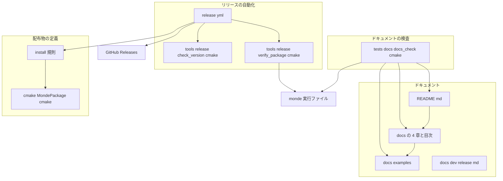
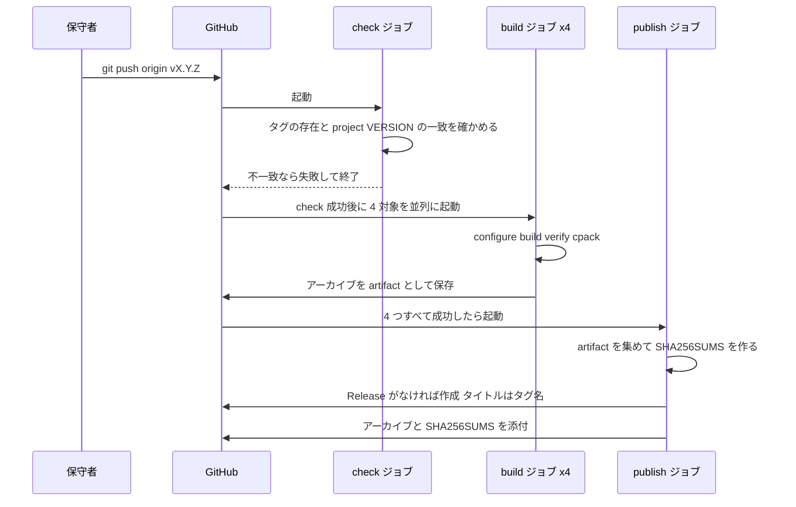
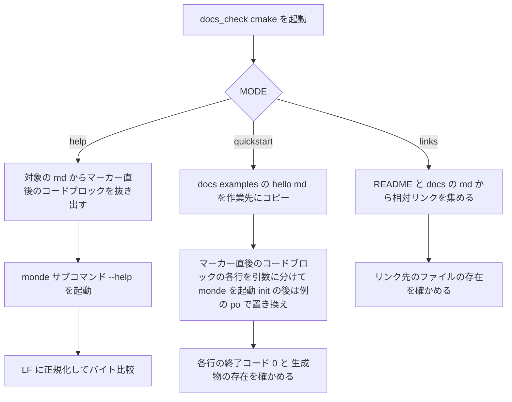

# Technical Design: docs-and-release

## Overview
**Purpose**: 本 spec は、Monde の初版を利用者に届けるための 2 つの成果物、すなわち日本語のドキュメント（README と `docs/` 配下の利用マニュアル）と、タグを契機にした GitHub Releases へのバイナリ配布ワークフローを作る。あわせて、ドキュメントが実際の `monde` の振る舞いとずれないことを CTest で機械的に検査する仕組みを持つ。
**Users**: 翻訳者と文書の保守者はドキュメントで `monde` の入手と 2 つの翻訳フローを学ぶ。Monde の保守者はバージョンを上げてタグを付けるだけでリリースを公開する。
**Impact**: リポジトリに `docs/` の利用者向けの章、`tests/docs/` の検査、`.github/workflows/release.yml`、CPack の設定（`CMakeLists.txt` への `install()` と `cmake/MondePackage.cmake`）を加える。製品のソース（`src/`）と CI（`ci.yml`）は変更しない。

### Goals
- 利用者が README とマニュアルだけで、入手、ビルド、2 つの翻訳フロー、各サブコマンドとオプション、既知の制限を理解できる（1〜5）。
- `vX.Y.Z` のタグを push すると、4 つの対象のアーカイブと `SHA256SUMS` が Release に添付される（6〜8）。
- ドキュメントのヘルプの引用、クイックスタートのコマンド列、リポジトリ内リンクが CTest で検査される（9）。

### Non-Goals
- パッケージマネージャーへの登録、英語版のドキュメント、リリースノートの本文の自動生成。
- `monde` の機能や CLI の仕様の変更。`src/` は変更しない。
- CI（`ci.yml`）の変更。リリースのビルドでテスト一式を実行すること（テストは main の CI が担う）。

## Boundary Commitments

### This Spec Owns
- `README.md` の内容と、`docs/README.md`（目次）、`docs/install.md`、`docs/workflow.md`、`docs/commands.md`、`docs/limitations.md`、`docs/examples/`（クイックスタートの例のファイル）、`docs/dev/release.md`（保守者向けのバージョンとリリースの手順）。
- ドキュメントの検査（`tests/docs/`）と、その約束事（マーカー付きのコードブロック）。
- 配布物の定義: `install()` の規則、CPack の設定（`cmake/MondePackage.cmake`）、アーカイブの名前・形式・構成。
- リリースワークフロー（`.github/workflows/release.yml`）と、その検証スクリプト（`tools/release/`）。
- バージョン番号の規則（SemVer、`vX.Y.Z` のタグ、`project(VERSION)` との一致）。
- 実行ファイルに取り込んだサードパーティの素材の表示: 索引 `THIRD_PARTY_NOTICES`、素材ごとの `licenses/<ID>.txt`、その書式と検査（改訂、要件 10）。

### Out of Boundary
- CLI の仕様とその実装（monde-cli）。ドキュメントは `--help` の出力を出典として写し、仕様の解釈を加えない。
- ビルド構成の共通部分（`MondeTargets.cmake`、`MondeCompilerOptions.cmake`、CI のマトリクス）。リリース固有の指定はワークフローからキャッシュ変数で渡し、これらのファイルは変更しない。
- `docs/dev/naos-feedback.md` と `docs/inputs/` の内容。
- 翻訳単位の規則の詳細な説明（translation-units の設計）。マニュアルは利用者が知るべき判定の結果（4.9）だけを書く。
- 表の生成スクリプト（`tools/gen_md_ucd.py`、`tools/gen_md_entities.py`、`tools/gen_po_ucd.py`）と生成したファイル（markdown-parser、po-format の持ち物）。改訂では、生成したファイルの先頭に `THIRD_PARTY_NOTICES` の ID を示す行（と WHATWG の BSD 3-Clause の表示）を加えるためだけにこれらを変え、表の内容は変えない（「改訂（2026-11-07）」を参照）。

### Allowed Dependencies
- `monde` ターゲット（`src/monde/CMakeLists.txt`）: `install(TARGETS monde)` の対象。`MONDE_VERSION` の出典である `project(monde VERSION ...)`。
- `tests/cli/cli_case.cmake` の方式（`cmake -P` で `monde` を起動して比べる）。コードは共有せず、同じ流儀で `tests/docs/docs_check.cmake` を書く。
- ランナーに同梱の CMake、コンパイラ、`gh` CLI、`sha256sum`、`arch`（Rosetta 2）、`ldd` / `otool`。サードパーティの Action は `actions/checkout`、`actions/upload-artifact`、`actions/download-artifact`、`msys2/setup-msys2`（CI と同じ系統）に限る。
- 依存の方向: `release.yml` → `tools/release/*.cmake` → CPack / `monde`。`tests/docs/` → `monde` と `docs/`。ドキュメントはコードに依存しない（コードがドキュメントを読むのは検査だけ）。

### Revalidation Triggers
- monde-cli のヘルプ、統計、診断の書式、終了コード、オプションの追加や変更 → `docs/commands.md`、README、`docs/workflow.md` の更新と `docs` ラベルのテストの再実行（9.3）。
- `project(monde VERSION)` の変更規則やタグの形式の変更 → `release.yml` の `check` ジョブと `docs/dev/release.md`。
- 配布対象の追加（Linux arm64 など）や macOS のランナーの変化（Rosetta 2 の有無） → マトリクスと `verify_package.cmake`。
- `LICENSE`、`README.md` のファイル名の変更 → `install(FILES ...)`。
- 実行ファイルに取り込む素材の追加・更新・削除（Unicode の版の更新、GFM の追加に伴う素材など） → `THIRD_PARTY_NOTICES`、`licenses/`、生成したファイルの ID の行、`docs_check.notices`（要件 10）。
- yaml-front-matter や markdown-parser の「受け入れた制限」の変更 → `docs/limitations.md`。

## Architecture

### Existing Architecture Analysis
- 実行ファイル `monde` は `monde_add_executable` で作られ、`MONDE_VERSION` を `project(VERSION)` から受け取る。MSVC は静的 CRT、MinGW は `-static` が済んでいる。Linux と macOS の静的リンクの指定はない。
- `install()` と CPack の設定はない。`spec.txt` はテストだけが読む。
- CI は `push`（main）と `pull_request` で動き、5 環境でビルドとテストを行う。タグの push では動かない。
- `tests/toolchain/` は `src/` に対応しない唯一のテストディレクトリであり、同じ例外として `tests/docs/` を加える。

### Architecture Pattern & Boundary Map



**Architecture Integration**:
- Selected pattern: 「ドキュメントが唯一の出典」+「既存の手順の再利用」。ドキュメントの引用は `monde` の出力そのものを載せ、検査がそれを確かめる。リリースは 3 行のビルド手順と CPack を使い、新しいビルドの仕組みを作らない。
- Domain/feature boundaries: ドキュメント（人が読む）、検査（CTest）、配布物の定義（CMake）、リリースの自動化（ワークフローと `tools/release/`）の 4 つに分け、互いにファイルを共有しない。
- Existing patterns preserved: `cmake -P` による起動テスト、`BUILD_TESTING=OFF` での製品ビルド、`tests/<name>/` のラベル付け、`tools/` は手で実行するスクリプト。
- New components rationale: `tests/docs/` はドキュメントと実装のずれを機械的に止めるため。`cmake/MondePackage.cmake` は配布物の定義を 1 か所に置くため。`tools/release/` はワークフローの検証を手元でも再現できるようにするため。
- Steering compliance: 追加の実行時依存なし、ドキュメントは日本語、CLI のメッセージは英語のまま引用、`spec.txt` と Naos は配布物に入れない。

### Technology Stack

| Layer | Choice / Version | Role in Feature | Notes |
|-------|------------------|-----------------|-------|
| ドキュメント | Markdown（GitHub 上と手元の両方で読める相対リンク） | README と `docs/` | HTML コメントのマーカーで検査対象を示す |
| 検査 | CMake 3.21 以上のスクリプトモード（`cmake -P`）、CTest | `tests/docs/` | シェル非依存。Windows でも動く |
| 配布物 | CMake `install()` + CPack（`ZIP` / `TGZ`） | アーカイブの作成 | `cpack -G` で生成器を選べる |
| リリース | GitHub Actions（`windows-latest`、`macos-latest`、`ubuntu-latest`）、`gh` CLI、`sha256sum` | ビルド、検証、Release の作成と添付 | サードパーティの Release Action は使わない |
| 静的リンク | Linux: `-DCMAKE_EXE_LINKER_FLAGS=-static`、macOS x64: `-DCMAKE_OSX_ARCHITECTURES=x86_64` | 配布物の可搬性 | ワークフローからキャッシュ変数で渡す。ソースは変更しない |

## File Structure Plan

### Directory Structure
```
THIRD_PARTY_NOTICES                # 改訂: 実行ファイルに取り込んだ素材の索引（ID、名称、版、出典、SPDX、ライセンスのファイル、取り込んだ先）
licenses/                          # 改訂: 素材ごとに 1 つ
├── unicode-ucd.txt                # Unicode Character Database 15.0.0、Unicode License V3 の全文
└── whatwg-entities.txt            # WHATWG HTML の entities.json、BSD 3-Clause の全文
README.md                          # 全面更新: 概要、サブコマンド一覧、インストール、クイックスタート、ビルド、バージョン規則、ライセンスとサードパーティ、マニュアルへのリンク
docs/
├── README.md                      # 利用マニュアルの目次（4 章への相対リンク）
├── install.md                     # インストール: Release からの入手、展開、配置、--version、ソースからのビルド
├── workflow.md                    # 翻訳フロー: 新規翻訳、原文更新、フロントマター、fuzzy、上書き、差分レビュー
├── commands.md                    # コマンドリファレンス: 全体と 4 サブコマンド（--help を引用）、統計、診断、終了コード、文字コード、翻訳対象の判定
├── limitations.md                 # 既知の制限: GFM、YAML の対応範囲と受け入れた制限、1 ファイル単位、警告の対処
├── examples/
│   ├── hello.md                   # クイックスタートの原文（見出し、段落、リスト、リンク、フロントマターを含む小さな文書）
│   └── hello.ja.po                # 翻訳済みの .po（「翻訳者が編集した結果」として検査で使う）
└── dev/
    └── release.md                 # 保守者向け: バージョン規則の運用、リリース手順、ドキュメントの更新とマーカーの約束事
cmake/
└── MondePackage.cmake             # CPack の設定（生成器の既定、パッケージ名、最上位ディレクトリ、対象名のキャッシュ変数）
tests/
└── docs/
    ├── CMakeLists.txt             # docs ラベルのテストを登録（help の引用、quickstart、links、改訂で notices）
    └── docs_check.cmake           # マーカー付きコードブロックの抜き出しと検査（cmake -P）
tools/
└── release/
    ├── check_version.cmake        # タグと project(VERSION) の一致を確かめる（cmake -P）
    └── verify_package.cmake       # 実行ファイルの --version、動的依存、アーカイブの内容を確かめる（cmake -P）
.github/workflows/
└── release.yml                    # タグ push と workflow_dispatch で起動するリリースワークフロー
```

### Modified Files
- `CMakeLists.txt` — `add_subdirectory(src)` の後に `include(MondePackage)` を加える。`install()` の規則は `MondePackage.cmake` 側に置き、ルートの変更を 1 行に留める。
- `tests/CMakeLists.txt` — `add_subdirectory(docs)` を 1 行加える。
- `.gitattributes` — `README.md` と `docs/**/*.md`、`docs/examples/*` を `text eol=lf` にし、検査がどの OS でも同じバイト列を読めるようにする（既存の `-text` の行は変えない）。examples と同じタスクで扱う。改訂で `THIRD_PARTY_NOTICES` と `licenses/*` も加える。
- 改訂: `tools/gen_md_ucd.py`、`tools/gen_md_entities.py`、`tools/gen_po_ucd.py` と、その生成物 `src/markdown/md_unicode_tables.c`、`src/markdown/md_entity_table.c`、`src/po/po_ucd_tables.c` の先頭のコメント（表の内容は変えない）。`.kiro/steering/tech.md` と `structure.md`。

## System Flows

### リリースワークフロー



- ゲート: `build` は `needs: check`、`publish` は `needs: build`。1 つでもビルドが失敗すれば `publish` は動かず、Release は作られない（7.7）。
- 再実行と手動起動は同じ経路を通り、`gh release upload --clobber` で同名の添付を置き換える（7.10、7.11）。
- `workflow_dispatch` の入力 `tag` は `check` ジョブでタグの存在を確かめてからチェックアウトする。

### ドキュメントの検査



## Requirements Traceability

| Requirement | Summary | Components | Interfaces | Flows |
|-------------|---------|------------|------------|-------|
| 1.1 | README の冒頭で目的を説明 | README | 構成表 | — |
| 1.2 | サブコマンドと入出力の一覧 | README | 構成表 | — |
| 1.3 | Release からの入手とソースからのビルド | README、install.md | 構成表 | — |
| 1.4 | 実行できるクイックスタート | README、examples | マーカー `quickstart` | ドキュメントの検査 |
| 1.5 | マニュアルへのリンク | README、docs/README.md | マーカー `links` | ドキュメントの検査 |
| 1.6 | MIT と The Monde Authors | README | 構成表 | — |
| 1.7 | サードパーティ表記（取り込んだものとテスト専用のもの） | README、THIRD_PARTY_NOTICES | 構成表 | — |
| 1.8 | 初版の範囲と次の版 | README | 構成表 | — |
| 2.1 | 4 章を別ファイルで | docs の 4 章 | File Structure Plan | — |
| 2.2 | 目次と README からの到達 | docs/README.md、README | マーカー `links` | ドキュメントの検査 |
| 2.3 | 日本語の本文、英語の引用 | docs の 4 章 | 執筆規約 | — |
| 2.4 | 相対リンク | docs の 4 章 | マーカー `links` | ドキュメントの検査 |
| 2.5 | dev と inputs を参照しない | docs の 4 章 | 執筆規約 | — |
| 3.1 | 入手、展開、配置、--version | install.md | 構成表 | — |
| 3.2 | ビルドに必要なツールと手順 | install.md | 構成表 | — |
| 3.3 | 新規翻訳のフロー | workflow.md、examples | マーカー `quickstart` | ドキュメントの検査 |
| 3.4 | 原文更新のフロー | workflow.md | 構成表 | — |
| 3.5 | update の上書きと失敗時の保全 | workflow.md | 構成表 | — |
| 3.6 | 未翻訳と fuzzy、--use-fuzzy、翻訳率 | workflow.md | 構成表 | — |
| 3.7 | --front-matter-keys とキーパス | workflow.md | 構成表 | — |
| 3.8 | .po の編集は外部ツール | workflow.md | 構成表 | — |
| 3.9 | 差分レビューの使い方 | workflow.md | 構成表 | — |
| 4.1 | 全体の使い方 | commands.md | マーカー `help` | ドキュメントの検査 |
| 4.2 | 各サブコマンドの引数とオプション | commands.md | マーカー `help` | ドキュメントの検査 |
| 4.3 | --help と過不足なく一致 | commands.md、docs_check | マーカー `help` | ドキュメントの検査 |
| 4.4 | init の言語コードの決め方 | commands.md | 構成表 | — |
| 4.5 | POT ヘッダのオプション | commands.md | 構成表 | — |
| 4.6 | 統計の書式と --quiet | commands.md | 統計の書式表 | — |
| 4.7 | 診断の形式と終了コード | commands.md | 診断の書式表 | — |
| 4.8 | 文字コード、改行コード、BOM | commands.md | 構成表 | — |
| 4.9 | 翻訳対象の判定 | commands.md | 構成表 | — |
| 4.10 | 出力先の上書きとエラー時の保全 | commands.md | 構成表 | — |
| 5.1 | GFM の非対応 | limitations.md | 構成表 | — |
| 5.2 | YAML の対応範囲 | limitations.md | 構成表 | — |
| 5.3 | ルートのインデント 0 の継続 | limitations.md | 構成表 | — |
| 5.4 | フロー形式の継続行 | limitations.md | 構成表 | — |
| 5.5 | キーの U+2028・U+2029 | limitations.md | 構成表 | — |
| 5.6 | 1 ファイル、設定なし、複数形、翻訳率 | limitations.md | 構成表 | — |
| 5.7 | 構造を変え得る訳文の警告 | limitations.md | 構成表 | — |
| 6.1 | SemVer の規則 | README、dev/release.md | 構成表 | — |
| 6.2 | vX.Y.Z、初版 v0.1.0 | dev/release.md、release.yml | タグのパターン | リリース |
| 6.3 | --version とタグの一致 | check_version、verify_package | スクリプトの契約 | リリース |
| 6.4 | バージョンを上げる手順 | dev/release.md | 構成表 | — |
| 6.5 | 0.x の緩和規則 | README、dev/release.md | 構成表 | — |
| 7.1 | 4 対象のビルド | release.yml | マトリクス | リリース |
| 7.2 | 共通の手順でリリース構成 | release.yml | マトリクス | リリース |
| 7.3 | --version の確認後にアーカイブ | verify_package、release.yml | スクリプトの契約 | リリース |
| 7.4 | Release への公開と添付 | release.yml（publish） | gh の呼び出し | リリース |
| 7.5 | 未作成なら作成 | release.yml（publish） | gh の呼び出し | リリース |
| 7.6 | 既存なら添付のみ | release.yml（publish） | gh の呼び出し | リリース |
| 7.7 | 失敗時は公開しない | release.yml（needs） | ジョブの依存 | リリース |
| 7.8 | タグとバージョンの不一致で失敗 | check_version、release.yml（check） | スクリプトの契約 | リリース |
| 7.9 | 起動条件 | release.yml（on） | タグのパターン | リリース |
| 7.10 | 手動起動 | release.yml（workflow_dispatch） | 入力 `tag` | リリース |
| 7.11 | 再実行で同じ成果物 | release.yml、MondePackage | `--clobber`、固定の名前 | リリース |
| 7.12 | CI と別のワークフロー | release.yml | — | — |
| 8.1 | アーカイブの名前 | MondePackage | `MONDE_RELEASE_TARGET` | — |
| 8.2 | zip と tar.gz | MondePackage、release.yml | 生成器の既定 | — |
| 8.3 | 同梱物（実行ファイル、LICENSE、README、THIRD_PARTY_NOTICES、licenses/） | MondePackage（install）、verify_package | install 規則、索引 | — |
| 8.4 | 最上位ディレクトリ | MondePackage | CPack の設定 | — |
| 8.5 | 実行権限の保持 | MondePackage（TGZ）、verify_package | 検証 | — |
| 8.6 | 単体で実行できる | release.yml（静的リンク）、verify_package | 検証 | — |
| 8.7 | spec.txt 等を含めない | MondePackage（install の対象を限定）、verify_package | 検証 | — |
| 8.8 | SHA256SUMS の書式 | release.yml（publish） | `sha256sum` | リリース |
| 8.9 | ハッシュの一致 | release.yml（publish） | `sha256sum -c` | リリース |
| 9.1 | ヘルプとの一致の検査 | docs_check（help） | マーカー `help` | ドキュメントの検査 |
| 9.2 | コマンド列の実行の検査 | docs_check（quickstart） | マーカー `quickstart` | ドキュメントの検査 |
| 9.3 | 仕様変更時の更新方針 | dev/release.md | 構成表 | — |
| 9.4 | リンク切れの検査 | docs_check（links） | マーカー `links` | ドキュメントの検査 |
| 10.1 | 索引 THIRD_PARTY_NOTICES | ThirdPartyNotices | 索引の書式 | — |
| 10.2 | 素材ごとのライセンスのファイル | ThirdPartyNotices | `licenses/<ID>.txt` の書式 | — |
| 10.3 | テスト専用のものは載せない | ThirdPartyNotices、README | 索引の書式 | — |
| 10.4 | 生成したファイルの ID の行 | 生成スクリプト（上流） | ID の行 | — |
| 10.5 | 索引とファイルの対応の検査 | docs_check（notices） | 索引の書式、ID の行 | ドキュメントの検査 |
| 10.6 | 初版の 2 つの素材 | ThirdPartyNotices | — | — |
| 10.7 | 素材の追加・更新の手順 | dev/release.md | 構成表 | — |

## Components and Interfaces

| Component | Domain/Layer | Intent | Req Coverage | Key Dependencies (P0/P1) | Contracts |
|-----------|--------------|--------|--------------|--------------------------|-----------|
| README | ドキュメント | 入口。概要から最初の 1 回まで | 1.1〜1.8, 2.2, 6.1, 6.5 | docs の 4 章 (P1) | 執筆規約 |
| docs/README.md | ドキュメント | 目次 | 2.2 | — | 執筆規約 |
| install.md | ドキュメント | 入手とビルド | 1.3, 3.1, 3.2 | Release の名前 (P1) | 執筆規約 |
| workflow.md | ドキュメント | 2 つの翻訳フロー | 3.3〜3.9 | examples (P1) | 執筆規約、マーカー |
| commands.md | ドキュメント | コマンドリファレンス | 4.1〜4.10 | monde の --help (P0) | 執筆規約、マーカー |
| limitations.md | ドキュメント | 既知の制限 | 5.1〜5.7 | yaml-front-matter の改訂 (P1) | 執筆規約 |
| examples | ドキュメント | クイックスタートの材料 | 1.4, 3.3, 9.2 | — | ファイルの契約 |
| dev/release.md | ドキュメント（保守者） | バージョンとリリースの手順 | 6.1〜6.5, 9.3 | release.yml (P1) | 執筆規約 |
| docs_check | 検査 | ドキュメントと実装の整合 | 4.3, 9.1, 9.2, 9.4 | monde (P0)、docs (P0) | Batch |
| MondePackage | 配布物の定義 | install と CPack | 8.1〜8.5, 8.7, 7.11 | monde ターゲット (P0) | 構成の契約 |
| check_version | リリース | タグとバージョンの一致 | 6.3, 7.8 | CMakeLists.txt (P0) | Batch |
| verify_package | リリース | 実行ファイルとアーカイブの検証 | 6.3, 7.3, 8.5〜8.7 | monde、cpack の出力 (P0) | Batch |
| release.yml | リリース | ビルド、検証、公開 | 6.2, 7.1〜7.12, 8.2, 8.6, 8.8, 8.9 | check_version、verify_package、MondePackage (P0)、gh (P0) | Batch |

### ドキュメント

#### 執筆規約（全ファイル共通）
- 本文は日本語。コマンド名、オプション名、ファイル名、`monde` の出力の例は英語の原文のまま（2.3）。
- 相対リンクはリポジトリのルートからの相対ではなく、そのファイルからの相対で書く（2.4）。`docs/dev/` と `docs/inputs/` へのリンクは利用者向けの章に置かない（2.5）。
- `monde` の出力を引用するコードブロックは、`--help` の出力なら **マーカー `help`** を直前の行に置く。クイックスタートのコマンド列は **マーカー `quickstart`** を置く。マーカーの形式は次のとおり。
  - `<!-- monde-check: help -->` → 直後のコードブロックを `monde --help` と比べる
  - `<!-- monde-check: help <subcommand> -->` → `monde <subcommand> --help` と比べる
  - `<!-- monde-check: quickstart -->` → 直後のコードブロックの各行を実行する（`#` で始まる行と空行は無視）
- 統計と診断の例は固定の書式を表で示す（4.6、4.7）。日時のように実行ごとに変わる値を含む出力は引用しない。

#### README
| Field | Detail |
|-------|--------|
| Intent | リポジトリの入口。目的、サブコマンド一覧、入手、クイックスタート、ビルド、バージョン規則、ライセンスとサードパーティ、マニュアルへのリンク |
| Requirements | 1.1〜1.8, 2.2, 6.1, 6.5 |

**構成（節の順）**
1. 概要（1.1）: 何をするか、バイト単位の書式保持、`.po` の編集は外部ツール。
2. サブコマンド（1.2）: product.md と同じ 4 行の表（操作、コマンド、入力 → 出力）。
3. インストール（1.3）: Release の表（対象、アーカイブ名の例）と展開・配置の要点。詳細は `docs/install.md` へ。
4. クイックスタート（1.4）: `docs/examples/hello.md` を使う `extract` → `init` → 編集 → `translate` の 4 段階。コマンド列はマーカー `quickstart` 付き（検査の対象）。
5. ソースからのビルド（1.3）: CMake 3.21 以上と対応コンパイラ、3 行の手順、`-DBUILD_TESTING=OFF`。
6. 対応範囲（1.8）: 初版は CommonMark 0.31.2 + YAML フロントマター。次の版で GFM。
7. バージョン（6.1、6.5）: SemVer、0.x では Y で互換性を壊し得る。
8. ドキュメント（1.5、2.2）: `docs/README.md` と 4 章へのリンク。
9. ライセンス（1.6）: MIT License、Copyright (c) 2026 The Monde Authors。
10. サードパーティ（1.7）: 改訂で 2 つの表に分ける。(a) 実行ファイルに取り込んでいるもの（Unicode Character Database 15.0.0、Unicode License V3。WHATWG の `entities.json`、BSD 3-Clause。詳細と全文は `THIRD_PARTY_NOTICES` と `licenses/` へリンク）。(b) テスト専用で配布物に含まれないもの: 表（名称、用途、ライセンス、配布物に含まれない）。CommonMark Spec 0.31.2 `spec.txt`（CC-BY-SA 4.0、テスト専用、`tests/data/commonmark/README.md` へリンク）、Naos v0.4.0（MIT License、テスト専用、`BUILD_TESTING=OFF` では取得されない）。

**Implementation Notes**
- README はアーカイブに同梱される（8.3）ため、リポジトリ内の相対リンクは展開先では切れる。相対リンクには GitHub 上の絶対 URL を併記せず、冒頭に「最新のドキュメントはリポジトリの `docs/` にある」と 1 行で示す。
- Risks: クイックスタートの例の出力（統計）はバージョンで変わり得るため、統計の行は引用せず説明にとどめる。

#### docs/README.md（目次）
| Field | Detail |
|-------|--------|
| Intent | 4 章の一覧と 1 行の説明、相対リンク |
| Requirements | 2.2 |

#### install.md
| Field | Detail |
|-------|--------|
| Intent | Release からの入手と、ソースからのビルド |
| Requirements | 1.3, 3.1, 3.2 |

**構成**: 対応表（OS・アーキテクチャ → アーカイブ名 `monde-X.Y.Z-<os>-<arch>.<ext>`）、`SHA256SUMS` での確認方法、展開と配置（PATH に置く、Windows は `monde.exe`）、`monde --version` での確認、ソースからのビルド（CMake 3.21 以上、Windows: MSVC または MinGW-w64、macOS: Apple Clang、Linux: GCC または Clang）、製品だけのビルド（`-DBUILD_TESTING=OFF`）、テストを含むビルドと `ctest` の実行。

#### workflow.md
| Field | Detail |
|-------|--------|
| Intent | 新規翻訳と原文更新の 2 つのフロー |
| Requirements | 3.3〜3.9 |

**構成**: 新規翻訳（3.3。各段階のコマンド、入出力ファイル、標準エラー出力に出る統計の意味）、原文更新（3.4。`extract` → `update` → fuzzy と未翻訳の確認 → `translate`。`update` の統計 `matched / fuzzy / added / obsoleted` の読み方）、`update` の上書き（3.5。`-o` に既存の `.po` を指定、失敗時は変更されない）、未翻訳と fuzzy（3.6。既定は原文、`--use-fuzzy`、翻訳率は fuzzy を含まない）、フロントマター（3.7。`extract` と `translate` に同じ `--front-matter-keys`、キーパスの書き方は monde-cli のヘルプと translation-units の仕様に従う）、`.po` の編集（3.8）、差分レビュー（3.9。翻訳済み Markdown をリポジトリに置き、原文更新のたびに差分が訳した箇所だけになること）。

#### commands.md
| Field | Detail |
|-------|--------|
| Intent | コマンドリファレンス。`--help` の引用と、ヘルプに書かれない振る舞いの補足 |
| Requirements | 4.1〜4.10 |

**構成**
- 全体（4.1）: マーカー `help` 付きで `monde --help` を引用。`help <command>`、`--version`（`monde X.Y.Z` の 1 行）、引数なしの実行（使い方を標準エラー出力に出して終了コード 2）。
- 各サブコマンド（4.2、4.3）: `extract`、`init`、`update`、`translate` の順に、マーカー `help <subcommand>` 付きで `--help` を引用し、続けて補足（省略時の既定値、`-` の意味、`init` の言語の決め方 4.4、`extract` のヘッダのオプション 4.5）。
- 統計（4.6）: 5 つの固定の書式を表で示す（`extract: N messages` など、research.md の「既存の CLI の確定した出力」に列挙した書式）。`-q/--quiet` が抑止するもの（統計と `init: using language ...`）としないもの（警告とエラー）。
- 診断と終了コード（4.7）: 3 つの形式と、0 / 1 / 2 の意味。
- 文字コードと改行コード（4.8）、翻訳対象の判定（4.9）、出力先の扱い（4.10）。

#### limitations.md
| Field | Detail |
|-------|--------|
| Intent | 既知の制限 |
| Requirements | 5.1〜5.7 |

**構成**: Markdown（5.1。GFM の表・タスクリスト・取り消し線・自動リンク・脚注は CommonMark としての解釈のまま翻訳単位になる）、YAML フロントマター（5.2。アンカー、エイリアス、タグ、複数ドキュメントは非対応）、受け入れた制限（5.3〜5.5。yaml-front-matter の「改訂」の 3 点を利用者の言葉で）、処理の単位と設定（5.6）、訳文の警告（5.7。警告の文面の例と、訳文を見直す対処）。

#### examples（`docs/examples/`）
| Field | Detail |
|-------|--------|
| Intent | クイックスタートと検査が使う小さな文書と翻訳済みの `.po` |
| Requirements | 1.4, 3.3, 9.2 |

**ファイルの契約**
- `hello.md`: フロントマター（`title`）、見出し、段落（強調とリンクを含む）、リスト、コードブロックを 1 つずつ含む 20 行程度の英語の文書。LF、BOM なし。
- `hello.ja.po`: `hello.md` を `extract --front-matter-keys title` した結果に日本語の訳を入れたもの。`Language: ja`。すべてのエントリを翻訳済みにし、fuzzy を含めない。
- README のクイックスタートは `init` の出力名を `hello.ja.po` にし、「翻訳する」段階を `#` のコメント行で示す。検査（quickstart）は `extract` → `init` → `translate` を実行し、`init` の出力が `msgstr ""` のみであることを確かめてから例の `hello.ja.po` で置き換え、`translate` の出力が `hello.md` と異なること（訳が入ったこと）を確かめる。

#### dev/release.md
| Field | Detail |
|-------|--------|
| Intent | 保守者向け。バージョン規則の運用、リリース手順、ドキュメントの更新とマーカーの約束事 |
| Requirements | 6.1〜6.5, 9.3 |

**構成**: バージョン規則（6.1、6.5）、手順（6.4。(1) main の CI が緑であることを確かめる、(2) `CMakeLists.txt` の `project(monde VERSION X.Y.Z)` を書き換える、(3) README とマニュアルの変更を同じ PR に含める（9.3）、(4) コミットして main に取り込む、(5) `git tag vX.Y.Z` と `git push origin vX.Y.Z`、(6) ワークフローの完了を待ち、Release の本文を書く）、失敗時の対処（`check` の不一致、ビルド失敗、再実行と手動起動）、手元での再現（`cpack`、`tools/release/verify_package.cmake`）、ドキュメントの更新の約束事（マーカー、`ctest -L docs`）。

### 検査

#### docs_check（`tests/docs/docs_check.cmake`、`tests/docs/CMakeLists.txt`）
| Field | Detail |
|-------|--------|
| Intent | ドキュメントから引用とコマンド列とリンクを抜き出し、ビルドした `monde` と照合する |
| Requirements | 4.3, 9.1, 9.2, 9.4 |

**Responsibilities & Constraints**
- `cmake -P` で動き、シェルに依存しない。`tests/cli/cli_case.cmake` と同じ流儀（`execute_process`、作業先の作り直し、失敗の一覧を最後に `FATAL_ERROR` で出す）。
- 対象の `.md` は `README.md` と `docs/*.md` に限る（`docs/dev/`、`docs/inputs/` は対象外）。
- `BUILD_TESTING=ON` のときだけ登録する。ラベルは `docs`。

**Dependencies**
- Inbound: CTest — `tests/docs/CMakeLists.txt` からの登録 (P0)
- Outbound: `monde` 実行ファイル（`$<TARGET_FILE:monde>`）(P0)、`README.md`、`docs/` (P0)

**Contracts**: Batch [x]

##### Batch / Job Contract
- Trigger: `ctest -L docs`。登録するテストは `docs_check.help`（`docs/commands.md` のマーカー `help` をすべて照合。マーカーが 0 件の判定は渡したファイル全体で行う）、`docs_check.quickstart`（README のマーカー `quickstart`）、`docs_check.links`（`README.md` と `docs/*.md`）、改訂で `docs_check.notices`（`THIRD_PARTY_NOTICES`、`licenses/`、`src/`。契約は「改訂（2026-11-07）」）。
- Input / validation: `-DMODE=help|quickstart|links -DMONDE=<path> -DSOURCE_DIR=<repo root> -DFILES=<;区切りの md> -DWORK=<作業先> [-DEXAMPLES=<docs/examples>]`。マーカーの直後（空行を挟まない）に ``` で始まるコードブロックがなければ失敗。
  - `help`: コードブロックの内容と `monde [<subcommand>] --help` の標準出力を、CRLF を LF に正規化してから比べる。終了コードが 0 でなければ失敗。マーカーが 1 つもなければ失敗（マーカーの付け忘れを検出）。
  - `quickstart`: `EXAMPLES` の `hello.md` だけを `WORK` にコピーし、コードブロックの各行（`#` と空行を除く）を `separate_arguments(UNIX_COMMAND)` で分け、先頭の `monde` を `MONDE` に置き換えて `WORK` で実行する。各行の終了コードが 0 でなければ失敗。先頭の引数が `init` の行の直後に、その出力 `hello.ja.po` の msgstr がすべて空であることを確かめてから `EXAMPLES` の `hello.ja.po` で置き換える（翻訳者の編集の代わり）。すべての行の後に `hello.pot`、`hello.ja.po`、`hello.ja.md` が存在し、`hello.ja.md` が `hello.md` と異なることを確かめる。行にパイプやリダイレクトがあれば失敗（検査できない行は書かない約束）。
  - `links`: `[text](target)` の `target` のうち `http://`、`https://`、`mailto:`、`#` で始まらないものを集め、`#` 以降を除き、そのファイルからの相対で存在を確かめる。
- Output / destination: 失敗の一覧を標準エラー出力に出し、1 つでもあれば終了コード 1。
- Idempotency & recovery: `WORK` は毎回作り直す。

**Implementation Notes**
- Integration: `tests/CMakeLists.txt` に `add_subdirectory(docs)` を 1 行加える。`docs` は `tests/toolchain` と同じく `src/` に対応しないディレクトリ。
- Validation: 意図的にヘルプの引用を 1 文字変えたときに `docs_check.help` が失敗することを、実装時に手で確かめる。
- Risks: 翻訳者による `.po` の編集の段階は実行できないため、`hello.ja.po` のコピーで代える。README にはその旨を「ここでは用意した訳を使う」と書く。

### 配布物の定義

#### MondePackage（`cmake/MondePackage.cmake`）
| Field | Detail |
|-------|--------|
| Intent | `install()` の規則と CPack の設定を 1 か所に置く |
| Requirements | 7.11, 8.1〜8.5, 8.7, 10.1, 10.2 |

**Responsibilities & Constraints**
- `install(TARGETS monde RUNTIME DESTINATION .)`、`install(FILES LICENSE README.md THIRD_PARTY_NOTICES DESTINATION .)`、`install(DIRECTORY licenses/ DESTINATION licenses)` だけを定義する（改訂。素材の追加でこのファイルを直さずに済むよう、`licenses/` はディレクトリごと入れる）。テスト、`spec.txt`、ヘッダ、静的ライブラリは install の対象にしない（8.7）。
- キャッシュ変数 `MONDE_RELEASE_TARGET`（例: `windows-x64`、`macos-arm64`、`macos-x64`、`linux-x64`）。未指定なら `CMAKE_SYSTEM_NAME` と `CMAKE_SYSTEM_PROCESSOR` から `<os>-<arch>` を作る（`Darwin` → `macos`、`Windows` → `windows`、`Linux` → `linux`、`AMD64` / `x86_64` → `x64`、`arm64` / `aarch64` → `arm64`）。`CMAKE_OSX_ARCHITECTURES` が 1 つ指定されていればそれを優先する。
- `CPACK_PACKAGE_FILE_NAME` = `monde-${PROJECT_VERSION}-${MONDE_RELEASE_TARGET}`（8.1）。`CPACK_GENERATOR` の既定は Windows で `ZIP`、それ以外で `TGZ`（8.2）。`CPACK_INCLUDE_TOPLEVEL_DIRECTORY` は ON（8.4）。`CPACK_SOURCE_GENERATOR` は空（ソースパッケージは作らない）。
- `include(CPack)` は本ファイルの末尾で行う。ルートの `CMakeLists.txt` は `include(MondePackage)` の 1 行だけ加える。

**Contracts**: 構成の契約（上記のキャッシュ変数と CPack 変数）。

**Implementation Notes**
- Validation: 手元で `cmake --build build && (cd build && cpack -C Release)` を実行し、`tar tzvf` / `unzip -l` で 8.3 のエントリと実行権限を確かめる（research.md の試作と同じ）。
- Risks: 複数構成ジェネレータ（Visual Studio）では `cpack -C Release` が必要。手順書とワークフローに明記する。

### リリース

#### check_version（`tools/release/check_version.cmake`）
| Field | Detail |
|-------|--------|
| Intent | タグ `vX.Y.Z` と `project(monde VERSION X.Y.Z)` の一致を確かめる |
| Requirements | 6.3, 7.8 |

##### Batch / Job Contract
- Trigger: `cmake -DTAG=<tag> -DSOURCE_DIR=<repo root> -P tools/release/check_version.cmake`。
- Input / validation: `TAG` が `^v[0-9]+\.[0-9]+\.[0-9]+$` に一致しなければ失敗。`SOURCE_DIR/CMakeLists.txt` から `project\(monde VERSION ([0-9.]+)` を正規表現で 1 つだけ読み、`TAG` から `v` を除いたものと一致しなければ `tag vX.Y.Z does not match project VERSION A.B.C` を出して失敗。
- Output / destination: 一致すれば `version X.Y.Z` を標準出力に出し、終了コード 0。

#### verify_package（`tools/release/verify_package.cmake`）
| Field | Detail |
|-------|--------|
| Intent | ビルドした実行ファイルとアーカイブが配布物の要件を満たすことを確かめる |
| Requirements | 6.3, 7.3, 8.3〜8.7, 10.1 |

##### Batch / Job Contract
- Trigger: `cmake -DMONDE=<exe> -DVERSION=X.Y.Z [-DARCHIVE=<path> -DNOTICES=<THIRD_PARTY_NOTICES のパス>] -DTARGET=<os>-<arch> [-DRUNNER=<prefix>] -P tools/release/verify_package.cmake`。`ARCHIVE` を指定するときは `NOTICES` も必須（改訂）。`RUNNER` は実行ファイルを起動するときの前置きコマンド（macOS x64 では `arch;-x86_64`）。`ARCHIVE` を省略すると 1 と 2 だけを確かめる（ワークフローは `cpack` の前にこの形で実行し、7.3 の「確認してからアーカイブを作る」を満たす）。
- Input / validation:
  1. `--version` の標準出力が `monde X.Y.Z\n` と一致（7.3、6.3）。
  2. 動的依存: `linux-*` は `ldd` の出力に `not a dynamic executable` を含む（8.6）。`macos-*` は `otool -L` の出力の依存が `/usr/lib/libSystem.B.dylib` だけ。`windows-*` は確認しない（静的 CRT は構成で保証）。
  3. アーカイブの一覧（`cmake -E tar tf`）が、`monde-X.Y.Z-<target>/` の下の `monde` または `monde.exe`、`LICENSE`、`README.md`、`THIRD_PARTY_NOTICES` と、`NOTICES` の各素材の `License-File`（`licenses/<ID>.txt`）（とディレクトリ自身）だけで、`spec.txt` やその他のファイルを含まない（8.3、8.4、8.7、10.1。改訂で、期待する一覧を `NOTICES` から組み立てる）。
  4. TGZ では `cmake -E tar tvf` の権限欄で実行ファイルが実行可能（8.5）。
- Output / destination: 失敗の一覧を出して終了コード 1。すべて通れば `package <archive> verified`（`ARCHIVE` 省略時は `executable verified`）を出す。

#### release.yml（`.github/workflows/release.yml`）
| Field | Detail |
|-------|--------|
| Intent | タグの push と手動起動で、4 対象をビルドし、検証し、Release に添付する |
| Requirements | 6.2, 7.1〜7.12, 8.2, 8.6, 8.8, 8.9 |

**Dependencies**
- Outbound: `check_version`、`verify_package`、`MondePackage`（`cpack`）(P0)、`gh` CLI (P0)、`actions/checkout`、`actions/upload-artifact`、`actions/download-artifact` (P1)
- External: GitHub Releases API（`gh` 経由。`permissions: contents: write`）(P0)

**Contracts**: Batch [x]

##### Batch / Job Contract
- Trigger（7.9、7.10）: `on.push.tags: ['v[0-9]+.[0-9]+.[0-9]+']` と `on.workflow_dispatch.inputs.tag`（必須、文字列）。ブランチの push では起動しない。
- ジョブ `check`（7.8）: `ref` はタグ（`github.ref_name` または入力の `tag`）。`git rev-parse --verify refs/tags/<tag>` でタグの存在を確かめ、`check_version.cmake` を実行する。出力 `version` を後続に渡す。
- ジョブ `build`（7.1〜7.3、8.2、8.6）: `needs: check`、`fail-fast: false`、マトリクス:

  | target | runs-on | configure の追加引数 | runner（検証の前置き） |
  |--------|---------|----------------------|------------------------|
  | windows-x64 | windows-latest | （MSVC の既定） | — |
  | macos-arm64 | macos-latest | `-DCMAKE_OSX_ARCHITECTURES=arm64 -DCMAKE_OSX_DEPLOYMENT_TARGET=11.0` | — |
  | macos-x64 | macos-latest | `-DCMAKE_OSX_ARCHITECTURES=x86_64 -DCMAKE_OSX_DEPLOYMENT_TARGET=11.0` | `arch -x86_64` |
  | linux-x64 | ubuntu-latest | `-DCMAKE_EXE_LINKER_FLAGS=-static` | — |

  共通: `cmake -S . -B build -DCMAKE_BUILD_TYPE=Release -DBUILD_TESTING=OFF -DMONDE_RELEASE_TARGET=<target> <追加引数>` → `cmake --build build --config Release` → `verify_package.cmake`（`ARCHIVE` 省略、`--version` の確認）→ `cpack -C Release`（`build` 内）→ `verify_package.cmake`（アーカイブ付き）→ アーカイブを artifact `package-<target>` として保存。`shell: bash` を全ステップで使う。
- ジョブ `publish`（7.4〜7.7、8.8、8.9）: `needs: build`、`runs-on: ubuntu-latest`、`permissions: contents: write`。artifact をすべて 1 つのディレクトリに集め、`sha256sum monde-*.zip monde-*.tar.gz > SHA256SUMS` と `sha256sum -c SHA256SUMS` で自己検証。`gh release view <tag>` が失敗したら `gh release create <tag> --title <tag> --notes ""`（7.5）。続けて `gh release upload <tag> monde-* SHA256SUMS --clobber`（7.4、7.6、7.11）。`GH_TOKEN` は `github.token`。
- Idempotency & recovery: 同じタグでの再実行はアーカイブを同名で置き換える。`check` または `build` の失敗で `publish` は動かない（7.7）。
- 4 つのアーカイブが揃っていること（`publish` で `ls` の件数が 4）を確かめてから添付する。

**Implementation Notes**
- Integration: `ci.yml` は変更しない（7.12）。`release.yml` の `permissions` はワークフロー全体で `contents: read` とし、`publish` だけ `write` に上げる。
- Validation: 実装後、テスト用のタグ（例: `v0.1.0` の前に `v0.0.1` を試験的に使わない。代わりに `workflow_dispatch` をフォークまたはブランチ上で `act` なしに確かめることはできないため、最初の本番のタグ `v0.1.0` で確かめ、失敗したら修正して再実行する）。手元では `cpack` と `verify_package.cmake` を各開発環境で確かめる。
- Risks: Rosetta 2 が使えない場合は `verify_package` が失敗する（意図どおり）。そのときは research.md の Revalidation Trigger に従い設計を見直す。

## 改訂（2026-11-07）: 実行ファイルに取り込んだ素材の表示

要件 1.7、8.3、8.4 の改訂と要件 10 の追加に対応する。経緯は requirements.md の「改訂（2026-11-07）」を参照。

### 方針
- 表示の出典はリポジトリの直下の `THIRD_PARTY_NOTICES`（索引）と `licenses/<ID>.txt`（素材ごと）で、ソースと配布物で同じファイルを使う。
- 素材ごとに分ける（ライセンスごとではない）。MIT や BSD は本文に著作権者が入るため。
- 「実行時の外部依存はゼロ」は変えない。バイナリに取り込む素材（生成した表、取り込んだソース、静的にリンクするライブラリ）は、許容型のライセンス（MIT、BSD、Unicode-3.0 など）に限り、同じ変更で索引と `licenses/` に登録する。コピーレフト（GPL、CC-BY-SA など）は取り込まない。これを steering の tech.md に書く。

### ThirdPartyNotices（`THIRD_PARTY_NOTICES`、`licenses/`）
| Field | Detail |
|-------|--------|
| Intent | 実行ファイルに取り込んだ素材とライセンスを、配布物の中で示す |
| Requirements | 1.7, 8.3, 10.1〜10.3, 10.6 |

**索引の書式**（UTF-8、LF、BOM なし）
- `#` で始まる行は説明のコメント。空行で区切った塊が 1 つの素材。
- 各塊は `Key: Value` の行からなり、次のキーをこの順にすべて持つ。
  - `ID`: `^[a-z0-9][a-z0-9-]*$`。索引の中で一意。
  - `Name`、`Version`、`Source`（URL）。
  - `License`: SPDX のライセンス識別子（例: `Unicode-3.0`、`BSD-3-Clause`）。
  - `License-File`: `licenses/<ID>.txt`。
  - `Used-In`: 取り込んだ先のファイル（リポジトリのルートからの相対パス）を `, ` で区切って並べる。
- 初版の素材（10.6）:
  - `unicode-ucd`: Unicode Character Database 15.0.0、`https://www.unicode.org/Public/15.0.0/ucd/`、`Unicode-3.0`、`src/markdown/md_unicode_tables.c, src/po/po_ucd_tables.c`。
  - `whatwg-entities`: WHATWG HTML Living Standard の named character references（`entities.json`）、版は Living Standard（取得した時点）、`https://html.spec.whatwg.org/entities.json`、`BSD-3-Clause`、`src/markdown/md_entity_table.c`。WHATWG の表示では、標準は CC BY 4.0 で、ソースコードに取り込んだ部分は BSD 3-Clause になる。

**`licenses/<ID>.txt` の書式**
- 先頭に素材の名称、版、出典、SPDX 識別子、著作権表示を `Key: Value` の行で書き、空行の後にライセンスの全文を原文のまま置く。ライセンスの適用の仕方に説明が要るとき（WHATWG のように、取り込んだ部分にだけ別のライセンスが適用されるとき）は、全文の前に説明の段落を置いてよい。
- `unicode-ucd.txt`: 生成したファイルにすでに載せている Unicode License V3（`Copyright © 1991-2022 Unicode, Inc.`）と同じ文面。
- `whatwg-entities.txt`: `Copyright © WHATWG (Apple, Google, Mozilla, Microsoft)` と BSD 3-Clause の全文。

### 生成したファイルの ID の行（上流のファイルへの変更）
- 3 つの生成スクリプトは、出力の先頭のコメントに `THIRD_PARTY_NOTICES: <ID>` の 1 行を出す（10.4）。`gen_md_entities.py` は、あわせて WHATWG の著作権表示と BSD 3-Clause の全文を出す（ソースの配布でも BSD 3-Clause の条件を満たすため）。
- 表の内容は変えない。生成元のデータから再生成して、コメント以外が変わらないことを確かめる。

### docs_check（notices モード）
- Trigger: `docs_check.notices`（ラベル `docs`）。`-DMODE=notices -DSOURCE_DIR=<repo root>`。`monde` は起動しない。
- 確かめること（10.5）。すべての失敗を集めて最後にまとめて報告する。
  1. 索引の各塊が 7 つのキーをすべて順に持ち、`ID` が書式に合い一意で、`License-File` が `licenses/<ID>.txt` である。
  2. `License-File` のファイルが存在し、空でない。
  3. `Used-In` の各ファイルが存在し、`THIRD_PARTY_NOTICES: <ID>` の行を含む。
  4. `licenses/` の下に、索引の `License-File` にないファイルがない。
  5. `src/` の下の `.c` と `.h` のうち `THIRD_PARTY_NOTICES: <ID>` の行を含むものについて、その ID が索引にあり、そのファイルがその素材の `Used-In` にある。
  6. 索引に塊が 1 つ以上ある。

### verify_package と release.yml
- `verify_package.cmake` は `ARCHIVE` を指定したときに `NOTICES` を必須とし、期待するアーカイブの一覧を「実行ファイル、`LICENSE`、`README.md`、`THIRD_PARTY_NOTICES`、各素材の `License-File`」として組み立てる（8.3、8.4）。
- `release.yml` の build ジョブはアーカイブの検証に `-DNOTICES=THIRD_PARTY_NOTICES` を渡す（チェックアウトしたタグのファイル）。

### ドキュメントと steering
- README の「サードパーティ」を 2 つの表に分ける（1.7）。`docs/install.md` の展開した後の構成と、`docs/dev/release.md` の同梱物の説明を改める。`docs/dev/release.md` に「取り込む素材を追加・更新・削除するとき」の手順を加える（10.7）。
- steering: tech.md に取り込む素材の規則を、structure.md に `THIRD_PARTY_NOTICES` と `licenses/` の役割を書く。

## Error Handling

### Error Strategy
- ドキュメントの検査: 1 つの失敗で止めず、全ファイル・全マーカーを調べて失敗の一覧を出す（修正の往復を減らす）。マーカーの直後にコードブロックがない、マーカーが 0 件、検査できない行（パイプ等）は「書き方の誤り」として同じ一覧に出す。
- リリース: `check` の失敗（タグの形式、タグの不在、バージョンの不一致）は Release に触れる前に止める。`build` の失敗は対象ごとに独立（`fail-fast: false`）で、失敗した対象がジョブ名から分かる（7.7）。`publish` は `sha256sum -c` と件数の確認で成果物の欠落を止める。
- `gh` の失敗（権限、ネットワーク）はそのままジョブの失敗にし、再実行で回復する。
- 利用者向けのエラー（`monde` の診断）は本 spec の対象外で、マニュアルは形式と終了コードを説明するにとどめる（4.7）。

## Testing Strategy

### ドキュメントの検査（CTest、ラベル `docs`）
- `docs_check.help`: `docs/commands.md` の 5 つの引用（全体 + 4 サブコマンド）が `--help` の出力と一致する（4.3、9.1）。意図的に 1 文字変えると失敗することを実装時に確認する。
- `docs_check.quickstart`: README のコマンド列が `docs/examples/` に対して成功し、`hello.ja.md` に訳が入る（1.4、3.3、9.2）。
- `docs_check.links`: `README.md` と `docs/*.md` の相対リンクがすべて存在する（1.5、2.2、2.4、9.4）。
- 各 OS の CI（既存の `ci.yml` が `ctest` を実行する）で `docs` ラベルのテストも走り、Windows での改行の正規化が効くことを確かめる。

### 配布物の検査（手元とワークフロー）
- `verify_package.cmake` を Linux（本環境）で実行し、`--version`、`ldd`、アーカイブの一覧、実行権限の 4 点が通ることと、意図的に `README.md` を install から外したときに失敗することを確かめる（7.3、8.3〜8.7）。
- `check_version.cmake` を、一致するタグ、不一致のタグ、形式の誤ったタグの 3 通りで実行して期待どおりに成否が分かれることを確かめる（7.8）。
- CPack の ZIP を Linux でも `cpack -G ZIP` で作り、構成が TGZ と同じことを確かめる（8.2、8.4）。

### リリースワークフローの確認
- 初回のタグ `v0.1.0` で 4 対象のビルド、検証、Release の作成と 5 つのファイル（4 アーカイブ + `SHA256SUMS`）の添付を確認する（7.1〜7.5、8.8、8.9）。
- 同じタグで `workflow_dispatch` を実行し、添付が置き換わり本文が変わらないことを確認する（7.6、7.10、7.11）。

### ドキュメントのレビュー（人による確認）
- 1.1〜1.8、2.1〜2.5、3.1〜3.9、4.4〜4.10、5.1〜5.7、6.1、6.4、6.5、9.3 は内容の要件であり、各章の「構成」に挙げた項目がすべて書かれていることをレビューのチェックリストで確かめる。

## Security Considerations
- `release.yml` の権限は最小にする（既定 `contents: read`、`publish` のみ `contents: write`）。`workflow_dispatch` の入力 `tag` はタグの形式を `check_version` で検証してから使い、シェルに直接展開しない（環境変数経由で渡す）。
- サードパーティの Action は GitHub 公式（`actions/*`）と CI で使用済みのものに限り、メジャーバージョンで固定する。
- `SHA256SUMS` により利用者が配布物の完全性を確かめられる（8.8、8.9）。署名は範囲外。

## Open Questions / Risks
- GitHub の macOS ランナーの Rosetta 2 の有無。設計は「ある」前提で、なければ `verify_package` が失敗して顕在化する。
- 配布物の README はリポジトリの README と同一ファイルであり、展開先では相対リンクが切れる。冒頭の 1 行の案内で対処し、別の README は作らない。
