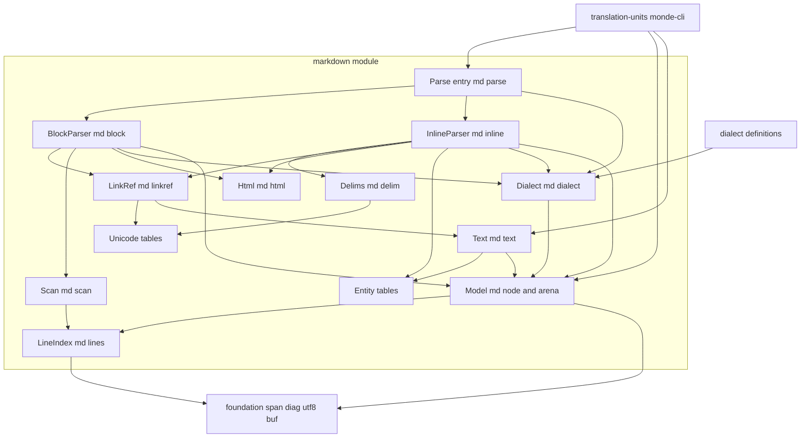
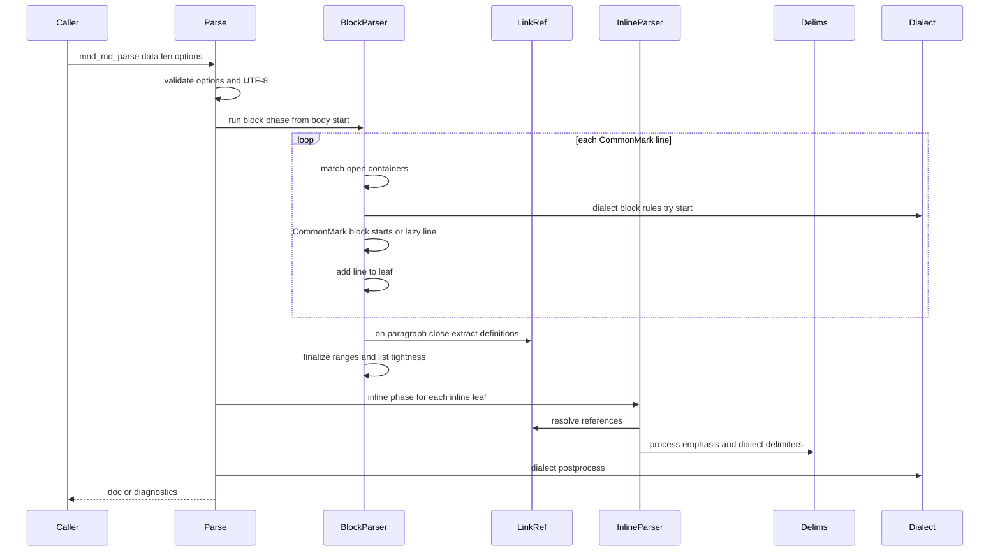

# 技術設計書: markdown-parser

## Overview

**Purpose**: markdown-parser は、CommonMark 0.31.2 に従って Markdown の内容（メモリ上のバイト列）を解析し、構文木を返す汎用の部品である。構文木の各ノードは、原文上のソース範囲（バイトオフセット）と行番号を持つ。複数行にわたるリーフブロックについては、行ごとにプレフィックスと内容の範囲を持つ。インラインは CommonMark のすべての要素を解析し、リンクと画像については、リンクテキスト（alt）・リンク先・タイトル・参照ラベルの範囲を個別に返す。方言の構造体を渡すと、ブロックとインラインの規則を CommonMark の規則に加えられる。

**Users**: translation-units は、構文木とソース範囲を使って翻訳単位を特定し、原文バッファの範囲を訳文で置き換える。次の版で GFM を実装する開発者は、方言の拡張点を使って規則を追加する。monde-cli は、解析が失敗したときの診断を表示する。本部品は Monde 固有の知識を持たないため、テストでは CommonMark spec の例と架空の文書だけで挙動を検証する。

**Impact**: 新しいモジュール `src/markdown/`（ライブラリ `monde::markdown`）と、テスト `tests/markdown/` を追加する。CommonMark spec 0.31.2 の spec.txt を、ライセンス表記を添えて `tests/data/commonmark/` に無改変で置く。Unicode のデータと HTML5 の実体名から C の表を作る開発用のスクリプトを `tools/` に追加する。既存のファイルの変更は次のものだけである。
- `src/CMakeLists.txt` と `tests/CMakeLists.txt` への `add_subdirectory` の追加
- `.gitattributes` の新規作成（spec.txt の改行を変えないため）
- steering（structure.md）への、予約済みの短縮名 `md` と、受け入れテストのデータの置き場所の追記

### Goals
- CommonMark spec 0.31.2 の全 652 例で、テスト専用の HTML 出力が期待 HTML と一致する。
- 全例で、すべてのノードのソース範囲と、行ごとの内容範囲が整合する（親の内側、兄弟と重ならない、原文の順）。
- 引用やリストの中の段落・コード・見出しについて、行ごとに、プレフィックスを除いた内容の範囲を返す。
- 何も追加しない方言では CommonMark と同じ構文木になる。テスト用の方言で、ブロックとインラインの規則を追加できることを示す。
- 不正な UTF-8 とメモリ不足のときに、異常終了せず、確保したメモリをすべて解放して診断を返す。

### Non-Goals
- 製品としての HTML へのレンダリング（HTML 出力はテストにだけ置く）
- GFM の拡張そのもの（次の版で、本設計の方言の拡張点を使って追加する）
- 翻訳単位の判断、msgid の組み立て、訳文の差し戻し（translation-units）
- フロントマターの検出と解析（yaml-front-matter）
- ファイルの入出力、BOM の除去、診断の表示、終了コード（foundation、monde-cli）
- 性能の目標（steering のとおり設けない。病的な入力で異常終了しないことだけを保証する）

## Boundary Commitments

### This Spec Owns
- 構文木の型（`mnd_md_doc_t`、`mnd_md_node_t`、`mnd_md_line_t`、ノードの種類ごとのデータ）と、その所有権の規則
- CommonMark 0.31.2 のブロック構造とインラインの解釈。リンク参照定義の照合と解決を含む
- ノードのソース範囲、行番号、行ごとのプレフィックスと内容の範囲の定義（本書「範囲の規則」）
- 範囲から論理的な文字列を得る関数（`mnd_md_logical_text`）と、エスケープと実体参照を文字に戻す関数（`mnd_md_unescape`）
- 方言の拡張点（`md_dialect.h`）と、既定の方言 `mnd_md_commonmark`
- 解析のエラーの英語のメッセージ（本書「メッセージ」）
- Unicode 15.0.0 から生成した文字の分類と大文字小文字の畳み込みの表、HTML5 の実体名の表、およびその生成スクリプト
- テスト専用の HTML 出力と HTML の正規化、spec.txt の例の読み込み（`tests/markdown/` の中だけ）
- 受け入れテストのデータの置き場所 `tests/data/commonmark/`（monde-cli も使う）と、そこに置く spec.txt の扱い

### Out of Boundary
- どのノードを翻訳対象にするか。リンク先 URL をプレースホルダにするかどうか（translation-units）
- 訳文を差し戻すときのプレフィックスの組み立てと、Markdown の特殊文字のエスケープ（translation-units）
- フロントマターの終わりの位置の決定（yaml-front-matter）。本部品は、渡された開始位置を使うだけである
- ファイルの読み書き、BOM の除去、診断の表示（foundation、monde-cli）
- GFM の規則の実装（次の版の spec）
- 方言を名前で選ぶ仕組みと、CLI のオプション（必要になったときに monde-cli が持つ）

### Allowed Dependencies
- 製品コード（`src/markdown/`）: C 標準ライブラリ、`monde::foundation` の `source.h`（`mnd_span_t`）、`diag.h`、`utf8.h`、`buf.h`（`mnd_md_logical_text` と `mnd_md_unescape` の出力先のみ）。`file_io.h` は使わない（I/O は境界に寄せる）。
- テストコード（`tests/markdown/`）: 上記に加えて Naos と、spec.txt を読むための foundation の `file_io.h`。
- 開発用スクリプト（`tools/gen_md_ucd.py`、`tools/gen_md_entities.py`）: Python 3 の標準ライブラリだけを使う。ネットワークからは取得しない。ビルドとテストからは呼ばない。
- モジュール間の依存は `foundation ← markdown ← translation-units` の一方向。markdown は他の汎用部品（cli_args、po、po_merge、yaml）に依存しない。
- モジュール内の依存の方向は「Architecture」の図に従う。

### Revalidation Triggers
- `mnd_md_node_t`、`mnd_md_line_t`、ノードの種類ごとのデータの、フィールドの追加・意味の変更 → translation-units
- 範囲の規則（ブロックの範囲の終わり、プレフィックスに含めるもの、遅延継続行の扱い）の変更 → translation-units の抽出と差し戻し、monde-cli のラウンドトリップテスト
- 行番号の数え方の変更 → translation-units の参照コメント `#:`
- 方言の拡張点の関数・コールバックの形の変更 → 次の版の GFM の spec
- `tests/data/commonmark/` の場所やファイル名の変更 → monde-cli の受け入れテスト
- Unicode の表や実体名の表のバージョンの変更 → spec の例の再確認

## Architecture

### Architecture Pattern & Boundary Map



**Architecture Integration**:
- **Selected pattern**: CommonMark の付録の 2 段階方式。1 段目（BlockParser）は 1 行ずつ処理してブロックの木を作る。2 段目（InlineParser）は、段落と見出し（と、方言のインラインを持つリーフ）の内容をインラインに分ける。選定の理由は `research.md` に記録した。
- **Dependency direction**: `Unicode・Entity・LineIndex → Model → Text・Scan・Html → LinkRef・Delims・Dialect → InlineParser → BlockParser → Parse`。左側が下位で、上位は下位だけを使う。ただし、Dialect のコンテキスト関数は、BlockParser と InlineParser の作業状態（`md_internal.h` の構造体）を操作する。作業状態の型は `md_internal.h` に置き、Dialect は型だけに依存する（BlockParser・InlineParser の関数を呼ばない）。
- **Existing patterns preserved**: 1 モジュール = 1 静的ライブラリ（`monde_add_module`）。エラーは `mnd_diag_list_t` に追加して返す。公開シンボルには接頭辞 `mnd_md_` を付ける。モジュール内で共有する関数と型は `md_internal.h` で宣言する（po の `po_internal.h` と同じ扱い）。生成した表は `tools/` のスクリプトで作り、リポジトリに含める（po の `po_ucd_tables.c` と同じ扱い）。
- **New components rationale**: Scan と Html は、ブロックの開始の判定と生の HTML の字句を、BlockParser と InlineParser から切り離して単体でテストするため。Delims は強調の処理（spec の process emphasis）が独立した手順であるため。Text は、translation-units とテスト用の HTML 出力が同じ方法で範囲を文字列にするため。

### Technology Stack

| Layer | Choice / Version | Role in Feature | Notes |
|-------|------------------|-----------------|-------|
| 言語 | C99 | 製品コードとテスト | steering の規約に従う |
| ビルド | CMake 3.21 以上 | `monde_add_module(markdown ...)`、テストの登録 | spec.txt のパスをコンパイル定義で渡す |
| テスト | Naos v0.4.0 | 単体テスト、spec のデータ駆動テスト | 既存の取り込みを使う |
| 仕様とテストデータ | CommonMark spec 0.31.2（タグ `0.31.2` の spec.txt） | 全 652 例の期待 HTML | CC-BY-SA 4.0。無改変で置く |
| Unicode データ | Unicode Character Database 15.0.0 | 句読点（P、S）、空白（Zs）、大文字小文字の畳み込み（C、F）の表の生成元 | po-format と同じバージョン |
| 実体名 | WHATWG HTML の `entities.json` | 実体参照の表の生成元 | `;` で終わる名前だけを使う |
| 開発用スクリプト | Python 3（標準ライブラリのみ） | 表を生成する | 生成物はリポジトリに含める |

## File Structure Plan

### Directory Structure
```
src/markdown/
├── CMakeLists.txt          # monde_add_module(markdown SOURCES ... DEPENDS foundation)
├── md.h                    # 公開: 構文木の型、種類、行、走査、論理的な文字列、アンエスケープ（Model、Text）
├── md_parse.h              # 公開: mnd_md_parse、解析のオプション、確保関数（Parse）
├── md_dialect.h            # 公開: 方言の構造体、規則、コンテキスト関数、mnd_md_commonmark（Dialect）
├── md_internal.h           # 内部: アリーナ、作業状態の型、各コンポーネントの内部関数の宣言
├── md_arena.c              # Model: アリーナと、確保関数の既定値
├── md_node.c               # Model: ノードの作成と連結、文書の解放、走査
├── md_lines.c              # LineIndex: 行の分割（LF、CRLF、CR）、行番号の表（foundation の数え方）
├── md_scan.c               # Scan: 1 行の中のブロックの開始の判定（テーマ区切り、ATX、Setext の下線、フェンス、リスト記号）
├── md_html.c               # Html: HTML の字句（開始タグ、終了タグ、コメント、処理命令、宣言、CDATA）と HTML ブロックの開始・終了条件
├── md_parse.c              # Parse: mnd_md_parse（オプションと UTF-8 の検査、2 段階と後処理の実行、失敗時の後始末）
├── md_block.c              # BlockParser: 行ごとのコンテナの照合、ブロックの開始、遅延継続行、閉じる処理、範囲の確定
├── md_linkref.c            # LinkRef: リンク参照定義の解析、ラベルの正規化、定義の表（ハッシュ表）
├── md_inline.c             # InlineParser: 行のカーソル、テキスト、エスケープ、実体参照、コードスパン、自動リンク、生の HTML、改行、角括弧とリンク
├── md_delim.c              # Delims: 区切り記号の連なりの判定と、強調の処理（方言の区切り記号の規則を含む）
├── md_text.c               # Text: mnd_md_logical_text、mnd_md_unescape
├── md_dialect.c            # Dialect: mnd_md_commonmark、方言の検査、コンテキスト関数の実装
├── md_entity.c             # Entity: 実体名の検索（二分探索）
├── md_entity_table.c       # Entity: tools/gen_md_entities.py が生成する表（手で編集しない）
├── md_unicode.c            # Unicode: 一般カテゴリの判定、大文字小文字の畳み込み
└── md_unicode_tables.c     # Unicode: tools/gen_md_ucd.py が生成する表（手で編集しない）

tests/markdown/
├── CMakeLists.txt          # monde_add_module_tests(markdown ...)、spec.txt のパスの定義
├── main.c                  # NAOS_MAIN にスイートを並べる
├── test_alloc.c / .h       # テスト用の確保関数（n 回目で失敗する、確保と解放の数を数える）
├── tree_check.c / .h       # 範囲の不変条件の検査（再帰を使わない）。spec のテストと個別のテストで使う
├── html_render.c / .h      # テスト専用の HTML 出力（commonmark.js と同じ出力規則）
├── html_normalize.c / .h   # テスト専用の HTML の正規化（normalize.py の移植）
├── spec_reader.c / .h      # spec.txt から例（番号、節、Markdown、HTML）を取り出す
├── parse_test.c            # 1.x（解析の入口、開始位置、空の内容、NUL）
├── block_test.c            # 2.x（ブロックの種類と属性）
├── range_test.c            # 3.x（ソース範囲と行番号）
├── lines_test.c            # 4.x（行ごとの内容範囲）
├── inline_test.c           # 5.x（インラインの種類と範囲）
├── linkref_test.c          # 6.x（参照の解決）
├── dialect_test.c          # 7.x（テスト用の方言）
├── error_test.c            # 8.x（不正な UTF-8、メモリ不足、病的な入力）
├── text_test.c             # Text と Unicode・Entity の表
└── spec_test.c             # 9.x（全 652 例の HTML と範囲の検査）

tests/data/commonmark/
├── spec.txt                # CommonMark spec 0.31.2（タグ 0.31.2 のもの。無改変）
└── README.md               # 出典の URL、タグ、SHA-256、CC-BY-SA 4.0 のライセンス表記、無改変であること、リリース成果物に含めないこと

tools/
├── gen_md_ucd.py           # UCD 15.0.0 から src/markdown/md_unicode_tables.c を生成する
└── gen_md_entities.py      # entities.json から src/markdown/md_entity_table.c を生成する
```

### Modified Files
- `src/CMakeLists.txt` — `add_subdirectory(markdown)` を追加する。
- `tests/CMakeLists.txt` — `add_subdirectory(markdown)` を追加する。
- `.gitattributes`（新規） — `tests/data/commonmark/spec.txt -text` を指定し、チェックアウトで改行が変わらないようにする。
- `.kiro/steering/structure.md` — 予約済みの短縮名に `md`（markdown が予約）を追記する。「受け入れテストのデータ」の置き場所を `tests/data/commonmark/` に確定する（markdown-parser が作り、monde-cli も使う）。

## 規約（本モジュール）

- **短縮名**: `md`。関数は `mnd_md_<対象>_<動作>`、型は `mnd_md_<対象>_t`、マクロと列挙値は `MND_MD_`。モジュール名（ディレクトリ・ターゲット）は `markdown`。
- **入力の不変条件**: 解析は、渡された内容を変更せず、複製もしない。構文木は内容を指す位置（オフセット）だけを持つ。呼び出し側は、構文木を使い終わるまで内容を保持する。
- **所有権**: 文書（`mnd_md_doc_t`）は、すべてのノード、行の配列、正規化したラベルを、自分のアリーナに持つ。`mnd_md_doc_free` がすべてを解放する。方言の規則がノードに付けるデータも、同じアリーナに確保する。
- **行番号**: 1 から数える。foundation の `mnd_source_line_of` と同じく、LF と CRLF を 1 つの改行として数え、単独の CR を数えない。基準は渡された内容全体の先頭（本文の開始位置ではない）。
- **CommonMark の行**: ブロックの解析では、LF、CRLF、単独の CR を行末とする（spec の「Characters and lines」）。このため、単独の CR を含む文書では、複数の CommonMark の行が同じ行番号になる。
- **再帰を使わない**: 入れ子の深さが入力で決まる処理（ブロックの照合、インライン、走査、解放、テストの検査と HTML 出力）は、再帰を使わずに、親へのポインタか明示的なスタックで行う（8.3）。
- **メモリ不足**: 解析は `false` を返し、`out of memory` の診断を追加する。Text の関数は `false` を返し、診断を追加しない（po の Model と同じ扱い）。
- **スタイル**: steering のコーディングスタイル（Allman、波括弧の省略禁止、比較の括弧）に従う。

## 範囲の規則

本節は、要件 3 と 4 の「範囲」が具体的にどのバイトを指すかを定める。オフセットはすべて渡された内容の先頭を 0 とし、範囲は開始を含み終了を含まない（`mnd_span_t`）。

### 物理的な行と、行の内容
- **物理的な行**: CommonMark の行（LF、CRLF、CR で終わる。最後の行は行末記号がなくてもよい）。行の先頭のオフセットを `line_start`、行末記号の直前を `line_end` とする。
- **行の内容（`mnd_md_line_t`）**: リーフの各行について、次の値を持つ。
  - `prefix`: `[line_start, content.start)`。その行が属するコンテナが使ったバイト（引用の `>` とその後ろの空白 1 つ分、リスト項目のインデント。リスト項目の最初の行ではリスト記号とその後ろの空白）と、そのブロック自身が取り除く空白を含む。
  - `content`: `[content.start, line_end)`。行末記号を含まない。
  - `pad`: タブの一部だけがプレフィックスとして使われたとき、そのタブはプレフィックスに入れ、内容の前に補う空白の数（1〜3）を `pad` に入れる。それ以外は 0。
  - `eol_len`: 行末記号のバイト数（0、1、2）。
  - `lazy`: 遅延継続行なら真。遅延継続行のプレフィックスは、行の先頭の空白だけからなる。
  - `line`: 行番号（`content.start` の位置の行番号）。

### ブロックごとの行の内容

| ブロック | 行 | 内容の開始 | 内容の終わり |
|----------|----|-----------|-------------|
| 段落 | すべての行 | 行の先頭の空白を除いた位置 | `line_end`（末尾の空白を含む） |
| ATX 見出し | 1 行 | 見出しの内容（`heading.content`）の開始 | 見出しの内容の終わり（閉じの `#` の並びと前後の空白を除く） |
| Setext 見出し | 下線を除く行 | 段落と同じ | 段落と同じ |
| フェンスコードブロック | 開きフェンスと閉じフェンスを除く行 | コンテナのプレフィックスのあと、開きフェンスのインデントの桁数までの空白を除いた位置 | `line_end` |
| インデントコードブロック | 末尾の空行を除く行 | コンテナのプレフィックスのあと、4 桁分の空白を除いた位置（空行で 4 桁に満たないときは、行の空白をすべて除いた位置） | `line_end` |
| HTML ブロック | すべての行 | コンテナのプレフィックスの直後 | `line_end` |
| リンク参照定義 | 定義を構成する行 | 段落と同じ | `line_end` |
| 方言のリーフ | 規則が追加した行 | 規則が使ったバイトの直後 | `line_end` |

### ノードのソース範囲
- **開始**: そのブロックの最初の行の、ブロック自身の最初のバイト。リスト項目はリスト記号、引用は最初の `>`、フェンスコードブロックは開きフェンス、段落と Setext 見出しは最初の行の内容の開始、インデントコードブロックは最初の行の内容の開始。
- **終わり**:
  - リーフ: 最後の行の `line_end`。ATX 見出しとテーマ区切りは、その行の `line_end`。Setext 見出しは下線の行の `line_end`。閉じフェンスのあるフェンスコードブロックは、閉じフェンスの行の `line_end`。
  - コンテナ: 「最後の子の終わり」と「コンテナ自身の記号が現れた最後の行の、空白でない最後のバイトの後ろ」の大きい方。末尾の空行は含めない。子を持たない空のリスト項目は、リスト記号の終わり。
  - リスト: 最初の項目の開始から最後の項目の終わりまで。
  - 文書: `[body_start, len)`。
- **インライン**: そのインラインの最初のバイトから最後のバイトの後ろまで。行をまたぐノード（コードスパン、リンク、強調）は、途中の行のプレフィックスと行末記号を範囲に含む。ソフト改行とハード改行は、前の行の末尾の空白（ハード改行ではバックスラッシュまたは 2 つ以上の空白）と、行末記号を範囲とする。最後の行の末尾の空白は、どのノードにも含めない。
- **行番号**: `start_line` は `span.start` の行番号、`end_line` は範囲の最後のバイト（範囲が空なら `span.start`）の行番号。

## 解析の流れ



- **検査の順序**: オプションの検査（開始位置、方言の規則）→ UTF-8 の検査 → ブロックの段階 → インラインの段階 → 後処理。どこかで失敗したら、その時点でアリーナと作業用の配列をすべて解放し、`*out` を `NULL` にして `false` を返す。
- **リンク参照定義**: ブロックの段階ですべての段落の先頭から定義を取り出し、定義の表に登録してから、インラインの段階を始める。したがって、参照より後ろの定義も使える（6.1）。
- **方言の規則の順序**: 新しいブロックの開始では、方言のブロックの規則を登録順に試し、どれも開始しなければ CommonMark の規則を試す（cmark-gfm と同じ）。インラインでは、CommonMark の特別な文字（`` ` ``、`\`、`&`、`<`、`[`、`]`、`!`、`*`、`_`、改行）でない文字で、方言の規則の開始文字に当たった位置で、方言の規則を試す。

### ブロックの段階（1 行の処理）
1. 物理的な行を 1 つ取り出す（LineIndex）。
2. 開いているコンテナを根から順に照合する。引用は `>`（インデント 3 以下）、リスト項目は内容のインデント以上の空白か空行、フェンスコードブロックは閉じフェンスの判定と開きフェンスのインデントの除去、インデントコードブロックは 4 桁以上の空白か空行、HTML ブロックは終了条件、段落は空行でないこと、方言のブロックは規則の `try_continue`。
3. 照合できたコンテナの中で、新しいブロックの開始を試す。最後に照合したブロックが、行を受け付けるリーフ（コード、HTML）でない場合に限る。インデント 4 以上で段落の中でなければインデントコードブロック。そうでなければ、方言の規則、引用、ATX 見出し、フェンス、HTML ブロック（1〜7。7 は段落を中断しない）、Setext の下線（開いている段落があり、すべてのコンテナを照合できた場合）、テーマ区切り、リスト項目（段落を中断できる条件を含む）の順に試す。コンテナが開始したら、行の残りで続けて試す。
4. 新しいブロックが始まらず、照合できなかったコンテナがあり、最も内側の開いているブロックが段落で、行が空行でなければ、遅延継続行としてその段落に追加する（`lazy` を真にする）。
5. それ以外の場合は、照合できなかったコンテナを閉じ、行を最も内側のリーフに追加するか、新しい段落を作る。空行は、リストのタイトとルーズの判定のために記録する。
6. ブロックを閉じるときに、範囲の終わりを確定する。段落の先頭からリンク参照定義を取り出す（LinkRef）。定義のノードは段落の前の兄弟として置き、段落の範囲と行は残りの行だけにする。行が残らなければ段落を取り除く。インデントコードブロックの末尾の空行を除き、フェンスの情報文字列の範囲を確定し、リストのタイトとルーズを確定する。

### インラインの段階
- **対象**: 段落、見出し、`inline_content` が真の方言のリーフ（5.11）。対象のリーフの行の内容を順に読むカーソルを作り、すべての位置を原文のオフセットで記録する。行の境目は、論理的には 1 つの改行である。
- **手順**: spec の付録のとおり。テキストを読み進め、特別な文字の位置で、エスケープ、実体参照、コードスパン、自動リンク、生の HTML、改行を認識する。`*` と `_` の連なり（と方言の区切り記号）は区切り記号のスタックに積む。`[` と `![` は角括弧のスタックに積み、`]` でリンクか画像かを判定する（インライン形式、完全参照、省略参照、ショートカット参照の順）。最後に強調を処理する（Delims）。
- **テキストのノード**: 1 つのテキストのノードは、1 つの行の内容の中の、連続したバイトだけを指す。使われなかった区切り記号や角括弧は、テキストとして残す。

## メッセージ

診断のメッセージは英語で、`mnd_diag_add` に渡す。パスはオプションの `path`（NULL 可）、行番号は位置が分かるときにその行番号、分からないときは 0。

| 状況 | 重大度 | メッセージ | 行番号 |
|------|--------|-----------|--------|
| 開始位置が内容の長さを超える（1.4） | エラー | `body start offset %zu exceeds content length %zu` | 0 |
| 不正な UTF-8（8.1） | エラー | `invalid UTF-8 sequence` | 不正なバイトの行 |
| メモリ不足（8.2） | エラー | `out of memory` | 0 |
| 方言の規則が不正（開始文字が CommonMark の特別な文字、種類が `MND_MD_KIND_DIALECT` 未満、必須のコールバックがない） | エラー | `dialect "%s": invalid %s rule %zu` | 0 |
| 方言の規則が不正な結果を返した（行の範囲を超えて消費した、など） | エラー | `dialect "%s": rule %zu returned an invalid result` | その行 |

## Requirements Traceability

| Requirement | Summary | Components | Interfaces | Flows |
|-------------|---------|------------|------------|-------|
| 1.1 | 内容を解析して文書を根とする木を返す | Parse、BlockParser、InlineParser | `mnd_md_parse`、`mnd_md_doc_root` | 解析の流れ |
| 1.2、1.3 | 本文の開始位置と、内容全体を基準にした位置 | Parse、LineIndex | `mnd_md_options_t.body_start` | 範囲の規則 |
| 1.4 | 開始位置が長さを超える | Parse | `mnd_md_parse` | メッセージ |
| 1.5 | 内容を変更しない | Parse、Model | `const char *data` | 規約 |
| 1.6 | NUL を含む内容 | LineIndex、InlineParser | `mnd_md_parse` | 規約 |
| 1.7 | 空の内容、空行だけの内容 | BlockParser | `mnd_md_parse` | ブロックの段階 |
| 2.1 | コンテナブロック | BlockParser、Model | `MND_MD_BLOCK_QUOTE`、`MND_MD_LIST`、`MND_MD_ITEM` | ブロックの段階 |
| 2.2 | リーフブロックの種類 | BlockParser、Scan、Html | `mnd_md_kind_t` | ブロックの段階 |
| 2.3 | 見出しのレベルと形式 | BlockParser、Scan | `mnd_md_heading_t` | — |
| 2.4 | リストの種類、記号、開始番号、タイト | BlockParser、Scan | `mnd_md_list_t` | ブロックの段階 6 |
| 2.5 | フェンスの文字・長さ・情報文字列・閉じ | BlockParser、Scan | `mnd_md_code_block_t` | — |
| 2.6 | HTML ブロックの開始条件の種類 | Html、BlockParser | `mnd_md_html_block_t` | — |
| 2.7 | リンク参照定義のラベル・リンク先・タイトル | LinkRef | `mnd_md_link_ref_def_t` | — |
| 2.8 | 段落の先頭のリンク参照定義 | LinkRef、BlockParser | `mnd_md_link_ref_def_t` | ブロックの段階 6 |
| 2.9 | 遅延継続行 | BlockParser | `mnd_md_line_t.lazy` | ブロックの段階 4 |
| 3.1 | すべてのノードの範囲と行番号 | Model、LineIndex | `mnd_md_node_t.span`、`start_line`、`end_line` | 範囲の規則 |
| 3.2、3.3 | 親の内側、兄弟と重ならない | BlockParser、InlineParser | — | 範囲の規則、tree_check |
| 3.4 | ブロックの範囲 | BlockParser | `mnd_md_node_t.span` | 範囲の規則 |
| 3.5 | 見出しの内容の範囲 | BlockParser、Scan | `mnd_md_heading_t.content` | 範囲の規則 |
| 3.6 | リスト記号の範囲 | BlockParser、Scan | `mnd_md_item_t.marker` | — |
| 3.7 | 原文の位置を返す | Model | `mnd_span_t` | 規約 |
| 4.1〜4.3 | 行ごとの行番号・内容・プレフィックス | BlockParser、LineIndex | `mnd_md_line_t` | 範囲の規則 |
| 4.4 | 遅延継続行の印 | BlockParser | `mnd_md_line_t.lazy` | — |
| 4.5 | タブの一部 | BlockParser、Scan | `mnd_md_line_t.pad` | 範囲の規則 |
| 4.6、4.7 | フェンスとインデントのコードの行 | BlockParser | `mnd_md_line_t` | ブロックごとの行の内容 |
| 5.1 | インラインの種類 | InlineParser、Delims、Html、Entity | `mnd_md_kind_t` | インラインの段階 |
| 5.2、5.3 | リンクと画像の各範囲 | InlineParser | `mnd_md_link_t` | — |
| 5.4、5.5 | 参照の形式と定義 | InlineParser、LinkRef | `mnd_md_link_t.ref_kind`、`def` | — |
| 5.6 | コードスパンの内容 | InlineParser | `mnd_md_code_span_t` | — |
| 5.7 | 自動リンク | InlineParser | `mnd_md_autolink_t` | — |
| 5.8 | エスケープと文字参照 | InlineParser、Entity | `mnd_md_escape_t`、`mnd_md_char_ref_t` | — |
| 5.9 | 強調の区切り記号 | Delims | `mnd_md_emph_t` | — |
| 5.10 | 行をまたぐインライン | InlineParser、Text | `mnd_md_logical_text` | 範囲の規則 |
| 5.11 | インラインを解析するブロック | InlineParser | — | インラインの段階 |
| 6.1 | 後ろの定義も使う | LinkRef、Parse | — | 解析の流れ |
| 6.2 | ラベルの照合 | LinkRef、Unicode | `mnd_md_link_ref_def_t.norm_label` | — |
| 6.3 | 最初の定義を使う | LinkRef | — | — |
| 6.4 | 定義がない参照はテキスト | InlineParser | — | — |
| 7.1 | 既定は CommonMark | Parse、Dialect | `mnd_md_commonmark` | — |
| 7.2〜7.4 | 方言の規則の適用 | Dialect、BlockParser、InlineParser、Delims | `mnd_md_dialect_t` | 解析の流れ |
| 7.5 | 何も追加しない方言 | Dialect | `mnd_md_dialect_t` | dialect_test、spec_test |
| 7.6 | テスト用の方言での検証 | dialect_test | — | Testing Strategy |
| 8.1 | 不正な UTF-8 | Parse | `mnd_md_parse` | メッセージ |
| 8.2 | メモリ不足 | Parse、Model | `mnd_md_allocator_t` | error_test |
| 8.3 | 病的な入力 | BlockParser、InlineParser、Delims | — | 規約（再帰を使わない） |
| 8.4 | 英語の診断、I/O をしない | すべて | `mnd_diag_list_t` | メッセージ |
| 8.5 | 構文木の解放 | Model | `mnd_md_doc_free` | — |
| 9.1 | テスト専用の HTML 出力 | html_render | — | Testing Strategy |
| 9.2、9.3 | 全例の比較と正規化 | spec_test、spec_reader、html_normalize | — | Testing Strategy |
| 9.4 | 全例の範囲の検査 | spec_test、tree_check | — | Testing Strategy |
| 9.5 | 代表的な例の範囲の個別テスト | range_test、lines_test、inline_test | — | Testing Strategy |
| 9.6 | HTML 出力と spec.txt を製品に含めない | ファイル構成（`tests/` に置く） | — | Allowed Dependencies |

## Components and Interfaces

| Component | Domain/Layer | Intent | Req Coverage | Key Dependencies | Contracts |
|-----------|--------------|--------|--------------|------------------|-----------|
| Model | データ | 構文木の型、アリーナ、走査、解放 | 1.5, 3.1, 3.7, 8.5 | foundation source（P0）、LineIndex（P0） | Service |
| Parse | 入口 | オプションと UTF-8 の検査、2 段階の実行、後始末 | 1.1〜1.4, 6.1, 7.1, 8.1, 8.2, 8.4 | BlockParser（P0）、InlineParser（P0） | Service |
| Text | 補助 | 範囲 → 論理的な文字列、アンエスケープ | 5.10 | Model（P0）、Entity（P0）、foundation buf | Service |
| Dialect | 拡張点 | 方言の型、規則の検査、コンテキスト関数 | 7.x | Model（P0） | Service |
| LineIndex | 内部 | 行の分割と行番号 | 1.3, 1.6, 3.1, 4.1 | foundation source（P1） | Service（内部） |
| Scan | 内部 | 1 行のブロックの開始の判定 | 2.2〜2.5, 3.5, 3.6, 4.5 | LineIndex | Service（内部） |
| Html | 内部 | HTML の字句、HTML ブロックの条件 | 2.6, 5.1 | なし | Service（内部） |
| BlockParser | 内部 | ブロックの木と行と範囲 | 1.7, 2.x, 3.2〜3.6, 4.x | Scan、Html、LinkRef、Dialect、Model | Service（内部） |
| LinkRef | 内部 | 定義の解析、ラベルの正規化、表 | 2.7, 2.8, 6.x | Unicode、Text | Service（内部） |
| InlineParser | 内部 | インラインの木と範囲 | 5.x, 6.4 | Delims、LinkRef、Html、Entity、Dialect | Service（内部） |
| Delims | 内部 | 区切り記号の判定と強調の処理 | 5.1, 5.9, 7.4 | Unicode | Service（内部） |
| Entity | 内部 | 実体名の表と検索 | 5.8 | なし | Service（内部） |
| Unicode | 内部 | 一般カテゴリと畳み込み | 5.1, 6.2 | なし | Service（内部） |

### データ

#### Model（`src/markdown/md.h`、`md_node.c`、`md_arena.c`）

| Field | Detail |
|-------|--------|
| Intent | 構文木の型を定義し、ノードの作成・連結・走査・解放を提供する |
| Requirements | 1.5, 3.1, 3.7, 8.5 |

**Responsibilities & Constraints**
- ノードは文書のアリーナに確保する。ノードは親・最初の子・最後の子・前・次へのポインタを持つ。
- 公開の型は読み取り用である。呼び出し側は木を変更しない（方言の後処理は `md_dialect.h` の関数を使う）。
- `mnd_md_node_next` は前順の走査を再帰なしで行う。

**Contracts**: Service [x]

```c
#include "foundation/buf.h"
#include "foundation/source.h"
#include <stdbool.h>
#include <stddef.h>

typedef enum mnd_md_kind
{
    /* ブロック */
    MND_MD_DOCUMENT,
    MND_MD_BLOCK_QUOTE,
    MND_MD_LIST,
    MND_MD_ITEM,
    MND_MD_PARAGRAPH,
    MND_MD_HEADING,         /* ATX と Setext（heading.setext で区別） */
    MND_MD_THEMATIC_BREAK,
    MND_MD_CODE_BLOCK,      /* インデントとフェンス（code_block.fenced で区別） */
    MND_MD_HTML_BLOCK,
    MND_MD_LINK_REF_DEF,
    /* インライン */
    MND_MD_TEXT,
    MND_MD_SOFT_BREAK,
    MND_MD_HARD_BREAK,
    MND_MD_ESCAPE,
    MND_MD_CHAR_REF,
    MND_MD_CODE_SPAN,
    MND_MD_EMPH,
    MND_MD_STRONG,
    MND_MD_LINK,
    MND_MD_IMAGE,
    MND_MD_AUTOLINK,
    MND_MD_HTML_INLINE,
    /* 方言が定める種類はこの値以上を使う */
    MND_MD_KIND_DIALECT = 0x100
} mnd_md_kind_t;

typedef struct mnd_md_line
{
    size_t line;            /* 行番号（1 起点。content.start の行） */
    mnd_span_t prefix;      /* [物理的な行の先頭, content.start) */
    mnd_span_t content;     /* 行末記号を含まない */
    unsigned char pad;      /* 内容の前に補う空白の数（0〜3） */
    unsigned char eol_len;  /* 行末記号のバイト数（0、1、2） */
    bool lazy;              /* 遅延継続行 */
} mnd_md_line_t;

typedef struct mnd_md_node mnd_md_node_t;

typedef struct mnd_md_heading
{
    int level;              /* 1〜6 */
    bool setext;
    mnd_span_t content;     /* 見出しの記号を除いた内容（3.5） */
} mnd_md_heading_t;

typedef struct mnd_md_list
{
    bool ordered;
    char marker;            /* '-'、'+'、'*'、または順序付きの '.'、')' */
    unsigned long start;    /* 順序付きの開始番号（0〜999999999） */
    bool tight;
} mnd_md_list_t;

typedef struct mnd_md_item
{
    mnd_span_t marker;      /* リスト記号（番号を含む）の範囲 */
    size_t content_indent;  /* 内容の開始の桁（継続行に必要なインデント） */
} mnd_md_item_t;

typedef struct mnd_md_code_block
{
    bool fenced;
    char fence_char;        /* '`' または '~'（fenced のとき） */
    size_t fence_len;
    size_t fence_indent;    /* 開きフェンスのインデントの桁数 */
    bool has_info;
    mnd_span_t info;        /* 前後の空白を除いた情報文字列（エスケープは未処理） */
    bool closed;            /* 閉じフェンスがある */
} mnd_md_code_block_t;

typedef struct mnd_md_html_block
{
    int type;               /* 開始条件の種類 1〜7 */
} mnd_md_html_block_t;

typedef struct mnd_md_link_ref_def
{
    mnd_span_t label;       /* [ と ] の内側 */
    mnd_span_t dest;        /* <> で囲まれていれば、その内側 */
    bool dest_angle;
    bool has_title;
    mnd_span_t title;       /* 引用符・括弧の内側 */
    char title_delim;       /* '"'、'\''、'('（has_title のとき） */
    const char *norm_label; /* 正規化したラベル（UTF-8、NUL 終端） */
} mnd_md_link_ref_def_t;

typedef enum mnd_md_ref_kind
{
    MND_MD_REF_INLINE,      /* [text](dest "title") */
    MND_MD_REF_FULL,        /* [text][label] */
    MND_MD_REF_COLLAPSED,   /* [text][] */
    MND_MD_REF_SHORTCUT     /* [text] */
} mnd_md_ref_kind_t;

typedef struct mnd_md_link
{
    mnd_md_ref_kind_t ref_kind;
    mnd_span_t text;        /* リンクテキスト、または画像の alt（[ と ] の内側） */
    mnd_span_t label;       /* 参照ラベル（FULL は 2 つ目の [] の内側、COLLAPSED と SHORTCUT は text と同じ） */
    const mnd_md_node_t *def; /* 参照形式のとき、対応するリンク参照定義のノード */
    mnd_span_t dest;        /* リンク先（参照形式では定義の dest） */
    bool dest_angle;
    bool has_title;
    mnd_span_t title;       /* タイトル（参照形式では定義の title） */
    char title_delim;
} mnd_md_link_t;

typedef struct mnd_md_code_span
{
    mnd_span_t content;     /* バッククォートの並びの内側（正規化は未処理） */
    size_t ticks;
} mnd_md_code_span_t;

typedef struct mnd_md_emph
{
    char delim;             /* '*' または '_' */
    mnd_span_t open;        /* 開きの区切り記号 */
    mnd_span_t close;       /* 閉じの区切り記号 */
} mnd_md_emph_t;

typedef struct mnd_md_autolink
{
    bool email;
    mnd_span_t dest;        /* < と > の内側 */
} mnd_md_autolink_t;

typedef struct mnd_md_escape
{
    char ch;                /* エスケープされた ASCII の句読点 */
} mnd_md_escape_t;

typedef struct mnd_md_char_ref
{
    bool numeric;
    unsigned char len;      /* text のバイト数（1〜6） */
    char text[8];           /* 表す文字の UTF-8（不正な数値は U+FFFD） */
} mnd_md_char_ref_t;

typedef struct mnd_md_hard_break
{
    bool backslash;         /* バックスラッシュによる改行 */
} mnd_md_hard_break_t;

struct mnd_md_node
{
    mnd_md_kind_t kind;
    mnd_span_t span;
    size_t start_line;
    size_t end_line;
    mnd_md_node_t *parent;
    mnd_md_node_t *first_child;
    mnd_md_node_t *last_child;
    mnd_md_node_t *prev;
    mnd_md_node_t *next;
    const mnd_md_line_t *lines; /* リーフの行（それ以外は NULL） */
    size_t line_count;
    union
    {
        mnd_md_heading_t heading;
        mnd_md_list_t list;
        mnd_md_item_t item;
        mnd_md_code_block_t code_block;
        mnd_md_html_block_t html_block;
        mnd_md_link_ref_def_t link_ref_def;
        mnd_md_link_t link;         /* MND_MD_LINK と MND_MD_IMAGE */
        mnd_md_code_span_t code_span;
        mnd_md_emph_t emph;         /* MND_MD_EMPH と MND_MD_STRONG */
        mnd_md_autolink_t autolink;
        mnd_md_escape_t escape;
        mnd_md_char_ref_t char_ref;
        mnd_md_hard_break_t hard_break;
        void *dialect_data;         /* 方言の種類のノード（方言が定める） */
    } as;
};

typedef struct mnd_md_doc mnd_md_doc_t; /* 不透明。内容へのポインタ、根、アリーナを持つ */

const mnd_md_node_t *mnd_md_doc_root(const mnd_md_doc_t *doc);
const char *mnd_md_doc_data(const mnd_md_doc_t *doc);
size_t mnd_md_doc_len(const mnd_md_doc_t *doc);
void mnd_md_doc_free(mnd_md_doc_t *doc);  /* NULL に対しても安全 */

/* 前順の次のノード。root の部分木を出たら NULL */
const mnd_md_node_t *mnd_md_node_next(const mnd_md_node_t *node, const mnd_md_node_t *root);
```

- 子のインライン: リンク・画像・強調・見出し・段落・方言のインラインを持つリーフは、インラインのノードを子に持つ。画像の子は alt のインラインである。
- 不変条件: `span` は内容の範囲内。子は親の内側。兄弟は重ならずに原文の順に並ぶ（3.2、3.3）。

#### Text（`md.h` で宣言、`md_text.c`）

| Field | Detail |
|-------|--------|
| Intent | 範囲が指す論理的な文字列を組み立て、エスケープと文字参照を文字に戻す |
| Requirements | 5.10（ほかに translation-units の msgid、テスト用の HTML 出力で使う） |

```c
/*
 * leaf の行に含まれる範囲 span の論理的な文字列を out の後ろに追加する。
 * 各行のプレフィックスを飛ばし、pad の数の空白を補い、行の境目を "\n" にする。
 * leaf には span を含む、行を持つノード（段落、見出し、コードブロック、リンク参照定義など）を渡す。インラインのノードの範囲には、それを含むリーフを渡す。
 * span が leaf の行の内容と重ならない部分は無視する。leaf が行を持たない場合は、span のバイト列をそのまま追加する。
 */
bool mnd_md_logical_text(const mnd_md_doc_t *doc, const mnd_md_node_t *leaf, mnd_span_t span,
                         mnd_buf_t *out);

/* text[0..len) のバックスラッシュエスケープと実体参照・数値文字参照を文字に戻して out の後ろに追加する */
bool mnd_md_unescape(const char *text, size_t len, mnd_buf_t *out);
```
- メモリ不足のときは `false` を返し、`out` にそれまでに追加した内容は残る（foundation のバッファの規則）。

### 入口

#### Parse（`src/markdown/md_parse.h`、`md_parse.c`）

| Field | Detail |
|-------|--------|
| Intent | 入力を検査し、ブロックの段階・インラインの段階・後処理を実行して文書を返す |
| Requirements | 1.1〜1.4, 6.1, 7.1, 8.1, 8.2, 8.4 |

**Contracts**: Service [x]

```c
#include "foundation/diag.h"
#include "markdown/md.h"
#include "markdown/md_dialect.h"

typedef struct mnd_md_allocator
{
    void *(*alloc)(void *ctx, size_t size);  /* 失敗したら NULL */
    void (*free)(void *ctx, void *ptr);      /* NULL に対しても安全であること */
    void *ctx;
} mnd_md_allocator_t;

typedef struct mnd_md_options
{
    const mnd_md_dialect_t *dialect;        /* NULL なら mnd_md_commonmark */
    size_t body_start;                      /* 本文の開始位置（バイトオフセット） */
    const char *path;                       /* 診断に付けるパス。NULL 可 */
    const mnd_md_allocator_t *allocator;    /* NULL なら malloc と free */
} mnd_md_options_t;

#define MND_MD_OPTIONS_INIT { NULL, 0, NULL, NULL }

/*
 * data[0..len) を解析する。成功したら *out に文書を設定して true を返す。
 * 失敗したら *out を NULL にし、diags にエラーを追加して false を返す。
 * options は NULL 可（MND_MD_OPTIONS_INIT と同じ）。data は len == 0 なら NULL 可。
 */
bool mnd_md_parse(const char *data, size_t len, const mnd_md_options_t *options,
                  mnd_md_doc_t **out, mnd_diag_list_t *diags);
```
- **事前条件**: `out` と `diags` は NULL でない。`data` は BOM を除去した後の内容である（BOM の除去は呼び出し側が行う）。
- **事後条件**: 成功したときは、`diags` に何も追加しない（CommonMark には構文エラーがない）。文書は `data` を指し続ける。
- **UTF-8 の検査**: `mnd_utf8_validate` で内容全体（開始位置より前も含む）を検査する。不正なバイトがあれば、その行番号で `invalid UTF-8 sequence` を報告する。
- **開始位置**: 行の途中を指していてもよく、その位置を最初の行の先頭として扱う（タブの桁は開始位置から数える）。

### 拡張点

#### Dialect（`src/markdown/md_dialect.h`、`md_dialect.c`）

| Field | Detail |
|-------|--------|
| Intent | 方言の規則の型と、規則が使うコンテキスト関数を定義する |
| Requirements | 7.1〜7.6 |

**Responsibilities & Constraints**
- 方言は、ブロックの規則の配列、インラインの規則の配列、後処理（任意）を持つ。どの配列も空でよい。`mnd_md_commonmark` は何も持たない方言である。
- 規則が作るノードの種類は `MND_MD_KIND_DIALECT` 以上とし、規則ごとに異なる値にする（解析の開始時に検査する）。
- コンテキストは解析中だけ有効である。規則はコンテキストを保持しない。
- 規則のコールバックが `false` を返すと「当てはまらない」の意味になる。メモリ不足は、コンテキスト関数が失敗を記録し、解析全体が `out of memory` で失敗する。

**Contracts**: Service [x]

```c
#include "markdown/md.h"

typedef struct mnd_md_block_ctx mnd_md_block_ctx_t;   /* 不透明 */
typedef struct mnd_md_inline_ctx mnd_md_inline_ctx_t; /* 不透明 */
typedef struct mnd_md_post_ctx mnd_md_post_ctx_t;     /* 不透明 */

/* ブロックの規則のコンテキストが示す、現在の行の状態 */
typedef struct mnd_md_line_view
{
    const char *data;       /* 内容全体 */
    size_t pos;             /* 現在の位置（コンテナが使ったバイトの後ろ） */
    size_t end;             /* 行末記号の直前 */
    size_t column;          /* pos の桁（タブは 4 桁ごとの位置まで進む） */
    size_t indent;          /* pos から最初の空白でない文字までの桁数 */
    size_t first_nonspace;  /* 最初の空白でない文字のオフセット（なければ end） */
    bool blank;
    size_t line;            /* 行番号 */
} mnd_md_line_view_t;

typedef struct mnd_md_block_rule
{
    mnd_md_kind_t kind;
    bool container;             /* 子のブロックを持つ */
    bool inline_content;        /* リーフの行をインラインとして解析する（container が偽のとき） */
    bool can_interrupt_paragraph;
    /* 新しいブロックを開始できるか試す。開始するなら、使ったバイトを進めて mnd_md_block_ctx_open を呼び、true を返す */
    bool (*try_start)(mnd_md_block_ctx_t *ctx);
    /* 開いている node が現在の行で続くか。続くなら、使ったバイトを進めて true を返す */
    bool (*try_continue)(mnd_md_block_ctx_t *ctx, mnd_md_node_t *node);
    /* node を閉じるときの後処理（NULL 可） */
    bool (*finalize)(mnd_md_block_ctx_t *ctx, mnd_md_node_t *node);
} mnd_md_block_rule_t;

typedef struct mnd_md_delim_run
{
    size_t length;          /* 残っている区切り記号の数 */
    size_t original_length; /* 元の連なりの長さ */
    bool can_open;
    bool can_close;
} mnd_md_delim_run_t;

typedef struct mnd_md_inline_rule
{
    mnd_md_kind_t kind;
    unsigned char trigger;      /* 開始文字（CommonMark の特別な文字であってはならない） */
    bool delimiter;             /* 真なら区切り記号形式、偽なら開始文字形式 */
    /* 開始文字形式: 現在の位置から要素を認識したら、mnd_md_inline_ctx_emit でノードを作って true を返す */
    bool (*try_match)(mnd_md_inline_ctx_t *ctx);
    /* 区切り記号形式: opener と closer の対で使う数を *use に入れて true を返す。対にしないなら false */
    bool (*match_delims)(const mnd_md_delim_run_t *opener, const mnd_md_delim_run_t *closer,
                         size_t *use);
} mnd_md_inline_rule_t;

typedef struct mnd_md_dialect
{
    const char *name;
    const mnd_md_block_rule_t *block_rules;
    size_t block_rule_count;
    const mnd_md_inline_rule_t *inline_rules;
    size_t inline_rule_count;
    bool (*postprocess)(mnd_md_post_ctx_t *ctx, mnd_md_node_t *root); /* NULL 可 */
} mnd_md_dialect_t;

extern const mnd_md_dialect_t mnd_md_commonmark;

/* ブロックの規則のコンテキスト関数 */
mnd_md_line_view_t mnd_md_block_ctx_line(const mnd_md_block_ctx_t *ctx);
void mnd_md_block_ctx_advance(mnd_md_block_ctx_t *ctx, size_t bytes);      /* 行末を超えない */
void mnd_md_block_ctx_advance_columns(mnd_md_block_ctx_t *ctx, size_t columns); /* タブの一部は pad になる */
mnd_md_node_t *mnd_md_block_ctx_open(mnd_md_block_ctx_t *ctx, mnd_md_kind_t kind); /* 現在の位置から始まるブロックを開く */
mnd_md_node_t *mnd_md_block_ctx_paragraph(const mnd_md_block_ctx_t *ctx); /* 中断しようとしている段落。なければ NULL */
bool mnd_md_block_ctx_take_paragraph_lines(mnd_md_block_ctx_t *ctx, size_t count); /* 段落の最後の count 行を、直後に開くブロックの最初の行にする */
void *mnd_md_block_ctx_alloc(mnd_md_block_ctx_t *ctx, size_t size);     /* アリーナから確保。失敗したら NULL */

/* インラインの規則のコンテキスト関数（開始文字形式は、現在の行の中だけを見る） */
mnd_md_line_view_t mnd_md_inline_ctx_line(const mnd_md_inline_ctx_t *ctx);
mnd_md_node_t *mnd_md_inline_ctx_emit(mnd_md_inline_ctx_t *ctx, mnd_md_kind_t kind, size_t length); /* 現在の位置から length バイトのノードを作り、位置を進める */
void *mnd_md_inline_ctx_alloc(mnd_md_inline_ctx_t *ctx, size_t size);

/* 後処理のコンテキスト関数 */
mnd_md_node_t *mnd_md_post_new_node(mnd_md_post_ctx_t *ctx, mnd_md_kind_t kind, mnd_span_t span);
bool mnd_md_post_split_text(mnd_md_post_ctx_t *ctx, mnd_md_node_t *text, size_t offset); /* テキストを offset で 2 つに分ける */
void mnd_md_post_insert_after(mnd_md_post_ctx_t *ctx, mnd_md_node_t *sibling, mnd_md_node_t *node);
void mnd_md_post_wrap(mnd_md_post_ctx_t *ctx, mnd_md_node_t *first, mnd_md_node_t *last, mnd_md_node_t *wrapper); /* first〜last の兄弟を wrapper の子にする */
void *mnd_md_post_alloc(mnd_md_post_ctx_t *ctx, size_t size);
```
- **ブロックの規則の行**: `container` が偽の規則が開いたブロックは、続く行（`try_continue` が真の行）の残りを `mnd_md_line_t` として記録する。開始した行の残りも最初の行になる（`take_paragraph_lines` を使った場合は、その行が先に来る）。
- **区切り記号形式**: 開始文字の連なりは、CommonMark の `*` と同じ左右の隣接の規則で `can_open` と `can_close` を決め、強調と同じスタックに積む。閉じの記号の処理で、規則の `match_delims` が真を返したら、その間のインラインを `kind` のノードの子にする。ノードのデータは `mnd_md_emph_t` と同じ形（開き・閉じの範囲）で、`as.dialect_data` が指す。
- **後処理**: インラインの段階のあとに 1 回呼ぶ。範囲の不変条件（3.2、3.3）を壊す変更は、解析が `rule returned an invalid result` で失敗する（後処理のあとに検査する）。
- **GFM での使い方（次の版の見込み）**: 表は `try_start` と `take_paragraph_lines`、タスクリストは後処理でリスト項目の最初のテキストを調べる、取り消し線は `~` の区切り記号形式、自動リンクの拡張は後処理の `split_text` と `wrap`。

### 内部

#### LineIndex（`md_lines.c`）
- 内容から CommonMark の行（LF、CRLF、CR）を順に取り出す関数と、行番号の表（LF の位置の配列。単独の CR は数えない）を作る関数を提供する。
- 行番号の表は解析の最初に 1 回作り、オフセットから行番号を二分探索で求める。テストで foundation の `mnd_source_line_of` と結果が一致することを確かめる。

#### Scan（`md_scan.c`）
- 1 行の、指定した位置から、テーマ区切り、ATX 見出しの開始と内容の範囲、Setext の下線、開きフェンスと閉じフェンス、リスト記号（順序付きは 9 桁まで）を判定する純粋な関数。結果は範囲と属性の構造体で返す。
- タブの桁の計算（4 桁ごと）と、指定した桁数の空白を取り除いたときの位置と `pad` の計算を提供する（4.5）。

#### Html（`md_html.c`）
- 生の HTML の字句（開始タグ、終了タグ、コメント、処理命令、宣言、CDATA）を、位置から認識して長さを返す。HTML ブロックの開始条件 1〜7 と、それぞれの終了条件を判定する。条件 6 のタグ名の一覧は spec 0.31.2 のものを使う。

#### BlockParser（`md_block.c`）
- 「解析の流れ」のブロックの段階を実装する。開いているブロックは、根から最も内側までの配列（作業用の配列）で持ち、再帰を使わない。
- リーフの行は作業用の配列に追加し、ブロックを閉じるときにアリーナへ複製して `lines` に設定する。
- 範囲は「範囲の規則」に従って、ブロックを閉じるときに確定する。

#### LinkRef（`md_linkref.c`）
- 段落の行の先頭からリンク参照定義を繰り返し解析する（ラベルは 999 文字まで、行をまたぐタイトルを含む）。解析は行のカーソルの上で行い、範囲を原文のオフセットで返す。
- ラベルの正規化: 論理的な文字列にしてから、前後の空白を除き、連続する空白（Unicode の空白）を 1 つの空白にまとめ、大文字小文字の畳み込み（C と F）を行う。
- 定義の表: 正規化したラベルのハッシュ表。同じラベルの 2 つ目以降の定義は、ノードとしては残すが表には登録しない（6.3）。

#### InlineParser（`md_inline.c`）と Delims（`md_delim.c`）
- 「解析の流れ」のインラインの段階を実装する。区切り記号のスタックと角括弧のスタックは作業用の配列で持つ。
- 病的な入力への対策（8.3）: リンクラベルは 999 文字まで。角括弧のスタックに「使えない」印を付け、リンクの中のリンクを作らない。強調の処理では、区切り記号の種類と長さの組ごとに探索の下限（`openers_bottom`）を持つ。コードスパンの閉じのバッククォートを探すとき、長さごとに「この先にない」ことを記録する。
- 文字の分類（左右の隣接の判定）は Unicode の表を使う。

#### Entity（`md_entity.c`、`md_entity_table.c`）
- `;` で終わる HTML5 の実体名と、それが表す UTF-8 の列の表（名前の順）を持ち、名前から二分探索する。

#### Unicode（`md_unicode.c`、`md_unicode_tables.c`）
- コードポイントが句読点（一般カテゴリ P または S）か、空白（Zs）かを判定する。大文字小文字の畳み込み（CaseFolding の C と F）を UTF-8 の列として返す。表は範囲の配列で、二分探索する。

## Error Handling

### Error Strategy
- **利用者の入力の誤り**（不正な UTF-8）: エラーの診断と `false`。構文木は返さない（8.1）。Markdown の構文としての誤りは存在しない。
- **呼び出し側のプログラムの誤り**（開始位置が長さを超える、方言の規則が不正）: エラーの診断と `false`（1.4）。
- **メモリ不足**: `false` と `out of memory`。アリーナと作業用の配列を、確保関数の `free` ですべて解放する（8.2）。診断の記録自体ができない場合は、foundation の `dropped` に任せる。
- どの関数も `stdout` / `stderr` に書かず、プロセスを終了しない（8.4）。

## Testing Strategy

すべての単体テストは Naos で書き、`markdown_tests` にまとめる（1 ファイル 1 スイート）。spec.txt のパスは `DEFINITIONS MND_MD_SPEC_FILE="${PROJECT_SOURCE_DIR}/tests/data/commonmark/spec.txt"` で渡し、foundation の `mnd_file_read` で読む。個別のテストでは、期待する範囲をオフセットの数値で書き、行ごとの内容は `mnd_md_logical_text` の結果の文字列でも確かめる。

### テスト用の部品
- **tree_check**: 文書を前順にたどり（`mnd_md_node_next`）、次を確かめる。範囲が内容の範囲内で開始 ≤ 終了。子が親の内側。兄弟が重ならず原文の順。`start_line` と `end_line` が `mnd_source_line_of` の結果と一致する。各行の `prefix.end == content.start`、`prefix.start` が物理的な行の先頭、内容が行末記号を含まない、行が原文の順、内容がノードの範囲の内側（3.1〜3.3、4.1〜4.3）。
- **html_render**: 構文木を commonmark.js と同じ規則で HTML にする。ブロックの改行の位置、タイトなリストの段落を `<p>` で囲まないこと、`<pre><code class="language-…">`（情報文字列の最初の語をアンエスケープ）、`<hr />` と `<br />`、`& < > "` のエスケープ、URL のパーセントエンコード（既存の `%XX` は残す）、画像の alt を子のインラインの文字列だけで書くこと、NUL を U+FFFD にすること。コードブロック・コードスパン・タイトル・URL の文字列は、`mnd_md_logical_text` と `mnd_md_unescape` で作る（範囲の誤りが HTML の不一致として現れるようにする）。再帰を使わない。
- **html_normalize**: normalize.py の規則（`research.md` に記録）を C に移植する。完全一致しなかった例だけに使う。
- **spec_reader**: spec_tests.py と同じ規則で例を取り出し、`→` をタブに置き換える。例が 652 個であることを確かめる。
- **test_alloc**: n 回目の確保で失敗する確保関数と、確保と解放の回数を数える確保関数。

### Unit Tests
- **parse**: 段落 1 つの文書の木（1.1）。開始位置を指定した文書で、開始位置より前の `# x` が見出しにならないこと、範囲と行番号が内容全体の先頭を基準にすること、行の途中の開始位置（1.2、1.3）。開始位置が長さ + 1 で、`*out` が NULL、診断のメッセージが表のとおりであること（1.4）。解析の前後で内容のバイト列が変わらないこと（1.5）。NUL を含む段落の範囲が NUL の後ろまで続くこと（1.6）。空の内容、空行だけの内容（LF、CRLF、空白とタブ）で、子のない文書になること（1.7）。
- **block**: 各ブロックの種類（2.1、2.2）。ATX のレベル 1〜6 と 7 個の `#`、Setext の `=` と `-`（2.3）。各リスト記号、開始番号 0 と 123456789、タイトとルーズ（空行の位置の違い）（2.4）。バッククォートと `~` のフェンス、長さ 3 と 5、情報文字列の範囲、閉じフェンスがないまま文書が終わる場合（2.5）。HTML ブロックの種類 1〜7 を 1 つずつ（2.6）。リンク参照定義のラベル・角括弧のリンク先・3 種類のタイトル（2.7）。段落の先頭の定義 2 つと残りの段落、定義だけの段落、Setext 見出しの前の定義（2.8）。引用とリスト項目の遅延継続行（2.9）。
- **range**: 3.4 の各ブロックの開始と終わり（リスト項目の後ろの空行、`>` だけの行で終わる引用、空のリスト項目、末尾に空行があるインデントコードブロック、閉じフェンスのないコード）。ATX の閉じの並びと前後の空白、閉じの並びの前のエスケープされた `#`（spec の「ATX headings」の例。エスケープされた `#` は内容に入る）、Setext の 2 行の内容（3.5）。リスト記号 `-`、`10.`、`3)`（3.6）。CRLF の文書と単独の CR を含む文書の行番号（単独の CR では同じ行番号になる）（3.1、3.7）。
- **lines**: 引用の中のリスト項目の中の段落（3 行）のプレフィックスと内容（4.1、4.2）。CRLF の行の `eol_len` が 2、内容に CR が入らないこと（4.3）。遅延継続行の `lazy`（4.4）。`-\tfoo` のようにタブの一部を使う例と、インデントコードの `\t\tfoo` の `pad`（4.5）。開きフェンスのインデントが 2 のときに内容から 2 桁を除くこと、フェンスの行が行に入らないこと（4.6）。インデントコードの 4 桁と、4 桁に満たない空行（4.7）。
- **inline**: 各インラインの種類（5.1）。インラインリンクの全体・テキスト・リンク先・タイトルの範囲、`<>` のリンク先、空のリンク先（5.2）。画像の alt と、alt の中の強調（5.3）。4 種類の参照の形式と参照ラベルの範囲（5.4）。参照形式のリンク先とタイトルが定義の範囲であり、`def` が定義のノードであること（5.5）。コードスパンの内容とバッククォートの数（5.6）。URI とメールアドレスの自動リンク（5.7）。`\*`、`&amp;`、`&#35;`、`&#0;`（U+FFFD）、`&ngE;`（2 つのコードポイント）（5.8）。`*` と `_` の強調と強い強調の区切り記号の範囲（5.9）。引用の中で行をまたぐコードスパンとリンクのタイトルの範囲と、その論理的な文字列（5.10）。コードブロック・HTML ブロックの中の `*a*` がインラインにならないこと（5.11）。
- **linkref**: 参照より後ろの定義（6.1）。`[ẞ]` と `[SS]`、空白の違うラベル（6.2）。同じラベルの 2 つの定義で最初のものが使われること（6.3）。定義のない `[foo]` がテキストになること（6.4）。
- **dialect**: 方言を指定しない解析と `mnd_md_commonmark` の解析で、同じ木になること（7.1）。テスト用の方言（ブロックの規則 1 つ: 行頭の `%%% ` で始まる 1 行のリーフで、段落を中断でき、内容をインラインとして解析する。インラインの規則 2 つ: 開始文字形式の `{{name}}`、区切り記号形式の `==text==`。後処理: テキストの `TODO` を分割して包む）で、各ノードが期待する種類と範囲で木に入ること（7.2〜7.4、7.6）。何も追加しない方言で、spec の全例の木が CommonMark と同じ（HTML とすべての範囲が一致する）こと（7.5）。不正な規則（開始文字が `*`、種類が `MND_MD_KIND_DIALECT` 未満）でエラーになること。
- **error**: 不正な UTF-8（途中の行、開始位置より前）の行番号とメッセージ（8.1）。メモリ不足: 中程度の文書（全種類のブロックとインライン）について、n = 1, 2, … と失敗させる位置を変えて解析し、失敗するたびに `false`、`*out == NULL`、確保と解放の回数が等しいことを確かめる。成功するまで続ける（8.2）。病的な入力（10,000 段の `>`、10,000 段のリスト、10,000 個の `[`、`*a` の 10,000 回の繰り返し、`[`、`](` の繰り返し、閉じないバッククォートの繰り返し）で、異常終了せずに解析が終わり、tree_check を満たすこと（8.3）。成功した解析で診断が増えないこと（8.4）。`mnd_md_doc_free` のあとに確保と解放の回数が等しいこと（8.5）。
- **text**: `mnd_md_logical_text` の行の境目、`pad`、行をまたぐ範囲。`mnd_md_unescape` のエスケープと実体参照。Unicode の表（`!`、`$`（S）、`。`、U+00A0 と U+3000（Zs）、`ẞ` → `ss`）。Entity の表（`&amp;`、`&ngE;`、存在しない名前）。

### spec のテスト（spec_test）
- **spec.html**: 全 652 例を解析し、html_render の出力と期待 HTML を比べる。完全一致しなければ、両方を html_normalize で正規化して比べる。一致しなかった例の番号と節を `NAOS_NOTE` で示し、一致しない例が 1 つでもあれば失敗にする。完全一致しなかった例の数もメモに出す（9.1〜9.3）。
- **spec.ranges**: 全 652 例で tree_check を満たすこと（9.4）。
- **spec.empty_dialect**: 7.5 のとおり。
- spec.txt のファイルの大きさと、改行に CR が含まれないことを先に確かめ、取り違えやチェックアウトでの改行の変換を検出する。

### 全体にかかわる確認
- 製品に含めない（9.6）: html_render、html_normalize、spec_reader は `tests/markdown/` にだけ置き、`src/markdown/` から参照しないことを、コードレビューで確かめる。spec.txt はインストールの対象にしない。
- Monde を知らない: `src/markdown/` に翻訳・PO・サブコマンドの語が現れないことを、コードレビューで確かめる。
- I/O をしない（8.4）: `src/markdown/` に `fopen`、`printf`、`fprintf`、`exit` が現れないことを、コードレビューで確かめる。
- 生成した表: スクリプトを同じデータでもう一度実行すると、同じ内容になること（手で確かめ、生成物の先頭に生成元のバージョンを書く）。

## Security Considerations
- 入力は信頼できない文書である。すべての走査は `end` までに限り、NUL で止めない。
- 配列の容量、行数、オフセットの計算では、確保の前にオーバーフローを検査する。
- 再帰を使わず、入れ子の深さでスタックがあふれないようにする（8.3）。
- 書式文字列を外部入力から作らない。方言の名前などは `%s` の引数として渡す。
- テスト用の HTML 出力は検証専用で、URL の安全性（`javascript:` など）は扱わない。
