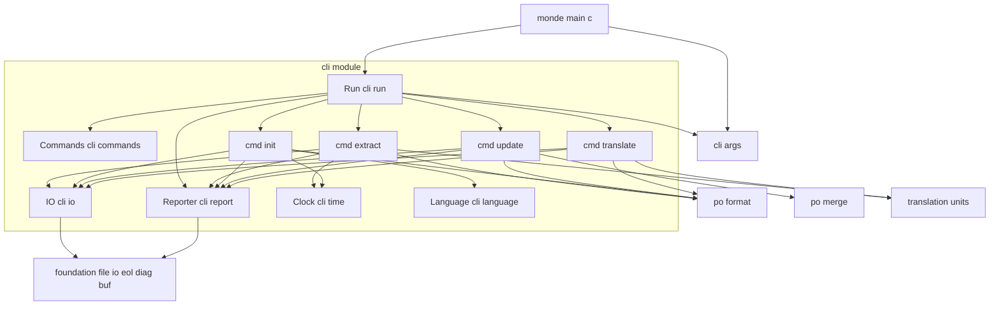
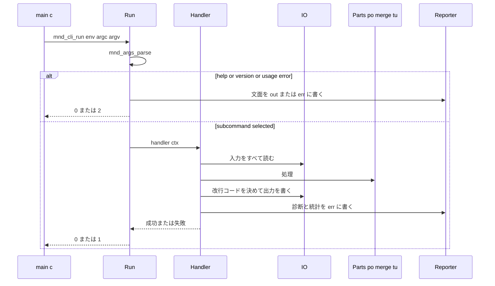

# 技術設計書: monde-cli

## Overview

**Purpose**: monde-cli は、これまでの spec で作った部品（cli-args、po-format、po-merge、translation-units、foundation）を 1 つの実行ファイル `monde` に統合する最上位の層である。`extract` / `init` / `update` / `translate` の 4 サブコマンドで新規翻訳と原文更新の 2 つのフローを実行できるようにし、ファイルと標準入出力の読み書き、統計と診断の表示、終了コードを決める。

**Users**: 翻訳者と文書の保守者が、コマンドラインとシェルスクリプトから使う。docs-and-release は本 spec が作る実行ファイル `monde` をそのまま配布する。

**Impact**: 新しいモジュール `src/cli/`（ライブラリ `monde::cli`）、実行ファイルのターゲット `src/monde/`（`monde`）、テスト `tests/cli/` を追加する。foundation の `file_io` にストリーム（`FILE *`）からの読み書きを追加する。それ以外の既存モジュールは変更しない。

### Goals
- 4 サブコマンドを、各部品の API の順次呼び出しだけで実装する（Monde 固有の論理を CLI に持ち込まない）。
- プロセスを起動せずにサブコマンド全体を Naos でテストでき、かつビルドした実行ファイルでも CommonMark spec の全例のラウンドトリップを検証する。
- `extract` / `init` / `update` の出力が `msgfmt --check` を通ることを、gettext のある環境（CI の Ubuntu）で確かめる。

### Non-Goals
- 翻訳単位の規則、PO の書式、マージの規則、引数の構文解析（各部品が所有する）
- 複数ファイルの一括処理、設定ファイル、方言の選択オプション、翻訳率による出力の制御
- 一時ファイルと rename による出力の原子的な置き換え（research.md の Design Decisions を参照）
- 日本語のドキュメントと GitHub Releases の配布ワークフロー（docs-and-release）

## Boundary Commitments

### This Spec Owns
- 実行ファイル `monde` と、その入口 `mnd_cli_run`・環境構造体 `mnd_cli_env_t`
- サブコマンド・オプション・位置引数の宣言（名前、短い名前、既定値、ヘルプの文面）
- ファイル・標準入出力の読み書きの決定: `-` の解釈、出力先、改行コードの決定、BOM の有無
- 各サブコマンドの手順（部品の呼び出し順）と、部品に渡す値（参照のファイル名、ヘッダの日時と値、言語コード、fuzzy の指定）
- 現在日時と UTC オフセットの取得、言語コードの環境変数からの決定
- 診断と統計の表示形式（本書「メッセージと書式」）と終了コードの対応表
- 実行ファイルを使う受け入れテスト（spec.txt のラウンドトリップ、`msgfmt --check`、起動テスト）と、そのための補助実行ファイルと CMake スクリプト
- foundation に追加するストリームの読み書き関数（`mnd_file_read_stream`、`mnd_file_write_stream`）

### Out of Boundary
- msgid の規則、`#:` / `#.` の内容、再構成の規則と警告（translation-units）
- PO の文法・折り返し・エスケープ・ヘッダの項目の並び、`init` でのヘッダの更新内容（po-format）
- マージの規則と件数の数え方（po-merge）
- 引数の構文（長い・短いオプション、リスト値、`--`）とヘルプの整形（cli-args）
- Windows での `argv` の UTF-8 化（cli-args が提供。本 spec は呼ぶだけ）
- 利用マニュアル、リリースのワークフロー、インストール先の決定（docs-and-release）

### Allowed Dependencies
- 製品コード（`src/cli/`）: C 標準ライブラリ、`monde::cli_args`（`cli_args/args.h`、`cli_args/args_help.h`）、`monde::po`（`po/po.h`、`po/po_read.h`、`po/po_write.h`、`po/po_init.h`）、`monde::po_merge`（`po_merge/merge.h`）、`monde::tu`（`tu/tu.h`）、`monde::foundation`（`buf.h`、`diag.h`、`eol.h`、`file_io.h`）。各部品の `*_internal.h` は使わない。`markdown/` と `yaml/` のヘッダは直接使わない（tu を介する）。
- 実行ファイル（`src/monde/main.c`）: `cli/cli.h`、`cli_args/args_argv.h`、Windows では `<io.h>` / `<fcntl.h>`（`_setmode`）。
- テストコード（`tests/cli/`）: 上記に加えて Naos、`../markdown/spec_reader.c`（spec.txt の読み込み）、CMake の `execute_process`、環境にあれば `msgfmt`。
- モジュール間の依存は `foundation ← cli_args / po ← po_merge / tu ← cli ← monde` の一方向。`cli` は `markdown`、`yaml` に直接依存しない。

### Revalidation Triggers
- サブコマンド名・オプション名・位置引数の順序・終了コード・統計の書式の変更 → docs-and-release（利用マニュアル）、`tests/cli/` の起動テスト
- `mnd_cli_env_t` / `mnd_cli_run` の変更 → `src/monde/main.c`、`tests/cli/`
- `mnd_file_read_stream` / `mnd_file_write_stream` の追加 → foundation の設計書とテスト（本 spec が同時に更新する）
- 上流の API の変更（`mnd_tu_*`、`mnd_po_*`、`mnd_merge_catalogs`、`mnd_args_*`）→ 本 spec のハンドラとテスト

## Architecture

### Existing Architecture Analysis
- 既存の部品はすべてメモリ上のバッファを入出力とし、診断を `mnd_diag_list_t` で返す。表示・終了・時計・環境変数の参照は行わない（各 spec の Adjacent expectations）。
- ファイルの読み書きは foundation の `file_io` に集約されている（`fopen` を直接呼ばない規約）。標準入出力の読み書きも同じ場所に置く。
- 外部ツールを使うテストは、Naos を使わない補助実行ファイル + `cmake -P` スクリプトで書かれている（`tests/tu/msgfmt_check.cmake`）。`find_program` の結果はキャッシュされ、見つからなければ `message(STATUS ...)` して登録しない。

### Architecture Pattern & Boundary Map



**Architecture Integration**:
- Selected pattern: 「薄い統合層」。`Run` が引数を解析してハンドラに振り分け、各ハンドラは「読む → 処理 → 書く → 統計」の同じ骨格で部品を順に呼ぶ。読み書き・改行コード・BOM は `IO`、表示は `Reporter`、時計と環境変数は `Clock` と `Language` に寄せ、ハンドラは呼び出し順だけを持つ。
- Domain/feature boundaries: Monde 固有の知識（何を翻訳するか）は tu に、PO の知識は po に残す。CLI は「どのファイルを、どの改行コードと BOM で、どの値を渡して」処理するかだけを決める。
- Existing patterns preserved: `monde_add_module` / `monde_add_module_tests` / `monde_add_executable`、`src/` 基点の include、診断の返却、`cmake -P` による外部ツールのテスト。
- New components rationale: `IO`（`-` と標準入出力、改行コード、BOM の決定を 1 か所に）、`Reporter`（診断と統計の書式を 1 か所に）、`Clock`・`Language`（実行環境への依存を差し替え可能に）。
- Steering compliance: C99、外部依存なし、Allman、`mnd_cli_` 接頭辞、I/O を境界（CLI 層と foundation）に寄せる、英語のメッセージ。
- モジュール内の依存の方向: `cli.h` ← `cli_run.c` ← `cmd_*.c` ← `cli_io` / `cli_report` / `cli_time` / `cli_language` / `cli_commands`。下位のファイルは上位を include しない。

### Technology Stack

| Layer | Choice / Version | Role in Feature | Notes |
| --- | --- | --- | --- |
| CLI | C99、`monde::cli` + 実行ファイル `monde` | サブコマンドの統合 | 新規。外部依存なし |
| 引数解析 | `monde::cli_args`（既存） | 宣言に基づく解析、ヘルプ、Windows の argv | 変更なし |
| PO / マージ / 翻訳単位 | `monde::po`、`monde::po_merge`、`monde::tu`（既存） | 各サブコマンドの処理 | 変更なし |
| 基盤 | `monde::foundation`（既存 + ストリーム読み書きの追加） | ファイル・標準入出力、改行検出、診断 | `file_io.h` / `file_io.c` に 2 関数を追加 |
| ビルド | CMake 3.21、`monde_add_executable` | `monde` の生成、`MONDE_VERSION` の受け渡し | `project(... VERSION)` から渡す |
| テスト | Naos v0.4.0、CTest、`cmake -P`、gettext の `msgfmt`（任意） | プロセス内テスト、起動テスト、互換性テスト | `msgfmt` は見つかった環境でだけ登録 |

## File Structure Plan

### Directory Structure
```
src/
├── cli/                         # ライブラリ monde::cli（モジュール名 cli、接頭辞 mnd_cli_）
│   ├── CMakeLists.txt           # monde_add_module(cli SOURCES ... DEPENDS cli_args po_merge tu)
│   ├── cli.h                    # 公開: mnd_cli_env_t、mnd_cli_run、終了コードの定数
│   ├── cli_run.c                # Run: 引数の解析結果の分岐、ヘルプ・バージョン・使い方の表示、ハンドラの呼び出し、終了コード
│   ├── cli_commands.h           # Commands: プログラムとサブコマンドの宣言（mnd_args_program_t）、オプション名の定数、ハンドラの型
│   ├── cli_commands.c           # 宣言のテーブル本体
│   ├── cli_internal.h           # ハンドラが共有する文脈の型（mnd_cli_ctx_t）とハンドラ関数の宣言
│   ├── cli_io.h / cli_io.c      # IO: 入力の読み込み（ファイル / -）、出力の書き込み（ファイル / -）、改行コードの決定、BOM
│   ├── cli_report.h / cli_report.c  # Reporter: 診断の表示、使い方のエラーと案内、統計と情報の書式
│   ├── cli_time.h / cli_time.c  # Clock: 現在日時と UTC オフセットから PO の日時文字列を作る
│   ├── cli_language.h / cli_language.c  # Language: --language と環境変数からの言語コードの決定と検査
│   ├── cmd_extract.c            # extract ハンドラ
│   ├── cmd_init.c               # init ハンドラ
│   ├── cmd_update.c             # update ハンドラ
│   └── cmd_translate.c          # translate ハンドラ
└── monde/
    ├── CMakeLists.txt           # monde_add_executable(monde SOURCES main.c LIBRARIES monde::cli monde::cli_args) と MONDE_VERSION の定義
    └── main.c                   # argv の取得（mnd_args_argv_get）、Windows のバイナリモード設定、mnd_cli_env_t の組み立て、mnd_cli_run

tests/
└── cli/
    ├── CMakeLists.txt           # Naos テスト、補助実行ファイル、起動テスト、ラウンドトリップ、msgfmt の登録
    ├── main.c                   # NAOS_MAIN とスイートの宣言
    ├── test_util.h / test_util.c  # 作業ディレクトリのファイルの作成・読み戻し、mnd_cli_run を FILE* 付きで呼ぶ補助、差し替え用の getenv / now
    ├── run_test.c               # スイート run: ヘルプ、バージョン、引数なし、使い方のエラー、終了コード（1.x、9.5〜9.9）
    ├── io_test.c                # スイート io: -o の省略、-、- の重複、同じパスへの上書き、失敗時に出力を作らない、改行コード、BOM（2.x、3.x）
    ├── report_test.c            # スイート report: 診断の書式、dropped、統計の書式と翻訳率の丸め、--quiet（8.x、9.1〜9.4）
    ├── time_test.c              # スイート time: 固定時刻からの日時文字列、正負のオフセット、日付境界（4.2、5.8）
    ├── language_test.c          # スイート language: 優先順位、`.` / `@` の除去、C / POSIX、空、不正な値（5.2〜5.7）
    ├── extract_test.c           # スイート extract: ヘッダの値、--front-matter-keys、#: のファイル名、--no-wrap、空の文書、エラー（4.x）
    ├── init_test.c              # スイート init: Language と PO-Revision-Date、fuzzy の除去、読み込みエラー（5.1、5.9〜5.10）
    ├── update_test.c            # スイート update: 引き継ぎ、--no-fuzzy-matching、ヘッダの保持、同じパスへの上書き、エラー（6.x）
    ├── translate_test.c         # スイート translate: 置き換え、--use-fuzzy、--front-matter-keys、警告、エラー、廃止・msgctxt の無視（7.x）
    ├── roundtrip_test.c         # スイート roundtrip: spec.txt の全例 × original / CRLF × 空カタログ / msgstr = msgid をプロセス内で検証（10.1〜10.3）
    ├── spec_split_main.c        # 補助実行ファイル cli_spec_split（Naos 不要）: spec.txt の例を <dir>/<番号>.md と <番号>.crlf.md に展開
    ├── roundtrip.cmake          # cmake -P: 展開した例ごとに monde extract → monde translate を起動して原文と比較、失敗した例の番号を列挙（10.1、10.3〜10.4）
    ├── cli_case.cmake           # cmake -P: 1 ケースの起動テスト（引数、標準入力、期待する標準出力・終了コード・標準エラー出力の部分一致）（10.6）
    ├── gettext_check.cmake      # cmake -P: extract → init → update を monde で実行し、3 つの出力を msgfmt --check にかける（11.1）
    └── data/                    # 起動テストと msgfmt テストの入力と期待値（sample.md、sample_old.po、期待する .pot / .po / .md）
```

### Modified Files
- `src/foundation/file_io.h`、`src/foundation/file_io.c` — `mnd_file_read_stream` / `mnd_file_write_stream` を追加し、`mnd_file_read` / `mnd_file_write` をその上に実装し直す（既存の挙動と診断の文言は変えない）。
- `tests/foundation/file_io_test.c` — ストリーム版の読み書き（BOM、空、不正な UTF-8、書き込み失敗）のテストを追加。
- `src/CMakeLists.txt` — `add_subdirectory(cli)`、`add_subdirectory(monde)` を追加。
- `tests/CMakeLists.txt` — `add_subdirectory(cli)` を追加。
- `.kiro/steering/structure.md` — 予約済みの短縮名に `cli` を追加し、実行ファイルの置き場所（`src/monde/`）を追記。
- `.github/workflows/ci.yml` — 変更なし（gettext は Linux で導入済み。`monde` のビルドとテストは既存の 3 行に含まれる）。

## System Flows

### サブコマンドの共通の流れ



- 入力は処理の前にすべてメモリに読む。出力は処理が成功したときにだけ 1 回書く（2.7、2.8）。
- 診断は、ハンドラの途中で失敗しても、それまでに集まったものをすべて表示してから終了する（9.4）。
- 警告だけなら出力を書き、終了コードは 0（7.7、9.5）。

### 改行コードと BOM の決定

| サブコマンド | 主となる入力 | 出力の改行コード | 出力の BOM |
| --- | --- | --- | --- |
| extract | `.md` | `mnd_eol_detect(.md).dominant`（NONE → LF） | なし |
| init | `.pot` | 同上（`.pot`） | なし |
| update | 既存の `.po` | 同上（既存の `.po`） | なし |
| translate | `.md` | 同上（`.md`） | `.md` に BOM があれば付ける |

## Requirements Traceability

| Requirement | Summary | Components | Interfaces | Flows |
| --- | --- | --- | --- | --- |
| 1.1 | 4 サブコマンド | Commands | `mnd_cli_program` | — |
| 1.2, 1.3 | ヘルプの表示先と終了コード | Run, Reporter | `mnd_cli_run`、`mnd_args_format_help` | 共通の流れ |
| 1.4 | `--version` | Run, main.c | `mnd_cli_env_t.version` | — |
| 1.5 | 引数なし → 使い方と 2 | Run | `MND_ARGS_NO_COMMAND` の分岐 | — |
| 1.6 | 引数の誤り → メッセージ + 案内 + 2 | Run, Reporter | `mnd_cli_report_usage_error` | — |
| 1.7 | 順序によらない解析 | Commands（cli-args に委ねる） | `mnd_args_parse` | — |
| 1.8 | Windows の UTF-8 引数 | main.c | `mnd_args_argv_get` | — |
| 2.1, 2.2 | 位置引数と `-o` | Commands | 宣言テーブル | — |
| 2.3, 2.4 | `-o` 省略・`-` | IO | `mnd_cli_read_input`、`mnd_cli_write_output` | — |
| 2.5 | `-` の重複 | IO, Run | `mnd_cli_check_stdin_once` | — |
| 2.6〜2.8 | 上書き・同じパス・失敗時に書かない | IO, 各ハンドラ | 共通の流れ | 共通の流れ |
| 2.9 | 入出力のエラー → 1 | IO, Run | foundation の診断 | — |
| 2.10 | 結果と統計の分離 | Reporter, IO | `env->out` / `env->err` | — |
| 3.1, 3.2 | UTF-8 と BOM の除去 | IO（foundation） | `mnd_file_read`、`mnd_file_read_stream` | — |
| 3.3〜3.5 | 改行コードの決定 | IO | `mnd_cli_choose_eol` | 改行コードと BOM の決定 |
| 3.6, 3.7 | BOM の出力 | IO, cmd_translate | `mnd_cli_write_output(add_bom)` | 同上 |
| 3.8 | 標準入出力の無変換 | main.c, foundation | `_setmode`、`mnd_file_*_stream` | — |
| 4.1〜4.10 | extract | cmd_extract, Clock, IO, Reporter | `mnd_tu_scan` → `mnd_po_header_template` → `mnd_tu_extract` → `mnd_po_write` | — |
| 5.1〜5.10 | init | cmd_init, Language, Clock, Reporter | `mnd_po_read` → `mnd_po_init` → `mnd_po_write` | — |
| 6.1〜6.7 | update | cmd_update, IO, Reporter | `mnd_po_read` ×2 → `mnd_merge_catalogs` → `mnd_po_write` | — |
| 7.1〜7.9 | translate | cmd_translate, IO, Reporter | `mnd_po_read` → `mnd_tu_scan` → `mnd_tu_translate` | — |
| 8.1〜8.8 | 統計と `--quiet` | Reporter, Commands | `mnd_cli_report_*` | — |
| 9.1〜9.4 | 診断の書式 | Reporter | `mnd_cli_report_diags` | — |
| 9.5〜9.9 | 終了コード、英語 | Run | `MND_CLI_EXIT_*` | 共通の流れ |
| 10.1〜10.4 | spec.txt のラウンドトリップ | tests: roundtrip_test, cli_spec_split, roundtrip.cmake | — | — |
| 10.5 | spec.txt の無改変・非同梱 | tests/cli/CMakeLists.txt | `MND_MD_SPEC_FILE` | — |
| 10.6 | 実行ファイルの起動テスト | tests: cli_case.cmake | — | — |
| 11.1〜11.4 | msgfmt --check | tests: gettext_check.cmake、CI | `find_program(MONDE_MSGFMT)` | — |
| 12.1〜12.4 | 実行ファイルのビルド | src/monde | `monde_add_executable`、`MONDE_VERSION` | — |

## Components and Interfaces

| Component | Domain/Layer | Intent | Req Coverage | Key Dependencies (P0/P1) | Contracts |
| --- | --- | --- | --- | --- | --- |
| main.c | 実行ファイル | argv と標準入出力の準備、`mnd_cli_run` の呼び出し | 1.4, 1.8, 3.8, 12.x | cli_args argv (P0), Run (P0) | Service |
| Run | cli | 解析結果の分岐、表示、終了コード | 1.2〜1.6, 2.5, 9.5〜9.9 | cli_args (P0), Reporter (P0) | Service |
| Commands | cli | 宣言テーブルとハンドラの対応 | 1.1, 1.7, 2.1, 2.2, 8.7 | cli_args (P0) | State |
| IO | cli | 入力の読み込み、出力の書き込み、改行コード、BOM | 2.3〜2.10, 3.1〜3.7 | foundation file_io / eol (P0) | Service |
| Reporter | cli | 診断・使い方のエラー・統計・情報の書式 | 1.6, 8.x, 9.1〜9.4 | foundation diag (P0) | Service |
| Clock | cli | 現在日時 → PO の日時文字列 | 4.2, 5.8 | po `mnd_po_date_format` (P0) | Service |
| Language | cli | 言語コードの決定と検査 | 5.2〜5.7 | — | Service |
| cmd_extract | cli | `.md` → `.pot` | 4.1〜4.10 | tu (P0), po (P0), IO, Clock, Reporter | Service |
| cmd_init | cli | `.pot` → `.po` | 5.1, 5.8〜5.10 | po (P0), Language, Clock, IO, Reporter | Service |
| cmd_update | cli | `.pot` + `.po` → `.po` | 6.1〜6.7 | po (P0), po_merge (P0), IO, Reporter | Service |
| cmd_translate | cli | `.md` + `.po` → `.md` | 7.1〜7.9 | tu (P0), po (P0), IO, Reporter | Service |
| foundation stream I/O | foundation | `FILE *` からの読み込みと書き込み | 2.4, 3.1, 3.8 | — | Service |
| テスト基盤 | tests/cli | プロセス内テスト、起動テスト、ラウンドトリップ、msgfmt | 10.x, 11.x | Naos, CMake, spec_reader | Batch |

### 公開

#### Run（`cli.h`、`cli_run.c`）

| Field | Detail |
| --- | --- |
| Intent | `mnd_cli_run` の提供。引数の解析結果を分岐し、ハンドラを呼び、終了コードを返す |
| Requirements | 1.2〜1.6, 2.5, 2.9, 9.4〜9.9 |

**Responsibilities & Constraints**
- `mnd_args_parse` の `mnd_args_status_t` を次のとおり扱う。

| 状態 | 動作 | 終了コード |
| --- | --- | --- |
| `MND_ARGS_HELP` | `mnd_args_format_help` の文面を `out` に書く | 0 |
| `MND_ARGS_VERSION` | `mnd_args_format_version` の文面を `out` に書く | 0 |
| `MND_ARGS_NO_COMMAND` | 全体のヘルプを `err` に書く | 2 |
| `MND_ARGS_USAGE_ERROR` | 診断を `monde: error: <message>` の形で `err` に書き、`mnd_args_format_usage_hint` の案内を続ける | 2 |
| `MND_ARGS_DECL_ERROR`、`MND_ARGS_OUT_OF_MEMORY` | 診断を `err` に書く（内部エラー） | 1 |
| `MND_ARGS_OK` | `command->name` に対応するハンドラを呼ぶ | ハンドラの結果 |

- ハンドラに渡す文脈 `mnd_cli_ctx_t`（`cli_internal.h`）は、`env`、解析結果 `mnd_args_result_t`、診断の一覧 `mnd_diag_list_t`、`quiet` を持つ。
- ハンドラの戻り値は `bool`（成功 / 失敗）。Run は戻り値にかかわらず診断を `Reporter` で表示し、成功なら 0、失敗なら 1 を返す。
- `mnd_args_result_t` と診断の一覧の解放は Run が行う。

**Contracts**: Service [x]

##### Service Interface
```c
/* cli/cli.h */
typedef const char *(*mnd_cli_getenv_fn)(const char *name);  /* NULL なら getenv */
typedef time_t (*mnd_cli_now_fn)(void);                        /* NULL なら time(NULL) */

typedef struct mnd_cli_env
{
    FILE *in;                   /* 標準入力として使うストリーム（バイナリモード） */
    FILE *out;                  /* 標準出力 */
    FILE *err;                  /* 標準エラー出力 */
    const char *version;        /* --version に表示するバージョン文字列 */
    mnd_cli_getenv_fn getenv;   /* 環境変数の参照 */
    mnd_cli_now_fn now;         /* 現在時刻 */
} mnd_cli_env_t;

#define MND_CLI_EXIT_OK 0
#define MND_CLI_EXIT_FAILURE 1
#define MND_CLI_EXIT_USAGE 2

/* argv[0] はプログラム名。戻り値はプロセスの終了コード */
int mnd_cli_run(const mnd_cli_env_t *env, int argc, char *const *argv);
```
- Preconditions: `env` と `env->in/out/err` は NULL でない。ストリームはバイナリモードで開かれている（Windows では呼び出し側が設定する）。
- Postconditions: 戻り値は 0 / 1 / 2 のいずれか。`out` には結果（または `--help` / `--version` の文面）だけが、`err` には診断・統計・使い方の文面だけが書かれる。確保した資源はすべて解放されている。
- Invariants: `mnd_cli_run` はプロセスを終了しない（`exit` を呼ばない）。メッセージはすべて英語。

#### main.c（`src/monde/main.c`）
- `mnd_args_argv_get` で UTF-8 の引数列を得る（失敗なら `monde: error: <message>` を標準エラー出力に書いて 1）。
- Windows では `_setmode(_fileno(stdin|stdout|stderr), _O_BINARY)` を呼んでから `mnd_cli_run` を呼ぶ（3.8）。
- `mnd_cli_env_t` は `stdin` / `stdout` / `stderr`、`MONDE_VERSION`（CMake のコンパイル定義 `"${PROJECT_VERSION}"`）、`getenv = NULL`、`now = NULL` で組む（12.4）。
- 戻り値をそのままプロセスの終了コードにする。

### 内部

#### Commands（`cli_commands.h` / `cli_commands.c`）

| Field | Detail |
| --- | --- |
| Intent | `mnd_args_program_t` の宣言テーブルと、サブコマンド名からハンドラへの対応 |
| Requirements | 1.1, 1.7, 2.1, 2.2, 4.3〜4.5, 4.8, 5.2, 5.9, 6.3, 6.5, 7.3, 7.4, 8.7 |

**宣言（名前は定数 `MND_CLI_OPT_*` としてヘッダに置く）**

| サブコマンド | 位置引数（min = max） | オプション |
| --- | --- | --- |
| `extract` | `INPUT`（1） | `-o/--output FILE`、`-q/--quiet`、`--front-matter-keys KEYS`（リスト）、`--project-id-version NAME`、`--msgid-bugs-address ADDRESS`、`--no-wrap` |
| `init` | `TEMPLATE`（1） | `-o/--output FILE`、`-q/--quiet`、`-l/--language CODE`、`--no-wrap` |
| `update` | `TEMPLATE PO`（2） | `-o/--output FILE`、`-q/--quiet`、`--no-fuzzy-matching`、`--no-wrap` |
| `translate` | `INPUT PO`（2） | `-o/--output FILE`、`-q/--quiet`、`--front-matter-keys KEYS`（リスト）、`--use-fuzzy` |

- プログラム名 `monde`、説明 `Translate Markdown documents through gettext .pot/.po files.`、バージョンは `env->version` を実行時に埋める（宣言は `static const` のテーブルを複製して `version` だけ差し替える）。
- `--output` は必須にしない（省略で標準出力、2.3）。`--language` も必須にしない（環境変数の既定値、5.3）。
- ハンドラの型: `typedef bool (*mnd_cli_handler_fn)(mnd_cli_ctx_t *ctx);`。`mnd_cli_find_handler(const char *name)` で引く。

**Contracts**: State [x]

#### IO（`cli_io.h` / `cli_io.c`）

| Field | Detail |
| --- | --- |
| Intent | 入力の読み込み（ファイルまたは標準入力）、出力の書き込み（ファイルまたは標準出力）、改行コードの決定 |
| Requirements | 2.3〜2.10, 3.1〜3.7 |

##### Service Interface
```c
/* 読み込んだ入力。content は BOM 除去後 */
typedef struct mnd_cli_input
{
    const char *path;      /* 指定されたパス。標準入力なら "-" */
    mnd_buf_t content;
    bool had_bom;
    mnd_eol_info_t eol;    /* content の改行の情報 */
} mnd_cli_input_t;

#define MND_CLI_INPUT_INIT { NULL, MND_BUF_INIT, false, { MND_EOL_NONE, false, 0, 0 } }

/* path が "-" なら env->in から、そうでなければファイルから読む。失敗: 診断を追加して false */
bool mnd_cli_read_input(const mnd_cli_env_t *env, const char *path, mnd_cli_input_t *out,
                        mnd_diag_list_t *diags);
void mnd_cli_input_free(mnd_cli_input_t *input);

/* 出力先。path が NULL または "-" なら env->out に、そうでなければファイルに 1 回で書く。失敗: 診断を追加して false */
bool mnd_cli_write_output(const mnd_cli_env_t *env, const char *path, const char *data, size_t len,
                          bool add_bom, mnd_diag_list_t *diags);

/* 主となる入力の改行コードから出力の改行コードを決める（NONE → LF） */
mnd_eol_t mnd_cli_choose_eol(const mnd_eol_info_t *info);

/* 位置引数のうち "-" が 2 つ以上なら使い方のエラーの診断を追加して false */
bool mnd_cli_check_stdin_once(const mnd_args_result_t *result, mnd_diag_list_t *diags);
```
- 標準入力は `mnd_file_read_stream(env->in, "-", ...)`、標準出力は `mnd_file_write_stream(env->out, ...)` で読み書きする。診断のパスは `"-"`。
- `mnd_cli_write_output` は `fflush` まで行い、その失敗も書き込みの失敗として扱う。
- 改行コード: `dominant` が `MND_EOL_NONE` なら `MND_EOL_LF`、それ以外はそのまま（3.3〜3.5。同数の扱いは `mnd_eol_detect` に従う）。

**Contracts**: Service [x]

#### Reporter（`cli_report.h` / `cli_report.c`）

| Field | Detail |
| --- | --- |
| Intent | 診断、使い方のエラー、統計、情報の文面を `err` に書く |
| Requirements | 1.6, 5.6, 8.1〜8.8, 9.1〜9.4 |

##### Service Interface
```c
/* 診断を順にすべて書く。dropped なら最後に "monde: error: some diagnostics were dropped (out of memory)" */
void mnd_cli_report_diags(FILE *err, const mnd_diag_list_t *diags);

/* 統計。quiet なら何も書かない */
void mnd_cli_report_extract(FILE *err, bool quiet, size_t messages);
void mnd_cli_report_init(FILE *err, bool quiet, size_t messages, const char *language);
void mnd_cli_report_init_language_source(FILE *err, bool quiet, const char *language, const char *variable);
void mnd_cli_report_update(FILE *err, bool quiet, const mnd_merge_stats_t *stats);
void mnd_cli_report_translate(FILE *err, bool quiet, const mnd_tu_stats_t *stats);
```

**メッセージと書式**（すべて英語、1 件 1 行、改行は `\n`）

| 種類 | 書式 |
| --- | --- |
| 診断（パスと行あり） | `<path>:<line>: error: <message>` / `<path>:<line>: warning: <message>` |
| 診断（行なし） | `<path>: error: <message>` |
| 診断（パスなし） | `monde: error: <message>` |
| 使い方のエラー | `monde: error: <message>` の次の行に `Run 'monde <subcommand> --help' for usage.`（cli-args の案内） |
| extract の統計 | `extract: <N> messages` |
| init の統計 | `init: <N> messages, language <code>` |
| init の言語の出どころ | `init: using language '<code>' from <VARIABLE>`（`--language` のときは出さない） |
| update の統計 | `update: <matched> matched, <fuzzy> fuzzy, <added> added, <obsoleted> obsoleted` |
| translate の統計 | `translate: <translated> translated, <fuzzy> fuzzy, <untranslated> untranslated, <missing> missing, <total> total, <rate> translated`（`<rate>` は `66.7%` の形） |
| translate（合計 0） | `translate: no translatable messages` |

- 翻訳率は `translated ÷ total` を 0.1% 単位に四捨五入する（整数演算: `(translated * 1000 + total / 2) / total` を `%zu.%zu%%` で表示）。fuzzy は採用の有無にかかわらず翻訳済みに数えない（8.5）。
- `--quiet` は統計と情報だけを抑止し、診断は抑止しない（8.7）。

**Contracts**: Service [x]

#### Clock（`cli_time.h` / `cli_time.c`）

| Field | Detail |
| --- | --- |
| Intent | `env->now` の時刻を、ローカル時刻と UTC オフセットで PO の日時文字列にする |
| Requirements | 4.2, 5.8 |

##### Service Interface
```c
/* "YYYY-MM-DD HH:MM+ZZZZ" を out に書く。失敗（localtime / gmtime が NULL、整形の失敗）なら診断を追加して false */
bool mnd_cli_format_now(const mnd_cli_env_t *env, char out[MND_PO_DATE_SIZE], mnd_diag_list_t *diags);
```
- オフセットは `localtime` と `gmtime` の結果の差（年月日時分を通算の分に直した差）で求め、`mnd_po_date_format` に渡す。DST は `localtime` の結果に含まれる。

**Contracts**: Service [x]

#### Language（`cli_language.h` / `cli_language.c`）

| Field | Detail |
| --- | --- |
| Intent | `--language` と環境変数から言語コードを決め、検査する |
| Requirements | 5.2〜5.7 |

##### Service Interface
```c
typedef struct mnd_cli_language
{
    const char *code;      /* 決定した言語コード（確保した文字列。呼び出し側が free） */
    const char *variable;  /* 環境変数から決めたときはその名前。--language なら NULL */
} mnd_cli_language_t;

/*
 * explicit が NULL でなければそれを使う。NULL なら LC_ALL → LC_MESSAGES → LANG の順に env->getenv で引き、
 * 空・"C"・"POSIX"（"." / "@" 以降を除いた後で判定）は未設定として次を見る。
 * 値は "." / "@" 以降を除く。決まらなければ使い方のエラー（--language を求める）、
 * 値が空か空白・制御文字を含めば使い方のエラー（値と出どころを示す）。どちらも診断を追加して false
 */
bool mnd_cli_resolve_language(const mnd_cli_env_t *env, const char *explicit,
                              mnd_cli_language_t *out, mnd_diag_list_t *diags);
```
- 使い方のエラーは Run の終了コード 2 に対応付けるため、ハンドラは失敗の種類を `mnd_cli_ctx_t.usage_error = true` で Run に伝える（Run はこのフラグが立っていれば 1 ではなく 2 を返す）。

**Contracts**: Service [x]

#### cmd_extract（`cmd_extract.c`）

| Field | Detail |
| --- | --- |
| Intent | `.md` を読み、ヘッダ付きの翻訳テンプレートを書く |
| Requirements | 4.1〜4.10 |

**手順**
1. `mnd_cli_read_input(INPUT)`。
2. `mnd_tu_scan(content, { path = INPUT, front_matter_keys = --front-matter-keys の項目 })`（4.5、4.6、4.9）。
3. カタログにヘッダを `mnd_po_header_template(header, --project-id-version or NULL, now)` で加え、`--msgid-bugs-address` があれば `mnd_po_header_set(header, "Report-Msgid-Bugs-To", value)`（4.2〜4.4）。
4. `mnd_tu_extract(doc, ref_file = INPUT（標準入力なら "-"）, catalog)`（4.7）。
5. `mnd_po_write(catalog, { no_wrap = --no-wrap, eol = choose_eol(.md) })`（4.8、3.3）。
6. `mnd_cli_write_output(-o, add_bom = false)`（3.7）、`mnd_cli_report_extract(catalog.count - 1)`（8.1）。
- 翻訳単位が 0 件でもヘッダだけのテンプレートを書く（4.10）。

#### cmd_init（`cmd_init.c`）

| Field | Detail |
| --- | --- |
| Intent | `.pot` を読み、言語を決めて `.po` を書く |
| Requirements | 5.1〜5.10 |

**手順**
1. `mnd_cli_resolve_language(--language)`（5.2〜5.7。失敗は使い方のエラー）。
2. `mnd_cli_read_input(TEMPLATE)`、`mnd_po_read`（5.10）。
3. `mnd_cli_format_now` → `mnd_po_init(catalog, code, now)`（5.1、5.8）。
4. `mnd_po_write({ no_wrap, eol = choose_eol(.pot) })` → `mnd_cli_write_output(add_bom = false)`。
5. 環境変数から決めたときは `mnd_cli_report_init_language_source`（5.6）、`mnd_cli_report_init(count - header, code)`（8.2）。

#### cmd_update（`cmd_update.c`）

| Field | Detail |
| --- | --- |
| Intent | `.pot` と既存の `.po` を読み、マージした `.po` を書く |
| Requirements | 6.1〜6.7 |

**手順**
1. `mnd_cli_check_stdin_once`、`mnd_cli_read_input(TEMPLATE)`、`mnd_cli_read_input(PO)`（両方読み終えてから次へ。2.7）。
2. `mnd_po_read` × 2（診断のパスはそれぞれの指定（6.6））。
3. `mnd_merge_catalogs(tpl, TEMPLATE, old, PO, { fuzzy_matching = !--no-fuzzy-matching }, out, stats)`（6.1〜6.4）。
4. `mnd_po_write({ no_wrap, eol = choose_eol(既存 .po) })` → `mnd_cli_write_output(add_bom = false)`（6.7）。
5. `mnd_cli_report_update(stats)`（8.3）。

#### cmd_translate（`cmd_translate.c`）

| Field | Detail |
| --- | --- |
| Intent | `.md` と `.po` を読み、翻訳済み Markdown を書く |
| Requirements | 7.1〜7.9 |

**手順**
1. `mnd_cli_check_stdin_once`、`mnd_cli_read_input(INPUT)`、`mnd_cli_read_input(PO)`。
2. `mnd_po_read(PO)`（7.8）。
3. `mnd_tu_scan(content, { path = INPUT, front_matter_keys })`（7.4）。
4. `mnd_tu_translate(doc, catalog, { use_fuzzy = --use-fuzzy, eol = choose_eol(.md), catalog_path = PO }, out, stats)`（7.1〜7.3、7.5〜7.7、7.9）。
5. `mnd_cli_write_output(-o, add_bom = input.had_bom)`（3.6）、`mnd_cli_report_translate(stats)`（8.4〜8.6）。
- 警告だけなら成功として扱う（7.7）。

#### foundation stream I/O（`src/foundation/file_io.h` / `file_io.c`）

| Field | Detail |
| --- | --- |
| Intent | `FILE *` からの読み込みと書き込み。既存のファイル版はこの上に乗せる |
| Requirements | 2.4, 3.1, 3.8 |

##### Service Interface
```c
/* fp を終端まで読み、BOM を除いた内容を content に入れる。name は診断に付けるパス（NULL 可）。UTF-8 を検証する */
bool mnd_file_read_stream(FILE *fp, const char *name, mnd_buf_t *content, bool *had_bom,
                          mnd_diag_list_t *diags);

/* data の len バイトを fp に書き、fflush する。add_bom が真なら先頭に BOM を書く。name は診断用 */
bool mnd_file_write_stream(FILE *fp, const char *name, const char *data, size_t len, bool add_bom,
                           mnd_diag_list_t *diags);
```
- `mnd_file_read` は `mnd_file_open("rb")` → `mnd_file_read_stream` → `fclose`、`mnd_file_write` は `mnd_file_open("wb")` → `mnd_file_write_stream` → `fclose` に置き換える。既存の診断の文言（`cannot open file for reading: ...` など）とテストは変えない。
- ストリーム版は `fclose` しない（所有権は呼び出し側）。

**Contracts**: Service [x]

#### テスト基盤（`tests/cli/`）

| Field | Detail |
| --- | --- |
| Intent | プロセス内テスト、実行ファイルの起動テスト、spec.txt のラウンドトリップ、`msgfmt --check` |
| Requirements | 10.1〜10.6, 11.1〜11.4 |

##### Batch / Job Contract
- **プロセス内テスト（Naos）**: `test_util` が作業ディレクトリ（`MONDE_CLI_TEST_WORK_DIR`、CMake が構成時に作る）にファイルを書き、`in` / `out` / `err` を作業ディレクトリのファイルで開いて `mnd_cli_run` を呼び、結果を読み戻す。`getenv` と `now` は表と固定値に差し替える。
- **cli_spec_split**（Naos 不要、`spec_reader.c` にリンク）: `cli_spec_split <spec.txt> <dir>` で、例ごとに `<dir>/<番号 3 桁>.md`（原文）と `<番号>.crlf.md`（LF → CRLF）を書く。終了コードで成否を返す。
- **roundtrip.cmake**: `-DMONDE=<実行ファイル> -DDIR=<展開先> -DVARIANT=md|crlf.md -DWORK=<作業先>`。各例について `monde extract <例> -o <work>/<n>.pot` → `monde translate <例> <work>/<n>.pot -o <work>/<n>.out` → `compare_files` を行い、失敗した例の番号を集めて最後に一覧で `FATAL_ERROR`。CTest には `cli_roundtrip.original` と `cli_roundtrip.crlf` の 2 件（`FIXTURES_REQUIRED cli_spec`、展開は `cli_spec_split` を `FIXTURES_SETUP` で 1 回）。msgstr = msgid の検査（10.2）はプロセス内テストで行う。
- **cli_case.cmake**: `-DMONDE -DARGS=<;区切り> [-DSTDIN=<file>] -DEXPECT_EXIT=<n> [-DEXPECT_STDOUT=<file>] [-DEXPECT_STDERR_CONTAINS=<text>] -DWORK=<dir>`。1 ケースを `execute_process` で実行し、終了コードと標準出力（バイト比較）と標準エラー出力（部分一致）を確かめる。登録するケース: `--help`、`--version`、引数なし（2）、未知のオプション（2）、`extract`（ファイルと `-`、標準入力）、`init`（`-l`、環境変数なしで 2）、`update`、`translate`（BOM、CRLF）、存在しない入力（1）。
- **gettext_check.cmake**: `-DMONDE -DMSGFMT -DDATA=<tests/cli/data> -DWORK=<dir>`。`monde extract data/sample.md --front-matter-keys title,description -o work/sample.pot` → `monde init work/sample.pot -l ja -o work/ja.po` → `monde update work/sample.pot data/sample_old.po -o work/merged.po` を実行し、3 つの出力それぞれに `msgfmt --check -o <out>.mo` をかける。`find_program(MONDE_MSGFMT msgfmt)` が見つかった環境でだけ `cli_msgfmt_check.flow` として登録し、なければ `message(STATUS "cli: msgfmt not found; the cli_msgfmt_check tests are not registered")`（11.2〜11.3）。
- spec.txt は `MND_MD_SPEC_FILE`（`tests/data/commonmark/spec.txt`）から読み、コピーも改変もしない。`monde` のターゲットとリリースの成果物に含めない（10.5）。
- すべての CTest テストにラベル `cli` を付ける。

## Error Handling

### Error Strategy
- 部品の診断はすべて `mnd_cli_ctx_t.diags` に集め、ハンドラの成否にかかわらず Run が `mnd_cli_report_diags` で表示する（9.1〜9.4）。
- 終了コードの対応表:

| 状況 | 終了コード |
| --- | --- |
| 成功（警告のみを含む）、`--help`、`--version` | 0 |
| 入力の内容のエラー（PO の構文、UTF-8、YAML、キーパス、訳文）、ファイル入出力のエラー、標準出力への書き込みの失敗、メモリ不足、cli-args の宣言エラー | 1 |
| 引数の誤り（cli-args の使い方のエラー、引数なし、`-` の重複、言語コードが決まらない・不正） | 2 |

- エラーで終了するとき、出力先のファイルは作成も変更もされない（出力は成功後に 1 回だけ書く。2.8、9.8）。標準出力への書き込みの途中で失敗した場合は、部分的な出力が残り得るが終了コード 1 で知らせる。
- `mnd_diag_list_t.dropped` が真なら、表示の最後に固定のメッセージを足し、成功として扱わない（`mnd_diag_list_has_error` が真になるため）。

## Testing Strategy

### Unit Tests（Naos、プロセス内）
- Run: `--help` / `-h` / `help` / `help <sub>` が `out` に出て 0、引数なしで `err` に使い方が出て 2、未知のサブコマンド・オプションで `monde: error:` + 案内が出て 2、`--version` が `monde <version>`（1.2〜1.6、9.5〜9.9）。
- IO: `-o` 省略で `out` に書く、`-` で `in` から読む、`-` の重複で 2、入力が存在しないとき出力が作られず 1、`update` で出力先 = 既存 `.po` のときに内容が引き継がれる、LF / CRLF / 混在 / 改行なしの入力に対する出力の改行コード、`translate` の BOM の保持と `.pot` / `.po` の BOM なし（2.3〜2.9、3.3〜3.7）。
- Reporter: 診断の 3 形式と順序、`dropped`、各統計の書式、翻訳率の丸め（`2/3` → `66.7%`、`0/0` → `no translatable messages`）、`--quiet` が統計だけを抑止（8.x、9.1〜9.4）。
- Clock: 固定の `now` と環境の時刻で、`+0900`、`-0500`、`+0000`、`+0530`、日付境界をまたぐオフセットの文字列（4.2、5.8）。
- Language: `--language` 優先、`LC_ALL` → `LC_MESSAGES` → `LANG`、`ja_JP.UTF-8@euro` → `ja_JP`、`C` / `POSIX` / `C.UTF-8` / 空は未設定、どれもなければ 2、空白を含む値は 2（5.2〜5.7）。
- 各ハンドラ: 上記の File Structure Plan のスイートに列挙したとおり。期待値は上流の部品のテストと重複させず、CLI が渡す値（ヘッダの項目、`#:` のファイル名、`use_fuzzy`、`fuzzy_matching`、`no_wrap`、`eol`）が結果に現れることを確かめる。
- foundation: `mnd_file_read_stream` / `mnd_file_write_stream` の BOM、空、不正な UTF-8、`fflush` の失敗（閉じたストリームへの書き込み）。

### Integration / Acceptance Tests
- `cli_tests.roundtrip.*`: spec.txt の 652 例 × { original, CRLF } × { 空のカタログ, msgstr = msgid } をプロセス内で `extract` → `translate` し、入力とバイト単位で比較。失敗した例の番号と変種をメモに出す（10.1〜10.4）。
- `cli_roundtrip.original` / `cli_roundtrip.crlf`: ビルドした `monde` で全例を起動して比較（10.1、10.3、10.4）。
- `cli_case.*`: 実行ファイルの起動テスト（10.6）。
- `cli_msgfmt_check.flow`: `extract` → `init` → `update` の出力が `msgfmt --check` を通る（11.1〜11.4）。

### 全体にかかわる確認
- CI の 5 環境で `monde` のビルドと `ctest` が通る（12.1〜12.3）。
- `monde --version` が `project(monde VERSION ...)` の値を表示する（12.4）。

## Security Considerations
- 入力はすべて UTF-8 として検証し、不正なバイト列は処理前にエラーにする（foundation と部品に委ねる）。
- 環境変数は `init` の言語コードにしか使わず、値は ASCII の範囲で検査してからヘッダに書く。パスは利用者が指定したものをそのまま使い、CLI が生成・推定しない。

## Performance & Scalability
- 性能目標はない（steering）。入力は全体をメモリに読む（1 ファイル単位の前提）。
- 実行ファイルの起動テストは Linux で数秒、Windows で数十秒の見込み。許容できなければ `cli_roundtrip.*` を抜き取り（例えば 50 例ごと）に減らし、プロセス内の `roundtrip` スイートを全例の正とする（Open Questions）。

## Open Questions / Risks
- Windows の CI での `cli_roundtrip.*` の所要時間。実測して長ければ上記のとおり抜き取りに変える（要件 10.1 の「実行ファイルで」は抜き取り + プロセス内の全例で満たすと読み替え、要件の「要件確認で決めた挙動」に追記する）。
- `getenv` の値が Windows で ANSI の場合、非 ASCII の言語コードは検査で弾かれる（空白・制御文字ではないので通る可能性がある）。言語コードは ASCII に限る検査を追加するかは実装時に判断し、テストで固定する。
