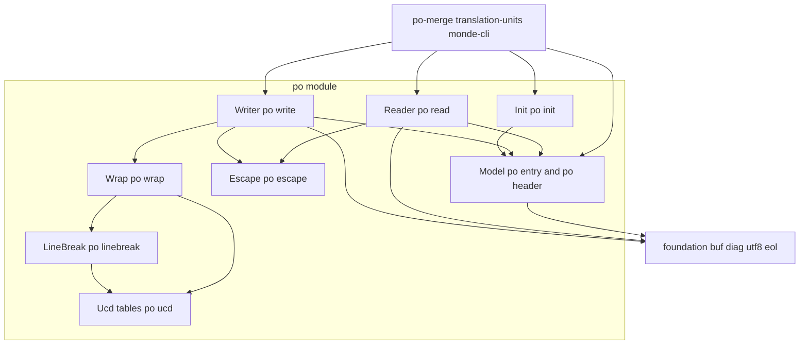
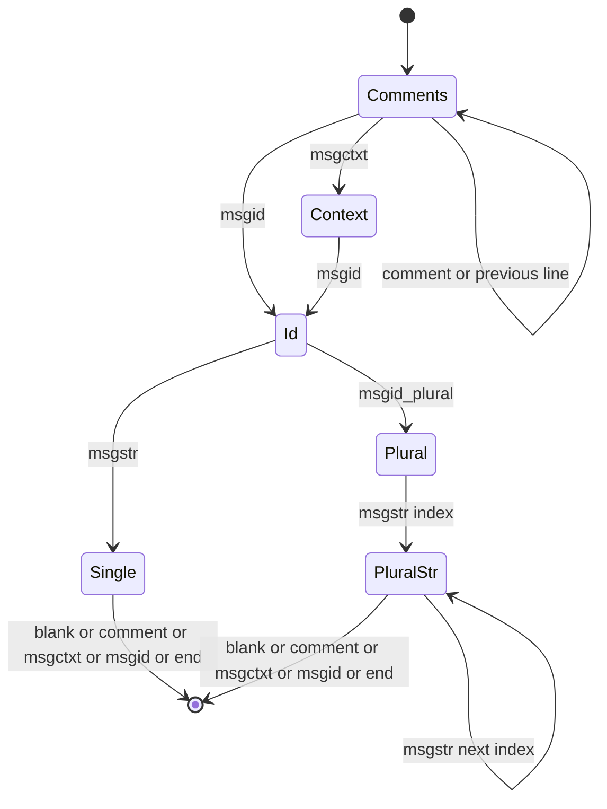

# 技術設計書: po-format

## Overview

**Purpose**: po-format は、GNU gettext の翻訳テンプレート（`.pot`）と翻訳ファイル（`.po`）を、外部ライブラリなしで読み書きする汎用の部品である。PO の内容（メモリ上のバイト列）をエントリの列（カタログ）に変換するリーダーと、カタログを gettext と同じ形式で書き出すライターを提供する。ライターの折り返しは gettext と同じ位置で行う。あわせて、ヘッダの項目の操作と、テンプレートから翻訳ファイルを作る最小限の初期化を提供する。

**Users**: po-merge は、カタログを入力としてマージを行う。translation-units は、カタログを作ってテンプレートを生成し、訳文を検索する。monde-cli は、ファイルの内容をリーダーに渡し、ライターの出力をファイルに書く。本部品は Monde 固有の知識を持たないため、テストでは架空の PO だけで挙動を検証する。

**Impact**: 新しいモジュール `src/po/`（ライブラリ `monde::po`）と、テスト `tests/po/` を追加する。Unicode のデータから C の表を作る開発用のスクリプト `tools/gen_po_ucd.py` を追加する。既存のファイルの変更は次のものだけである。
- `src/CMakeLists.txt` と `tests/CMakeLists.txt` への `add_subdirectory` の追加
- CI の Ubuntu のジョブで gettext を入れる変更
- steering（structure.md）への、予約済みの短縮名 `po` と `tools/` の記載の追記

### Goals
- 一般的な PO（ヘッダ、各種コメント、msgctxt、複数形、廃止エントリ）を、エラーなくカタログに変換し、内容と順序を保って書き戻せる。
- gettext のツール（msgcat、msgmerge）が既定の設定で書き出した PO を読み込んで書き出すと、日本語を含む場合でもバイト単位で同じになる。
- 壊れた PO では、すべてのエラーを行番号付きの診断として返す。
- ライターと初期化の出力が `msgfmt --check` を通ることを、CI で確かめる。

### Non-Goals
- マージ、あいまい一致、廃止エントリ化（po-merge）
- Markdown からの msgid・参照・抽出コメントの生成（translation-units）
- ファイルの入出力、診断の表示、終了コード（foundation、monde-cli）
- `.mo` のコンパイル、書式文字列の検査、Plural-Forms の決定、UTF-8 以外の文字コード
- msgcat が行う並べ替え（廃止エントリを末尾に移すこと）と、未翻訳の廃止エントリの削除

## Boundary Commitments

### This Spec Owns
- カタログとエントリの型（`mnd_po_catalog_t`、`mnd_po_entry_t`、`mnd_po_strings_t`、`mnd_po_refs_t`）と、その所有権の規則
- エントリの状態の判定（`mnd_po_state_t`）、フラグの操作、msgctxt と msgid による検索
- ヘッダの項目の取得と設定、テンプレート用ヘッダの生成、PO の日時の書式
- PO の文法の解釈（本書「読み込みの規則」）と、エラー・警告の英語のメッセージ（本書「メッセージ」）
- PO の書き出しの形式（本書「書き出しの規則」）。折り返しの規則（UAX #14 と UAX #11 による）を含む
- テンプレートから翻訳ファイルを作る初期化の規則
- Unicode 15.0.0 から生成した行分割クラスと文字幅の表、およびその生成スクリプト

### Out of Boundary
- 2 つのカタログの比較とマージ、類似度、廃止エントリへの移動（po-merge）
- msgid の作り方、参照に書くファイル名と行番号の決め方（translation-units）
- ファイルの読み書き、BOM 以外の文字コードの判定、診断の表示、終了コード（foundation、monde-cli）
- 言語コードの妥当性（ISO 639 などに照らした検査）。本部品は空白・制御文字の有無だけを検査する
- 現在時刻の取得。日時は呼び出し側が渡す

### Allowed Dependencies
- 製品コード（`src/po/`）: C 標準ライブラリ、`monde::foundation` の `buf.h`、`diag.h`、`utf8.h`、`eol.h`、`source.h`（`mnd_slice_t` のみ）。`file_io.h` は使わない（I/O は境界に寄せる）。
- テストコード（`tests/po/`）: 上記に加えて Naos と、テストデータの読み込みのための foundation の `file_io.h`。
- 開発用スクリプト（`tools/gen_po_ucd.py`）: Python 3 の標準ライブラリだけを使う。ビルドとテストからは呼ばない。
- 互換性テスト: gettext の `msgcat`、`msgfmt`。見つかった環境でだけ CTest に登録する。
- モジュール間の依存は `foundation ← po ← (po-merge、translation-units、monde-cli)` の一方向。po は他の汎用パーサ（cli_args、markdown、yaml）に依存しない。
- モジュール内の依存の方向は「Architecture」の図に従う。

### Revalidation Triggers
- `mnd_po_entry_t` などの公開の型のフィールドの追加・意味の変更 → po-merge、translation-units
- 状態の判定（翻訳済み・fuzzy・未翻訳）の規則の変更 → translation-units（未翻訳・fuzzy の扱い）、monde-cli（翻訳率）
- 書き出しの形式・折り返しの規則の変更 → po-merge と monde-cli のテストの期待値（po-merge の msgmerge の正解ファイルを含む）、利用者の既存の PO の差分
- Unicode の表のバージョンの変更 → 正解ファイルの再生成
- リーダーが受け付ける文法、エラー・警告の分類の変更 → monde-cli のエラー表示とテスト
- 初期化で設定するヘッダの項目の変更 → monde-cli（`monde init`）のテストと利用マニュアル

## Architecture

### Architecture Pattern & Boundary Map



**Architecture Integration**:
- **Selected pattern**: 行単位の字句解析と、エントリ単位の状態機械（Reader）。書き出しは、エントリの各部分を規則に従って並べる手続き（Writer）。選定の理由は `research.md` に記録した。
- **Dependency direction**: `Ucd → LineBreak → Wrap → Writer`、`Escape → Reader / Writer`、`Model → Reader / Writer / Init`。矢印の左側が下位で、上位は下位だけを include する。Reader と Writer と Init は互いに依存しない。Model は Reader、Writer、Init に依存しない。
- **Existing patterns preserved**: 1 モジュール = 1 静的ライブラリ（`monde_add_module`）。エラーは `mnd_diag_list_t` に追加して返す。公開シンボルには接頭辞 `mnd_po_` を付ける。モジュール内で共有する関数は `po_internal.h` で宣言する（cli_args の `args_internal.h` と同じ扱い）。
- **New components rationale**: LineBreak と Ucd は、gettext と同じ位置で折り返すため（6.1、6.2、7.3）に必要である。Escape は Reader と Writer が共有する。

### Technology Stack

| Layer | Choice / Version | Role in Feature | Notes |
|-------|------------------|-----------------|-------|
| 言語 | C99 | 製品コードとテスト | steering の規約に従う |
| ビルド | CMake 3.21 以上 | `monde_add_module(po ...)`、テストの登録 | `find_program` で msgcat と msgfmt を探す |
| テスト | Naos v0.4.0 | 単体テスト | 既存の取り込みを使う |
| 互換性の確認 | GNU gettext 0.21（Ubuntu 24.04） | `msgcat` による正解ファイルの検証、`msgfmt --check` | CI の Ubuntu のジョブで `apt-get install gettext` |
| Unicode データ | Unicode Character Database 15.0.0 | 行分割クラスと文字幅の表の生成元 | libunistring 1.1 と同じバージョン |
| 開発用スクリプト | Python 3（標準ライブラリのみ） | `tools/gen_po_ucd.py` で表を生成する | 生成物はリポジトリに含める |

## File Structure Plan

### Directory Structure
```
src/po/
├── CMakeLists.txt        # monde_add_module(po SOURCES ... DEPENDS foundation)
├── po.h                  # 公開: カタログ・エントリの型、状態、フラグ、検索、ヘッダ、日時（Model）
├── po_entry.c            # Model: 型の初期化・解放、配列の追加、状態、フラグ、検索、重複の検出
├── po_header.c           # Model: ヘッダの取得と設定、テンプレート用ヘッダ、日時の書式
├── po_read.h             # 公開: mnd_po_read
├── po_read.c             # Reader: 行の分類、エントリの状態機械、エラーからの回復、読み込み後の検査
├── po_write.h            # 公開: mnd_po_write と書き出しのオプション
├── po_write.c            # Writer: エントリの各部分の並べ方、コメント・参照・フラグの行
├── po_init.h             # 公開: mnd_po_init
├── po_init.c             # Init: テンプレートからの初期化
├── po_internal.h         # 内部: Escape、Wrap、LineBreak、Ucd、重複の検出の宣言
├── po_escape.c           # Escape: エスケープとアンエスケープ
├── po_wrap.c             # Wrap: 文字列 1 つを PO の行の列に整形する
├── po_linebreak.c        # LineBreak: UAX #14 のペアテーブルによる分割の機会の計算
├── po_ucd.c              # Ucd: 表の検索（行分割クラス、文字幅）
└── po_ucd_tables.c       # Ucd: tools/gen_po_ucd.py が生成する表（手で編集しない）

tests/po/
├── CMakeLists.txt        # Naos のテスト、互換性テストの登録
├── msgcat_compare.cmake  # msgcat の出力と正解ファイルを比べる（cmake -P。入力を正解ファイルと別に指定できる）
├── main.c                # NAOS_MAIN にスイートを並べる
├── entry_test.c          # Model（1.x）
├── header_test.c         # Model のヘッダと日時（8.x）
├── escape_test.c         # Escape（3.x）
├── read_test.c           # Reader の正常系（2.x）
├── read_error_test.c     # Reader のエラーと警告（4.x）
├── linebreak_test.c      # LineBreak と Ucd（6.1、6.2）
├── write_test.c          # Writer（5.x、6.x）
├── roundtrip_test.c      # 正解ファイルとの比較（7.x）
├── init_test.c           # Init（9.x）
├── msgfmt_gen.c          # 互換性テスト用の実行ファイル（Naos を使わない）
└── data/
    ├── README.md         # 正解ファイルの作り方（msgcat のバージョン）と各ファイルの内容
    ├── basic.po          # ヘッダ、全種類のコメント、msgctxt、複数形、廃止エントリ（msgcat の出力）
    ├── wrap_latin.po     # 英語の折り返し、ハイフン、エスケープを含む行（msgcat の出力）
    ├── wrap_cjk.po       # 日本語・韓国語・全角英数字・絵文字・句読点・括弧（msgcat の出力）
    ├── refs.po           # 参照の折り返し、日本語と空白を含むファイル名（msgcat の出力）
    ├── nowrap_flag.po    # `#, no-wrap` のエントリ（msgcat の出力）
    ├── fuzzy_empty_in.po # fuzzy で最初の msgstr が空のエントリを含む入力（手で書いたもの。msgcat の出力ではない）
    ├── fuzzy_empty.po    # fuzzy_empty_in.po を msgcat で書き出したもの（5.7）
    └── nowrap_option.po  # wrap_cjk.po を `msgcat --no-wrap` で書き出したもの

tools/
└── gen_po_ucd.py         # UCD 15.0.0 から src/po/po_ucd_tables.c を生成する
```

### Modified Files
- `src/CMakeLists.txt` — `add_subdirectory(po)` を追加する。
- `tests/CMakeLists.txt` — `add_subdirectory(po)` を追加する。
- `.github/workflows/ci.yml` — Ubuntu のジョブ（gcc、clang）に、`sudo apt-get install -y gettext` のステップを追加する。
- `.kiro/steering/structure.md` — 予約済みの短縮名に `po` を追記する。開発用スクリプトの置き場所 `tools/` を記載する（ビルドとテストからは呼ばず、生成物をリポジトリに含める）。

## 規約（本モジュール）

- **短縮名**: `po`。関数は `mnd_po_<対象>_<動作>`、型は `mnd_po_<対象>_t`、マクロは `MND_PO_`。
- **文字列の不変条件**: カタログ内の文字列は、すべて NUL を含まない正しい UTF-8 である。リーダーはこれを検査する。利用者が設定する文字列もこれに従う（ライターは検査しない）。このため、検索とヘッダの操作では NUL 終端の文字列（`mnd_buf_cstr`）を使える。
- **所有権**: カタログはエントリを、エントリは文字列と配列を所有する。`mnd_po_catalog_free` がすべてを解放する。
- **行番号**: 1 から数える。LF と CRLF を 1 つの改行として数える（foundation の `mnd_source_line_of` と同じ数え方）。
- **メモリ不足**: 関数は `false`（または `NULL`）を返す。リーダーとライターと初期化は、`out of memory` の診断を追加する。Model の関数は診断を追加しない。

## 読み込みの規則

### 前処理（2.8、2.9、4.8）
1. 先頭の UTF-8 の BOM（`EF BB BF`）を飛ばす。
2. 内容全体を `mnd_utf8_validate` で検査する。不正な場合は、最初の不正な位置の行番号で `invalid UTF-8 sequence` を報告し、解析しない（不正なバイトのあとは行の区切りも信頼できないため）。
3. 行に分ける。`\n` で区切り、行末の `\r` を取り除く。

### 行の分類
各行の先頭の空白（空白とタブ）を飛ばしてから、次の表で分類する。

| 行の先頭 | 分類 | 内容 |
|----------|------|------|
| （空行） | Blank | エントリの区切り |
| `#~|` | Previous（廃止） | 残りを `msgctxt` / `msgid` / `msgid_plural` + 文字列として解析する |
| `#~` | Keyword または String（廃止） | 残りの先頭の空白を飛ばし、下の Keyword / String と同じく解析する。残りが空なら無視する |
| `#|` | Previous | 残りを `msgctxt` / `msgid` / `msgid_plural` + 文字列、または String として解析する |
| `#.` | Extracted | `#.` の後ろの空白 1 つを除いた残り |
| `#:` | Reference | 残りを参照の列として解析する |
| `#,` | Flags | 残りを `,` で区切り、各項目の前後の空白を除く。空の項目は捨てる |
| `#` + 空白または行末 | Translator | `#` の後ろの空白 1 つを除いた残り |
| `#` + そのほかの文字 | Translator | `#` の後ろの全部（gettext と同じく受け付ける） |
| `msgctxt`、`msgid`、`msgid_plural`、`msgstr`、`msgstr[n]` | Keyword | キーワードの後ろに空白が 1 つ以上あり、その後ろに文字列リテラルがある |
| `"` | String | 直前の Keyword / Previous の文字列への連結（2.5） |
| そのほか | エラー | `unknown keyword '<先頭の語>'` |

- **文字列リテラル**: `"` で始まり、エスケープされていない `"` で終わる。その後ろは空白だけを許す。閉じていない場合は `unterminated string`、後ろに余分な文字がある場合は `unexpected text after string` を報告する。キーワードの後ろに文字列がない場合は `missing string after '<keyword>'` を報告する（4.4）。
- **アンエスケープ**（3.1〜3.3）: Escape の `mnd_po_unescape` を使う。未知のエスケープは `invalid escape sequence '\<c>'` になる。アンエスケープした結果に NUL が含まれる場合は `string contains a NUL byte`、UTF-8 として不正な場合は `invalid UTF-8 sequence` を報告する。
- **参照**（2.3）: 残りを空白とタブで区切る。U+2068 で始まる語は、U+2069 までをファイル名とする（中の空白で区切らない）。U+2068 と U+2069 は取り除く。区切ったそれぞれについて、最後の `:` の後ろが 1 文字以上の 10 進数なら、その前をファイル名、後ろを行番号とする。それ以外は、語全体をファイル名とし、行番号はなし（0）とする。

### エントリの組み立て（状態機械）



- **エントリの境界**: msgstr（または最後の `msgstr[n]`）の後に、空行、コメントの行、`msgctxt`、`msgid` が現れるか、内容が終わると、エントリが完成する。コメントだけの並びの後に空行があっても、エントリの区切りにはしない（gettext と同じく、次のキーワードまでのコメントを同じエントリに付ける）。内容の最後がコメントだけで終わる場合は、そのコメントを捨てる（2.10）。
- **廃止エントリ**（2.6、4.6）: エントリの最初のキーワードの行が `#~` 付きなら、そのエントリを廃止エントリとする。そのエントリの中で、`#~` の付いたキーワードの行と、付いていないキーワードの行（String を含む）が混在した場合は `obsolete and active lines mixed in one entry` を報告する。コメントの行（`#`、`#.`、`#:`、`#,`）は、どちらのエントリにも付けられる。Previous は、廃止エントリでは `#~|`、通常のエントリでは `#|` だけを受け付ける。
- **複数形**（2.7、4.5）: `msgstr[n]` の添字は 0 から 1 ずつ増えなければならない。そうでない場合は `msgstr index out of order: expected [<k>]` を報告する。msgid_plural があるのに添字のない `msgstr` がある場合と、msgid_plural がないのに `msgstr[n]` がある場合は、`msgstr form does not match msgid_plural` を報告する。
- **欠落**（4.4）: msgid がない場合（`msgctxt` の後ろにキーワード `msgstr` があるなど）は `missing msgid`、msgstr がない場合は `missing msgstr` を報告する。重複したキーワード（`msgid` の後に `msgctxt` など、順序が逆のもの）も、それぞれの欠落と同じ扱いにする。
- **開始行**: エントリの `line` は、最初のコメントの行か、コメントがなければ最初のキーワードの行とする。

### エラーからの回復（4.2、4.3）
- 構文エラーを見つけたら診断を追加し、組み立て中のエントリを捨てる。そのあと、次の空行、コメントの行、`msgctxt`、`msgid` の行まで読み飛ばし、そこから新しいエントリの解析を始める。
- 1 つのエントリでエラーを報告したあとは、回復するまで同じエントリの中の後続のエラーを報告しない（連鎖を防ぐ）。
- 内容の最後まで解析を続ける。エラーが 1 つ以上あれば、読み込み後の検査（下記）を行わずに `false` を返し、`out` を空のカタログにする（4.3）。

### 読み込み後の検査
構文エラーがない場合にだけ、次の順で行う。
1. **重複**（4.7）: 廃止エントリでないエントリの中で、msgctxt（有無を含む）と msgid が等しい組をすべて報告する。メッセージは `duplicate message definition (first defined at line <n>)` とし、診断の行番号は後のエントリの行番号とする。1 件でもあれば失敗とする。
2. **charset**（4.9）: ヘッダがあり、Content-Type の `charset=` の値（`;` か行末まで、前後の空白を除く）が、大文字と小文字を区別せずに `UTF-8` でも `CHARSET` でもない場合は、ヘッダの行で `unsupported charset '<value>'; only UTF-8 is supported` を報告し、失敗とする。
3. **改行の不一致**（4.10）: 状態が翻訳済みで、ヘッダでも廃止エントリでもない各エントリについて、msgid と各 msgstr の先頭の `\n` の有無、末尾の `\n` の有無が異なる場合に、警告 `msgid and msgstr[<i>] do not both begin with '\n'`（または `end with`）を報告する。単数形では `msgstr[<i>]` を `msgstr` とする。

## 書き出しの規則

### エントリの並びと区切り（5.1、5.4）
- エントリを渡された順に書く。エントリの間に空行を 1 つ書く。最後のエントリの後ろには空行を書かない（各行は改行で終わる）。
- 改行は、オプションの `eol` が `MND_EOL_CRLF` なら CRLF、それ以外（`MND_EOL_LF`、`MND_EOL_NONE`）なら LF とする。
- 書き始める前に重複を検査する。重複がある場合は、`out` に何も追加せずに `duplicate message definition: msgctxt <有無と値>, msgid "<値>"` を報告して `false` を返す（5.5）。値は先頭 40 バイトまでとし、それより長い場合は `...` を付ける。

### 1 つのエントリの行（5.2、5.3）
次の順で書く。`P` は廃止エントリなら `#~ `、それ以外は空とする。`Q` は廃止エントリなら `#~| `、それ以外は `#| ` とする。

| 順 | 行 | 条件 |
|----|----|------|
| 1 | `# <text>`（空なら `#`） | 翻訳者コメントの各行 |
| 2 | `#. <text>`（空なら `#.`） | 抽出コメントの各行 |
| 3 | `#: <ref> <ref> ...`（折り返しは下記） | 参照が 1 つ以上 |
| 4 | `#, fuzzy, <flag>, ...` | 書くフラグが 1 つ以上。`fuzzy` は書く条件（下記）を満たせば先頭に書き、ほかはエントリの順に書く |
| 5 | `Q msgctxt ...`、`Q msgid ...`、`Q msgid_plural ...` | `has_prev_*` が真のもの |
| 6 | `P msgctxt ...` | `has_msgctxt` が真 |
| 7 | `P msgid ...` | 常に |
| 8 | `P msgid_plural ...` | `has_msgid_plural` が真 |
| 9 | `P msgstr ...`、または `P msgstr[i] ...` | 単数形: `msgstr` の 1 つ目（0 個なら空文字列）。複数形: 各要素を添字付きで（0 個なら `msgstr[0] ""` と `msgstr[1] ""`） |

- `fuzzy` を書く条件（5.7）: エントリが `fuzzy` フラグを持ち、msgstr が 1 個以上あって最初の msgstr が空でないとき。満たさないときは `fuzzy` を飛ばし、ほかのフラグがなければ行 4 を書かない。単数形と複数形、廃止エントリ、ヘッダで同じ規則とする（gettext 0.21 の書き出しと同じ。research.md）。エントリの `flags` は変更しない。
- 参照は `<file>` または `<file>:<line>` と書く。ファイル名に空白かタブが含まれる場合は、U+2068 と U+2069 で囲む。
- 単数形のエントリで `msgstr` が 2 個以上ある場合は、1 つ目だけを書く（利用者の誤りであり、書き出しは決定的にする）。

### 文字列の行（6.1〜6.6）
文字列を書くときは、`P`（または `Q`）とキーワード `K` に続けて、次の規則で書く。`W` = 79 とする。

1. **エスケープ**（3.4）: `\` → `\\`、`"` → `\"`、改行 → `\n`、タブ → `\t`、CR → `\r`、BEL → `\a`、BS → `\b`、FF → `\f`、VT → `\v`。そのほかの文字はそのまま書く。
2. **区分**: エスケープ後の文字列を、各 `\n` の直後で区切って区分の列にする。末尾の空の区分は捨てる。文字列が空なら、空の区分 1 つとする。
3. **1 行で書く場合**: 区分が 1 つで、`桁(P + K + ' "' + 区分 + '"') ≤ W` なら（折り返しが無効なら桁を問わず）、1 行で書く。
4. **複数行で書く場合**: それ以外は、`P K ""` を書き、続けて各区分を次の行の列として書く。
   - 折り返しが無効（オプションの `no_wrap`、またはエントリのフラグ `no-wrap`）: 区分を 1 行に `P"<区分>"` で書く。
   - 折り返しが有効: 区分を、LineBreak が示す分割の機会の位置で、貪欲に行に分ける。各行の `桁(P + '"' + 部分 + '"') ≤ W` を満たす最も長い部分を 1 行にする。最初の分割の機会までで W を超える場合は、その位置までを 1 行にする（W を超えてもよい）。行末の空白も桁に数える。
5. **桁**: Ucd の文字幅を合計する。エスケープは表記の文字数（`\"` は 2）で数える。`P` も数える。

### 分割の機会（LineBreak）
- エスケープ前の区分の文字列（UTF-8）に対して、UAX #14（Unicode 15.0）の規則で「直前で区切ってよい」位置を求め、エスケープ後の位置に対応付ける。エスケープの内部では区切らない。
- **クラスの解決（LB1）**: AI、SG、XX → AL。SA → AL（一般カテゴリが Mn / Mc のものは CM）。CJ → NS（gettext の実測で、小さい仮名の前では区切らない）。
- **ペアテーブル**: 解決したクラス（OP、CL、CP、QU、GL、NS、EX、SY、IS、PR、PO、NU、AL、HL、ID、IN、HY、BA、BB、B2、ZW、CM、WJ、H2、H3、JL、JV、JT、RI、EB、EM、ZWJ）の組ごとに、直接に区切れる・空白をはさむ場合だけ区切れる・区切れない、のいずれかを持つ 2 次元の表で判定する。空白の連続（LB7、LB18）、結合文字（LB9、LB10）、ZWJ（LB8a）、地域指示子の対（LB30a）、絵文字の修飾子（LB30b）は、表の外の文脈で処理する。
- 区分の先頭では区切らない（LB2）。

### 参照の行（6.7）
- `#:` から行を始め、参照ごとに ` <ref>` を加える。行に参照が 1 つ以上あり、加えると行の**バイト数**が W を超える場合は、その行を書いて新しい `#:` の行を始める。
- 折り返しが無効（オプションの `no_wrap`）の場合は、すべての参照を 1 行に書く。エントリの `no-wrap` フラグは参照に影響しない（gettext と同じ）。

## メッセージ

診断はすべて英語で、`path` に呼び出し側が渡したファイル名、`line` に問題の行番号を持たせる（4.1）。ライターと初期化の診断は `path` を `NULL`、`line` を 0 とする。

| 発生元 | 重大度 | メッセージ |
|--------|--------|-----------|
| Reader | error | `invalid UTF-8 sequence` |
| Reader | error | `unknown keyword '%s'` |
| Reader | error | `unterminated string` |
| Reader | error | `unexpected text after string` |
| Reader | error | `missing string after '%s'` |
| Reader | error | `invalid escape sequence '\%c'` |
| Reader | error | `string contains a NUL byte` |
| Reader | error | `missing msgid` / `missing msgstr` |
| Reader | error | `msgstr form does not match msgid_plural` |
| Reader | error | `msgstr index out of order: expected [%zu]` |
| Reader | error | `obsolete and active lines mixed in one entry` |
| Reader | error | `duplicate message definition (first defined at line %zu)` |
| Reader | error | `unsupported charset '%s'; only UTF-8 is supported` |
| Reader | warning | `msgid and msgstr%s do not both begin with '\n'` / `... end with '\n'` |
| Writer | error | `duplicate message definition: %s` |
| Init | error | `invalid language code '%s'` |
| 共通 | error | `out of memory` |

利用者の入力は、常に `%s` の引数として渡す（書式文字列に入力を入れない）。表示に使う値（未知のキーワード、言語コード）は 40 バイトまでとし、制御文字を `?` に置き換える。

## Requirements Traceability

| Requirement | Summary | Components | Interfaces | Flows |
|-------------|---------|------------|------------|-------|
| 1.1, 1.2, 1.3 | エントリの要素、参照、msgctxt の有無 | Model | `mnd_po_entry_t`、`mnd_po_ref_t` | — |
| 1.4 | ヘッダの識別 | Model | `mnd_po_catalog_header` | — |
| 1.5 | 状態の判定 | Model | `mnd_po_entry_state` | — |
| 1.6 | フラグの追加・削除 | Model | `mnd_po_flag_add`、`mnd_po_flag_remove` | — |
| 1.7 | 検索 | Model | `mnd_po_catalog_find` | — |
| 1.8 | 順序の保持 | Model、Reader、Writer | `mnd_po_catalog_append` | 書き出しの規則 |
| 2.1〜2.7 | 読み込みと各要素の解釈 | Reader、Escape | `mnd_po_read` | 読み込みの規則、状態機械 |
| 2.8、2.9 | LF / CRLF、BOM | Reader | `mnd_po_read` | 前処理 |
| 2.10、2.11 | 空の内容、ヘッダなし | Reader | `mnd_po_read` | エントリの組み立て |
| 3.1〜3.3 | アンエスケープ | Escape、Reader | `mnd_po_unescape` | — |
| 3.4 | エスケープ | Escape、Writer | `mnd_po_escape` | 文字列の行 |
| 3.5 | 往復の一致 | Escape | `mnd_po_escape`、`mnd_po_unescape` | — |
| 4.1〜4.6、4.8 | 構文エラーと回復 | Reader | `mnd_po_read` | エラーからの回復 |
| 4.7、4.9、4.10 | 重複、charset、改行の不一致 | Reader、Model | `mnd_po_find_duplicate` | 読み込み後の検査 |
| 5.1〜5.4 | 並び、行の順序、廃止エントリ、改行コード | Writer | `mnd_po_write` | 書き出しの規則 |
| 5.5 | 重複の拒否 | Writer、Model | `mnd_po_find_duplicate` | — |
| 5.6 | msgfmt --check | Writer | `mnd_po_write` | 互換性テスト |
| 5.7 | 最初の msgstr が空のエントリの `fuzzy` を書かない | Writer | `mnd_po_write` | 書き出しの規則 |
| 6.1〜6.6 | 折り返し | Wrap、LineBreak、Ucd | `mnd_po_wrap_string`、`mnd_po_linebreaks`、`mnd_po_ucd_width` | 文字列の行、分割の機会 |
| 6.7 | 参照の折り返し | Writer | `mnd_po_write` | 参照の行 |
| 7.1、7.2 | 内容の保持と再読み込み（5.7 の `fuzzy` を除く） | Reader、Writer | `mnd_po_read`、`mnd_po_write` | 書き出しの規則 |
| 7.3 | gettext の出力とのバイト一致 | Reader、Writer、Wrap | — | 正解ファイルとの比較 |
| 7.4 | 整形の正規化 | Writer | `mnd_po_write` | 書き出しの規則 |
| 8.1〜8.3 | ヘッダの取得と設定 | Model | `mnd_po_header_get`、`mnd_po_header_set` | — |
| 8.4、8.5 | テンプレート用ヘッダ | Model | `mnd_po_header_template` | — |
| 9.1〜9.5 | 初期化 | Init、Model | `mnd_po_init` | — |
| 9.6 | 初期化の結果の msgfmt --check | Init、Writer | `mnd_po_init`、`mnd_po_write` | 互換性テスト |
| 10.1、10.2 | Monde を知らない、I/O をしない | すべて | — | Allowed Dependencies |
| 10.3 | 外部ライブラリなし、全環境で同じ結果 | すべて、Ucd | — | 正解ファイルとの比較（全環境） |

## Components and Interfaces

| Component | Domain/Layer | Intent | Req Coverage | Key Dependencies | Contracts |
|-----------|--------------|--------|--------------|------------------|-----------|
| Model | データ | カタログ・エントリの型と操作、ヘッダ | 1.x, 8.x | foundation buf（P0） | Service |
| Reader | 入力 | PO の内容 → カタログ | 2.x, 3.1〜3.3, 4.x | Model（P0）、Escape（P0） | Service |
| Writer | 出力 | カタログ → PO の内容 | 3.4, 5.x, 6.7, 7.x | Model（P0）、Escape（P0）、Wrap（P0） | Service |
| Init | 変換 | テンプレート → 翻訳ファイル | 9.x | Model（P0） | Service |
| Escape | 内部 | 文字列リテラルの相互変換 | 3.x | foundation buf | Service（内部） |
| Wrap | 内部 | 文字列 1 つを行の列に整形 | 6.1〜6.6 | LineBreak（P0）、Ucd（P0） | Service（内部） |
| LineBreak | 内部 | UAX #14 の分割の機会 | 6.1 | Ucd（P0） | Service（内部） |
| Ucd | 内部 | 行分割クラスと文字幅の表 | 6.2 | なし | Service（内部） |

### データ

#### Model（`src/po/po.h`、`po_entry.c`、`po_header.c`）

| Field | Detail |
|-------|--------|
| Intent | カタログとエントリを表し、所有権と不変条件にかかわる操作を提供する |
| Requirements | 1.1〜1.8, 4.7, 5.5, 8.1〜8.5 |

**Responsibilities & Constraints**
- 文字列のフィールドは `mnd_buf_t` とし、利用者は `mnd_buf_*` で直接設定する。省略可能な文字列は `has_*` で有無を表す（1.3）。`has_*` が偽のときの文字列の内容は無視される。
- 配列への追加は関数を通す（確保の失敗を返すため）。
- ヘッダは「廃止エントリでなく、`has_msgctxt` が偽で、msgid が空の最初のエントリ」とする（1.4）。
- 状態（1.5）: フラグ `fuzzy` があり、msgstr が 1 個以上あって最初の msgstr が空でなければ FUZZY。フラグ `fuzzy` がなく、msgstr が 1 個以上あり、すべてが空でなければ TRANSLATED。それ以外（`fuzzy` があって msgstr がないか最初の msgstr が空のものを含む）は UNTRANSLATED。「最初の msgstr が空でない」の条件は、ライターの `fuzzy` を書く条件（5.7）と同じにする。ヘッダと廃止エントリにも同じ規則を当てはめる（除外は呼び出し側が決める）。
- フラグの比較は、バイト単位の完全一致とする。

**Contracts**: Service [x]

```c
/* po.h */
#include "foundation/buf.h"
#include "foundation/source.h"
#include <stdbool.h>
#include <stddef.h>
#include <time.h>

typedef struct mnd_po_strings
{
    mnd_buf_t *items;
    size_t count;
    size_t cap;
} mnd_po_strings_t;

typedef struct mnd_po_ref
{
    mnd_buf_t file;
    size_t line;  /* 1 起点。0 は行番号なし */
} mnd_po_ref_t;

typedef struct mnd_po_refs
{
    mnd_po_ref_t *items;
    size_t count;
    size_t cap;
} mnd_po_refs_t;

typedef struct mnd_po_entry
{
    mnd_po_strings_t translator_comments;
    mnd_po_strings_t extracted_comments;
    mnd_po_refs_t refs;
    mnd_po_strings_t flags;
    bool has_prev_msgctxt;
    mnd_buf_t prev_msgctxt;
    bool has_prev_msgid;
    mnd_buf_t prev_msgid;
    bool has_prev_msgid_plural;
    mnd_buf_t prev_msgid_plural;
    bool has_msgctxt;
    mnd_buf_t msgctxt;
    mnd_buf_t msgid;
    bool has_msgid_plural;
    mnd_buf_t msgid_plural;
    mnd_po_strings_t msgstr;  /* 単数形は 1 個、複数形は添字の順 */
    bool obsolete;
    size_t line;              /* 入力上の開始行。入力から作られていなければ 0 */
} mnd_po_entry_t;

typedef struct mnd_po_catalog
{
    mnd_po_entry_t *entries;
    size_t count;
    size_t cap;
} mnd_po_catalog_t;

#define MND_PO_CATALOG_INIT { NULL, 0, 0 }

typedef enum mnd_po_state
{
    MND_PO_STATE_UNTRANSLATED,
    MND_PO_STATE_FUZZY,
    MND_PO_STATE_TRANSLATED
} mnd_po_state_t;

void mnd_po_entry_init(mnd_po_entry_t *entry);
void mnd_po_entry_free(mnd_po_entry_t *entry);       /* 初期状態に戻す */
bool mnd_po_strings_push(mnd_po_strings_t *list, const char *data, size_t len);
bool mnd_po_refs_push(mnd_po_refs_t *refs, const char *file, size_t line);

void mnd_po_catalog_init(mnd_po_catalog_t *catalog);
void mnd_po_catalog_free(mnd_po_catalog_t *catalog);  /* 初期状態・解放済みに対しても安全 */
/* 初期化したエントリを末尾（または index の位置）に加えて返す。失敗時は NULL。既存のエントリへのポインタは無効になる */
mnd_po_entry_t *mnd_po_catalog_append(mnd_po_catalog_t *catalog);
mnd_po_entry_t *mnd_po_catalog_insert(mnd_po_catalog_t *catalog, size_t index);  /* index <= count */

mnd_po_state_t mnd_po_entry_state(const mnd_po_entry_t *entry);
bool mnd_po_flag_has(const mnd_po_entry_t *entry, const char *flag);
bool mnd_po_flag_add(mnd_po_entry_t *entry, const char *flag);    /* あれば何もせず true */
void mnd_po_flag_remove(mnd_po_entry_t *entry, const char *flag); /* なければ何もしない */

/* msgctxt が NULL なら msgctxt のないエントリだけに一致する。廃止エントリは対象外 */
bool mnd_po_catalog_find(const mnd_po_catalog_t *catalog, const char *msgctxt,
                         const char *msgid, size_t *index);
bool mnd_po_catalog_header(const mnd_po_catalog_t *catalog, size_t *index);

/* ヘッダの項目。名前は大文字と小文字を区別せずに照合する。value は header の内部を指す */
bool mnd_po_header_get(const mnd_po_entry_t *header, const char *name, mnd_slice_t *value);
bool mnd_po_header_set(mnd_po_entry_t *header, const char *name, const char *value);

/* テンプレート用ヘッダを out（初期化済み）に作る。project_id_version が NULL なら "PACKAGE VERSION" */
bool mnd_po_header_template(mnd_po_entry_t *out, const char *project_id_version,
                            const char *creation_date);

/* "YYYY-MM-DD HH:MM+ZZZZ" を書く。utc_offset_minutes は東を正とする */
#define MND_PO_DATE_SIZE 32
bool mnd_po_date_format(const struct tm *local_time, long utc_offset_minutes,
                        char out[MND_PO_DATE_SIZE]);
```

- **ヘッダの項目の解釈**（8.1）: msgstr を `\n` で行に分け、最初の `:` より前を名前、後ろの先頭の空白を除いた残りを値とする。`:` のない行は項目として扱わない。
- **設定**（8.2、8.3）: 既存の項目は、名前の綴りをそのまま残して値だけを置き換える。ない場合は末尾に `Name: value\n` を加える（msgstr が `\n` で終わっていなければ、先に `\n` を加える）。
- **テンプレート用ヘッダ**（8.4、8.5）: msgid が空、フラグ `fuzzy`、コメントなし。msgstr は次の順の項目からなる。`Project-Id-Version: <引数>`、`Report-Msgid-Bugs-To: `、`POT-Creation-Date: <引数>`、`PO-Revision-Date: YEAR-MO-DA HO:MI+ZONE`、`Last-Translator: FULL NAME <EMAIL@ADDRESS>`、`Language-Team: LANGUAGE <LL@li.org>`、`Language: `、`MIME-Version: 1.0`、`Content-Type: text/plain; charset=UTF-8`、`Content-Transfer-Encoding: 8bit`。各項目は `\n` で終わる。
- **重複の検出**（内部、`po_internal.h`）: `bool mnd_po_find_duplicate(const mnd_po_catalog_t *catalog, size_t from, size_t *first, size_t *second);` は、`from` 以降で最初に見つかった重複の組を返す（Reader はすべての組を列挙するために繰り返し呼ぶ）。線形の比較とする（性能目標がないため。`research.md`）。

**Implementation Notes**
- Integration: `mnd_po_catalog_append` は容量を 2 倍ずつ増やす。乗算のオーバーフローを確保の前に検査する。
- Validation: entry_test と header_test で、すべての関数を検証する。
- Risks: 利用者が `has_*` と文字列の内容の不一致を作っても、書き出しは `has_*` に従うので決定的である。

### 入力

#### Reader（`src/po/po_read.h`、`po_read.c`）

| Field | Detail |
|-------|--------|
| Intent | PO の内容を検査し、カタログに変換する |
| Requirements | 2.1〜2.11, 3.1〜3.3, 4.1〜4.10, 7.1, 7.2 |

**Responsibilities & Constraints**
- 本書「読み込みの規則」を実装する。
- 成功時は、`out` にエントリを読み込んだ順に加える（1.8）。失敗時は `out` を空のカタログにして返す。
- 警告は、成功・失敗のどちらでも追加しうる。

**Contracts**: Service [x]

```c
/* po_read.h */
#include "foundation/diag.h"
#include "po/po.h"

/*
 * data[0..len) を PO として読み込み、out（初期化済みで空）にエントリを加える。
 * path は診断に使うファイル名（NULL 可）。エラーが 1 つでもあれば false を返し、out を空にする
 */
bool mnd_po_read(const char *data, size_t len, const char *path,
                 mnd_po_catalog_t *out, mnd_diag_list_t *diags);
```
- Preconditions: `out` は初期化済みで空。`diags` は NULL でない。
- Postconditions: 戻り値が真なら、`out` のすべての文字列は NUL を含まない正しい UTF-8 で、廃止エントリでないエントリに重複はない。

**Implementation Notes**
- Integration: 行の分類（字句）と、状態機械（構文）を、同じファイルの中で `static` 関数に分ける。
- Validation: read_test、read_error_test。
- Risks: gettext が受け付ける、まれな書き方（1 行に複数のキーワードなど）はエラーになる。`research.md` の Risks を参照。

### 出力

#### Writer（`src/po/po_write.h`、`po_write.c`）

| Field | Detail |
|-------|--------|
| Intent | カタログを gettext と同じ形式の PO として書き出す |
| Requirements | 3.4, 5.1〜5.6, 6.1〜6.7, 7.1〜7.4 |

**Responsibilities & Constraints**
- 本書「書き出しの規則」を実装する。文字列の整形は Wrap に任せ、参照の行は Writer が組み立てる。
- `out` の末尾に追加する（既存の内容は残す）。失敗時は、`out` の長さを呼び出し前に戻す。

**Contracts**: Service [x]

```c
/* po_write.h */
#include "foundation/buf.h"
#include "foundation/diag.h"
#include "foundation/eol.h"
#include "po/po.h"

typedef struct mnd_po_write_options
{
    bool no_wrap;   /* 真なら \n の直後でだけ区切る（参照も 1 行にする） */
    mnd_eol_t eol;  /* MND_EOL_CRLF なら CRLF、それ以外は LF */
} mnd_po_write_options_t;

#define MND_PO_WRITE_OPTIONS_INIT { false, MND_EOL_LF }

/* options が NULL なら既定（折り返しあり、LF）。重複があれば何も書かずに false */
bool mnd_po_write(const mnd_po_catalog_t *catalog, const mnd_po_write_options_t *options,
                  mnd_buf_t *out, mnd_diag_list_t *diags);
```

**Implementation Notes**
- Integration: 1 エントリずつ書き、行の改行は最後に `eol` に合わせて書く（Wrap は行の内容だけを返す）。
- Validation: write_test（規則ごと）、roundtrip_test（正解ファイル）、msgfmt の互換性テスト。
- Risks: 正解ファイルにない文字の組み合わせでは、gettext と折り返しの位置が異なる可能性がある（Ucd と LineBreak のリスクを参照）。

#### Wrap、Escape（`src/po/po_wrap.c`、`po_escape.c`、宣言は `po_internal.h`）

| Field | Detail |
|-------|--------|
| Intent | 文字列リテラルの相互変換と、文字列 1 つの PO の行への整形 |
| Requirements | 3.1〜3.5, 6.1〜6.6 |

**Contracts**: Service [x]（内部）

```c
/* po_internal.h（抜粋） */
typedef enum mnd_po_unescape_status
{
    MND_PO_UNESCAPE_OK,
    MND_PO_UNESCAPE_BAD_ESCAPE,   /* *bad_offset に \ の位置 */
    MND_PO_UNESCAPE_NUL,          /* 結果に NUL が含まれる */
    MND_PO_UNESCAPE_BAD_UTF8,     /* 結果が UTF-8 として不正 */
    MND_PO_UNESCAPE_NO_MEMORY
} mnd_po_unescape_status_t;

/* 引用符の内側の lit[0..len) をアンエスケープして out の末尾に加える */
mnd_po_unescape_status_t mnd_po_unescape(const char *lit, size_t len, mnd_buf_t *out,
                                         size_t *bad_offset);
/* s[0..len) をエスケープして out の末尾に加える */
bool mnd_po_escape(const char *s, size_t len, mnd_buf_t *out);

/*
 * prefix（"", "#~ ", "#| ", "#~| "）と keyword（"msgid", "msgstr[1]" など）で s を整形し、
 * 各行の内容を eol で区切って out に加える。wrap が偽なら \n の直後でだけ区切る
 */
bool mnd_po_wrap_string(const char *prefix, const char *keyword, const char *s, size_t len,
                        bool wrap, const char *eol, mnd_buf_t *out);
```
- 8 進数のエスケープは `\` の後ろの 1〜3 桁、16 進数のエスケープは `\x` の後ろの 1 桁以上の 16 進数とする。値が 255 を超える 16 進数は `BAD_ESCAPE` とする。

#### LineBreak、Ucd（`src/po/po_linebreak.c`、`po_ucd.c`、`po_ucd_tables.c`）

| Field | Detail |
|-------|--------|
| Intent | UAX #14 の分割の機会と、UAX #11 による文字幅を求める |
| Requirements | 6.1, 6.2, 10.3 |

**Responsibilities & Constraints**
- Ucd は、コードポイントの範囲の表を二分探索して、行分割クラスと文字幅を返す。表は `tools/gen_po_ucd.py` が UCD 15.0.0 の `LineBreak.txt`、`EastAsianWidth.txt`、`extracted/DerivedGeneralCategory.txt` から生成する。生成したファイルの先頭に、Unicode のバージョン、生成元、Unicode License v3 の表記、手で編集しない旨を書く。
- 文字幅: 一般カテゴリが Mn、Me、Cf の文字と、U+1160〜U+11FF は 0。East Asian Width が W または F の文字は 2。そのほか（A を含む）は 1。制御文字（U+0000〜U+001F、U+007F〜U+009F）は 0。
- LineBreak は、本書「分割の機会」の規則を実装する。ペアテーブルは UAX #14 の規則から転記し、表の各行にどの規則によるかを注記する。

**Contracts**: Service [x]（内部）

```c
/* po_internal.h（抜粋） */
#include <stdint.h>

typedef enum mnd_po_lb
{
    MND_PO_LB_OP, MND_PO_LB_CL, MND_PO_LB_CP, MND_PO_LB_QU, MND_PO_LB_GL, MND_PO_LB_NS,
    MND_PO_LB_EX, MND_PO_LB_SY, MND_PO_LB_IS, MND_PO_LB_PR, MND_PO_LB_PO, MND_PO_LB_NU,
    MND_PO_LB_AL, MND_PO_LB_HL, MND_PO_LB_ID, MND_PO_LB_IN, MND_PO_LB_HY, MND_PO_LB_BA,
    MND_PO_LB_BB, MND_PO_LB_B2, MND_PO_LB_ZW, MND_PO_LB_CM, MND_PO_LB_WJ, MND_PO_LB_H2,
    MND_PO_LB_H3, MND_PO_LB_JL, MND_PO_LB_JV, MND_PO_LB_JT, MND_PO_LB_RI, MND_PO_LB_EB,
    MND_PO_LB_EM, MND_PO_LB_ZWJ,
    MND_PO_LB_SP, MND_PO_LB_BK, MND_PO_LB_CR, MND_PO_LB_LF, MND_PO_LB_NL,
    MND_PO_LB_AI, MND_PO_LB_SA, MND_PO_LB_CJ, MND_PO_LB_SG, MND_PO_LB_XX
} mnd_po_lb_t;

mnd_po_lb_t mnd_po_ucd_lb(uint32_t cp);       /* 解決前のクラス */
int mnd_po_ucd_width(uint32_t cp);             /* 0、1、2 */

/*
 * s[0..len)（正しい UTF-8）について、breaks[i] に「バイト位置 i の直前で区切れるなら 1」を入れる。
 * breaks は len 要素。文字の途中の位置と i == 0 は常に 0
 */
void mnd_po_linebreaks(const char *s, size_t len, unsigned char *breaks);
```

**Implementation Notes**
- Integration: 生成スクリプトは UCD のファイルのパスを引数で受け取る（ネットワークから取得しない）。生成物を再生成したときに差分が出ないことを、レビューで確かめる。
- Validation: linebreak_test（規則ごとの小さな例）と、wrap_cjk.po・wrap_latin.po の正解ファイル。
- Risks: gettext が使う libunistring が新しい Unicode に上がると、正解ファイルの検証（msgcat）が失敗しうる。その場合は表のバージョンを上げ、正解ファイルを作り直す（Revalidation Triggers）。

### 変換

#### Init（`src/po/po_init.h`、`po_init.c`）

| Field | Detail |
|-------|--------|
| Intent | テンプレートのカタログを、特定の言語の翻訳ファイルのカタログに変える |
| Requirements | 9.1〜9.6 |

**Responsibilities & Constraints**
- 引数を検査してから変更する。検査に失敗した場合は、カタログを変更しない（9.5）。
- ヘッダがある場合（9.1〜9.3）: `Language` を言語コードに、`PO-Revision-Date` を日時に設定し、フラグ `fuzzy` を外す。Content-Type の charset が `CHARSET`（大文字と小文字を区別しない）なら、その値だけを `UTF-8` に置き換える。それ以外の項目、コメント、ほかのエントリは変更しない。Plural-Forms は追加しない。
- ヘッダがない場合（9.4）: 次の項目を持つヘッダを先頭に挿入する。`PO-Revision-Date: <日時>`、`Language: <言語コード>`、`MIME-Version: 1.0`、`Content-Type: text/plain; charset=UTF-8`、`Content-Transfer-Encoding: 8bit`。
- 言語コード（9.5）: 空、または空白（U+0020）・制御文字（0x00〜0x1F、0x7F）を含む場合は `invalid language code '<値>'` を報告する。

**Contracts**: Service [x]

```c
/* po_init.h */
#include "foundation/diag.h"
#include "po/po.h"

/* catalog（テンプレート）をその場で翻訳ファイルに変える。失敗時は catalog を変更しない */
bool mnd_po_init(mnd_po_catalog_t *catalog, const char *language, const char *revision_date,
                 mnd_diag_list_t *diags);
```

**Implementation Notes**
- Integration: monde-cli は、`mnd_po_read` → `mnd_po_init` → `mnd_po_write` の順に呼ぶ。日時は `mnd_po_date_format` で作る。
- Validation: init_test と、msgfmt の互換性テスト（9.6）。
- Risks: メモリ不足が変更の途中で起きた場合、カタログは部分的に変更されうる。そのときは `false` と `out of memory` を返し、呼び出し側はカタログを破棄する（契約に明記する）。

## Error Handling

### Error Strategy
- **利用者の入力の誤り**（壊れた PO、不正な言語コード）: エラーの診断と `false`。Reader は回復してすべてのエラーを報告する。
- **互換性の注意**（改行の不一致）: 警告の診断。処理は続ける。
- **利用者のプログラムの誤り**（重複のあるカタログを書き出す）: Writer のエラーの診断と `false`。
- **メモリ不足**: `false` と `out of memory`（Model の関数は診断なし）。
- どの関数も `stdout` / `stderr` に書かず、プロセスを終了しない（10.2）。

## Testing Strategy

すべての単体テストは Naos で書き、`po_tests` にまとめる（1 ファイル 1 スイート）。正解ファイルは `tests/po/data/` に置き、`DEFINITIONS MND_PO_TEST_DATA_DIR="${CMAKE_CURRENT_SOURCE_DIR}/data"` で渡して foundation の `mnd_file_read` で読む。正解ファイルは Ubuntu 24.04 の msgcat 0.21（libunistring 1.1）で作る。

### Unit Tests
- **entry**: `mnd_po_catalog_append` と `insert` の順序（1.8）。`has_msgctxt` が偽のエントリと、空の msgctxt を持つエントリを、`mnd_po_catalog_find` が区別すること（1.3、1.7）。廃止エントリが検索に一致しないこと。状態の判定: fuzzy、空の msgstr、複数形で 1 つだけ空、すべて空でない（1.5）。fuzzy で最初の msgstr が空・msgstr が 0 個なら UNTRANSLATED、複数形の fuzzy で msgstr[0] が空でなく msgstr[1] が空なら FUZZY（1.5）。フラグの追加の重複と、削除の後のほかのフラグの順序（1.6）。ヘッダの識別で、msgctxt を持つ空の msgid と、廃止エントリを除くこと（1.4）。
- **header**: 大文字と小文字を区別しない取得、存在しない項目（8.1）。既存の項目の置き換えで、ほかの項目の順序と名前の綴りが変わらないこと（8.2）。末尾が `\n` でない msgstr への追加（8.3）。テンプレート用ヘッダの msgstr を、期待するリテラルとバイト単位で比較する（8.4、8.5）。`mnd_po_date_format` の正と負の UTC オフセット。
- **escape**: 各エスケープの変換（3.1）。`\0`〜`\377` と `\x41`、`\x1ff`（`BAD_ESCAPE`）、`\q`（3.2、3.3）。`\0` による NUL と、`\xff` による不正な UTF-8。制御文字・非 ASCII を含む文字列のエスケープ（3.4）。0x01〜0x7F のすべての ASCII と、日本語・絵文字の文字列の往復（3.5）。
- **read**: 全種類のコメント、参照（行番号なし、U+2068 で囲まれた空白を含むファイル名）、フラグの空白とカンマ（2.2〜2.4）。複数行の連結（2.5）。廃止エントリと、その `#~|`（2.6）。複数形（2.7）。CRLF と LF の混在、BOM（2.8、2.9）。空の内容、コメントだけの内容、ヘッダのない内容（2.10、2.11）。
- **read_error**: 4.4〜4.6 の各エラーのメッセージと行番号（4.1）。3 つのエントリに 1 つずつ誤りがある内容で、診断が 3 件になり、`out` が空であること（4.2、4.3）。重複で先の行番号を含むこと（4.7）。不正な UTF-8 の行番号（4.8）。`charset=ISO-8859-1` がエラーになり、`CHARSET` と `utf-8` がエラーにならないこと（4.9）。改行の不一致が警告で、戻り値が真であること。fuzzy のエントリでは警告しないこと（4.10）。
- **linebreak**: 空白の後、ハイフンの後、ひらがなの間で区切れること。`。`、`」`、`っ` の前で区切れないこと。`（` の後で区切れないこと。数字と `%` の間、絵文字の修飾子、地域指示子の対の内部で区切れないこと。文字幅: `a`=1、`あ`=2、`Ａ`=2、`😀`=2、結合文字 U+0301=0、`…`（A）=1。
- **write**: 行の順序とコメントの書き方（5.2）。`fuzzy` を先頭に置くこと。廃止エントリの行の前置き（5.3）。CRLF（5.4）。重複のあるカタログで、`out` が変わらずに `false` が返ること（5.5）。79 桁ちょうどと 80 桁の境界、末尾だけに `\n` がある文字列、途中に `\n` がある文字列、空文字列、分割の機会のない長い語（6.1、6.3、6.4）。`no_wrap` オプションと `no-wrap` フラグ（6.5、6.6）。参照の 79 バイトの境界（6.7）。msgstr が 0 個の単数形と複数形のエントリ。`fuzzy` の書き出し（5.7）: 単数形で空の msgstr（フラグの行を書かない）、`fuzzy` と `c-format` で空の msgstr（`#, c-format`）、msgstr が 0 個、複数形で msgstr[0] だけ空（書かない）と msgstr[1] だけ空（書く）、廃止エントリ、ヘッダ。書き出しの前後でエントリの `flags` が変わらないこと。
- **roundtrip**: `data/` の各正解ファイルを読み込み、既定の設定で書き出した結果が、正解ファイルとバイト単位で一致すること（7.3、6.1、6.2、6.7）。wrap_cjk.po を読み込んで `no_wrap` で書き出した結果と、nowrap_option.po を読み込んで `no_wrap` で書き出した結果が、どちらも nowrap_option.po と一致すること（6.5）。各正解ファイルを CRLF に変えた内容を読み込み、LF で書き出すと元の正解ファイルと一致すること（2.8）。書き出した内容をもう一度読み込んだカタログが、最初のカタログと一致すること（7.1、7.2）。行の分け方の違う入力（gettext の形式でない）を書き出すと、規則どおりに整形されること（7.4）。fuzzy_empty_in.po を読み込んで書き出した結果が fuzzy_empty.po と一致し、それを読み直したカタログが、5.7 で書かなかった `fuzzy` を除いて最初のカタログと一致すること（5.7、7.1、7.2）。
- **init**: ヘッダの Language、PO-Revision-Date、fuzzy の解除（9.1）。`CHARSET` の置き換え（9.2）。ほかの項目とエントリが変わらないこと、Plural-Forms がないこと（9.3）。ヘッダのないテンプレート（9.4）。空、`"ja JP"`、`"ja\t"` の言語コードでカタログが変わらないこと（9.5）。

### 互換性テスト（gettext のある環境）
`tests/po/CMakeLists.txt` で `find_program(MONDE_MSGCAT msgcat)`、`find_program(MONDE_MSGFMT msgfmt)` を探し、見つかったときだけ次を登録する（ラベル `po`）。見つからない場合は、構成時に `message(STATUS ...)` で登録しないことを示す。
- **po_msgcat_golden.<file>**: `msgcat <正解ファイル>` の出力が、正解ファイルと一致することを確かめる（`cmake -E compare_files`）。`nowrap_option.po` は `msgcat --no-wrap` で確かめる。`fuzzy_empty.po` も対象に含める。正解ファイルが gettext の出力そのものであることを保証する（7.3 の前提）。
- **po_msgcat_normalize.fuzzy_empty**: `msgcat fuzzy_empty_in.po` の出力が `fuzzy_empty.po` と一致することを確かめる（`msgcat_compare.cmake` に入力を `-DINPUT=` で渡す。省略時は `GOLDEN` を入力とする）。ライターの 5.7 の規則が gettext と同じであることを保証する。fuzzy_empty_in.po には、msgcat が書き出さない「msgstr が空の廃止エントリ」を含めない（research.md の未決）。
- **po_msgfmt_gen**: `msgfmt_gen.c`（`add_executable`、`monde::po` にリンク、`monde_apply_compile_options` を適用）が、次の PO をビルドディレクトリに書く（`FIXTURES_SETUP po_msgfmt`）。
  - テンプレート用ヘッダ、日本語の長い msgid、msgctxt、改行を含む msgid、参照を持つ `.pot`
  - その `.pot` を `mnd_po_init` で初期化し、一部を翻訳済み・fuzzy・廃止エントリにした `.po`
  - basic.po を読み込んで書き出した `.po`（複数形と Plural-Forms を含む）
- **po_msgfmt_check.<file>**: 各ファイルに `msgfmt --check -o <ビルドディレクトリ>/<file>.mo <file>` を実行し、終了コードが 0 であることを確かめる（`FIXTURES_REQUIRED po_msgfmt`）（5.6、9.6）。

### 全体にかかわる確認
- Monde を知らない（10.1）: `src/po/` に Markdown やサブコマンドの名前が現れないことを、コードレビューで確かめる。
- I/O をしない（10.2）: `src/po/` に `fopen`、`printf`、`fprintf`、`exit` が現れないことを、コードレビューで確かめる。
- 全環境で同じ結果（10.3）: roundtrip_test は全環境で正解ファイルと比べる。

## Security Considerations
- 書式文字列を外部入力から作らない。入力の値は `%s` の引数として渡し、表示する長さを制限する。
- 行数、文字列の長さ、配列の容量の計算では、確保の前にオーバーフローを検査する。
- 不正な UTF-8 と NUL をカタログに入れない（ライターが不正なファイルを書かないようにする）。
