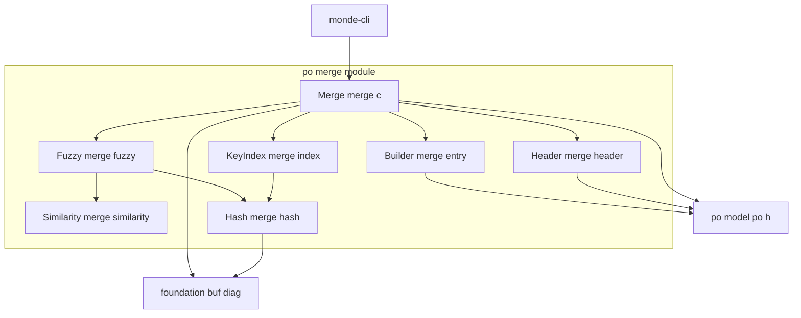
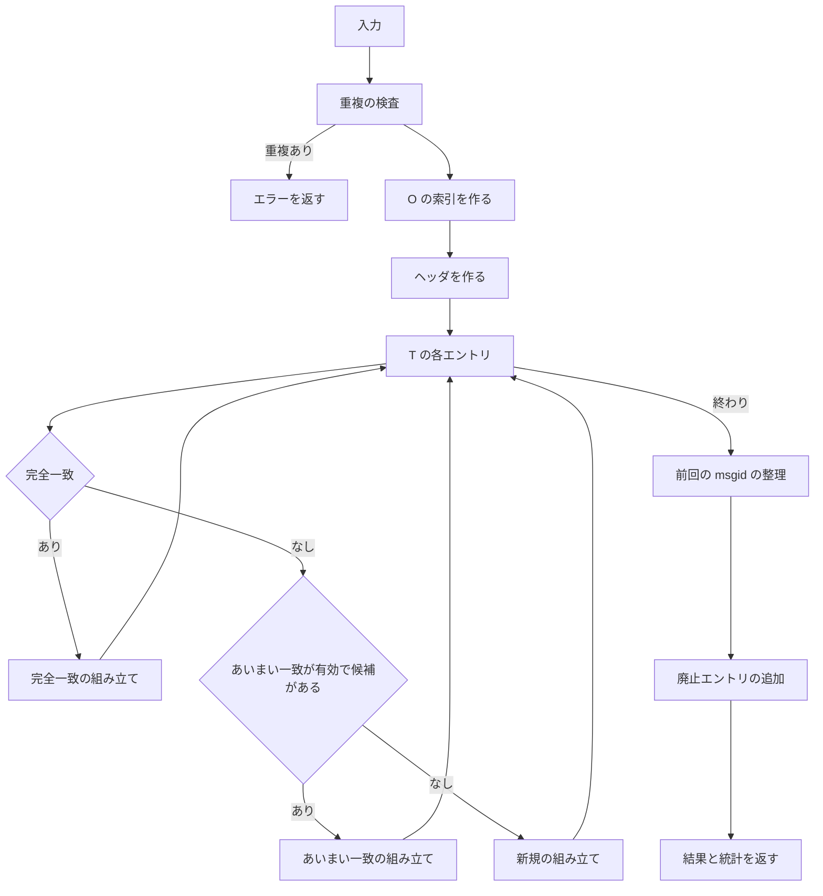

# 技術設計書: po-merge

## Overview

**Purpose**: po-merge は、新しい翻訳テンプレート（`.pot`）のカタログと既存の翻訳ファイル（`.po`）のカタログから、更新後の翻訳ファイルのカタログを作る汎用の部品である。完全一致で訳を引き継ぎ、似た msgid の訳を fuzzy として再利用し、使われなくなった訳を廃止エントリとして残す。結果を po-format のライターで書き出すと、GNU gettext 0.21 の `msgmerge --previous` の出力とバイト単位で同じになることを目標とする。

**Users**: monde-cli は、`monde update` で 2 つのファイルを po-format で読み込んで本部品に渡し、結果を po-format で書き出し、統計を表示する。本部品は Monde 固有の知識を持たないため、テストでは架空の PO だけで挙動を検証する。

**Impact**: 新しいモジュール `src/po_merge/`（ライブラリ `monde::po_merge`）と、テスト `tests/po_merge/` を追加する。既存のファイルの変更は、`src/CMakeLists.txt` と `tests/CMakeLists.txt` への `add_subdirectory` の追加と、steering（structure.md）への予約済みの短縮名 `merge` の追記だけである。

### Goals
- 完全一致、あいまい一致、新規、廃止エントリ化、廃止エントリの復活、ヘッダの更新、単数形と複数形の食い違いを、msgmerge 0.21 と同じ規則で処理する。
- 正解ファイル（msgmerge 0.21 の出力）とのバイト単位の一致を、gettext のない環境も含む全環境で確かめる。
- 2,000 エントリ規模で、1 割が更新された場合に 1 秒以内に終える。

### Non-Goals
- PO の読み書きと折り返し（po-format）、ファイルの入出力・オプション・統計の表示（monde-cli）
- 辞書ファイル（`--compendium`）、翻訳メモリ、機械翻訳
- 書式文字列と `range` の検査、Plural-Forms の式の解釈、msgstr[n] の個数の検査
- `msgmerge` のほかのオプション（`--update`、`--for-msgfmt`、並べ替え、`--lang` など）
- Language-Team の英語名からの言語コードの推測

## Boundary Commitments

### This Spec Owns
- マージの公開 API（`mnd_merge_catalogs`）と、その設定・統計の型（`mnd_merge_options_t`、`mnd_merge_stats_t`）
- マージの規則（本書「マージの規則」）: 完全一致、あいまい一致、新規、廃止エントリ化、エントリの組み立て、前回の msgid、複数形の後処理、出力の順序
- ヘッダのマージの規則（本書「ヘッダの規則」）と、Plural-Forms からの nplurals の読み取り
- あいまい一致の類似度と候補の選び方（本書「あいまい一致の規則」）
- 入力の重複の検出と、その英語のメッセージ（本書「メッセージ」）
- msgmerge 0.21 の出力である正解ファイル（`tests/po_merge/data/`）と、その作り方

### Out of Boundary
- エントリの型、PO の文法、書き出しの形式、ヘッダの項目の取得と設定の関数（po-format が所有する。本部品は使うだけで変更しない）
- ファイルの読み書き、改行コードと折り返しの設定、統計とエラーの表示、終了コード（monde-cli）
- `monde update` のオプション名と、あいまい一致の無効の指定方法（monde-cli）
- 現在時刻の取得と PO-Revision-Date の更新（msgmerge も行わない。翻訳者が編集時に更新する）

### Allowed Dependencies
- 製品コード（`src/po_merge/`）: C 標準ライブラリ（`math.h` を除く。数値は整数と double の四則演算だけを使う）、`monde::po` の公開ヘッダ `po/po.h`、`monde::foundation` の `buf.h`、`diag.h`。`po/po_internal.h`、`po/po_read.h`、`po/po_write.h`、`foundation/file_io.h` は使わない。
- テストコード（`tests/po_merge/`）: 上記に加えて Naos、`po/po_read.h`、`po/po_write.h`（入力の作成と結果の比較）、`foundation/file_io.h`（正解ファイルの読み込み）。
- 互換性テスト: gettext 0.21 の `msgmerge`。見つかった環境でだけ CTest に登録する。
- モジュール間の依存は `foundation ← po ← po_merge ← monde-cli` の一方向。po_merge は他の汎用パーサ（cli_args、markdown、yaml）と translation-units に依存しない。
- モジュール内の依存の方向は「Architecture」の図に従う。

### Revalidation Triggers
- `mnd_merge_catalogs` の引数・戻り値、`mnd_merge_options_t`・`mnd_merge_stats_t` のフィールドの変更 → monde-cli
- 統計の数え方の変更 → monde-cli の表示とテスト
- マージ・ヘッダ・あいまい一致の規則の変更 → 正解ファイルの再生成、monde-cli の `update` のテスト、利用マニュアル
- po-format のエントリの型・状態の判定・ライターの形式の変更 → 本 spec（Builder、正解ファイルの比較）
- 比較に使う gettext の版の変更 → 正解ファイルの再生成と、本書の規則の再確認

## Architecture

### Architecture Pattern & Boundary Map



**Architecture Integration**:
- **Selected pattern**: 段階ごとの部品と、それを順に呼ぶ手続き（Merge）。各部品は msgmerge の規則の 1 つの段階に対応する。選定の理由は `research.md` に記録した。
- **Dependency direction**: `Hash → KeyIndex / Fuzzy`、`Similarity → Fuzzy`、`Builder / Header / KeyIndex / Fuzzy → Merge`。矢印の左側が下位で、上位は下位だけを使う。Builder、Header、KeyIndex、Fuzzy は互いに依存しない。すべての部品は po の Model（`po/po.h`）と foundation を使ってよい。
- **Existing patterns preserved**: 1 モジュール = 1 静的ライブラリ（`monde_add_module`）。エラーは `mnd_diag_list_t` に追加して返す。I/O をしない。モジュール内で共有する宣言は `merge_internal.h` に置く（po の `po_internal.h` と同じ扱い）。
- **New components rationale**: Fuzzy と Similarity は msgmerge と同じ候補を選ぶため（3.2、3.5）、Hash は完全一致と 4-gram の索引を線形探索なしで引くため（10.1）、Header はヘッダだけの特別な規則（5.x）のために必要である。

### Technology Stack

| Layer | Choice / Version | Role in Feature | Notes |
|-------|------------------|-----------------|-------|
| 言語 | C99 | 製品コードとテスト | steering の規約に従う |
| ビルド | CMake 3.21 以上 | `monde_add_module(po_merge ... DEPENDS po foundation)` | `find_program(msgmerge)` |
| テスト | Naos v0.4.0 | 単体テスト、正解ファイルとの比較 | 既存の取り込みを使う |
| 互換性の確認 | GNU gettext 0.21（Ubuntu 24.04） | 正解ファイルが `msgmerge --previous` の出力であることの確認 | CI の Ubuntu のジョブに gettext は導入済み |

## File Structure Plan

### Directory Structure
```
src/po_merge/
├── CMakeLists.txt         # monde_add_module(po_merge SOURCES ... DEPENDS po foundation)
├── merge.h                # 公開: mnd_merge_options_t、mnd_merge_stats_t、mnd_merge_catalogs
├── merge.c                # Merge: 入力の検査、各段階の呼び出し、出力の順序、統計、失敗時の後始末
├── merge_internal.h       # 内部: Builder、Header、KeyIndex、Fuzzy、Similarity、Hash の宣言
├── merge_entry.c          # Builder: エントリの複製、完全一致・あいまい一致・新規・廃止の組み立て、前回の msgid、複数形
├── merge_header.c         # Header: ヘッダの msgstr のマージ、ヘッダのエントリの組み立て、nplurals の読み取り
├── merge_index.c          # KeyIndex: msgctxt と msgid による索引、重複の検出
├── merge_fuzzy.c          # Fuzzy: 候補の登録、4-gram の索引、短い msgid の列、候補の順序と最良の選択
├── merge_similarity.c     # Similarity: 問い合わせのマスク、bit-parallel LCS、上限、比較値
└── merge_hash.c           # Hash: バイト列をキーとする開番地法のハッシュ表

tests/po_merge/
├── CMakeLists.txt         # Naos のテスト、性能テスト、msgmerge との互換性テストの登録
├── main.c                 # NAOS_MAIN にスイートを並べる
├── test_util.h           # テスト用の補助関数の宣言
├── test_util.c           # PO の文字列からカタログを作る、結果を書き出して比べる、正解ファイルの読み込み
├── similarity_test.c      # Similarity（3.2、10.2）
├── index_test.c           # Hash と KeyIndex（2.6、2.7、8.1、8.2）
├── entry_test.c           # Builder（2.x、3.6、3.7、4.2、6.x）
├── fuzzy_test.c           # Fuzzy（3.1〜3.5、3.9）
├── header_test.c          # Header（5.x、6.2 の nplurals）
├── merge_test.c           # Merge（1.x、2.x、3.8、3.10、3.11、4.x、5.7、5.8、6.x、7.x、8.x）
├── golden_test.c          # 正解ファイルとの比較（9.x）
├── perf_main.c            # 性能テストの実行ファイル（Naos を使わない。10.1）
├── msgmerge_compare.cmake # msgmerge の出力と正解ファイルを比べる（cmake -P）
└── data/
    ├── README.md          # 正解ファイルの作り方（msgmerge のバージョンとコマンド）と各ケースの内容
    └── <case>/            # old.po、template.pot、expected.po（msgmerge 0.21 --previous の出力）
```

正解ファイルのケース（`<case>`）は次のとおりとする。各ケースの `old.po` と `template.pot` は、msgcat 0.21 で整形済みのもの（po-format の正解ファイルと同じ形）にする。

| case | 内容（9.2） |
|------|-------------|
| `exact` | 完全一致、翻訳者コメントの保持、参照・抽出コメント・`no-wrap` の更新、fuzzy の既存エントリの完全一致（前回の msgid の保持） |
| `fuzzy` | あいまい一致、fuzzy の候補（前回の msgid の引き継ぎ）、msgctxt の異なる候補、同点の候補、4 文字未満の msgid、日本語の msgid |
| `obsolete` | 新規、廃止エントリ化、訳のない既存のエントリの削除、廃止エントリの復活（完全一致・あいまい一致）、元からの廃止エントリ |
| `header` | 既知の項目の並べ替え、未知の項目、大文字・小文字の異なる項目名、Report-Msgid-Bugs-To と POT-Creation-Date の置き換え、ヘッダの fuzzy と翻訳者コメント |
| `no_header` | テンプレートにだけヘッダがある場合 |
| `plural` | 単数形 → 複数形（Plural-Forms あり）、複数形 → 単数形、msgid_plural の変更、新規の複数形エントリの msgstr[n] の個数 |
| `nofuzzy` | `fuzzy` と同じ入力を、`--no-fuzzy-matching` で処理した結果（`expected.po`）（9.3） |

### Modified Files
- `src/CMakeLists.txt` — `add_subdirectory(po_merge)` を追加する（`po` の後）。
- `tests/CMakeLists.txt` — `add_subdirectory(po_merge)` を追加する。
- `.kiro/steering/structure.md` — 予約済みの短縮名に、po-merge の `merge` を追記する。

## 規約（本モジュール）

- **モジュール名と短縮名**: モジュール `po_merge`、短縮名 `merge`。関数は `mnd_merge_<動作>`、型は `mnd_merge_<対象>_t`、マクロは `MND_MERGE_`。`mnd_po_` は po-format の名前空間なので使わない。
- **入力の不変条件**: 入力のカタログは po-format の不変条件（文字列は NUL を含まない正しい UTF-8）を満たす。`mnd_po_read` が返したカタログは常に満たす。
- **入力を変えない**: 入力のカタログは `const` で受け取り、変更しない（1.5）。出力のエントリの文字列は、すべて入力からの複製で、入力と領域を共有しない。
- **「訳がある」の定義**: msgstr を 1 個以上持ち、最初の msgstr（単数形の msgstr、複数形の msgstr[0]）が空でないこと。msgmerge と同じ定義で、po-format の状態（すべての msgstr が空でない）とは異なる。
- **ヘッダ**: `mnd_po_catalog_header` が返すエントリ（msgctxt のない空の msgid の、最初の廃止エントリでないエントリ）。
- **キー**: msgctxt の有無、msgctxt、msgid の 3 つ組。msgctxt がないことと空の msgctxt は別のキーである。
- **出力の行番号**: 出力のエントリの `line` は 0（入力から作られていない）とする。
- **メモリ不足**: `out of memory` の診断を追加して `false` を返す。内部の関数は `false`（または `NULL`）を返し、診断は Merge が追加する。

## マージの規則

Merge は次の順に処理する。入力の名前は、テンプレートを T、既存の翻訳ファイルを O とする。



### 1. 重複の検査（8.1〜8.3）
- T と O のそれぞれで、廃止エントリでないエントリのキーの重複を KeyIndex で探す。見つかったすべての重複を、後のエントリについて報告する（`path` は T または O の `path`、`line` は後のエントリの `line`）。
- 重複が 1 つでもあれば、出力を空のまま `false` を返す。廃止エントリどうし、廃止エントリと通常のエントリの重複は報告しない。

### 2. O の索引（2.1、2.6、2.7）
- KeyIndex に、O のヘッダ以外の廃止エントリでないエントリを先に登録し、次に廃止エントリを登録する。登録済みのキーは上書きしない（通常のエントリが優先し、同じキーの廃止エントリが複数あれば先のものが勝つ）。
- Fuzzy に、O の訳のあるエントリ（廃止エントリを含み、ヘッダを除く）を、O での添字とともに登録する（3.3、3.9）。あいまい一致が無効なら Fuzzy を作らない（3.11）。
- Header で、O のヘッダから nplurals を求める（ヘッダがなければ 2）。

### 3. ヘッダ（5.x）
- O にヘッダがあれば、Header が O のヘッダと T のヘッダ（なければ NULL）から結果のヘッダを作り、出力の先頭に置く（1.2、5.1〜5.6）。O のヘッダは「使われた」とする。
- O にヘッダがなければ、ヘッダを出力しない（5.7、5.8）。T のヘッダは無視する。

### 4. テンプレートの各エントリ（1.2〜1.4、2.x、3.x）
T のエントリを順に処理する。廃止エントリと T のヘッダは飛ばす（1.4）。各エントリについて、次のどれか 1 つの組み立てで出力のエントリを 1 つ加える（1.3）。どの候補も、ほかのテンプレートのエントリの処理の結果に影響されない（3.8）。

| 場合 | 条件 | 組み立て | 使われた | 統計 |
|------|------|----------|----------|------|
| 完全一致 | KeyIndex に T のキーがある | `combine(O[i], T[j], false)` | O[i] | matched |
| あいまい一致 | 有効で、Fuzzy が候補 O[i] を返す | `combine(O[i], T[j], true)` | O[i] | fuzzy |
| 新規 | それ以外 | `fresh(T[j])` | — | added |

### 5. エントリの組み立て（Builder）
`combine(d, r, force_fuzzy)`（d は O のエントリ、r は T のエントリ）は次の規則で新しいエントリを作る（2.1〜2.8、3.6、3.7、6.1〜6.5）。

| 要素 | 取り方 |
|------|--------|
| msgctxt、msgid、msgid_plural | r から |
| msgstr | d から（すべての msgstr を順に） |
| 翻訳者コメント | d から |
| 抽出コメント、参照 | r から |
| fuzzy | `d が fuzzy` または `force_fuzzy` または `複数形の食い違い`（r と d の片方だけが msgid_plural を持つ、または両方が持ち値が異なる） |
| フラグ | fuzzy なら先頭に `fuzzy`、その後に r のフラグから `fuzzy` を除いたものを r の順に |
| 前回の msgctxt・msgid・msgid_plural | d が fuzzy なら d の前回の値（ないものはない）。d が fuzzy でなければ d の msgctxt・msgid・msgid_plural（ないものはない） |
| 廃止エントリ | いいえ |

続けて、複数形の後処理を行う（6.2〜6.4）。
- r が複数形で d が単数形: msgstr を、d の最初の msgstr（msgstr がなければ空文字列）の複製 nplurals 個にし、fuzzy にする。
- r が単数形で d が複数形: msgstr を d の最初の msgstr 1 個（msgstr がなければ空文字列 1 個）にし、fuzzy にする。
- 両方が複数形: msgstr[n] をそのまま保つ（6.1、6.4。msgid_plural が異なれば上の規則ですでに fuzzy）。

`fresh(r)` は r を複製する（3.10）。r が複数形で、msgstr がすべて空なら、msgstr を空文字列 nplurals 個にする（6.6）。

### 6. 前回の msgid の整理（2.4、2.5）
手順 3 と 4 で加えたエントリのうち、fuzzy でないもの、または訳がない（最初の msgstr が空、または msgstr がない）ものから、前回の msgctxt・msgid・msgid_plural をすべて消す。

### 7. 廃止エントリ（4.x）
O のエントリを O の順に調べ、使われなかったもの（ヘッダを除く）について次のようにする。
- 訳がなければ、出力しない（4.3）。
- 訳があれば、複製を廃止エントリとして出力の末尾に加える（4.1、4.4、4.5）。抽出コメントと参照を消し、msgctxt・msgid・msgid_plural・msgstr・翻訳者コメント・フラグ・前回の msgid は保つ（4.2）。手順 6 の整理は行わない。
- 元が廃止エントリでないものだけを、統計の obsoleted に数える（7.5）。

手順 4 で使われた O のエントリ（あいまい一致の候補になった廃止エントリを含む）は、ここで出力しない（4.6）。

### 8. 統計（7.x）
| フィールド | 数えるもの |
|------------|------------|
| `matched` | 手順 4 の完全一致（廃止エントリの復活、複数形の食い違いで fuzzy にしたものを含む）（7.1、7.4） |
| `fuzzy` | 手順 4 のあいまい一致 |
| `added` | 手順 4 の新規 |
| `obsoleted` | 手順 7 で廃止エントリにした、元が廃止エントリでないエントリ |

ヘッダは数えない（7.2）。`matched + fuzzy + added` は T の廃止エントリでもヘッダでもないエントリの数に等しい（7.3）。

## ヘッダの規則

Header は、O のヘッダ `d` と T のヘッダ `r`（NULL 可）から結果のヘッダを作る。msgstr は次の手順で作る（5.1〜5.6）。

1. **行に分ける**: `d` の最初の msgstr を `\n` の直後で区切る。最後の行が `\n` で終わらなければ `\n` を補う。空の msgstr は 0 行とする。
2. **既知の項目を取り出す**: 各行の先頭が、次の表の名前（`:` を含む）と ASCII の大文字・小文字を区別せずに一致すれば、その項目の値（名前の直後から `\n` までを含む行の残り）として記録する。同じ項目が複数の行にあれば、後の行の値にする。一致しない行は、「ほかの行」として順に記録する。

   | 順 | 名前 |
   |----|------|
   | 1 | `Project-Id-Version:` |
   | 2 | `Report-Msgid-Bugs-To:` |
   | 3 | `POT-Creation-Date:` |
   | 4 | `PO-Revision-Date:` |
   | 5 | `Last-Translator:` |
   | 6 | `Language-Team:` |
   | 7 | `Language:` |
   | 8 | `MIME-Version:` |
   | 9 | `Content-Type:` |
   | 10 | `Content-Transfer-Encoding:` |

3. **Language を補う**: Language の値がなく Language-Team の値があれば、Language の値を ` \n`（空白 1 つと改行）にする（5.5）。
4. **テンプレートの値で置き換える**: `r` があれば、`r` の最初の msgstr の中で `Report-Msgid-Bugs-To:` と `POT-Creation-Date:` を（大文字・小文字を区別する部分文字列として）最初に見つかった位置から探し、名前の直後から行末の `\n` まで（`\n` がなければ文字列の終わりまでとし、`\n` を補う）を、その項目の値にする（5.1、5.3）。見つからない項目は手順 2 の値のままにする。
5. **並べる**: 表の順に、値のある項目を「表の名前の綴り + 値」として連結し、その後に「ほかの行」を順に連結する（5.4）。

ヘッダのエントリのほかの要素は、`combine` と同じ規則で取る。翻訳者コメントは `d` から、抽出コメントと参照は `r` から（`r` がなければなし）、fuzzy は `d` から、fuzzy 以外のフラグは `r` から（`r` がなければなし）、前回の msgid はなし（5.2、5.6）。

**nplurals**: O のヘッダの `Plural-Forms` の値（`mnd_po_header_get`）から、`nplurals` の直後の空白・タブ、`=`、空白・タブに続く 10 進数を読む。値が 1 以上 100 以下ならその値、それ以外（項目がない、`nplurals` がない、数字がない、0、100 を超える）は 2 とする（6.2、6.6）。

## あいまい一致の規則

Fuzzy と Similarity は、msgmerge 0.21 と同じ候補を選ぶため、次の規則に従う（3.1〜3.5、3.9）。

**類似度**: 2 つのバイト列 `a`、`b` について、`s(a, b) = 2 × LCS(a, b) / (|a| + |b|)`。LCS はバイト単位の最長共通部分列の長さ。両方が空なら 1、片方だけが空なら 0。

**比較値**: 候補 `c` と問い合わせ `q`（T のエントリ）について、
- `bonus = 0.00001`（`c` が msgctxt を持たない、または `q` が msgctxt を持ち `c` の msgctxt と等しい）、それ以外は 0。
- `w = (double)(2 × LCS) / (double)(|q.msgid| + |c.msgid|)`（片方だけが空なら 0.0、両方空なら 1.0）を `volatile double` に入れ、`w + bonus` を比較値とする。

**候補の登録**: O の訳のあるエントリ（廃止エントリを含む、ヘッダを除く）を、O での添字の昇順に登録する。
- msgid が 4 文字（UTF-8 の文字）以上の候補は、msgid の各位置から始まる 4 文字のバイト列（4-gram）ごとに、その 4-gram を持つ候補の添字の列（昇順、重複なし）に加える。
- msgid のバイト長が 28 以下の候補は、そのバイト長の列に加える。

**候補を調べる順**:
- `q.msgid` が 4 文字以上: `q.msgid` の 4-gram の各出現について、その 4-gram の列にある各候補の数え上げを 1 増やす（同じ 4-gram が `q.msgid` に複数回あれば、その回数だけ数える）。数え上げが 1 以上の候補を、数え上げの降順、同数なら添字の昇順に調べる。
- `q.msgid` が 4 文字未満（バイト長 `l`）: `k = 2.0 / 0.6 − 1.0`（double）として、バイト長 `ceil(l / k)` から `(size_t)(l × k)` までの列を、バイト長の昇順、各列の中は添字の昇順に調べる。`ceil` は整数の演算で求める（`l / k` が整数でなければ切り上げ）。

**選択**: 最良値を 0.6 とし、調べた順に、比較値が最良値を **超えた** 候補で最良値と候補を更新する。最後に残った候補を返す（なければなし）。比較値が等しい候補は、先に調べたものが残る。

**枝刈り**: 次の上限 `u` について `u + bonus` が現在の最良値以下なら、その候補の LCS を計算せずに飛ばす。上限は類似度と同じ形（`(double)(分子) / (double)(長さの和)`）で計算するため、飛ばした候補は選ばれることがなく、結果を変えない。
- 長さの上限: 分子 = `2 × min(|a|, |b|)`
- 出現数の上限（長さの和が 20 以上のとき）: 256 種のバイトの出現数の差の絶対値の和を `D` として、分子 = `|a| + |b| − D`

**LCS の計算**: 問い合わせごとに、`q.msgid` のバイトごとの位置のビットマスク（64 ビットの語の列、256 種）を 1 回作る。各候補について、ビットベクトル `V`（`|q.msgid|` ビット、初期値はすべて 1）を候補のバイトごとに `U = V & M[byte]`、`V = (V + U) | (V − U)`（語の列の加減算は桁上がり・桁借りを伝える）で更新し、`LCS = |q.msgid| − popcount(V)` とする。計算量は候補 1 つあたり `⌈|q.msgid| / 64⌉ × |c.msgid|` 語の演算である。

## メッセージ

診断はすべて英語で、重大度は error とする。`path` に呼び出し側が渡したファイル名（NULL 可）、`line` に後のエントリの行番号（入力から作られていなければ 0）を持たせる（8.3）。

| 発生元 | メッセージ |
|--------|-----------|
| Merge | `duplicate message definition: msgctxt "%s", msgid "%s"` |
| Merge | `duplicate message definition: msgid "%s"`（msgctxt のないエントリ） |
| Merge | `out of memory` |

先のエントリの行番号がわかる場合は、` (first defined at line %zu)` を続ける。表示する値（msgctxt、msgid）は 40 バイトまで（UTF-8 の文字の途中で切らない）とし、制御文字を `?` に置き換え、切った場合は `...` を付ける。値は常に `%s` の引数として渡す。

## Requirements Traceability

| Requirement | Summary | Components | Interfaces | Flows |
|-------------|---------|------------|------------|-------|
| 1.1 | 入力と出力 | Merge | `mnd_merge_catalogs` | マージの規則 |
| 1.2、1.3 | 出力の順序、1 対 1 | Merge | `mnd_merge_catalogs` | 手順 3、4、7 |
| 1.4 | テンプレートの廃止エントリを無視 | Merge | — | 手順 4 |
| 1.5 | 入力を変えない | Merge、Builder | `const mnd_po_catalog_t *` | 規約 |
| 1.6 | 既存が空 | Merge、Builder | `fresh` | 手順 4 |
| 2.1〜2.3 | 完全一致の訳・コメント・フラグ | KeyIndex、Builder | `mnd_merge_key_index_find`、`mnd_merge_combine` | 手順 2、4、5 |
| 2.4、2.5 | 前回の msgid | Builder、Merge | `mnd_merge_combine` | 手順 5、6 |
| 2.6、2.7 | 廃止エントリの復活、通常の優先 | KeyIndex | `mnd_merge_key_index_add` | 手順 2 |
| 2.8 | 未翻訳の完全一致 | Builder | `mnd_merge_combine` | 手順 5 |
| 3.1〜3.5、3.9 | 候補の集合、類似度、bonus、同点 | Fuzzy、Similarity | `mnd_merge_fuzzy_search`、`mnd_merge_similarity_*` | あいまい一致の規則 |
| 3.6、3.7 | あいまい一致の組み立て | Builder | `mnd_merge_combine` | 手順 5 |
| 3.8 | 候補の再利用 | Merge、Fuzzy | `mnd_merge_fuzzy_search`（状態を持たない検索） | 手順 4 |
| 3.10、3.11 | 候補なし、無効の指定 | Merge、Builder | `mnd_merge_options_t.fuzzy_matching`、`mnd_merge_fresh` | 手順 4 |
| 4.1〜4.6 | 廃止エントリ | Merge、Builder | `mnd_merge_obsolete` | 手順 7 |
| 5.1〜5.6 | ヘッダの更新 | Header | `mnd_merge_header` | ヘッダの規則 |
| 5.7、5.8 | ヘッダのない場合 | Merge | — | 手順 3 |
| 6.1〜6.5 | 複数形の食い違い | Builder、Header | `mnd_merge_combine`、`mnd_merge_nplurals` | 手順 5 |
| 6.6、6.7 | 新規の複数形、それ以外の個数 | Builder | `mnd_merge_fresh` | 手順 5 |
| 7.1〜7.5 | 統計 | Merge | `mnd_merge_stats_t` | 手順 8 |
| 8.1〜8.3 | 重複のエラー | Merge、KeyIndex | `mnd_merge_key_index_add` | 手順 1、メッセージ |
| 8.4 | 結果に重複がない | Merge | — | 手順 1、4（T のキーは一意で、出力の通常のエントリのキーは T のキー） |
| 9.1〜9.3 | msgmerge との一致 | すべて | — | 正解ファイル、互換性テスト |
| 10.1 | 性能 | Fuzzy、Similarity、Hash | — | Performance |
| 10.2 | 決定性 | Fuzzy、Similarity | — | あいまい一致の規則（全順序の並べ替え、double の式） |
| 11.1〜11.3 | 独立性 | すべて | — | Allowed Dependencies |

## Components and Interfaces

| Component | Domain/Layer | Intent | Req Coverage | Key Dependencies | Contracts |
|-----------|--------------|--------|--------------|------------------|-----------|
| Merge | 公開 | 手順の実行、出力の順序、統計、エラー | 1.x, 3.8, 3.10, 3.11, 4.x, 5.7, 5.8, 7.x, 8.x | Builder、Header、KeyIndex、Fuzzy（P0） | Service |
| Builder | 内部 | エントリの複製と組み立て | 2.x, 3.6, 3.7, 4.2, 6.x | po Model（P0） | Service（内部） |
| Header | 内部 | ヘッダのマージ、nplurals | 5.1〜5.6, 6.2, 6.6 | po Model（P0） | Service（内部） |
| KeyIndex | 内部 | キーによる索引と重複の検出 | 2.1, 2.6, 2.7, 8.1, 8.2 | Hash（P0） | Service（内部） |
| Fuzzy | 内部 | 候補の索引と最良の候補の選択 | 3.1〜3.5, 3.9, 10.x | Similarity（P0）、Hash（P0） | Service（内部） |
| Similarity | 内部 | LCS、上限、比較値 | 3.2, 10.x | なし | Service（内部） |
| Hash | 内部 | バイト列キーのハッシュ表 | 10.1 | foundation buf（P2） | Service（内部） |

### 公開

#### Merge（`src/po_merge/merge.h`、`merge.c`）

| Field | Detail |
|-------|--------|
| Intent | テンプレートと既存の翻訳ファイルのカタログから、更新後のカタログと統計を作る |
| Requirements | 1.1〜1.6, 3.8, 3.10, 3.11, 4.1〜4.6, 5.7, 5.8, 7.1〜7.5, 8.1〜8.4, 11.1〜11.3 |

**Responsibilities & Constraints**
- 「マージの規則」の手順 1〜8 を実行する。各部品を呼ぶ順序と、出力のカタログへの追加は Merge だけが行う。
- 失敗（重複、メモリ不足）では、出力のカタログを空（`mnd_po_catalog_free` の後に初期化）にし、統計を 0 にして `false` を返す。

**Dependencies**
- Inbound: monde-cli — `monde update`（P0）
- Outbound: Builder、Header、KeyIndex、Fuzzy（P0）
- External: po Model（`mnd_po_catalog_append`、`mnd_po_catalog_header`、`mnd_po_flag_has`）（P0）、foundation diag（P0）

**Contracts**: Service [x]

##### Service Interface
```c
#include "foundation/diag.h"
#include "po/po.h"

#include <stdbool.h>
#include <stddef.h>

typedef struct mnd_merge_options
{
    bool fuzzy_matching;  /* 偽ならあいまい一致を行わない（msgmerge --no-fuzzy-matching） */
} mnd_merge_options_t;

#define MND_MERGE_OPTIONS_INIT { true }

typedef struct mnd_merge_stats
{
    size_t matched;    /* 完全一致（廃止エントリの復活を含む） */
    size_t fuzzy;      /* あいまい一致 */
    size_t added;      /* どちらにも一致しなかった新規 */
    size_t obsoleted;  /* 今回新たに廃止エントリにした既存のエントリ */
} mnd_merge_stats_t;

#define MND_MERGE_STATS_INIT { 0, 0, 0, 0 }

/*
 * template_catalog と old_catalog をマージし、out（初期化済みで空）にエントリを加える。
 * template_path と old_path は診断に使うファイル名（NULL 可）。options が NULL なら既定（あいまい一致あり）。
 * stats は NULL 可。失敗時は false を返し、out を空に、*stats を 0 にする。diags は NULL でない
 */
bool mnd_merge_catalogs(const mnd_po_catalog_t *template_catalog, const char *template_path,
                        const mnd_po_catalog_t *old_catalog, const char *old_path,
                        const mnd_merge_options_t *options,
                        mnd_po_catalog_t *out, mnd_merge_stats_t *stats,
                        mnd_diag_list_t *diags);
```
- Preconditions: 入力のカタログは po-format の不変条件を満たす。`out` は初期化済みで空。`template_catalog`、`old_catalog`、`out`、`diags` は NULL でない。
- Postconditions: 成功時、`out` は「マージの規則」の順序のエントリを持ち、`mnd_po_write` で重複のエラーにならない（8.4）。入力は変わらない。
- Invariants: 同じ入力と設定に対して、常に同じ `out` と `stats` を返す（10.2）。

**Implementation Notes**
- Integration: monde-cli は、`mnd_po_read` で読んだ 2 つのカタログを渡し、`out` を `mnd_po_write`（既存の `.po` の改行コード）で書き出す。
- Validation: `golden_test` が全ケースを msgmerge の出力と比べる。
- Risks: 手順 4 の「使われた」の記録は O の添字の真偽値の配列で持ち、Fuzzy の検索結果に影響させない（3.8）。

### 内部

`merge_internal.h` に宣言し、`src/po_merge/` の .c と `tests/po_merge/` だけが include する。

#### Builder（`merge_entry.c`）

| Field | Detail |
|-------|--------|
| Intent | 「マージの規則」の手順 5 と 7 のエントリの組み立て |
| Requirements | 2.1〜2.5, 2.8, 3.6, 3.7, 3.10, 4.2, 6.1〜6.7 |

```c
/* src を dst（初期化済み）に複製する。失敗時は dst を初期状態に戻して false */
bool mnd_merge_entry_copy(mnd_po_entry_t *dst, const mnd_po_entry_t *src);
/* combine(d, r, force_fuzzy)。nplurals は 1 以上 */
bool mnd_merge_combine(mnd_po_entry_t *dst, const mnd_po_entry_t *old_entry,
                       const mnd_po_entry_t *template_entry, bool force_fuzzy, size_t nplurals);
/* fresh(r) */
bool mnd_merge_fresh(mnd_po_entry_t *dst, const mnd_po_entry_t *template_entry, size_t nplurals);
/* 廃止エントリの複製（抽出コメントと参照を除く） */
bool mnd_merge_obsolete(mnd_po_entry_t *dst, const mnd_po_entry_t *old_entry);
/* 手順 6: fuzzy でない、または訳がなければ前回の msgid を消す */
void mnd_merge_tidy_previous(mnd_po_entry_t *entry);
/* 訳がある（最初の msgstr が空でない） */
bool mnd_merge_has_translation(const mnd_po_entry_t *entry);
```
- `dst` は呼び出し側が `mnd_po_catalog_append` で得たエントリで、失敗時に初期状態に戻す（Merge がカタログ全体を破棄する）。

#### Header（`merge_header.c`）

| Field | Detail |
|-------|--------|
| Intent | 「ヘッダの規則」によるヘッダのエントリの作成と nplurals |
| Requirements | 5.1〜5.6, 6.2, 6.6 |

```c
/* old_header と template_header（NULL 可）から dst（初期化済み）にヘッダを作る */
bool mnd_merge_header(mnd_po_entry_t *dst, const mnd_po_entry_t *old_header,
                      const mnd_po_entry_t *template_header);
/* header（NULL 可）の Plural-Forms から nplurals を返す。1〜100 以外は 2 */
size_t mnd_merge_nplurals(const mnd_po_entry_t *header);
```

#### KeyIndex（`merge_index.c`）

| Field | Detail |
|-------|--------|
| Intent | キー（msgctxt の有無、msgctxt、msgid）からカタログの添字を引く |
| Requirements | 2.1, 2.6, 2.7, 8.1, 8.2 |

```c
typedef struct mnd_merge_key_index mnd_merge_key_index_t;  /* 定義は merge_internal.h */

bool mnd_merge_key_index_init(mnd_merge_key_index_t *index, const mnd_po_catalog_t *catalog);
void mnd_merge_key_index_free(mnd_merge_key_index_t *index);
/* entry_index のキーを登録する。既にあれば登録せず *existing に先の添字を入れて true、*added を偽にする */
bool mnd_merge_key_index_add(mnd_merge_key_index_t *index, size_t entry_index,
                             bool *added, size_t *existing);
bool mnd_merge_key_index_find(const mnd_merge_key_index_t *index, const mnd_po_entry_t *key,
                              size_t *entry_index);
```
- キーの文字列はカタログの文字列を指すだけで複製しない（索引はカタログより先に破棄する）。

#### Fuzzy（`merge_fuzzy.c`）

| Field | Detail |
|-------|--------|
| Intent | 「あいまい一致の規則」の候補の登録と、最良の候補の選択 |
| Requirements | 3.1〜3.5, 3.9, 10.1, 10.2 |

```c
typedef struct mnd_merge_fuzzy mnd_merge_fuzzy_t;  /* 定義は merge_internal.h */

/* catalog の訳のあるエントリ（ヘッダを除く）を登録する */
bool mnd_merge_fuzzy_init(mnd_merge_fuzzy_t *fuzzy, const mnd_po_catalog_t *catalog);
void mnd_merge_fuzzy_free(mnd_merge_fuzzy_t *fuzzy);
/*
 * query の msgctxt と msgid に最も近い候補を探す。見つかれば *found に catalog の添字を入れて
 * *has_found を真にする。false はメモリ不足だけを表す。検索は fuzzy の登録内容を変えない
 */
bool mnd_merge_fuzzy_search(mnd_merge_fuzzy_t *fuzzy, const mnd_po_entry_t *query,
                            bool *has_found, size_t *found);
```
- 数え上げの配列、触れた候補の列、問い合わせのマスクは `mnd_merge_fuzzy_t` が持つ作業領域として再利用する（検索結果には影響しない）。

#### Similarity（`merge_similarity.c`）

| Field | Detail |
|-------|--------|
| Intent | 問い合わせのマスク、LCS、上限、比較値の計算 |
| Requirements | 3.2, 10.1, 10.2 |

```c
typedef struct mnd_merge_pattern mnd_merge_pattern_t;  /* 定義は merge_internal.h。256 × 語数のマスク */

bool mnd_merge_pattern_set(mnd_merge_pattern_t *pattern, const char *s, size_t len);
void mnd_merge_pattern_free(mnd_merge_pattern_t *pattern);
size_t mnd_merge_lcs(const mnd_merge_pattern_t *pattern, const char *s, size_t len);
/* 2 × numerator / sum を double で返す（sum == 0 なら 1.0） */
double mnd_merge_ratio(size_t numerator, size_t sum);
/* 長さと出現数による上限の分子 */
size_t mnd_merge_upper_numerator(const char *a, size_t alen, const char *b, size_t blen);
```

#### Hash（`merge_hash.c`）

| Field | Detail |
|-------|--------|
| Intent | バイト列（ポインタと長さ）をキー、`size_t` を値とする開番地法のハッシュ表 |
| Requirements | 10.1 |

```c
typedef struct mnd_merge_hash mnd_merge_hash_t;  /* 定義は merge_internal.h */

void mnd_merge_hash_init(mnd_merge_hash_t *hash);
void mnd_merge_hash_free(mnd_merge_hash_t *hash);
/* key が既にあれば *value に既存の値を入れて *inserted を偽にする。キーは複製しない */
bool mnd_merge_hash_insert(mnd_merge_hash_t *hash, const void *key, size_t len,
                           size_t value, bool *inserted, size_t *existing);
bool mnd_merge_hash_find(const mnd_merge_hash_t *hash, const void *key, size_t len,
                         size_t *value);
```
- FNV-1a（64 ビット）、容量は 2 の累乗、使用率 1/2 以下。容量の計算はオーバーフローを検査する。KeyIndex はキーを「msgctxt の有無の 1 バイト + msgctxt + 0x04 + msgid」の連結としてカタログの外に持つ（この連結だけは KeyIndex が所有する）。Fuzzy の 4-gram のキーは候補の msgid の内部を指す。

## Error Handling

### Error Strategy
- **利用者の入力の誤り**（同じキーの重複）: エラーの診断をすべて追加し、`false`。
- **メモリ不足**: `out of memory` と `false`。
- どの関数も `stdout` / `stderr` に書かず、プロセスを終了しない（11.2）。

## Testing Strategy

すべての単体テストは Naos で書き、`po_merge_tests` にまとめる（1 ファイル 1 スイート）。入力のカタログは、PO の文字列を `mnd_po_read` で読み込んで作る（`test_util`）。正解ファイルは `DEFINITIONS MND_MERGE_TEST_DATA_DIR="${CMAKE_CURRENT_SOURCE_DIR}/data"` で渡し、`mnd_file_read` で読む。

### Unit Tests
- **similarity**: 空と空（1.0）、片方だけ空（0.0）、同一、共通なし、UTF-8 の複数バイト文字（バイト単位で数えること）。64 バイトと 65 バイト、128 バイトを超える問い合わせ（語の境界の桁上がり）。固定の種の擬似乱数による 1,000 組で、動的計画法の LCS（テスト内の参照実装）と一致すること。上限の分子が常に `2 × LCS` 以上であること（10.2、3.2）。
- **index**: Hash の挿入・検索・既存のキーの扱い、容量の拡大の前後で値が保たれること、長さ 0 のキー。KeyIndex で、msgctxt のないキーと空の msgctxt のキーを区別すること、先に登録した添字が残ること（2.6、2.7、8.1、8.2）。
- **entry**: `combine` の各要素の取り方の表、フラグの順序（`fuzzy` を先頭、未知のフラグの保持）、前回の msgid の 2 通り、複数形の後処理の 3 通り、`fresh` の新規の複数形、`obsolete` が抽出コメントと参照だけを消すこと、`tidy_previous`、複製が入力と領域を共有しないこと（1.5、2.1〜2.5、2.8、3.6、3.7、4.2、6.1〜6.7）。
- **fuzzy**: 類似度 0.6 ちょうどの候補を選ばないこと（3.1）。4-gram を共有しない候補を選ばないこと。数え上げの多い候補が同点で勝つこと、数え上げも同じなら先の候補が勝つこと（3.5）。4 文字未満の問い合わせで、長さの範囲外の候補を調べないこと、3 文字の日本語（9 バイト）の問い合わせ。msgctxt のない候補と同じ msgctxt の候補が、同じ類似度の異なる msgctxt の候補に勝つこと（3.3、3.4）。廃止エントリが候補になり、未翻訳とヘッダが候補にならないこと（3.3、3.9）。同じ検索を 2 回行うと同じ結果になること（10.2）。
- **header**: 既知の項目の並べ替えと表の綴りへの統一（`language:` → `Language:`）、未知の行の順序、同じ項目の後の行の優先、末尾に `\n` のない msgstr、空の msgstr（5.4）。Report-Msgid-Bugs-To と POT-Creation-Date の置き換え、テンプレートにない項目の保持、テンプレートにだけある項目の追加（5.1、5.3）。Language-Team だけがある場合の空の Language（5.5）。翻訳者コメント・fuzzy の保持とテンプレートの fuzzy の無視、テンプレートのヘッダが NULL の場合（5.2、5.6）。nplurals: なし、`nplurals=3; plural=...`、`nplurals = 1`、`nplurals=0`、`nplurals=x`、`nplurals=101`（6.2）。
- **merge**: 出力の順序（ヘッダ、テンプレートの順、廃止エントリの順）と 1 対 1（1.2、1.3、4.5）。テンプレートの廃止エントリの無視（1.4）。入力のカタログが変わらないこと（バイト単位で書き出して比べる）（1.5）。空の既存（1.6）。完全一致の各要素の取り方、未知のフラグの保持、fuzzy の既存の前回の msgid、未翻訳の完全一致（2.1〜2.5、2.8）。廃止エントリの復活と、通常と廃止の両方がある場合（2.6、2.7）。あいまい一致の組み立てと、fuzzy の候補の前回の msgid（3.6、3.7）。1 つの候補を 2 つのテンプレートのエントリが使うこと（3.8）。無効の指定（3.11）。廃止エントリ化の各要素、訳のないものの削除、元からの廃止エントリ、あいまい一致に使われた廃止エントリ（4.1〜4.6）。ヘッダのない 3 つの組み合わせ（5.6〜5.8）。複数形の 4 つの場合と新規の複数形（6.1〜6.7）。統計の各値と合計（7.1〜7.5）。重複のエラーのメッセージ・行番号・出力が空であること、両方の入力の重複がすべて報告されること、廃止エントリどうしの重複を報告しないこと（8.1〜8.3）。結果を `mnd_po_write` で書き出せること（8.4）。

### 正解ファイルとの比較（9.1〜9.3）
- **golden**: `data/` の各ケースの `old.po` と `template.pot` を読み込み、`nofuzzy` は `fuzzy_matching = false`、ほかは既定でマージし、`mnd_po_write` の既定の設定（折り返しあり、LF）で書き出した結果が、`expected.po` とバイト単位で一致すること。全環境で実行する。

### 互換性テスト（msgmerge 0.21 のある環境）
`tests/po_merge/CMakeLists.txt` で `find_program(MONDE_MSGMERGE msgmerge)` を探し、`--version` の 1 行目が `(GNU gettext-tools) 0.21` の場合だけ、各ケースに `po_merge_msgmerge_golden.<case>` を登録する（ラベル `po_merge`）。`msgmerge_compare.cmake` は `msgmerge --previous [--no-fuzzy-matching] -o <ビルドディレクトリの出力> old.po template.pot` を実行し、出力が `expected.po` と一致することを `cmake -E compare_files` で確かめる。見つからない、または版が異なる場合は、構成時に `message(STATUS ...)` で登録しないことを示す。正解ファイルが msgmerge の出力そのものであることを保証する。

### 性能テスト（10.1）
- **po_merge_perf**: `perf_main.c`（`add_executable`、`monde::po_merge` と `monde::po` にリンク、`monde_apply_compile_options` を適用）を CTest に登録する（ラベル `po_merge`、`perf`）。固定の種の擬似乱数と単語の表から、平均 200 バイトの英語風の msgid を持つ 2,000 エントリの既存のカタログ（すべて翻訳済み）を作る。テンプレートは同じ 2,000 エントリのうち 200 エントリの msgid の一部の語を置き換えたものとする。`clock()` でマージだけの時間を測り、ビルド構成が Release（`$<CONFIG>` を引数で渡す）のときは 1.0 秒を超えたら失敗する。ほかの構成では時間を表示するだけにする。参考として、全 2,000 エントリを変えた場合の時間も表示する（判定しない）。

### 全体にかかわる確認
- Monde を知らない（11.1）: `src/po_merge/` に Markdown やサブコマンドの名前が現れないことを、コードレビューで確かめる。
- I/O をしない（11.2）: `src/po_merge/` に `fopen`、`printf`、`fprintf`、`exit`、`po_read.h`、`po_write.h`、`file_io.h` が現れないことを、コードレビューで確かめる。
- 外部コマンドを使わない（11.3）: 製品コードは msgmerge を呼ばない。互換性テストだけが呼ぶ。

## Performance & Scalability
- 目標: 2,000 エントリ × 2,000 エントリ、1 割の更新で 1 秒以内（Release、一般的な開発用 PC）。
- 見積もり: 完全一致はハッシュ表の検索（合計で数 ms）。あいまい一致は 200 回の問い合わせ × 最大 2,000 候補 = 40 万組で、1 組あたり約 800 語の演算（200 バイト × 4 語）。上限による枝刈りを除いても 1 秒を十分に下回る。
- 最悪の場合（全 2,000 エントリが完全一致しない）は 400 万組で、数秒かかりうる。要件の対象外とし、性能テストで時間を記録する。
- メモリ: 4-gram の索引は候補の msgid の合計バイト数に比例する（2,000 × 200 バイトで数 MB 以下）。問い合わせのマスクは `256 × ⌈|msgid| / 64⌉` 語。

## Security Considerations
- 書式文字列を外部入力から作らない。表示する値は `%s` の引数とし、長さと制御文字を制限する。
- ハッシュ表の容量、マスクの語数、nplurals 個の msgstr の確保では、確保の前にオーバーフローを検査する。nplurals は 100 を上限とし、壊れた Plural-Forms で巨大な確保をしない。
- ハッシュ関数は固定（FNV-1a）で、入力に依存する衝突攻撃の対策はしない。入力は利用者自身のファイルであり、最悪でも速度が落ちるだけである。

## Open Questions / Risks
- msgmerge の類似度は、diffseq の打ち切りにより、長さの和が数万バイトを超えてかなり異なる文字列で、厳密な値より小さくなることがある。本設計は厳密な値を使うため、そのような入力では msgmerge と異なる候補を選びうる。段落単位の msgid では起こらないと判断し、正解ファイルには含めない。
- msgmerge と意図して異なる点（テンプレートの廃止エントリ、通常と廃止の重複、未知のフラグ、書式の検査、Language の推測、Plural-Forms の式、空の msgid のテンプレートのエントリとヘッダのあいまい一致）は、`research.md` の「msgmerge と意図して異なる点」に記録した。正解ファイルのケースはこれらを含まない。
