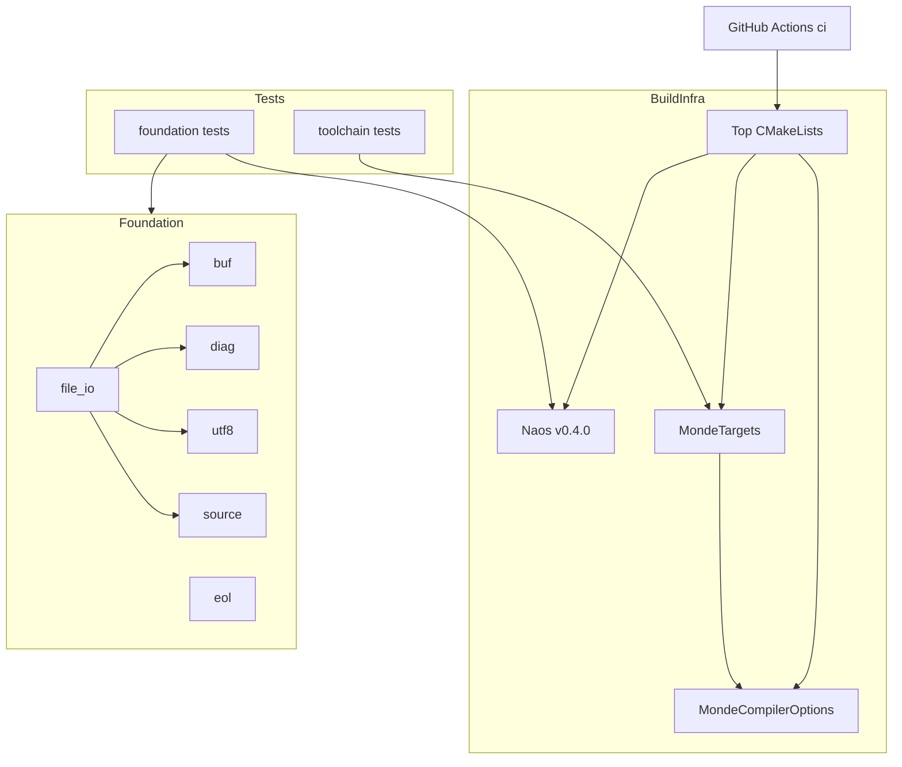
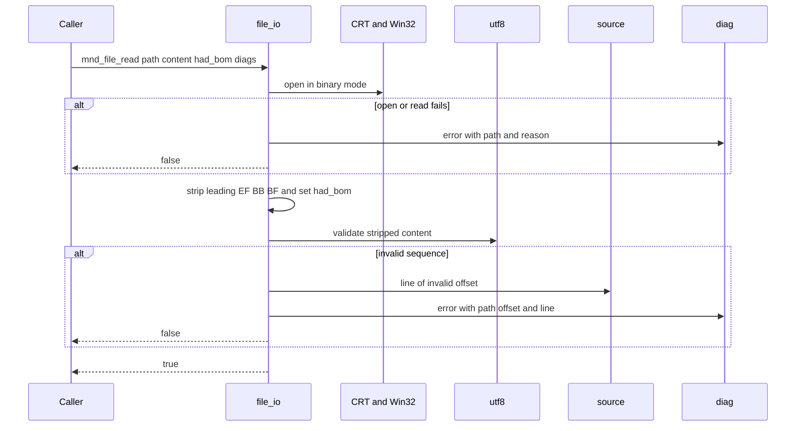

# 技術設計書: project-foundation

## Overview

**Purpose**: project-foundation は、Monde のすべての後続 spec が依存する開発基盤（ビルド構成、テスト基盤、CI）と共通部品（UTF-8 ファイル入出力、改行検出、可変長バッファ、ソース範囲、診断）を提供する。

**Users**: Monde の開発者は、本 spec が定める CMake の関数でモジュールとテストを追加し、5 種のコンパイラで同じ手順でビルド・テストする。後続部品（cli-args、po-format、markdown-parser、yaml-front-matter ほか）は、共通部品をライブラリ `monde::foundation` として利用する。

**Impact**: ソースコードもビルド構成もないリポジトリに、`CMakeLists.txt`、`cmake/`、`src/foundation/`、`tests/`、`.github/workflows/ci.yml` を新設する。

### Goals
- 1 つの手順（構成・ビルド・テスト）で、MSVC、MinGW-w64、Apple Clang、GCC、Clang のすべてにおいて警告ゼロでビルドとテストが通る。
- モジュールとそのテストを、CMake の関数呼び出し 1 つずつで追加できる。
- 後続部品が直接 `fopen` や `stderr` を使わずに済む共通部品を、単体テスト付きで提供する。
- ビルド構成の要件（警告のエラー化、VLA の禁止、MSVC のフラグ）を CTest のテストとして自動検証する。

### Non-Goals
- Markdown、YAML、PO、コマンドライン引数の解析
- 診断をユーザーに表示する書式と終了コードの決定（monde-cli）
- 出力時の改行コードの変換・統一（呼び出し側が組み立てる）
- リリース配布のワークフロー（docs-and-release）、`msgfmt --check` の CI ジョブ（monde-cli）
- 製品の実行ファイル自体（monde-cli が本 spec の `monde_add_executable()` で作る）
- `MAX_PATH` を超える Windows の長いパス、アトミックなファイル書き込み

## Boundary Commitments

### This Spec Owns
- トップレベルの CMake 構成、コンパイラフラグの定義、モジュール・テスト・実行ファイルを作る CMake 関数（`monde_add_module`、`monde_add_module_tests`、`monde_add_executable`）
- Naos の取得とバージョン固定（v0.4.0）
- GitHub Actions のビルド・テスト用ワークフロー（`.github/workflows/ci.yml`）
- 命名とレイアウトの規約: モジュールのディレクトリ、ターゲット名、シンボル接頭辞 `mnd_`、include の基点 `src/`
- `monde::foundation` の公開 API と型: `mnd_buf_t`、`mnd_diag` / `mnd_diag_list`、`mnd_utf8_validate`、`mnd_eol_info`、`mnd_span` / `mnd_slice` と行番号算出、`mnd_file_read` / `mnd_file_write`
- 「LF と CRLF をそれぞれ 1 つの改行と数え、単独の CR は改行としない」という改行の数え方の規則

### Out of Boundary
- 各パーサとそのデータモデル、PO エントリ型
- 診断の表示（`stderr` への出力、色付け、書式）とプロセスの終了コード
- 改行コードの変換、出力内容の組み立て
- リリース用のワークフロー、成果物のパッケージング、`msgfmt` の導入
- 下流モジュールの短縮名・API の決定（本 spec は規則のみ定める）

### Allowed Dependencies
- 製品コード（`src/`）: C 標準ライブラリ、Windows では Win32 API（`MultiByteToWideChar`）と CRT の `_wfopen` のみ。
- テストコード（`tests/`）: 上記に加えて Naos（`Naos::naos`）。
- ビルド時: CMake 3.21 以上、Git（FetchContent による Naos の取得）。
- モジュール間の依存は `foundation ← 汎用パーサ ← po-merge / translation-units ← monde-cli` の一方向。`foundation` は他のどのモジュールにも依存しない。
- `foundation` 内の依存: `file_io` だけが `buf`、`diag`、`utf8`、`source` に依存する。`buf`、`diag`、`utf8`、`eol`、`source` は互いに依存しない（下図参照）。この方向を逆にする include は禁止する。

### Revalidation Triggers
- `mnd_span` の意味（オフセットの基準、終了を含まないこと、行番号の起点）の変更 → markdown-parser、yaml-front-matter、translation-units
- 改行の数え方の規則の変更 → 行番号を出力する全部品、monde-cli の `#:` 出力
- `mnd_diag` のフィールド変更、`mnd_diag_list` の所有権規則の変更 → 全部品と monde-cli
- `mnd_file_read` の BOM 除去・UTF-8 検証の挙動変更 → monde-cli、translation-units
- コンパイラフラグや `monde_add_*` 関数の引数の変更 → 全モジュール
- Naos のバージョン更新 → 全モジュールのテスト

## Architecture

### Architecture Pattern & Boundary Map

ビルド基盤（CMake 関数とフラグ）と、ライブラリ `monde::foundation` の 2 層構成とする。foundation 内は小さな部品を一方向の依存で積み上げる。



**Architecture Integration**:
- Selected pattern: 単一ライブラリ内のレイヤード構成。共通部品は 1 つのモジュール `foundation` にまとめ、下流は `monde::foundation` にのみリンクする。
- Domain/feature boundaries: ビルド基盤は「どうビルドするか」、foundation は「実行時に何を提供するか」を担い、互いのファイルを編集しない。
- Steering compliance: I/O を境界に寄せる（file_io のみがファイルを開く）、エラーを診断として返す（stderr への出力・exit なし）、外部の実行時依存ゼロ、モジュール単位の構成。

### Technology Stack

| Layer | Choice / Version | Role in Feature | Notes |
|-------|------------------|-----------------|-------|
| 言語 | C99（MSVC は `/std:c11` で C99 の範囲のみ使用） | 製品コードとテスト | VLA、`_Complex` は使用禁止 |
| ビルド | CMake 3.21 以上 | 構成、ターゲット定義、CTest | `cmake_minimum_required(VERSION 3.21)` |
| テスト | Naos v0.4.0（コミット 09fde7172c4b63d416c32e98499cb0c0306d3dea） | 単体テスト、CTest への登録 | FetchContent、`BUILD_TESTING` が ON のときのみ取得 |
| CI | GitHub Actions、`msys2/setup-msys2`（MinGW-w64） | 5 環境のビルドとテスト | アクションはメジャーバージョンのタグで固定 |
| 実行時 | C 標準ライブラリ、Win32 API | ファイル入出力、パス変換 | MSVC は静的 CRT、MinGW-w64 は静的リンク |

## File Structure Plan

### Directory Structure
```
CMakeLists.txt                     # トップレベル: 最小バージョン、project()、include(CTest)、Naos 取得、src/ と tests/ の追加
cmake/
├── MondeCompilerOptions.cmake     # monde_apply_compile_options(<target>): C 標準・警告・定義・リンクオプション
├── MondeTargets.cmake             # monde_add_module / monde_add_module_tests / monde_add_executable
└── MondeNaos.cmake                # Naos の FetchContent 宣言（タグとコミットの固定）
src/
├── CMakeLists.txt                 # add_subdirectory(foundation)。後続モジュールはここに 1 行追加
└── foundation/
    ├── CMakeLists.txt             # monde_add_module(foundation SOURCES ...)
    ├── buf.h / buf.c              # 可変長バイトバッファ mnd_buf_t
    ├── diag.h / diag.c            # 診断 mnd_diag と蓄積リスト mnd_diag_list
    ├── utf8.h / utf8.c            # UTF-8 の妥当性検査
    ├── eol.h / eol.c              # 改行コードの検出
    ├── source.h / source.c        # mnd_span、mnd_slice、範囲検証、行番号、範囲の内容
    └── file_io.h / file_io.c      # ファイルの読み書き（BOM、UTF-8 検証、Windows のパス変換）
tests/
├── CMakeLists.txt                 # add_subdirectory(toolchain)、add_subdirectory(foundation)
├── toolchain/
│   ├── CMakeLists.txt             # プローブターゲットと CTest 登録、toolchain_tests の登録
│   ├── toolchain_test.c           # Naos: /utf-8 と /Zc:preprocessor の有効性を検証
│   ├── probe_clean.c              # 対照: 警告なしでビルドできるべきソース
│   ├── probe_warning.c            # 未使用変数を含み、ビルドが失敗すべきソース
│   └── probe_vla.c                # VLA を含み、ビルドが失敗すべきソース
└── foundation/
    ├── CMakeLists.txt             # monde_add_module_tests(foundation ...)、非 ASCII 作業ディレクトリの作成
    ├── main.c                     # NAOS_DECLARE_SUITE と NAOS_MAIN
    ├── buf_test.c                 # スイート buf
    ├── diag_test.c                # スイート diag
    ├── utf8_test.c                # スイート utf8
    ├── eol_test.c                 # スイート eol
    ├── source_test.c              # スイート source
    └── file_io_test.c             # スイート file_io
.github/workflows/ci.yml           # 5 環境のビルドとテスト
.gitignore                         # build/ などビルド成果物を除外
```

`tests/toolchain/` は `src/` に対応するモジュールを持たない唯一の例外で、ビルド構成そのものを検証する。

### Modified Files
- `.kiro/steering/structure.md` — 確定した規約（接頭辞 `mnd_`、include 基点 `src/`、ターゲット名、spec 名とモジュール名の対応規則）を反映する。
- `.kiro/steering/tech.md` — Common Commands を確定した手順に更新する。

## 規約（後続 spec 共通）

| 項目 | 規則 | foundation での値 |
|------|------|-------------------|
| モジュールのディレクトリ | `src/<module>/`、`tests/<module>/`。`<module>` は小文字の snake_case（spec 名の短い形） | `foundation` |
| ライブラリターゲット | `monde_<module>`、別名 `monde::<module>`（静的ライブラリ） | `monde_foundation` / `monde::foundation` |
| テスト実行ファイル | `<module>_tests`。CTest 名は `<module>_tests.<suite>.<test>`、ラベルは `<module>` | `foundation_tests` |
| 公開シンボル | 関数・型は `mnd_<短縮名>_`、マクロ・列挙値は `MND_<短縮名>_`。短縮名はモジュールの設計で決め、既存と重複させない | `buf`、`diag`、`utf8`、`eol`、`span` / `slice` / `source`、`file` |
| include | 基点は `src/`。`#include "foundation/buf.h"` | — |
| ヘッダガード | `MONDE_<MODULE>_<FILE>_H` | `MONDE_FOUNDATION_BUF_H` |
| モジュール内部の関数 | `static` | — |

foundation が予約する短縮名は `buf`、`diag`、`severity`、`utf8`、`eol`、`span`、`slice`、`source`、`file`。

## ビルド構成

### トップレベルの構成（1.1、1.2、2.1）
- `cmake_minimum_required(VERSION 3.21)` を先頭に置き、3.21 未満では構成時に CMake 自身が必要バージョンを示すエラーで停止する（1.2）。
- `project(monde VERSION 0.1.0 LANGUAGES C)`。
- `CMAKE_MSVC_RUNTIME_LIBRARY` を `MultiThreaded$<$<CONFIG:Debug>:Debug>` に設定する（Naos を含む全ターゲットで CRT を揃えるため、Naos 取得より前に設定）。
- `include(CTest)` で `BUILD_TESTING`（既定 ON）を有効にする。`BUILD_TESTING` が ON のときだけ `MondeNaos.cmake` を読み込み、`tests/` を追加する。OFF なら Naos は取得されず、製品ターゲットだけがビルドされる（1.8）。
- 単一構成・複数構成ジェネレータの両方で同じ手順が使えるよう、標準の手順を次の 3 行とする（1.1）。

```sh
cmake -S . -B build -DCMAKE_BUILD_TYPE=Release
cmake --build build --config Release
ctest --test-dir build -C Release --output-on-failure
```

### Naos の取得（2.1）
`cmake/MondeNaos.cmake`:
- `FetchContent_Declare(Naos GIT_REPOSITORY https://github.com/vabelorg/naos.git GIT_TAG v0.4.0 GIT_SHALLOW TRUE)` + `FetchContent_MakeAvailable(Naos)`。
- タグに対応するコミット `09fde7172c4b63d416c32e98499cb0c0306d3dea` をコメントに記録する。バージョン更新はこのファイル 1 か所の変更で行う。
- オフライン環境では CMake 標準の `FETCHCONTENT_SOURCE_DIR_NAOS` でローカルの Naos を指定できる。

### コンパイラオプション（1.4〜1.7）
`monde_apply_compile_options(<target>)` を全 Monde ターゲット（モジュール、テスト、実行ファイル、プローブ）に適用する。`CMAKE_C_FLAGS` などのグローバル変数は変更せず、Naos 本体のビルドには影響させない。

| 対象 | 設定 |
|------|------|
| 共通（MSVC 以外） | `C_STANDARD 99`、`C_STANDARD_REQUIRED ON`、`C_EXTENSIONS OFF`、`-Wall -Wextra -Wpedantic -Werror -Werror=vla` |
| MSVC | `C_STANDARD 11`（`/std:c11`）、`/W4 /WX /utf-8 /Zc:preprocessor`、定義 `_CRT_SECURE_NO_WARNINGS` |
| MinGW-w64 | 共通に加えて定義 `__USE_MINGW_ANSI_STDIO=1` |

- 警告はすべてエラー（1.5）。VLA は GCC / Clang 系では `-Werror=vla`、MSVC では未対応機能としてコンパイルエラーになる（1.6）。
- MSVC はソースを UTF-8 として解釈し（`/utf-8`）、標準準拠のプリプロセッサを使う（`/Zc:preprocessor`）（1.7）。

### ターゲット作成関数（1.3、1.8、2.4）
`cmake/MondeTargets.cmake`:

```cmake
# モジュールの静的ライブラリ monde_<module> と別名 monde::<module> を作る。
# include の基点 ${PROJECT_SOURCE_DIR}/src を PUBLIC で公開し、DEPENDS のモジュールに PUBLIC でリンクする。
monde_add_module(<module>
    SOURCES <source>...
    [DEPENDS <module>...])

# tests/<module>/ から呼ぶ。naos_add_executable(<module>_tests ...) で CTest に登録し、
# monde::<module> にリンク、LABELS <module> を付け、コンパイラオプションを適用する。
monde_add_module_tests(<module>
    SOURCES <source>...
    [DEFINITIONS <name=value>...]
    [PROPERTIES <name> <value>...])

# 製品の実行ファイルを作る（monde-cli が使う）。LIBRARIES に Naos::naos が含まれていれば構成時エラー。
monde_add_executable(<target>
    SOURCES <source>...
    LIBRARIES <library>...)
```

- 事前条件: `monde_add_module_tests` は `BUILD_TESTING` が ON のときのみ呼ばれる（`tests/` 自体がそのときだけ追加される）。
- 1.8 の担保: Naos へのリンクは `monde_add_module_tests` 内の `naos_add_executable` だけで発生し、`monde_add_module` と `monde_add_executable` は Naos を参照しない。実行ファイルは MSVC で静的 CRT、MinGW-w64 で `-static` リンクとし、C 標準ライブラリと OS のシステムライブラリ以外の実行時ライブラリに依存しない。
- 新しいモジュールの追加手順（2.4）: `src/CMakeLists.txt` と `tests/CMakeLists.txt` に `add_subdirectory(<module>)` を 1 行ずつ追加し、それぞれのディレクトリで `monde_add_module` / `monde_add_module_tests` を呼ぶ。

### ビルド構成の自己検証（1.5、1.6、1.7）
`tests/toolchain/CMakeLists.txt`:
- `probe_clean`、`probe_warning`、`probe_vla` を `add_library(... OBJECT EXCLUDE_FROM_ALL ...)` で定義し、`monde_apply_compile_options` を適用する（通常のビルドではコンパイルされない）。
- CTest に次の 3 件を登録する。コマンドは `${CMAKE_COMMAND} --build ${CMAKE_BINARY_DIR} --config $<CONFIG> --target <probe>`、プロパティ `RUN_SERIAL TRUE`、ラベル `toolchain`。

| CTest 名 | 対象 | 期待 |
|----------|------|------|
| `toolchain.probe_clean_builds` | 警告のないソース | 成功（誤検知防止の対照） |
| `toolchain.probe_warning_fails` | 未使用のローカル変数（GCC/Clang `-Wunused-variable`、MSVC C4101） | 失敗（`WILL_FAIL TRUE`）（1.5） |
| `toolchain.probe_vla_fails` | 実行時の値で長さを決める配列 | 失敗（`WILL_FAIL TRUE`）（1.6） |

- `toolchain_tests`（Naos、`naos_add_executable` を直接使用）: ソースに書いた UTF-8 リテラル `"日本"` のバイト列が `E6 97 A5 E6 9C AC` と一致すること、および MSVC では `_MSVC_TRADITIONAL == 0` であること（コンパイル時の `#error`）を検証する（1.7）。

### CI（3.1〜3.4）
`.github/workflows/ci.yml`:
- トリガー: `push`（`main` ブランチ）、`pull_request`（3.1）。
- ジョブ `build-and-test` をマトリクスで実行し、`strategy.fail-fast: false` とする（3.3）。いずれかの環境が失敗すればワークフロー全体が失敗になる（3.2）。

| 名前 | ランナー | コンパイラ | 準備 |
|------|----------|-----------|------|
| `msvc` | `windows-latest` | MSVC（Visual Studio ジェネレータ） | なし |
| `mingw-w64` | `windows-latest` | MSYS2 UCRT64 の GCC（Ninja） | `msys2/setup-msys2` で `mingw-w64-ucrt-x86_64-{gcc,cmake,ninja}` を導入し、シェル `msys2 {0}` で実行 |
| `apple-clang` | `macos-latest` | Apple Clang | なし |
| `gcc` | `ubuntu-latest` | GCC（`CC=gcc`） | なし |
| `clang` | `ubuntu-latest` | Clang（`CC=clang`） | なし |

- 手順: checkout → 構成・ビルド・テスト（標準の 3 行、構成は `Release`）。`ctest --output-on-failure` により、失敗したテストの名前と Naos の `file:line: error:` 出力がログに残る（3.4、2.3）。

## System Flows

### ファイル読み込み



- Windows では open の前に UTF-8 のパスを UTF-16 に変換する。変換できない（パスが不正な UTF-8）場合も open 失敗と同じ経路でエラーにする。
- 読み込みはサイズを事前に取得せず、固定長のチャンクで `fread` を繰り返して `mnd_buf_t` に追加する（`ftell` の 32 ビット制限やシークできないファイルの問題を避ける）。
- 失敗時は `content` を空、`had_bom` を `false` にして返す。

## Requirements Traceability

| Requirement | Summary | Components | Interfaces | Flows |
|-------------|---------|------------|------------|-------|
| 1.1 | 5 環境で同じ手順でビルド | TopCMake、MondeCompilerOptions、CI | 標準の 3 行の手順 | CI |
| 1.2 | CMake 3.21 未満で停止 | TopCMake | `cmake_minimum_required(VERSION 3.21)` | — |
| 1.3 | モジュール単位のライブラリ | MondeTargets | `monde_add_module`、`monde_add_module_tests` | — |
| 1.4 | 全ターゲットに同じフラグ | MondeCompilerOptions、MondeTargets | `monde_apply_compile_options` | — |
| 1.5 | 警告でビルド失敗 | MondeCompilerOptions、ToolchainTests | `-Werror`、`/WX`、`toolchain.probe_warning_fails` | — |
| 1.6 | VLA でビルド失敗 | MondeCompilerOptions、ToolchainTests | `-Werror=vla`、`toolchain.probe_vla_fails` | — |
| 1.7 | MSVC で UTF-8 と標準プリプロセッサ | MondeCompilerOptions、ToolchainTests | `/utf-8`、`/Zc:preprocessor`、`toolchain_tests` | — |
| 1.8 | 外部実行時依存なし、Naos 非リンク | TopCMake、MondeTargets | `monde_add_executable`、静的 CRT | — |
| 2.1 | Naos を固定版で取り込み | MondeNaos | `GIT_TAG v0.4.0` | — |
| 2.2 | CTest で全テスト実行・成否表示 | MondeTargets、TopCMake | `naos_add_executable`、`include(CTest)` | — |
| 2.3 | 失敗時に非 0 終了と特定可能な出力 | MondeTargets | CTest 名 `<module>_tests.<suite>.<test>`、`--output-on-failure` | — |
| 2.4 | 新モジュールのテストを同じ手順で登録 | MondeTargets | `monde_add_module_tests` | — |
| 2.5 | 共通部品ごとの単体テスト | FoundationTests | スイート buf、diag、utf8、eol、source、file_io | — |
| 3.1 | push / PR で 5 環境実行 | CI | `ci.yml` のトリガーとマトリクス | CI |
| 3.2 | 1 環境の失敗で全体失敗 | CI | GitHub Actions のジョブ結果 | — |
| 3.3 | 他環境を中断しない | CI | `fail-fast: false` | — |
| 3.4 | 失敗テストの出力をログに残す | CI | `ctest --output-on-failure` | — |
| 4.1 | 改行変換なしでバイト単位に読む | FileIo | `mnd_file_read` | ファイル読み込み |
| 4.2 | BOM を除去し、あったことを返す | FileIo | `had_bom` | ファイル読み込み |
| 4.3 | BOM なしはそのまま返す | FileIo | `had_bom` | ファイル読み込み |
| 4.4 | 不正 UTF-8 でオフセットと行番号付きエラー | FileIo、Utf8、Source、Diag | `mnd_utf8_validate`、`mnd_source_line_of` | ファイル読み込み |
| 4.5 | 空ファイルは長さ 0 で成功 | FileIo | `mnd_file_read` | ファイル読み込み |
| 4.6 | 非 ASCII パスの読み込み | FileIo | UTF-16 変換 + `_wfopen` | ファイル読み込み |
| 4.7 | 読めないときパスと理由付きエラー | FileIo、Diag | `mnd_diag_add` | ファイル読み込み |
| 5.1 | 改行変換なしで書く | FileIo | `mnd_file_write` | — |
| 5.2 | 指定時に BOM を付ける | FileIo | `add_bom` | — |
| 5.3 | 既定は BOM なし | FileIo | `add_bom = false` | — |
| 5.4 | 非 ASCII パスへの書き込み | FileIo | UTF-16 変換 + `_wfopen` | — |
| 5.5 | 書けないときパスと理由付きエラー | FileIo、Diag | `mnd_diag_add` | — |
| 5.6 | 読み書きのラウンドトリップ一致 | FileIo | `mnd_file_read` → `mnd_file_write` | — |
| 6.1 | LF / CRLF を数え多い方を返す | Eol | `mnd_eol_detect` | — |
| 6.2 | 同数なら先に現れた方 | Eol | `mnd_eol_info.dominant` | — |
| 6.3 | 混在を伝える | Eol | `mnd_eol_info.mixed` | — |
| 6.4 | 改行なしを伝える | Eol | `MND_EOL_NONE` | — |
| 6.5 | 単独 CR を数えない | Eol | 改行の数え方の規則 | — |
| 7.1 | 追加時に容量を拡張し連結 | Buf | `mnd_buf_t_append` ほか | — |
| 7.2 | NUL を含むバイト列を保持 | Buf | `len` による長さ管理 | — |
| 7.3 | 内容と長さを返し NUL 終端 | Buf | `data`、`len`、`mnd_buf_t_cstr` | — |
| 7.4 | 確保失敗で内容を壊さず失敗を返す | Buf | `bool` 戻り値 | — |
| 7.5 | 空にする・解放する | Buf | `mnd_buf_t_clear`、`mnd_buf_t_free` | — |
| 8.1 | BOM 除去後基準の半開区間 | Source | `mnd_span` | — |
| 8.2 | 行番号は 1 起点 | Source | `mnd_source_line_of` | — |
| 8.3 | LF・CRLF を 1 改行、単独 CR は数えない | Source | `mnd_source_line_of` | — |
| 8.4 | 不正な範囲を返す | Source | `mnd_span_is_valid`、`false` 戻り値 | — |
| 8.5 | 範囲の内容を変更せずに返す | Source | `mnd_span_text` | — |
| 9.1 | 重大度・英語メッセージ・パス・行番号 | Diag | `mnd_diag` | — |
| 9.2 | 発生順に蓄積し全取り出し | Diag | `mnd_diag_list`、`mnd_diag_list_at` | — |
| 9.3 | エラーの有無を返す | Diag | `mnd_diag_list_has_error` | — |
| 9.4 | 記録時に stderr 出力・終了しない | Diag | `mnd_diag_add` の事後条件 | — |

## Components and Interfaces

| Component | Domain/Layer | Intent | Req Coverage | Key Dependencies (P0/P1) | Contracts |
|-----------|--------------|--------|--------------|--------------------------|-----------|
| TopCMake | ビルド | プロジェクト構成、CTest、Naos 取得の入口 | 1.1, 1.2, 1.8, 2.2 | MondeTargets (P0)、MondeNaos (P0) | Batch |
| MondeCompilerOptions | ビルド | 全ターゲット共通のフラグ定義 | 1.4, 1.5, 1.6, 1.7 | — | Service |
| MondeTargets | ビルド | モジュール・テスト・実行ファイルの作成関数 | 1.3, 1.8, 2.2, 2.3, 2.4 | MondeCompilerOptions (P0)、Naos (P0) | Service |
| MondeNaos | ビルド | Naos のバージョン固定と取得 | 2.1 | Naos v0.4.0 (P0) | — |
| ToolchainTests | テスト | ビルド構成の要件を検証 | 1.5, 1.6, 1.7 | MondeCompilerOptions (P0) | Batch |
| CI | CI | 5 環境のビルドとテスト | 1.1, 3.1, 3.2, 3.3, 3.4 | TopCMake (P0) | Batch |
| Buf | foundation | 可変長バイトバッファ | 7.1〜7.5 | — | Service, State |
| Diag | foundation | 診断の記録と蓄積 | 9.1〜9.4 | — | Service, State |
| Utf8 | foundation | UTF-8 の妥当性検査 | 4.4 | — | Service |
| Eol | foundation | 改行コードの検出 | 6.1〜6.5 | — | Service |
| Source | foundation | ソース範囲、行番号、範囲の内容 | 8.1〜8.5, 4.4 | — | Service |
| FileIo | foundation | ファイルの読み書き | 4.1〜4.7, 5.1〜5.6 | Buf (P0)、Diag (P0)、Utf8 (P0)、Source (P1) | Service |
| FoundationTests | テスト | foundation の単体テスト | 2.5 | Naos (P0)、全 foundation 部品 (P0) | — |

ビルド層のコンポーネントの契約は前節「ビルド構成」「CI」に記載した。以下は foundation の各部品の契約を示す。共通の約束として、すべての公開関数はポインタ引数に `NULL` を受け付けない（明記したものを除く）。内部状態を持たずスレッド間で共有する状態もない（各オブジェクトは呼び出し側が所有する）。

### foundation

#### Buf（`src/foundation/buf.h`）

| Field | Detail |
|-------|--------|
| Intent | NUL を含む任意のバイト列を連結して保持する可変長バッファ |
| Requirements | 7.1, 7.2, 7.3, 7.4, 7.5 |

**Responsibilities & Constraints**
- 不変条件: `data == NULL` のとき `len == 0 && cap == 0`。`data != NULL` のとき `len < cap` かつ `data[len] == '\0'`。
- 容量は必要に応じて拡張する（倍増）。拡張に失敗した操作は `false` を返し、`data`・`len`・`cap` を変更しない（7.4）。サイズ計算のオーバーフローも同じ失敗として扱う。

**Contracts**: Service [x] / State [x]

##### Service Interface
```c
typedef struct mnd_buf
{
    char *data;  /* NULL または len + 1 バイト以上の領域。data[len] == '\0' */
    size_t len;  /* 内容のバイト数（終端の NUL を含まない） */
    size_t cap;  /* 確保済みのバイト数 */
} mnd_buf_t;

#define MND_BUF_t_INIT { NULL, 0, 0 }

void mnd_buf_t_init(mnd_buf_t *buf);
/* 追加で additional バイトを再確保なしに追加できる容量を確保する */
bool mnd_buf_t_reserve(mnd_buf_t *buf, size_t additional);
bool mnd_buf_t_append(mnd_buf_t *buf, const void *bytes, size_t len); /* len == 0 なら bytes は NULL 可 */
bool mnd_buf_t_append_str(mnd_buf_t *buf, const char *str);
bool mnd_buf_t_append_byte(mnd_buf_t *buf, unsigned char byte);
/* 内容を C 文字列として返す。data == NULL なら "" を返す */
const char *mnd_buf_t_cstr(const mnd_buf_t *buf);
/* 内容を破棄し、確保済みの領域は再利用のため残す（len = 0） */
void mnd_buf_t_clear(mnd_buf_t *buf);
/* 領域を解放し、初期状態に戻す。初期状態・解放済みのバッファに対しても安全 */
void mnd_buf_t_free(mnd_buf_t *buf);
```
- 事後条件（追加が成功した場合）: 以前の内容の直後に追加したバイト列がそのまま続く（7.1、7.2）。

#### Diag（`src/foundation/diag.h`）

| Field | Detail |
|-------|--------|
| Intent | 部品が検出したエラー・警告を、発生順に呼び出し側へ返すためのリスト |
| Requirements | 9.1, 9.2, 9.3, 9.4 |

**Responsibilities & Constraints**
- 診断はメッセージとパスのコピーを所有する。リストは呼び出し側が初期化・解放する。
- 記録時に `stderr` への出力、`exit`、`abort` を行わない（9.4）。表示は CLI 層が `mnd_diag_list_at` で取り出して行う。
- メモリ不足で診断を記録できなかった場合、`dropped` を `true` にする。`dropped` のリストはエラーを含むとみなす（エラーの見落としを防ぐ）。

**Contracts**: Service [x] / State [x]

##### Service Interface
```c
typedef enum mnd_severity
{
    MND_SEVERITY_ERROR,
    MND_SEVERITY_WARNING
} mnd_severity_t;

typedef struct mnd_diag {
    mnd_severity_t severity;
    char *message;  /* 英語のメッセージ（UTF-8、NUL 終端） */
    char *path;     /* ファイルパス（UTF-8）。不明なら NULL */
    size_t line;    /* 1 起点の行番号。不明なら 0 */
} mnd_diag;

typedef struct mnd_diag_list {
    mnd_diag *items;
    size_t count;
    size_t cap;
    bool dropped;   /* メモリ不足で記録できなかった診断がある */
} mnd_diag_list;

#define MND_DIAG_LIST_INIT { NULL, 0, 0, false }

void mnd_diag_list_init(mnd_diag_list *list);
void mnd_diag_list_free(mnd_diag_list *list);  /* 初期状態・解放済みに対しても安全 */

/* printf 形式でメッセージを組み立てて末尾に追加する。path は NULL 可、line は 0 可 */
void mnd_diag_add(mnd_diag_list *list, mnd_severity_t severity,
                  const char *path, size_t line, const char *format, ...)
    MND_PRINTF_LIKE(5, 6);

size_t mnd_diag_list_count(const mnd_diag_list *list);
const mnd_diag *mnd_diag_list_at(const mnd_diag_list *list, size_t index); /* index < count */
/* エラーの診断が 1 つ以上ある、または dropped なら true */
bool mnd_diag_list_has_error(const mnd_diag_list *list);
```
- `MND_PRINTF_LIKE(fmt, args)` は GCC / Clang で `__attribute__((format(printf, fmt, args)))`（MinGW-w64 では `gnu_printf`）、MSVC では空に展開するマクロで、書式の誤りをコンパイル時に検出する。
- メッセージの組み立ては `vsnprintf` で長さを求めてから確保する（長さの上限なし）。

#### Utf8（`src/foundation/utf8.h`）

| Field | Detail |
|-------|--------|
| Intent | バイト列が UTF-8 として妥当かを検査し、最初の不正箇所を返す |
| Requirements | 4.4 |

**Contracts**: Service [x]

##### Service Interface
```c
/* 妥当なら true。不正なら false を返し、*invalid_offset に最初の不正なシーケンスの先頭オフセットを入れる */
bool mnd_utf8_validate(const char *data, size_t len, size_t *invalid_offset);
```
- 判定は Unicode Standard Table 3-7 に従う。冗長表現、サロゲート、U+10FFFF 超、途中で切れたシーケンス、単独の継続バイト、0xC0・0xC1・0xF5〜0xFF を不正とする。U+0000 は妥当。
- `len == 0` なら `data` は `NULL` 可で、`true` を返す。

#### Eol（`src/foundation/eol.h`）

| Field | Detail |
|-------|--------|
| Intent | 内容の改行コードを判定する |
| Requirements | 6.1, 6.2, 6.3, 6.4, 6.5 |

**Contracts**: Service [x]

##### Service Interface
```c
typedef enum mnd_eol {
    MND_EOL_NONE,  /* 改行が 1 つもない */
    MND_EOL_LF,
    MND_EOL_CRLF
} mnd_eol;

typedef struct mnd_eol_info {
    mnd_eol dominant;   /* 多い方。同数なら先に現れた方。改行なしなら MND_EOL_NONE */
    bool mixed;         /* LF のみの改行と CRLF の両方がある */
    size_t lf_count;    /* 直前が CR でない LF の数 */
    size_t crlf_count;  /* CR LF の組の数 */
} mnd_eol_info;

mnd_eol_info mnd_eol_detect(const char *data, size_t len);
```
- 改行の数え方の規則（Source と共有）: `CR LF` は 1 つの CRLF、直前が CR でない `LF` は 1 つの LF、直後が LF でない `CR` は改行ではない（6.5）。`CR CR LF` は「単独 CR + CRLF」と数える。

#### Source（`src/foundation/source.h`）

| Field | Detail |
|-------|--------|
| Intent | 内容中の位置と範囲を表す共通の型と、それに対する検証・行番号・内容取得 |
| Requirements | 8.1, 8.2, 8.3, 8.4, 8.5（4.4 の行番号にも使用） |

**Responsibilities & Constraints**
- オフセットの基準は、`mnd_file_read` が返す BOM 除去後の内容の先頭（8.1）。
- `mnd_span` は値型で、内容への参照を持たない。内容は呼び出し側が別途渡す。

**Contracts**: Service [x]

##### Service Interface
```c
typedef struct mnd_span {
    size_t start;  /* 含む */
    size_t end;    /* 含まない。start <= end */
} mnd_span;

typedef struct mnd_slice {
    const char *data;  /* 元の内容の内部を指す（コピーしない） */
    size_t len;
} mnd_slice;

/* start <= end かつ end <= content_len なら true */
bool mnd_span_is_valid(mnd_span span, size_t content_len);

/* offset（0 <= offset <= len）の位置の 1 起点の行番号を *line に入れる。offset > len なら false */
bool mnd_source_line_of(const char *data, size_t len, size_t offset, size_t *line);

/* 範囲が指す元の内容を *out に入れる。不正な範囲なら false（*out は変更しない） */
bool mnd_span_text(const char *data, size_t len, mnd_span span, mnd_slice *out);
```
- 行番号 = 1 + 「`offset` より前で完結した改行の数」。改行は Eol と同じ規則で数え、CRLF は LF の位置で完結する。したがって CRLF の CR と LF の間を指すオフセットは CR と同じ行になる（8.3）。
- `offset == len`（内容の末尾）は有効で、範囲の終端に使える。
- 計算量は `offset` に比例する（索引は持たない）。

#### FileIo（`src/foundation/file_io.h`）

| Field | Detail |
|-------|--------|
| Intent | UTF-8 のパスでファイルをバイナリモードで読み書きし、BOM と UTF-8 の妥当性を扱う |
| Requirements | 4.1〜4.7, 5.1〜5.6 |

**Responsibilities & Constraints**
- Monde でファイルを開く唯一の部品。常にバイナリモード（`"rb"` / `"wb"`）で開き、改行を変換しない（4.1、5.1）。
- Windows（`_WIN32`）では `MultiByteToWideChar(CP_UTF8, MB_ERR_INVALID_CHARS, ...)` で UTF-16 に変換して `_wfopen` を使う。それ以外では `fopen` に UTF-8 のパスをそのまま渡す（4.6、5.4）。変換処理は `file_io.c` 内の `static` 関数に閉じ込める。
- 失敗時のメッセージは英語で、`path` フィールドに対象のパスを入れる。理由には `strerror(errno)` の文字列、または固定の説明を使う。

| 失敗 | メッセージの例 |
|------|----------------|
| open 失敗 | `cannot open file for reading: <strerror>` / `cannot open file for writing: <strerror>` |
| 読み込み・書き込み・close 失敗 | `cannot read file: <strerror>` / `cannot write file: <strerror>` |
| パスが不正な UTF-8（Windows） | `file path is not valid UTF-8` |
| メモリ不足 | `out of memory while reading file` |
| 内容が不正な UTF-8 | `invalid UTF-8 byte sequence at byte offset <n>`（`line` に行番号） |

**Dependencies**
- Outbound: Buf — 読み込み結果の格納 (P0)、Diag — エラーの記録 (P0)、Utf8 — 内容の検証 (P0)、Source — 不正箇所の行番号 (P1)
- External: CRT（`fopen` / `_wfopen`、`fread`、`fwrite`、`fclose`）、Win32（`MultiByteToWideChar`）(P0)

**Contracts**: Service [x]

##### Service Interface
```c
/* path のファイルを読み、BOM を除いた内容を content に入れる。
 * content は初期化済みのバッファで、既存の内容は置き換えられる。
 * 成功: true、*had_bom に BOM の有無。
 * 失敗: diags にエラーを 1 つ追加して false。content は空、*had_bom は false。 */
bool mnd_file_read(const char *path, mnd_buf_t *content, bool *had_bom,
                   mnd_diag_list *diags);

/* data の len バイトを path に書く（既存のファイルは切り詰めて上書き）。
 * add_bom が true なら先頭に EF BB BF を書く。既定の使い方は false。
 * 失敗: diags にエラーを 1 つ追加して false。 */
bool mnd_file_write(const char *path, const char *data, size_t len, bool add_bom,
                    mnd_diag_list *diags);
```
- 事後条件: BOM なしで読み込んだ内容を `add_bom = false` で書くと、元のファイルとバイト単位で一致する（5.6）。BOM ありで読んだ内容は `had_bom` を `add_bom` に渡せば元に戻る。
- 空ファイルは `content->len == 0` の成功（4.5）。不正 UTF-8 の検証は BOM 除去後の内容に対して行い、オフセットもその基準（8.1 と一致）。

**Implementation Notes**
- Integration: 書き込みはアトミックではない。途中で失敗した場合、部分的に書かれたファイルが残りうる（要件外。必要になれば一時ファイル + 置換を追加する）。
- Validation: `fclose` の失敗も書き込み失敗として扱う（バッファされた書き込みのエラーを見落とさないため）。
- Risks: MinGW-w64 の `-std=c99` で `_wfopen` の宣言が隠れる可能性（research.md 参照）。

## Error Handling

### Error Strategy
- 詳細が自明な失敗（メモリ確保、範囲の検証）は `bool` の `false` のみで返す。
- 理由の説明が必要な失敗（ファイル入出力、不正な UTF-8）は、`mnd_diag_list` にエラーを 1 つ追加して `false` を返す。
- foundation のどの関数も `stderr` に書かず、プロセスを終了しない（9.4）。`assert` で契約違反（`NULL` 引数など）を検出するのはデバッグビルドのみとし、製品の挙動はそれに依存しない。

### Error Categories and Responses
- **入力ファイルの問題**（存在しない、権限がない、不正な UTF-8）: パス・理由・位置付きのエラー診断。表示と終了コードは monde-cli が決める。
- **出力先の問題**（作成・書き込み・close の失敗）: パスと理由付きのエラー診断。
- **資源不足**（メモリ）: Buf は内容を保持したまま `false`。Diag は `dropped` を立て、`has_error` を真にする。

## Testing Strategy

すべて Naos で書き、`foundation_tests` に 1 ファイル 1 スイートでまとめる（2.5）。入力のバイト列はソース内のリテラルで持ち、Git の改行変換の影響を受けない。

### Unit Tests
- **buf**: 空バッファへの追加、容量を超える連続追加で内容が連結されること（7.1）。`"a\0b"` の追加で `len == 3` かつ `MEM_EQ` で一致し、`data[len] == '\0'`（7.2、7.3）。`mnd_buf_t_reserve(&b, SIZE_MAX)` と長さがオーバーフローする追加が `false` を返し、既存の内容・長さが変わらないこと（7.4）。`clear` 後に `len == 0` で容量が残り再利用できること、`free` を 2 回呼んでも安全なこと（7.5）。
- **diag**: 重大度・メッセージ・パス・行番号が保存されること、`path` に `NULL`・`line` に 0 を渡せること（9.1）。3 件追加して追加順に取り出せること（9.2）。警告のみなら `has_error` が偽、エラーを 1 件含めば真（9.3）。9.4 はコードレビューと、テストの出力に診断が現れないことで確認する。
- **utf8**: ASCII、2〜4 バイト文字、U+0000、U+10FFFF が妥当。`C0 80`、`ED A0 80`（サロゲート）、`F4 90 80 80`（U+10FFFF 超）、末尾で切れたシーケンス、単独の `80`、`FF` が不正で、オフセットが最初の不正シーケンスの先頭を指すこと（4.4）。
- **eol**: LF のみ・CRLF のみ・改行なし（6.1、6.4）、LF 2 + CRLF 1 で LF かつ `mixed`（6.1、6.3）、同数で先に現れた方（6.2）、`"a\rb"` が改行なし、`"\r\r\n"` が CRLF 1（6.5）。
- **source**: 1 行目の先頭が 1（8.2）、LF・CRLF の直後の行番号、単独 CR では行が増えないこと、CRLF の CR と LF の間が同じ行（8.3）。`offset == len` が有効で `len + 1` が `false`、`start > end` と `end > len` の範囲が不正（8.4）。`mnd_span_text` が元の内容の該当バイト列を指すこと（8.5）。

### Integration Tests（file_io スイート。ビルドディレクトリ配下の作業ディレクトリを使用）
- CRLF・LF 混在・NUL を含むバイト列を書いて読み、バイト単位で一致すること（4.1、5.1、5.6）。
- BOM 付きファイルを読むと BOM が除去され `had_bom` が真、BOM なしなら内容不変で偽（4.2、4.3）。`add_bom = true` で先頭 3 バイトが `EF BB BF`、`false` で付かないこと（5.2、5.3）。
- 空ファイルが長さ 0 で成功すること（4.5）。
- 2 行目に不正なバイトを置いたファイルの読み込みが失敗し、診断にパス・`byte offset <n>`・`line == 2` が含まれること（4.4）。
- 存在しないファイルの読み込み、存在しないディレクトリ配下への書き込みが失敗し、診断の `path` が対象のパスであること（4.7、5.5）。
- 構成時に `tests/foundation/CMakeLists.txt` が作成する非 ASCII のディレクトリ（例: `work/日本語ディレクトリ`）の中に、非 ASCII のファイル名（例: `翻訳.md`）で書き込み・読み込みできること。作業ディレクトリの絶対パスはコンパイル定義 `MONDE_TEST_WORK_DIR` で渡し、非 ASCII 部分は C ソース内の UTF-8 エスケープで組み立てる（4.6、5.4）。

### Build Configuration Tests（toolchain）
- `toolchain.probe_clean_builds` が成功し、`toolchain.probe_warning_fails` と `toolchain.probe_vla_fails` がビルド失敗として期待どおりになること（1.5、1.6）。
- `toolchain_tests` で UTF-8 リテラルのバイト列と、MSVC の標準準拠プリプロセッサを確認すること（1.7）。

### CI（E2E）
- 5 環境すべてで構成・ビルド・`ctest` が成功すること（1.1、3.1）。意図的に失敗するテストを含む変更で、該当環境のみ失敗し、他環境は完走し、ログに失敗したテスト名と `file:line: error:` が残ること（3.2〜3.4。導入時に一度確認する）。

## Security Considerations
- パスは呼び出し側が指定したものをそのまま開き、正規化やディレクトリ外へのアクセス制限は行わない（CLI の利用者が自分で指定するパスのため）。
- 書式文字列を外部入力から作らない。`mnd_diag_add` の書式は常にリテラルとし、`MND_PRINTF_LIKE` でコンパイル時に検査する。
- サイズ計算はすべてオーバーフローを検査する（Buf、Diag、FileIo）。
