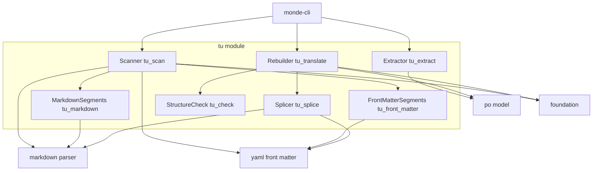
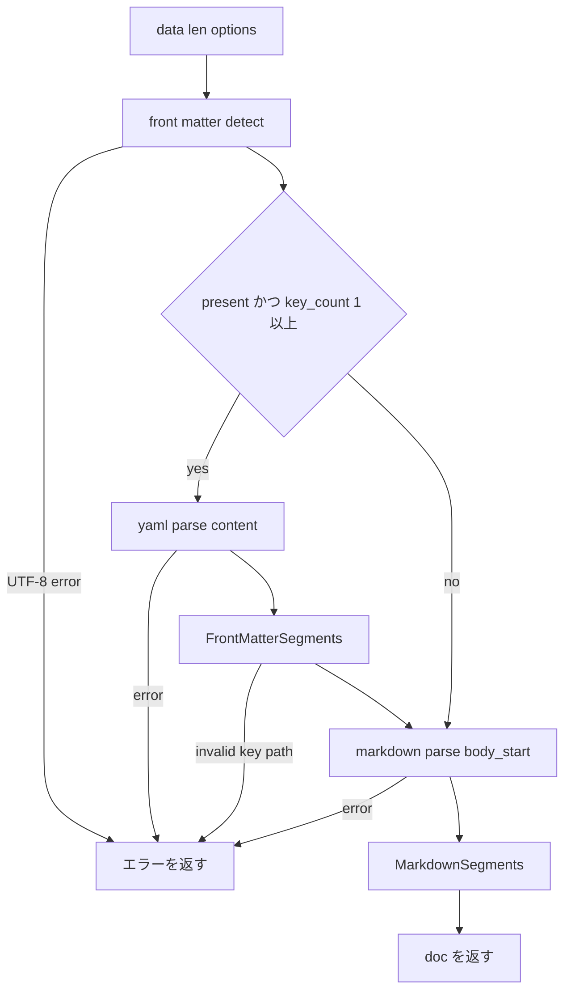
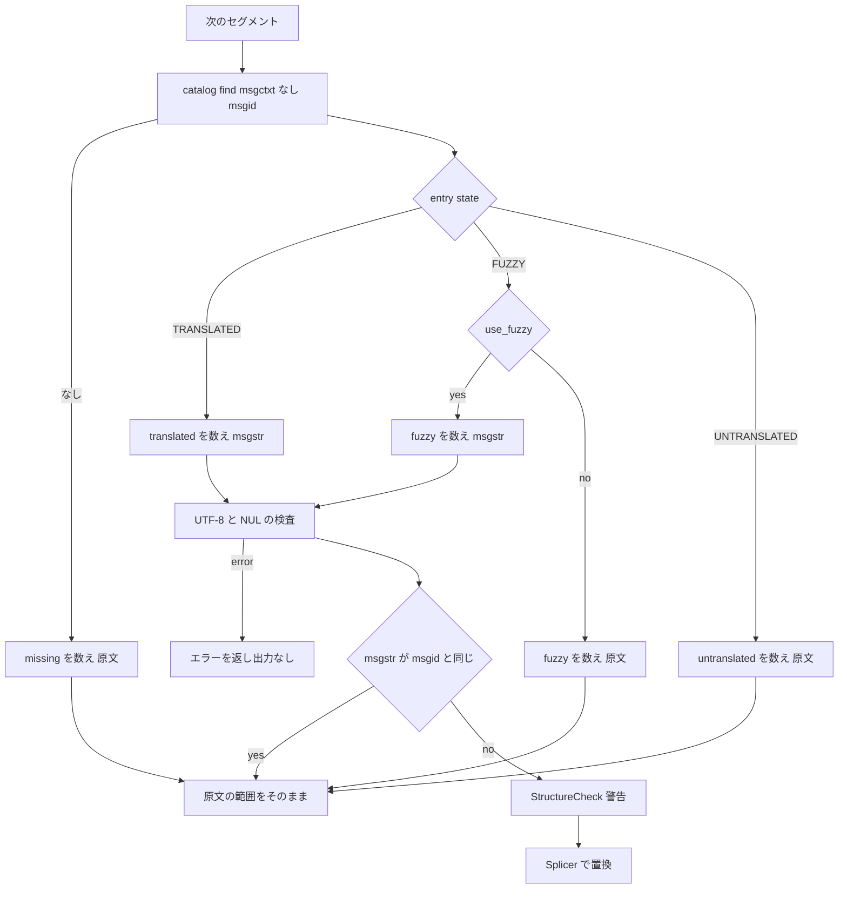

# 技術設計書: translation-units

## Overview

**Purpose**: translation-units は、Markdown 本文と YAML フロントマターから翻訳セグメントを取り出し、（1）翻訳テンプレートの PO エントリの列を作る「抽出」と、（2）翻訳カタログの訳文を原文の範囲に差し戻して翻訳済み Markdown を作る「再構成」を提供する Monde 固有の部品である。両者は 1 回の「走査」が作る同じセグメントの列の上で動くため、翻訳対象の判定と msgid の正規化の規則が抽出と再構成で食い違うことはない。

**Users**: monde-cli は、`monde extract` で走査 → 抽出 → po-format で書き出し、`monde translate` で走査 → po-format で読んだカタログを渡して再構成 → 出力と統計の表示を行う。その先の利用者は翻訳者（msgid の形）と文書の保守者（出力の差分）である。

**Impact**: 新しいモジュール `src/tu/`（ライブラリ `monde::tu`）とテスト `tests/tu/` を追加する。既存のファイルの変更は `src/CMakeLists.txt` と `tests/CMakeLists.txt` への `add_subdirectory`、steering（structure.md）への予約済みの短縮名 `tu` の追記だけである。上流の 3 部品は変更しない。

### Goals
- 段落・見出し・指定したフロントマターの値を翻訳セグメントにし、インライン記法を含む論理テキストを msgid にする。
- 同一 msgid の統合、`#:`、`#.` を持つエントリの列を、`msgfmt --check` を通る形で作る。
- 翻訳対象以外のバイトを一切変えずに訳文を差し戻し、翻訳なし・msgstr == msgid の両方で原文とバイト単位で同一の出力を返す（CommonMark spec 0.31.2 の全例で確認する）。
- 出現ごとの翻訳の状態の件数を返す。

### Non-Goals
- ファイルの入出力、BOM の除去、改行コードの検出、CLI のオプション、統計の表示（foundation と monde-cli）
- PO の書式とマージ（po-format、po-merge）、Markdown と YAML の構文解析（markdown-parser、yaml-front-matter）
- msgctxt による訳し分け、URL のプレースホルダ化、方言固有の翻訳単位（GFM の表のセル）
- 訳文のエスケープや整形による構造の保護

## Boundary Commitments

### This Spec Owns
- 翻訳セグメントのモデル（`mnd_tu_segment_t`）と、文書からセグメントの列を作る規則（本書「走査の規則」）
- msgid の正規化の規則（本書「msgid の規則」）
- 抽出の規則（統合、順序、`#:`、`#.` の語彙。本書「抽出の規則」）
- 差し戻しの規則（カタログの検索、状態の扱い、プレフィックスと改行の復元、短絡、構造の検査。本書「再構成の規則」）
- 統計の数え方と、本部品が出す英語の診断メッセージ（本書「メッセージ」）
- 公開 API（`mnd_tu_scan`、`mnd_tu_extract`、`mnd_tu_translate` とその型）

### Out of Boundary
- 構文木・行・範囲の意味（markdown-parser）、フロントマターの検出・照合・整形の規則（yaml-front-matter）、エントリの型・状態の判定・エスケープ・折り返し（po-format）。本部品はこれらを使うだけで、再定義も補正もしない。
- `--front-matter-keys` のカンマ区切りの分割、fuzzy 採用のオプション名、`#:` に書くファイル名の決め方（相対パスにするかなど）、ヘッダエントリの作成、POT-Creation-Date（monde-cli）
- 翻訳率の計算式と表示（monde-cli）
- 訳文の Markdown としての妥当性の保証。構造の検査は警告だけで、出力を変えない。

### Allowed Dependencies
- 製品コード（`src/tu/`）: C 標準ライブラリ、`monde::markdown` の `markdown/md.h`・`markdown/md_parse.h`、`monde::yaml` の `yaml/yaml.h`・`yaml_front_matter.h`・`yaml_parse.h`・`yaml_path.h`・`yaml_format.h`、`monde::po` の `po/po.h`、`monde::foundation` の `buf.h`・`diag.h`・`eol.h`・`source.h`・`utf8.h`。
- 使わないもの: `po/po_read.h`、`po/po_write.h`、`foundation/file_io.h`、各モジュールの `*_internal.h`、`markdown/md_dialect.h`（方言は既定の CommonMark だけを使う）。
- テストコード（`tests/tu/`）: 上記に加えて Naos、`po/po_write.h`・`po/po_read.h`（抽出結果の確認と翻訳カタログの作成）、`foundation/file_io.h`（spec.txt の読み込み）、`tests/markdown/spec_reader.c`。
- モジュール間の依存は `foundation ← markdown / yaml / po ← tu ← monde-cli` の一方向。`tu` は `cli_args` と `po_merge` に依存しない。

### Revalidation Triggers
- 公開 API（`mnd_tu_options_t`、`mnd_tu_translate_options_t`、`mnd_tu_segment_t`、`mnd_tu_stats_t`、3 つの関数）の変更 → monde-cli
- msgid の規則・`#.` の語彙・エントリの順序の変更 → monde-cli のテスト、既存の `.po` との互換（po-merge のあいまい一致に影響）、利用マニュアル
- 統計の数え方の変更 → monde-cli の翻訳率の表示
- 上流の変更で本 spec を再検証するもの: markdown-parser の行の内容範囲・`pad`・`content_indent`・行番号の数え方、yaml-front-matter の範囲の規則・整形の規則（特に空の範囲と末尾の改行の扱い）、po-format の状態の判定・ヘッダの定義

## Architecture

### Existing Architecture Analysis
- 上流の 3 部品は実装済みで、構文木はすべて原文のバイトオフセットで表され、原文を複製しない。本部品も同じ方針（原文を指す、置換は範囲単位）で設計する。
- 各部品の失敗は `mnd_diag_list_t` にエラーを追加して `false` を返す。本部品は上流の診断をそのまま通し、自分の診断を加える。
- `tests/markdown/spec_reader.c` が spec.txt の例を取り出す。本部品のラウンドトリップのテストはこれを再利用する。

### Architecture Pattern & Boundary Map



**Architecture Integration**:
- **Selected pattern**: 共通のセグメントの列（Scanner が作る `mnd_tu_doc_t`）の上に、抽出（Extractor）と再構成（Rebuilder）を載せる。選定の理由は `research.md` の「Architecture Pattern Evaluation」に記録した。
- **Dependency direction（モジュール内）**: `MarkdownSegments / FrontMatterSegments → Scanner`、`Splicer / StructureCheck → Rebuilder`。Extractor と Rebuilder は Scanner の結果（`mnd_tu_doc_t`）だけを入力にし、互いに依存しない。Splicer と StructureCheck は互いに依存しない。
- **Existing patterns preserved**: 1 モジュール = 1 静的ライブラリ。I/O をしない。診断で返す。原文を指す不透明な文書型（`mnd_tu_doc_t`）と読み取り用の公開構造体（`mnd_tu_segment_t`）は markdown / yaml の Model と同じ流儀。モジュール内で共有する宣言は `tu_internal.h` に置く。
- **New components rationale**: Scanner は判定と正規化を 1 か所に集めて 4.12 を構造で保証するため。Splicer は Markdown とフロントマターで書き戻し方が違うため。StructureCheck は 4.11 の検査項目を独立にテストするため。

### Technology Stack

| Layer | Choice / Version | Role in Feature | Notes |
|-------|------------------|-----------------|-------|
| 言語 | C99 | 製品コードとテスト | steering の規約に従う |
| ビルド | CMake 3.21 以上 | `monde_add_module(tu ... DEPENDS markdown yaml po foundation)` | `find_program(msgfmt)` を互換性テストに使う |
| テスト | Naos v0.4.0 | 単体テスト、spec.txt のラウンドトリップ | 既存の取り込みを使う |
| 互換性の確認 | GNU gettext（`msgfmt --check`） | 抽出結果が gettext に受け入れられることの確認 | CI の Ubuntu のジョブに gettext は導入済み。ない環境では登録しない |

## File Structure Plan

### Directory Structure
```
src/tu/
├── CMakeLists.txt         # monde_add_module(tu SOURCES ... DEPENDS markdown yaml po foundation)
├── tu.h                   # 公開: mnd_tu_options_t、mnd_tu_segment_t、mnd_tu_doc_t、mnd_tu_translate_options_t、mnd_tu_stats_t、mnd_tu_scan / mnd_tu_extract / mnd_tu_translate
├── tu_internal.h          # 内部: mnd_tu_seg_t（公開部 + 上流ノードへのポインタ）、mnd_tu_doc の構造体、各部品の内部関数の宣言
├── tu_scan.c              # Scanner: 検出 → 解析 → セグメントの列の組み立て、mnd_tu_doc_t の生成と解放
├── tu_markdown.c          # MarkdownSegments: 構文木の走査、翻訳対象の判定、範囲と msgid と #. のラベル
├── tu_front_matter.c      # FrontMatterSegments: キーパスの照合、スカラーの判定、先頭・末尾の改行の除去、原文順の整列
├── tu_extract.c           # Extractor: msgid の統合、エントリの順序、#: と #. の付与
├── tu_translate.c         # Rebuilder: カタログの検索、状態と統計、訳文の検査、短絡、出力の組み立て
├── tu_splice.c            # Splicer: Markdown の行ごとの書き戻し（プレフィックスと改行の復元）、フロントマターの整形の呼び出し
└── tu_check.c             # StructureCheck: 構造を変え得る訳文の検査

tests/tu/
├── CMakeLists.txt         # Naos のテスト（spec_reader.c を ../markdown から取り込む）、msgfmt の互換性テストの登録
├── main.c                 # NAOS_MAIN にスイートを並べる
├── test_util.c / .h       # 文書の走査、カタログの組み立て（po_read）、出力の比較の補助
├── markdown_test.c        # 走査の規則（Markdown）: 対象の判定、範囲、msgid、#. のラベル、方言のノード
├── front_matter_test.c    # 走査の規則（フロントマター）: 照合、非スカラーの警告、空の値、改行の除去、キー未指定
├── extract_test.c         # 抽出の規則: 統合、順序、#:、#.、msgstr とフラグ
├── splice_test.c          # 書き戻し: プレフィックスの再利用と組み立て、行数の増減、CRLF、ATX 見出し
├── check_test.c           # 構造の検査の各項目
├── translate_test.c       # 再構成: 状態ごとの出力、fuzzy の採用、統計、訳文の UTF-8 / NUL、エラー時の出力なし
├── roundtrip_test.c       # spec.txt の全例: 空のカタログ、msgstr == msgid、短絡なしの splice、CRLF 版、末尾改行なし版
└── data/                  # msgfmt の互換性テスト用の入力 Markdown
```

### Modified Files
- `src/CMakeLists.txt` — `add_subdirectory(tu)` を追加
- `tests/CMakeLists.txt` — `add_subdirectory(tu)` を追加
- `.kiro/steering/structure.md` — 予約済みの短縮名に `tu` を追記

## 規約（本モジュール）

- **モジュール名と短縮名**: モジュール `tu`、短縮名 `tu`（translation unit の業界の略。TMX の `<tu>`）。関数は `mnd_tu_<動作>`、型は `mnd_tu_<対象>_t`、マクロは `MND_TU_`、ヘッダガードは `MONDE_TU_<FILE>_H`。
- **原文を指す**: `mnd_tu_doc_t` と各セグメントは、`mnd_tu_scan` に渡された `data` を指し続ける。呼び出し側は `mnd_tu_doc_free` まで `data` を変更も解放もしない（markdown / yaml の文書と同じ契約）。
- **入力の前提**: `data` は BOM を除去した後の内容。UTF-8 の検査は上流（`mnd_yaml_front_matter_detect` が文書全体を検査する）に任せ、本部品は訳文だけを検査する。
- **オフセットと行番号**: すべて `data` の先頭を基準にし、行番号は 1 起点で `mnd_source_line_of` と同じ数え方（LF と CRLF を 1 つと数え、単独の CR は数えない）。
- **訳文の形**: カタログの msgstr は po-format の不変条件により LF 改行・NUL なしの UTF-8 だが、`mnd_po_read` を通らないカタログに備えて `mnd_utf8_validate` と `strlen == len` で検査する（7.4）。
- **失敗時の後始末**: `false` を返すときは、`mnd_tu_scan` は `*out = NULL`、`mnd_tu_extract` は `out` に加えたエントリを取り除いて呼び出し前の件数に戻し、`mnd_tu_translate` は `out` を空にし `*stats` を 0 にする。
- **メモリ不足**: `out of memory` の診断を追加して `false` を返す。内部の関数は `false` を返し、診断は公開関数が追加する。

## 走査の規則

Scanner は次の順に処理し、セグメントの列を `data` の順に並べる。



### フロントマター（1.8〜1.12、2.6、2.7）
- `mnd_yaml_front_matter_detect` の結果が `present == false`、または `front_matter_key_count == 0` なら、YAML は解析せず、`body_start` だけを使う（1.9）。
- キーパスは `options->front_matter_keys[i]` を**そのまま** `mnd_yaml_path_find` に渡す（分割や正規化はしない）。不正なキーパスのエラーは上流の診断（`invalid key path "%s"`）をそのまま返して失敗する（7.3）。
- 照合の結果の各ノードについて: `kind != MND_YAML_SCALAR` なら警告 `front matter key "%s" is not a scalar` を出して飛ばす（1.11）。該当なし（`count == 0`）は診断なし（1.10）。
- スカラーの論理値 `value[0..value_len)` から、先頭の `\n` の並びと末尾の `\n` の並びを取り除き、それぞれの数を `lead_newlines`、`trail_newlines` に記録する（2.7）。残りが空、または空白（空白・タブ・改行）だけなら、診断なしで飛ばす（1.12）。
- 同じノードが複数のキーパスに一致したら 1 つにする（最初のキーパスのラベルを使う）。セグメントの `span` は `scalar->span`、`line` は `scalar->start_line`、`kind` は `front matter: <キーパス>`。
- 各キーパスの `mnd_yaml_matches_t` は使い終わるたびに `mnd_yaml_matches_free` で解放する（`mnd_yaml_doc_free` より前）。YAML の文書は再構成の整形で使うため `mnd_tu_doc_t` が保持し、`mnd_tu_doc_free` で解放する。
- フロントマターのセグメントは `span.start` の昇順に並べる（照合はキーパスごとに原文順なので、複数のキーパスをまたいで整列する）。

### Markdown（1.1〜1.7、2.1〜2.5）
- `mnd_md_parse(data, len, {dialect = NULL, body_start, path}, ...)` で解析し、根から `mnd_md_node_next` で前順に走査する。
- 判定:
  - `MND_MD_PARAGRAPH` と `MND_MD_HEADING` → セグメント候補（1.1、1.2）。その子（インライン）には入らない。
  - `MND_MD_CODE_BLOCK`、`MND_MD_HTML_BLOCK`、`MND_MD_LINK_REF_DEF`、`MND_MD_THEMATIC_BREAK` → 飛ばす（1.5）。
  - `MND_MD_DOCUMENT`、`MND_MD_BLOCK_QUOTE`、`MND_MD_LIST`、`MND_MD_ITEM`、および `kind >= MND_MD_KIND_DIALECT` のノード → 自身はセグメントにせず、子を走査する（1.7）。
- 範囲: `span.start = lines[0].content.start`、`span.end` = 最後の行の `content.end` から空白とタブを後ろ向きに除いた位置（2.3）。`line_count` は 1 以上（パーサの不変条件）。
- msgid: `mnd_md_logical_text(doc, node, span, &msgid)`。段落と見出しの行は `pad == 0` なので、結果は各行の内容を `\n` で連結したものに等しい（2.1、2.2、2.4）。エスケープ・文字参照・インライン記法は原文のまま（1.3、1.4、2.5）。
- 空: msgid が空、または空白・タブ・改行だけなら、セグメントにしない（1.6）。
- `line = node->start_line`。`kind` は「ラベルの規則」で作る。

### ラベルの規則（3.5、3.6）
- 根から葉へ向かう祖先のうち、`MND_MD_BLOCK_QUOTE` を `block quote`、`MND_MD_ITEM` を `list item` とし（`MND_MD_LIST`・方言のノードは出さない）、葉を `paragraph` または `heading (level N)` として、` > ` で連結する。例: `list item > block quote > paragraph`、`heading (level 2)`。
- フロントマターは `front matter: <キーパス>`（キーパスは呼び出し側が渡した文字列そのまま）。

## msgid の規則

| 項目 | 規則 | 要件 |
|------|------|------|
| 行の境界 | `\n`。原文が LF、CRLF、単独の CR のいずれでも同じ | 2.1、2.2 |
| 行頭 | 各行の `prefix` を除く（引用の `>` と空白、リストのインデントと記号、ブロック自身が除く空白） | 2.1 |
| 行末 | 最後の行の末尾の空白・タブは含めない（原文側に残す）。それ以外の行の末尾の空白は含める（ハードブレークの 2 つ以上の空白を含む） | 2.3、2.4 |
| インライン | 記法・URL・title・alt・エスケープ・文字参照・インライン HTML をそのまま含める | 1.3、1.4、2.5 |
| フロントマター | スカラーの論理値（引用符・エスケープ・ブロックスカラーの折り返しを解決した値）から、先頭と末尾の `\n` を除いたもの | 2.6、2.7 |
| 禁止 | 空の msgid、`\n` で始まる msgid は作らない（上の規則の帰結。空・空白だけは 1.6 / 1.12 で除く） | 2.8 |

## 抽出の規則

Extractor は `mnd_tu_doc_t` のセグメントを順に処理する。

1. `mnd_po_catalog_find(out, NULL, msgid, &index)` で既存のエントリを探す。あれば参照とラベルを足すだけ、なければ `mnd_po_catalog_append` で新しいエントリを加える（3.2、3.3）。ヘッダ（空の msgid）はセグメントの msgid が空でないため一致しない。
2. 新しいエントリ: `msgid` にセグメントの msgid、`msgstr` は要素なし（ライターが `msgstr ""` を書く）、フラグなし（3.7）。
3. 参照: `mnd_po_refs_push(&entry->refs, ref_file, segment->line)`。セグメントの順に追加するので、出現順になる（3.4）。
4. 抽出コメント: `entry->extracted_comments` に同じ文字列がなければ `mnd_po_strings_push` で加える（3.5、3.6）。
5. 結果: エントリの順は各 msgid の最初の出現の順で、フロントマターが本文より前（3.3）。msgid は空でなく `\n` で始まらず、Markdown の msgid は `\n` で終わらない。フロントマターの msgid も末尾の `\n` を除いているので、`msgfmt --check` の改行の検査を通る（3.9）。エスケープは po-format のライターが行う。

## 再構成の規則

Rebuilder はセグメントを順に処理し、原文のバイト列をコピーしながら、セグメントの `span` だけを置き換える。



### 検索と状態（4.3〜4.7、6.1〜6.4）
- 検索は `mnd_po_catalog_find(catalog, NULL, msgid, &index)`。msgctxt のあるエントリと廃止エントリは対象外（4.3）。
- 状態は `mnd_po_entry_state`。TRANSLATED → `msgstr.items[0]` を使う（4.4）。FUZZY → `use_fuzzy` なら `msgstr.items[0]`（4.7）、そうでなければ原文（4.6）。UNTRANSLATED と該当なし → 原文（4.5）。
- 統計: セグメントごとに `total` を 1 増やし、該当なしは `missing`、状態に応じて `translated` / `fuzzy` / `untranslated` を 1 増やす。fuzzy は採用の有無にかかわらず `fuzzy`（6.1〜6.3）。セグメントにならなかった要素は数えない（6.4）。

### 訳文の検査（7.4）
- 採用した msgstr を `mnd_utf8_validate` と `strlen(msgstr) == len` で検査する。失敗したらエラー `invalid UTF-8 sequence in translation` / `NUL in translation` を、`catalog_path` と `entry->line` を添えて追加し、出力を空にして `false` を返す。

### 短絡（5.2）
- 採用した msgstr がセグメントの msgid とバイト単位で等しければ、置換も検査もせず、原文の `span` をそのまま出力する。これにより、すべての訳が原文と同じ文書は原文とバイト単位で同一になる。フロントマターの整形はバイト同一性を保証しないため、この短絡が 5.2 の根拠である。Markdown の書き戻し経路はそれ自体でも同一性を満たす（次節）。

### Markdown の書き戻し（4.8、4.9、5.4）
訳文 `t` を `\n` で `m` 行に分ける（`m >= 1`）。セグメントのノードの行を `lines[0..n)` とする。出力する置換のバイト列は次のとおり。

1. `t[0]`
2. `k = 1 .. m-1` について、行の境界とプレフィックス、そして `t[k]`:
   - `k < n` なら、原文のバイト列 `[lines[k-1].content.end, lines[k].content.start)` をそのまま出す。これは「前の行の行末記号 + k 行目のプレフィックス」に等しい（`prefix.start` は物理的な行の先頭で、行末記号の直後だから）。遅延継続行、CRLF と LF の混在、タブを含むインデントもそのまま再現される。
   - `k >= n` なら、`options->eol`（`MND_EOL_NONE` なら LF）の改行コードと、**組み立てたプレフィックス**を出す。
3. 置換の後ろは原文の `span.end` から続く（最後の行の末尾の空白と行末記号は原文のまま）。`m < n` のときは、原文の `m` 行目以降のプレフィックスと内容は出力されない。

**組み立てたプレフィックス**: `n >= 2` で `lines[n-1].lazy == false` なら `lines[n-1].prefix` のバイト列。そうでなければ、根から葉への祖先を順に見て、`MND_MD_BLOCK_QUOTE` に `"> "`、`MND_MD_ITEM` に `content_indent` 個の空白を連結したもの（`MND_MD_LIST`・方言のノードは何も足さない）。`content_indent` は囲むコンテナの内容の桁を 0 とした桁数なので、入れ子はこの連結で正しい桁になる。

msgstr == msgid のとき、`t[k]` は原文の `k` 行目の内容（最後の行は末尾の空白を除く）に等しく、境界は原文のバイト列なので、出力は原文と同一になる（5.2、5.4）。4.9 の「原文の改行コード」は、原文に対応する行があるときはその行の行末記号そのもの、ないときは呼び出し側が渡した改行コードである。

### フロントマターの書き戻し（4.10）
- `"\n" × lead_newlines + t + "\n" × trail_newlines` を `mnd_yaml_format_value(yaml_doc, scalar, text, len, path, out, diags)` に渡し、返ったバイト列で `scalar->span` を置き換える。区切り・引用符・インデントは足さない。
- 訳文の UTF-8 と NUL は検査済みなので、整形の失敗はメモリ不足だけである。

### 構造の検査（4.11）
StructureCheck は Markdown のセグメントの訳文（短絡しなかったもの）を行に分けて検査し、最初に当てはまった項目で警告を 1 つ返す。出力は変えない。

| 項目 | 条件 | メッセージ |
|------|------|-----------|
| 空行 | いずれかの行が空、または空白・タブだけ | `translation contains a blank line (msgid at line %zu)` |
| 1 行の見出し | ATX 見出し（`heading.setext == false`）の訳文が `\n` を含む | `translation of a one-line heading contains a line break (msgid at line %zu)` |
| ブロックの開始 | いずれかの行が、先頭の 0〜3 個の空白のあとに次のいずれかで始まる: `#` 1〜6 個の後ろが空白か行末（ATX 見出し）、`>`（引用）、`-` / `+` / `*` の後ろが空白か行末（箇条書き）、1〜9 桁の数字と `.` / `)` の後ろが空白か行末（番号付き）、`` ` `` または `~` 3 個以上（フェンス）、`-` / `*` / `_` だけ（空白を挟んでよい）3 個以上（区切り線）、`=` だけ 1 個以上（setext の下線） | `translation line %zu starts with a block marker (msgid at line %zu)` |

診断の `path` は走査の `path`、`line` はセグメントの `line`。フロントマターの訳文は整形が構造を守るので検査しない。

### 出力の組み立て（4.1、4.2、5.1）
- `pos = 0` から始め、セグメントごとに `data[pos..span.start)` をコピー、置換（または原文の `span`）を出力、`pos = span.end`。最後に `data[pos..len)` をコピーする。セグメントは `span.start` の昇順で重ならない（フロントマターは `body_start` より前、段落と見出しは入れ子にならない）。
- 置換しないセグメントは原文の `span` を出すので、空のカタログやすべて未翻訳のカタログでは出力が原文と同一になる（5.1）。

## メッセージ

本部品が自分で追加する診断。上流の診断（`invalid UTF-8 sequence`、`invalid key path "%s"`、YAML の構文エラー、`out of memory` など）はそのまま通す（7.1〜7.3、7.6）。

| 重大度 | メッセージ | path / line | 要件 |
|--------|-----------|-------------|------|
| warning | `front matter key "%s" is not a scalar` | 走査の path / ノードの `start_line` | 1.11 |
| warning | `translation contains a blank line (msgid at line %zu)` | 走査の path / セグメントの line | 4.11 |
| warning | `translation of a one-line heading contains a line break (msgid at line %zu)` | 同上 | 4.11 |
| warning | `translation line %zu starts with a block marker (msgid at line %zu)` | 同上 | 4.11 |
| error | `invalid UTF-8 sequence in translation` | `catalog_path` / `entry->line` | 7.4 |
| error | `NUL in translation` | 同上 | 7.4 |
| error | `out of memory` | 走査の path / 0 | 7.5 |

警告だけなら公開関数は `true` を返し、出力を生成する（7.7）。エラーがあれば `false` を返し、出力を生成しない（7.1〜7.5）。

## Requirements Traceability

| Requirement | Summary | Components | Interfaces | Flows |
|-------------|---------|------------|------------|-------|
| 1.1, 1.2 | 段落・見出しをセグメントにする | MarkdownSegments | `mnd_tu_scan` | 走査の規則 |
| 1.3, 1.4, 2.5 | インライン記法・URL・alt をそのまま含める | MarkdownSegments | `mnd_md_logical_text` | msgid の規則 |
| 1.5 | コード・HTML・リンク参照定義・区切り線は対象外 | MarkdownSegments | — | 走査の規則 |
| 1.6 | 空・空白だけの見出し・段落を除く | MarkdownSegments | — | 走査の規則 |
| 1.7 | 方言のノードは子だけ走査 | MarkdownSegments | — | 走査の規則 |
| 1.8 | キーパスに一致したスカラーを対象にする | FrontMatterSegments | `mnd_yaml_path_find` | 走査の規則 |
| 1.9 | キー未指定ならフロントマターを解析しない | Scanner | `mnd_yaml_front_matter_detect` | 走査の規則 |
| 1.10, 1.11, 1.12 | 該当なし・非スカラー・空の扱い | FrontMatterSegments | 診断 | 走査の規則、メッセージ |
| 2.1, 2.2, 2.4 | プレフィックス除去、`\n`、末尾空白の包含 | MarkdownSegments | `mnd_md_logical_text` | msgid の規則 |
| 2.3 | 最後の行の末尾の空白を除く | MarkdownSegments | `mnd_tu_segment_t.span` | msgid の規則 |
| 2.6, 2.7 | フロントマターの論理値、先頭・末尾の改行 | FrontMatterSegments、Splicer | `lead_newlines` / `trail_newlines` | 走査の規則、書き戻し |
| 2.8 | 空・改行で始まる msgid を作らない | MarkdownSegments、FrontMatterSegments | — | msgid の規則 |
| 3.1 | エントリの列を返す（ヘッダなし） | Extractor | `mnd_tu_extract` | 抽出の規則 |
| 3.2, 3.3 | 統合と最初の出現の順 | Extractor | `mnd_po_catalog_find` / `append` | 抽出の規則 |
| 3.4 | 出現ごとの参照 | Extractor | `mnd_po_refs_push` | 抽出の規則 |
| 3.5, 3.6 | `#.` の語彙と重複なし | MarkdownSegments（ラベル）、Extractor | `mnd_tu_segment_t.kind` | ラベルの規則 |
| 3.7 | msgstr 空、フラグなし | Extractor | — | 抽出の規則 |
| 3.8 | 出現位置と種類の参照 | Scanner | `mnd_tu_doc_segment` | — |
| 3.9 | `msgfmt --check` を通る | Extractor | — | 抽出の規則、互換性テスト |
| 4.1, 4.2 | 範囲だけを置き換えた出力 | Rebuilder | `mnd_tu_translate` | 出力の組み立て |
| 4.3〜4.7 | 検索、状態、fuzzy | Rebuilder | `mnd_po_catalog_find`、`mnd_po_entry_state` | 検索と状態 |
| 4.8 | プレフィックスの再利用と組み立て | Splicer | `mnd_tu_splice_markdown` | Markdown の書き戻し |
| 4.9 | 改行コード | Splicer | `mnd_tu_translate_options_t.eol` | Markdown の書き戻し |
| 4.10 | フロントマターの整形の挿入 | Splicer | `mnd_yaml_format_value` | フロントマターの書き戻し |
| 4.11 | 構造の検査と警告 | StructureCheck | `mnd_tu_check_structure` | 構造の検査 |
| 4.12 | 抽出と再構成の規則の同一性 | Scanner | `mnd_tu_doc_t` | Architecture |
| 5.1 | 翻訳なしで同一 | Rebuilder | — | 出力の組み立て |
| 5.2 | msgstr == msgid で同一 | Rebuilder、Splicer | 短絡 | 短絡、Markdown の書き戻し |
| 5.3 | spec.txt の全例 | — | — | Testing Strategy |
| 5.4 | CRLF・混在・末尾改行なし | Splicer | — | Markdown の書き戻し、Testing Strategy |
| 6.1〜6.4 | 出現ごとの統計 | Rebuilder | `mnd_tu_stats_t` | 検索と状態 |
| 7.1 | 不正な UTF-8 | Scanner | 上流の診断 | 走査の規則 |
| 7.2 | YAML の解析エラー | Scanner | 上流の診断 | 走査の規則 |
| 7.3 | 不正なキーパス | FrontMatterSegments | 上流の診断 | 走査の規則 |
| 7.4 | 訳文の UTF-8 / NUL | Rebuilder | `mnd_utf8_validate` | 訳文の検査 |
| 7.5 | メモリ不足 | 全部品 | 診断 | 規約 |
| 7.6 | 英語・path・行番号 | 全部品 | `mnd_diag_add` | メッセージ |
| 7.7 | 警告だけなら成功 | Scanner、Rebuilder | 戻り値 | メッセージ |

## Components and Interfaces

| Component | Domain/Layer | Intent | Req Coverage | Key Dependencies | Contracts |
|-----------|--------------|--------|--------------|------------------|-----------|
| Scanner | 公開 | 文書の解析とセグメントの列の生成、文書のライフサイクル | 1.9, 3.8, 4.12, 7.1, 7.2, 7.5〜7.7 | MarkdownSegments、FrontMatterSegments（P0）、markdown / yaml（P0） | Service、State |
| MarkdownSegments | 内部 | 構文木から Markdown のセグメントを作る | 1.1〜1.7, 2.1〜2.5, 2.8, 3.5 | markdown Model（P0） | Service（内部） |
| FrontMatterSegments | 内部 | キーパスの照合とフロントマターのセグメント | 1.8, 1.10〜1.12, 2.6〜2.8, 7.3 | yaml Path・Model（P0） | Service（内部） |
| Extractor | 公開 | セグメントの列から PO エントリの列を作る | 3.1〜3.7, 3.9 | po Model（P0） | Service |
| Rebuilder | 公開 | カタログの検索、統計、出力の組み立て | 4.1〜4.7, 4.12, 5.1, 5.2, 6.x, 7.4, 7.7 | Splicer、StructureCheck（P0）、po Model（P0） | Service |
| Splicer | 内部 | 1 セグメントの置換のバイト列を作る | 2.7, 4.8〜4.10, 5.2, 5.4 | markdown Model、yaml Formatter（P0） | Service（内部） |
| StructureCheck | 内部 | 訳文の構造の検査 | 4.11 | なし | Service（内部） |

### 公開

#### Scanner（`src/tu/tu.h`、`tu_scan.c`）

| Field | Detail |
|-------|--------|
| Intent | 原文を解析し、翻訳セグメントの列を持つ文書を作る |
| Requirements | 1.9, 3.8, 4.12, 7.1, 7.2, 7.5, 7.6, 7.7 |

**Responsibilities & Constraints**
- 「走査の規則」の順に上流を呼び、FrontMatterSegments と MarkdownSegments の結果を連結する。セグメントの列は `span.start` の昇順で重ならない。
- `mnd_tu_doc_t` は markdown の文書、yaml の文書（解析した場合）、セグメントの配列、走査の `path` を所有し、`mnd_tu_doc_free` でまとめて解放する。

**Dependencies**
- Inbound: monde-cli — `extract` と `translate` の前段（P0）
- Outbound: MarkdownSegments、FrontMatterSegments（P0）
- External: `mnd_yaml_front_matter_detect`、`mnd_yaml_parse`、`mnd_md_parse`（P0）、foundation diag（P0）

**Contracts**: Service [x] / State [x]

##### Service Interface
```c
#include "foundation/buf.h"
#include "foundation/diag.h"
#include "foundation/eol.h"
#include "foundation/source.h"
#include "po/po.h"

#include <stdbool.h>
#include <stddef.h>

typedef enum mnd_tu_origin
{
    MND_TU_ORIGIN_MARKDOWN,      /* 段落または見出し */
    MND_TU_ORIGIN_FRONT_MATTER   /* フロントマターのスカラー値 */
} mnd_tu_origin_t;

/* 翻訳セグメント。読み取り用。文字列と範囲は mnd_tu_doc_t が所有する */
typedef struct mnd_tu_segment
{
    mnd_tu_origin_t origin;
    mnd_span_t span;             /* 置き換える原文の範囲（data の先頭基準） */
    size_t line;                 /* 1 起点の行番号（#: に書く） */
    mnd_buf_t msgid;             /* 論理テキスト（msgid の規則） */
    mnd_buf_t kind;              /* 要素の種類（#. に書く。ラベルの規則） */
    size_t lead_newlines;        /* フロントマターのみ: 論理値から除いた先頭の \n の数 */
    size_t trail_newlines;       /* フロントマターのみ: 論理値から除いた末尾の \n の数 */
} mnd_tu_segment_t;

typedef struct mnd_tu_options
{
    const char *path;                      /* 診断に付けるパス。NULL 可 */
    const char *const *front_matter_keys;  /* 翻訳対象のキーパス（そのまま yaml に渡す）。count == 0 なら NULL 可 */
    size_t front_matter_key_count;
} mnd_tu_options_t;

#define MND_TU_OPTIONS_INIT { NULL, NULL, 0 }

typedef struct mnd_tu_doc mnd_tu_doc_t;  /* 不透明。原文を指す */

/*
 * data[0..len)（BOM 除去後）を走査し、*out に文書を設定して true を返す。
 * 失敗したら *out を NULL にし、diags にエラーを追加して false を返す。警告だけなら true。
 * options は NULL 可（MND_TU_OPTIONS_INIT と同じ）。data は len == 0 なら NULL 可。
 * 文書は data を指し続けるので、呼び出し側は mnd_tu_doc_free まで data を保持する
 */
bool mnd_tu_scan(const char *data, size_t len, const mnd_tu_options_t *options,
                 mnd_tu_doc_t **out, mnd_diag_list_t *diags);

size_t mnd_tu_doc_segment_count(const mnd_tu_doc_t *doc);
const mnd_tu_segment_t *mnd_tu_doc_segment(const mnd_tu_doc_t *doc, size_t index);  /* index < count */
void mnd_tu_doc_free(mnd_tu_doc_t *doc);  /* NULL に対しても安全 */
```
- Preconditions: `data` は BOM 除去後の内容。`out` と `diags` は NULL でない。
- Postconditions: 成功時、セグメントは `span.start` の昇順で重ならず、`msgid` は空でなく `\n` で始まらない。失敗時、確保したものはすべて解放済み。
- Invariants: 同じ入力とオプションに対して常に同じセグメントの列を返す。

##### State Management
- `mnd_tu_doc_t`（`tu_internal.h`）: `const char *data; size_t len; char *path; mnd_md_doc_t *md; mnd_yaml_doc_t *yaml;（NULL 可）mnd_tu_seg_t *segs; size_t seg_count;`。`mnd_tu_seg_t` は `mnd_tu_segment_t pub` に `const mnd_md_node_t *node`（Markdown）と `const mnd_yaml_node_t *scalar`（フロントマター）を添えたもの。
- 解放の順序: 各キーパスの matches は走査中に解放済み。`mnd_tu_doc_free` は segs の `msgid` / `kind` → yaml の文書 → md の文書 → path → 自身の順に解放する。

**Implementation Notes**
- Integration: monde-cli は `extract` と `translate` の両方で最初に `mnd_tu_scan` を呼び、`#:` のファイル名は `mnd_tu_extract` に別に渡す。
- Validation: `markdown_test` と `front_matter_test` がセグメントの列を直接検査する。
- Risks: 方言は既定の CommonMark 固定。次の版で方言を選べるようにするときは `mnd_tu_options_t` に方言を足す（Revalidation Trigger）。

#### Extractor（`src/tu/tu.h`、`tu_extract.c`）

| Field | Detail |
|-------|--------|
| Intent | セグメントの列から、統合済みの PO エントリの列を作る |
| Requirements | 3.1〜3.7, 3.9 |

**Responsibilities & Constraints**
- 「抽出の規則」に従う。`out` に加えるのは廃止エントリでない単数形のエントリだけで、ヘッダは作らない。
- 失敗時は、呼び出し前の件数より後ろのエントリを `mnd_po_entry_free` して件数を戻す。

**Dependencies**
- Inbound: monde-cli — `monde extract`（P0）
- External: po Model（`mnd_po_catalog_find`、`mnd_po_catalog_append`、`mnd_po_refs_push`、`mnd_po_strings_push`）（P0）

**Contracts**: Service [x]

##### Service Interface
```c
/*
 * doc のセグメントから PO エントリを作り、out の末尾に加えて true を返す。ヘッダエントリは加えない。
 * ref_file は参照コメント（#:）に書くファイル名（NULL でない）。
 * 同じ msgid はひとつのエントリにまとめ、out に既にある msgctxt のない同じ msgid のエントリがあればそれに統合する。
 * メモリ不足なら diags にエラーを追加し、out を呼び出し前の状態に戻して false を返す
 */
bool mnd_tu_extract(const mnd_tu_doc_t *doc, const char *ref_file,
                    mnd_po_catalog_t *out, mnd_diag_list_t *diags);
```
- Preconditions: `out` は初期化済み。ヘッダ以外のエントリを含まないこと（含む場合はそのエントリにも統合される）。
- Postconditions: 成功時、加えたエントリの順は各 msgid の最初の出現の順。各エントリの `refs` は出現順、`extracted_comments` は重複なし。`mnd_po_write` で重複のエラーにならない。
- Invariants: `doc` は変わらない。

**Implementation Notes**
- Integration: monde-cli は `mnd_po_header_template` でヘッダを先に `out` に加えてから本関数を呼び、`mnd_po_write` で書き出す。
- Validation: `extract_test` と、msgfmt のある環境での互換性テスト。

#### Rebuilder（`src/tu/tu.h`、`tu_translate.c`）

| Field | Detail |
|-------|--------|
| Intent | カタログの訳文をセグメントに差し戻し、出力バッファと統計を作る |
| Requirements | 4.1〜4.7, 4.12, 5.1, 5.2, 6.1〜6.4, 7.4, 7.7 |

**Responsibilities & Constraints**
- 「再構成の規則」の検索・状態・検査・短絡・出力の組み立てを行い、置換のバイト列の生成は Splicer に、警告の判定は StructureCheck に任せる。
- `out` には追加せず、呼び出し時に空にしてから書く。失敗時は `out` を空にし `*stats` を 0 にする。

**Dependencies**
- Inbound: monde-cli — `monde translate`（P0）
- Outbound: Splicer、StructureCheck（P0）
- External: po Model（`mnd_po_catalog_find`、`mnd_po_entry_state`）（P0）、foundation utf8・buf・diag（P0）

**Contracts**: Service [x]

##### Service Interface
```c
typedef struct mnd_tu_translate_options
{
    bool use_fuzzy;            /* fuzzy のエントリの訳を採用する */
    mnd_eol_t eol;             /* 原文より多い訳文の行の境界に使う改行コード。MND_EOL_NONE なら LF */
    const char *catalog_path;  /* 訳文の診断に付ける翻訳ファイルのパス。NULL 可 */
} mnd_tu_translate_options_t;

#define MND_TU_TRANSLATE_OPTIONS_INIT { false, MND_EOL_LF, NULL }

typedef struct mnd_tu_stats
{
    size_t total;         /* セグメントの出現の数 */
    size_t translated;    /* 翻訳済み */
    size_t fuzzy;         /* fuzzy（採用の有無を問わない） */
    size_t untranslated;  /* エントリはあるが msgstr が空 */
    size_t missing;       /* カタログにない */
} mnd_tu_stats_t;

#define MND_TU_STATS_INIT { 0, 0, 0, 0, 0 }

/*
 * doc のセグメントを catalog の訳文で置き換えた内容を out（初期化済み。内容は捨てる）に入れ、true を返す。
 * options は NULL 可（MND_TU_TRANSLATE_OPTIONS_INIT と同じ）。stats は NULL 可。
 * 構造を変え得る訳文は diags に警告を追加し、出力は変えない。
 * 訳文の不正な UTF-8 / NUL とメモリ不足は diags にエラーを追加し、out を空に、*stats を 0 にして false を返す
 */
bool mnd_tu_translate(const mnd_tu_doc_t *doc, const mnd_po_catalog_t *catalog,
                      const mnd_tu_translate_options_t *options,
                      mnd_buf_t *out, mnd_tu_stats_t *stats, mnd_diag_list_t *diags);
```
- Preconditions: `doc` を作った `data` が生きている。`catalog` は po-format の不変条件を満たす（満たさなくても 7.4 の検査で止まる）。`doc`、`catalog`、`out`、`diags` は NULL でない。
- Postconditions: 成功時、`out` はセグメント以外のすべてのバイトが `data` と同じ。`stats->total == mnd_tu_doc_segment_count(doc)`。すべてのセグメントが置換なし（該当なし・未翻訳・不採用の fuzzy・短絡）なら `out` は `data` とバイト単位で同一。
- Invariants: `doc` と `catalog` は変わらない。同じ入力に対して常に同じ出力と統計。

**Implementation Notes**
- Integration: monde-cli は `mnd_eol_detect(data, len).dominant` を `eol` に、翻訳ファイルのパスを `catalog_path` に渡す。
- Validation: `translate_test`（状態と統計）、`roundtrip_test`（5.1、5.2）。
- Risks: `mnd_po_catalog_find` は線形探索。性能目標はないが、大きな文書とカタログで遅ければ Rebuilder 内に msgid の索引を足す（公開 API は不変）。

### 内部

`tu_internal.h` に宣言し、`src/tu/` の .c と `tests/tu/` だけが include する。

#### MarkdownSegments（`tu_markdown.c`）

| Field | Detail |
|-------|--------|
| Intent | 構文木を走査し、段落と見出しのセグメント（範囲、msgid、ラベル）を作る |
| Requirements | 1.1〜1.7, 2.1〜2.5, 2.8, 3.5 |

**Contracts**: Service（内部）[x]

```c
/* md の木を走査し、セグメントを doc の配列の末尾に加える。メモリ不足なら false */
bool mnd_tu_collect_markdown(mnd_tu_doc_t *doc);

/* node（段落または見出し）の #. のラベルを out の後ろに追加する（ラベルの規則）。メモリ不足なら false */
bool mnd_tu_kind_label(const mnd_md_node_t *node, mnd_buf_t *out);
```
- Postconditions: 加えたセグメントは `node->span` の順。`span` は `node->lines` の内側で、`span.end` の直前は空白・タブでない。

#### FrontMatterSegments（`tu_front_matter.c`）

| Field | Detail |
|-------|--------|
| Intent | キーパスに一致したスカラーからセグメントを作る |
| Requirements | 1.8, 1.10〜1.12, 2.6〜2.8, 7.3 |

**Contracts**: Service（内部）[x]

```c
/*
 * keys の各キーパスを doc->yaml で照合し、セグメントを doc の配列の末尾に加える。
 * 非スカラーの一致は警告。不正なキーパスとメモリ不足は false（診断は上流または本関数が追加する）
 */
bool mnd_tu_collect_front_matter(mnd_tu_doc_t *doc, const char *const *keys, size_t key_count,
                                 mnd_diag_list_t *diags);
```
- Postconditions: 加えたセグメントは `span.start` の昇順で、同じスカラーは 1 回だけ。`msgid` は論理値から先頭と末尾の `\n` を除いたもので、空・空白だけのものは含まない。

#### Splicer（`tu_splice.c`）

| Field | Detail |
|-------|--------|
| Intent | 1 つのセグメントの訳文から、`span` を置き換えるバイト列を作る |
| Requirements | 2.7, 4.8, 4.9, 4.10, 5.2, 5.4 |

**Contracts**: Service（内部）[x]

```c
/*
 * Markdown のセグメント seg を text[0..len)（LF 改行）で置き換えるバイト列を out の後ろに追加する。
 * 「Markdown の書き戻し」の規則に従う。eol は原文より多い行の境界に使う。メモリ不足なら false
 */
bool mnd_tu_splice_markdown(const mnd_tu_doc_t *doc, const mnd_tu_seg_t *seg,
                            const char *text, size_t len, mnd_eol_t eol, mnd_buf_t *out);

/*
 * フロントマターのセグメント seg を text[0..len) で置き換えるバイト列を out の後ろに追加する。
 * lead_newlines / trail_newlines の \n を補ってから mnd_yaml_format_value を呼ぶ。失敗なら false（診断は上流が追加する）
 */
bool mnd_tu_splice_front_matter(const mnd_tu_doc_t *doc, const mnd_tu_seg_t *seg,
                                const char *text, size_t len, mnd_diag_list_t *diags, mnd_buf_t *out);
```
- Postconditions（Markdown）: `text` が `seg->pub.msgid` と等しければ、出力は `data[seg->pub.span]` とバイト単位で等しい。これは短絡を経由しないテストで確かめる。

#### StructureCheck（`tu_check.c`）

| Field | Detail |
|-------|--------|
| Intent | 訳文がブロック構造を変え得るかを判定する |
| Requirements | 4.11 |

**Contracts**: Service（内部）[x]

```c
typedef enum mnd_tu_check_result
{
    MND_TU_CHECK_OK,
    MND_TU_CHECK_BLANK_LINE,
    MND_TU_CHECK_HEADING_LINE_BREAK,
    MND_TU_CHECK_BLOCK_MARKER
} mnd_tu_check_result_t;

/*
 * text[0..len) を「構造の検査」の表で検査し、最初に当てはまった項目を返す。
 * is_atx_heading は seg が ATX 見出しのとき真。BLOCK_MARKER のときは *line_index に 0 起点の行番号を入れる。
 * メモリを確保しない
 */
mnd_tu_check_result_t mnd_tu_check_structure(const char *text, size_t len, bool is_atx_heading,
                                             size_t *line_index);
```

## Error Handling

### Error Strategy
- 上流の失敗（UTF-8、YAML の構文、不正なキーパス、Markdown の解析、メモリ不足）は、上流が追加した診断をそのまま返し、本部品は何も生成しない（7.1〜7.3、7.5）。
- 本部品のエラーは訳文の UTF-8 / NUL（7.4）とメモリ不足（7.5）だけで、どちらも出力を空にして `false` を返す。
- 警告（非スカラーのキー、構造の検査）は処理を止めず、`true` を返す（7.7）。呼び出し側は `mnd_diag_list_has_error` で成否を、診断の列で警告を扱う。
- すべての診断は英語で、`path` と 1 起点の行番号（不明なら 0）を持つ（7.6）。

## Testing Strategy

### テスト用の部品
- `test_util`: 文字列から `mnd_tu_doc_t` を作る、PO の文字列から `mnd_po_read` でカタログを作る、`mnd_tu_translate` の出力を期待と比べる、セグメントの `msgid` / `kind` / `line` / `span` を並べて比べる。
- `tests/markdown/spec_reader.c` を SOURCES に加え、`MND_MD_SPEC_FILE` で spec.txt のパスを渡す。

### Unit Tests
- **markdown_test**（1.1〜1.7、2.1〜2.5、2.8、3.5）: 段落・ATX・setext・リスト項目内・引用内・入れ子のラベル、コード・HTML・リンク参照定義・区切り線の除外、空の見出し `#`、画像だけの段落（msgid が ``）、リンクの title、ハードブレーク（末尾の 2 空白とバックスラッシュ）、最後の行の末尾の空白、CRLF と単独 CR の行境界、方言のノード（テスト用の方言で子に段落を持つコンテナを作る）。
- **front_matter_test**（1.8〜1.12、2.6、2.7、7.2、7.3）: 複数キーパス、ネストしたキー、列の展開、該当なし、マッピングへの一致（警告）、空の値、空白だけの値、`|` の末尾改行と先頭空行の除去と数、クオートの解決、キー未指定で不正な YAML でも成功、キー指定で不正な YAML はエラー、不正なキーパス、`present == false` で `body_start == 0`。
- **extract_test**（3.1〜3.7、3.9）: 統合と順序（フロントマター → 本文、最初の出現の順）、`#:` の行番号と順、`#.` の重複なしと複数種類、msgstr と flags、ヘッダ入りの `out` への追加、失敗時の件数の復元、`mnd_po_write` で書けること。
- **splice_test**（4.8、4.9、5.4）: 引用内の 2 行の段落で訳文が 1 / 2 / 3 行、リスト項目内の段落、リスト項目内の引用、遅延継続行、タブのインデント、CRLF の原文と LF の追加行（`eol` = CRLF）、混在、ATX 見出し、`eol == MND_EOL_NONE`。
- **check_test**（4.11）: 表の各項目の検出と非検出（`#foo`、`1.5`、`- ` の前の 4 空白、`---` 2 個など）。
- **translate_test**（4.1〜4.7、6.x、7.4、7.7）: 翻訳済み・未翻訳・該当なし・fuzzy（採用あり / なし）・廃止エントリ・msgctxt 付きエントリの無視、統計の各件数、同じ msgid の 3 回出現、フロントマターの訳の整形、警告だけで `true`、不正な UTF-8 / NUL の msgstr でエラーと空の出力、訳文が msgid と同じときの短絡。

### ラウンドトリップ（5.1〜5.4）
- spec.txt の全例（652 例）について: (a) 空のカタログで出力が入力と同一、(b) 抽出したすべての msgid に msgstr = msgid を与えたカタログで同一、(c) 短絡を通さず、各 Markdown セグメントに `mnd_tu_splice_markdown(..., msgid)` を直接呼んで `data[span]` と同一、(d) 入力の LF をすべて CRLF にした版で (a)〜(c)、(e) 末尾の改行を取り除いた版で (a)〜(c)。
- 失敗した例は番号と節を出力する（spec_test と同じ形）。

### 互換性テスト（msgfmt のある環境）
- `tests/tu/data/` の Markdown（フロントマター、見出し、リスト、引用、画像、複数行の段落、同一 msgid の重複を含む）から抽出し、ヘッダを付けて書き出した `.pot` を `msgfmt --check -o /dev/null` に通す（3.9）。po-merge と同じく `find_program(msgfmt)` で見つかった環境でだけ登録する。

## Performance & Scalability
- 性能目標はない（steering）。走査は構文木のサイズに線形、抽出は `mnd_po_catalog_find` によるセグメント数 × エントリ数、再構成も同じ。一般的な文書の規模（数百セグメント × 数千エントリ）で体感上すぐ終わる。

## Security Considerations
- 入力は信頼できない文書とカタログである。範囲はすべて上流の不変条件（`span` は内容の範囲内）に従い、置換の組み立ては `span.start <= span.end <= len` を前提にする。訳文は使う前に UTF-8 と NUL を検査する。外部のプロセスやファイルには触れない。

## Open Questions / Risks
- 構造の検査の過検出（例: 訳文の先頭が `*強調*` で始まる行は `*` の後ろが空白でないので検出しないが、`* ` で始まる箇条書き風の訳は検出する）。警告のみで出力は変わらないため許容する。検査項目の表を利用マニュアルに転記する（docs-and-release）。
- 方言の選択は次の版（GFM）で `mnd_tu_options_t` に足す。GFM の表のセルを翻訳単位にするときは MarkdownSegments の判定に種類を足し、本 spec を再検証する。
