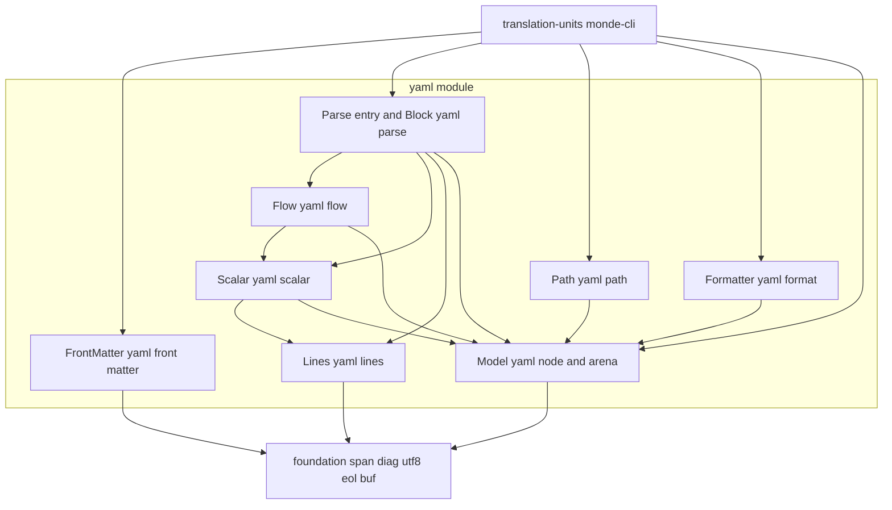
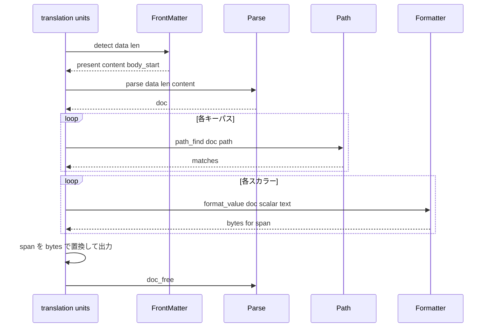

# 技術設計書: yaml-front-matter

## Overview

**Purpose**: yaml-front-matter は、Markdown 文書の先頭にある YAML フロントマターを検出し、フロントマターでよく使われる YAML のサブセットを解析して、各スカラーの論理値と原文上の範囲・スタイルを返す汎用の部品である。キーパスでスカラーを参照する機能と、訳文を元のスタイルを保って（保てなければダブルクオートに切り替えて）書き戻す整形の機能を持つ。

**Users**: translation-units は、検出器が返す本文の開始位置を markdown-parser に渡し、キーパスで取り出したスカラーの論理値を msgid にし、整形した訳文でスカラーの範囲を置き換える。monde-cli は、解析が失敗したときの診断を表示する。本部品は Monde 固有の知識（どのキーを翻訳するか、CLI オプション）を持たない。

**Impact**: 新しいモジュール `src/yaml/`（ライブラリ `monde::yaml`）と、テスト `tests/yaml/` を追加する。既存のファイルの変更は、`src/CMakeLists.txt` と `tests/CMakeLists.txt` への `add_subdirectory` の追加と、steering（structure.md）への予約済みの短縮名 `yaml` の追記だけである。

### Goals
- 文書の 1 行目の `---` と、`---` または `...` の閉じの行でフロントマターを検出し、本文の開始位置を返す。閉じの行がなければフロントマターなしとする。
- ブロック形式とフロー形式のマッピング・シーケンス、5 種類のスタイルのスカラー、コメントを解析し、各スカラーの論理値（YAML 1.2 のエスケープ、折り返し、チョンプを解決した文字列）と、文書全体を基準とする範囲・行番号・スタイルを返す。
- `seo.title` のようなドット区切りのキーパスで、該当するすべてのスカラーを原文の順に返す。
- 訳文を整形して、整形後の内容を解析し直すと論理値が訳文と一致し、置き換えた範囲の外側のバイト列が変わらないようにする。
- 非対応の構文（アンカー、エイリアス、タグ、ディレクティブ、複雑なキー）と不正な入力を、行番号付きの英語の診断で返す。メモリ不足と深い入れ子で異常終了しない。

### Non-Goals
- YAML 1.2 の完全な対応（アンカー、エイリアス、タグ、ディレクティブ、複雑なキー、複数ドキュメント、`---` で始まらない文書）
- YAML 全体の再シリアライズ、値の型（数値、真偽値、null）の解釈
- TOML（`+++`）など YAML 以外のフロントマター
- どのキーを翻訳するか、msgid の組み立て、範囲置換の実行（translation-units）、CLI オプションの解釈（monde-cli、cli-args）
- ファイルの入出力、BOM の除去、診断の表示、終了コード（foundation、monde-cli）
- 性能の目標（steering のとおり設けない）

## Boundary Commitments

### This Spec Owns
- フロントマターの検出の規則（開きと閉じの行の形、閉じの行がない場合の扱い）と、その結果の型 `mnd_yaml_front_matter_t`
- YAML サブセットの文法の解釈（本書「解析の規則」）と、構文木の型（`mnd_yaml_doc_t`、`mnd_yaml_node_t`、スカラーのデータ）、その所有権の規則
- スカラーの論理値の定義（エスケープ、折り返し、チョンプの解決）と、スカラーの範囲の定義（本書「範囲の規則」）
- キーパスの書式（`.` 区切り、シーケンスは全要素）と照合の規則
- 訳文の整形の規則（本書「整形の規則」）: 元のスタイルを維持できる条件と、ダブルクオートへの切り替え
- 本部品の診断の英語のメッセージ（本書「メッセージ」）

### Out of Boundary
- フロントマターのどのキーを翻訳対象にするか。カンマ区切りのオプション値を 1 本ずつのキーパスに分けること（monde-cli）
- スカラーの範囲を訳文で置き換えること、本文との統合、出力の組み立て（translation-units）
- フロントマターの後ろの本文の解析（markdown-parser）。本部品は本文の開始位置を返すだけである
- ファイルの読み書き、BOM の除去、診断の表示（foundation、monde-cli）
- アンカーやタグを含むフロントマターの救済（エラーにする。Q3-2 の決定）

### Allowed Dependencies
- 製品コード（`src/yaml/`）: C 標準ライブラリと、`monde::foundation` の `source.h`（`mnd_span_t`、`mnd_source_line_of`）、`diag.h`、`utf8.h`、`eol.h`（`mnd_eol_detect`）、`buf.h`（整形の出力先と論理値の組み立て）。`file_io.h` は使わない。
- テストコード（`tests/yaml/`）: 上記に加えて Naos。
- モジュール間の依存は `foundation ← yaml ← translation-units` の一方向。yaml は他の汎用部品（cli_args、po、po_merge、markdown）に依存しない。
- モジュール内の依存の方向は「Architecture」の図に従う。

### Revalidation Triggers
- `mnd_yaml_node_t`、`mnd_yaml_scalar_t`、`mnd_yaml_front_matter_t` のフィールドの追加・意味の変更 → translation-units
- 範囲の規則（スカラーの範囲に引用符やヘッダを含めること、空の値の位置）の変更 → translation-units の範囲置換
- 整形の規則（切り替えの条件、空の範囲への先頭の空白）の変更 → translation-units、monde-cli のラウンドトリップテスト
- キーパスの書式の変更 → monde-cli の `--front-matter-keys` のヘルプと利用マニュアル
- フロントマターの検出の規則（`...` の扱い、閉じの行がない場合）の変更 → markdown-parser に渡す本文の開始位置、利用マニュアル
- 確保関数の型を foundation に移す変更 → markdown-parser、本部品の両方

## Architecture

### Architecture Pattern & Boundary Map



**Architecture Integration**:
- **Selected pattern**: 行の表を先に作り、ブロックの構造をインデントのスタックで、フロー形式のコレクションとスカラーを文字単位の走査で解析する（選定の理由は `research.md`）。再帰を使わない。
- **Dependency direction**: `Lines → Model → Scalar → Flow → Parse`、`Model → Path`、`Model → Format`。FrontMatter は Model に依存しない（検出だけなら解析を使わない）。左側が下位で、上位は下位だけを使う。
- **Existing patterns preserved**: 1 モジュール = 1 静的ライブラリ（`monde_add_module`）。エラーは `mnd_diag_list_t` に追加して返す。公開シンボルには接頭辞 `mnd_yaml_` を付ける。構文木は内容を複製せずオフセットで指し、アリーナで一括で解放する。確保関数をオプションで差し替える（markdown-parser と同じ）。モジュール内で共有する型は `yaml_internal.h` に置く。
- **New components rationale**: FrontMatter は、検出だけを使う呼び出し（本文の開始位置の取得）が解析を必要としないため分ける。Scalar と Flow は、字句の規則が独立していて単体でテストしたいため分ける。Path と Format は、構文木を読むだけの利用側の機能であり、解析と切り離して差し替えられるようにする。

### Technology Stack

| Layer | Choice / Version | Role in Feature | Notes |
|-------|------------------|-----------------|-------|
| 言語 | C99 | 製品コードとテスト | steering の規約に従う |
| ビルド | CMake 3.21 以上 | `monde_add_module(yaml ...)`、テストの登録 | 既存の関数を使う |
| テスト | Naos v0.4.0 | 単体テスト | 既存の取り込みを使う |
| 仕様 | YAML 1.2.2 | サブセットの字句と折り返し、チョンプ、Core Schema の非文字列の形 | 仕様の範囲は本書「解析の規則」に限る |

## File Structure Plan

### Directory Structure
```
src/yaml/
├── CMakeLists.txt         # monde_add_module(yaml SOURCES ... DEPENDS foundation)
├── yaml.h                 # Model の公開ヘッダ: ノード・スカラー・文書の型、アクセサ、解放
├── yaml_node.c            # Model: アリーナ、ノードと配列の確保、文書の解放、アクセサ
├── yaml_internal.h        # モジュール内で共有する型: アリーナ、文書の内部構造、解析の作業状態
├── yaml_front_matter.h    # FrontMatter の公開ヘッダ
├── yaml_front_matter.c    # FrontMatter: 開きと閉じの行の検出、本文の開始位置
├── yaml_parse.h           # Parse の公開ヘッダ: オプション、確保関数、mnd_yaml_parse
├── yaml_parse.c           # Parse: 入口（UTF-8 の検証、行の表の作成、改行コードの検出）とブロックのコレクションの解析
├── yaml_lines.h           # Lines の内部ヘッダ
├── yaml_lines.c           # Lines: 物理的な行の表（インデント、内容、行末記号、空行・コメント行の判定）
├── yaml_scalar.h          # Scalar の内部ヘッダ
├── yaml_scalar.c          # Scalar: プレーン・引用符付き・ブロックスカラーの走査と論理値、非対応の指示文字の検出
├── yaml_flow.h            # Flow の内部ヘッダ
├── yaml_flow.c            # Flow: フロー形式のシーケンスとマッピング（明示的なスタック）
├── yaml_path.h            # Path の公開ヘッダ
├── yaml_path.c            # Path: キーパスの検証と照合、該当するノードの列
├── yaml_format.h          # Formatter の公開ヘッダ
└── yaml_format.c          # Formatter: スタイルの維持の判定、各スタイルの整形、ダブルクオートへの切り替え

tests/yaml/
├── CMakeLists.txt         # monde_add_module_tests(yaml SOURCES ...)
├── main.c                 # スイートの登録
├── test_alloc.h / .c      # n 回目の確保で失敗する確保関数、確保と解放の回数（markdown の test_alloc と同じ形）
├── front_matter_test.c    # スイート front_matter（1.1〜1.7、6.6、7.1）
├── lines_test.c           # スイート lines（Lines の単体テスト、7.2）
├── scalar_test.c          # スイート scalar（3.2〜3.9、6.5）
├── block_test.c           # スイート block（2.1、2.2、2.4〜2.10、6.2〜6.4）
├── flow_test.c            # スイート flow（2.3、6.2）
├── model_test.c           # スイート model（3.1、6.10）
├── path_test.c            # スイート path（4.1〜4.8）
├── format_test.c          # スイート format（5.1〜5.8）
├── error_test.c           # スイート error（6.1、6.6〜6.9）
└── roundtrip_test.c       # スイート roundtrip（8.2、8.3）
```

### Modified Files
- `src/CMakeLists.txt` — `add_subdirectory(yaml)` を追加する
- `tests/CMakeLists.txt` — `add_subdirectory(yaml)` を追加する
- `.kiro/steering/structure.md` — 予約済みの短縮名に `yaml` を追記する

## 規約（本モジュール）

- **短縮名**: `yaml`。関数は `mnd_yaml_<対象>_<動作>`、型は `mnd_yaml_<対象>_t`、マクロと列挙値は `MND_YAML_`。モジュール名（ディレクトリ・ターゲット）も `yaml`。
- **入力の不変条件**: 検出と解析は、渡された内容を変更せず、複製しない。構文木は内容を指すオフセットと、論理値の複製だけを持つ。呼び出し側は、構文木を使い終わるまで内容を保持する。
- **所有権**: 文書（`mnd_yaml_doc_t`）は、すべてのノード、ノードの配列、論理値の文字列を自分のアリーナに持つ。`mnd_yaml_doc_free` がすべてを解放する。キーパスの結果の配列は文書の確保関数で確保し、`mnd_yaml_matches_free` で解放する。
- **オフセットと行番号**: 基準は渡された文書の内容全体の先頭（フロントマターの内容の先頭ではない）。行番号は 1 から数え、foundation の `mnd_source_line_of` と同じく LF と CRLF を 1 つの改行として数え、単独の CR を数えない。
- **行末記号**: LF と CRLF を行末とする。単独の CR は行末ではなく、YAML の印字可能文字でもないため、解析のエラーにする。
- **再帰を使わない**: 入れ子の深さが入力で決まる処理（ブロックの解析、フロー形式の解析、キーパスの照合）は、明示的なスタックまたは作業用の配列で行う（6.9）。
- **メモリ不足**: 解析・照合・整形は `false` を返し、`out of memory` の診断を追加する。Model のアクセサは失敗しない。
- **スタイル**: steering のコーディングスタイル（Allman、波括弧の省略禁止、比較の括弧）に従う。

## 解析の規則

本節は、要件 2 と 3 の「YAML のサブセット」を具体的に定める。ここに書かれていない構文は、6.1（非対応）または 6.2（解析できない）のエラーになる。

### 行とインデント
- 内容の範囲を物理的な行に分ける。各行は、インデント（行頭の空白の数）、内容の範囲（行末記号を含まない）、行末記号の長さを持つ。
- 空白だけの行と、インデントのあとが `#` で始まる行は、構造の解析では読み飛ばす（ブロックスカラーの内容の中では読み飛ばさない）。
- インデントにタブが含まれる行は、6.3 のエラーにする（ブロックスカラーの内容の行で、インデントの幅のあとにあるタブは内容として扱う）。
- 行の内容に単独の CR が含まれる場合は、6.2 のエラーにする。

### ブロックのコレクション
- ルートは、内容の最初の空でない行のインデントで始まるブロックのノード 1 つ（マッピング、シーケンス、またはスカラー）。内容が空なら空のドキュメント（`root == NULL`）。
- マッピングの項目: `key: value`。キーはプレーン・シングルクオート・ダブルクオートのスカラー（1 行）。`:` の後ろは空白か行末。値は、同じ行にあるスカラーまたはフロー形式のコレクション、同じ行のブロックスカラーのヘッダ、次の行以降のより深いインデントのブロックのノード、またはキーと同じインデントで始まるシーケンス（`key:\n- a`）。行末までに値がなく、次の空でない行がより深いインデントでもキーと同じインデントのシーケンスでもなければ、空のプレーンスカラー（2.8）。
- シーケンスの項目: `- ` または行末の `-`。項目の内容はマッピングの値と同じ規則で、`- ` の後ろのインデント（`-` の桁 + 2）を基準にする。`- key: value` のように項目の中で始まるマッピングを認める。
- 同じコレクションの項目は同じインデントを持つ。インデントが浅くなったら、そのインデントのコレクションまで閉じる。開いているコレクションのどれとも一致しないインデント、`key:` でも `- ` でもない行、項目の後ろの余分な内容は、6.2 のエラー。
- 同じマッピングに論理値が同じキーが 2 つあれば、6.4 のエラー（後のキーの行番号）。
- `? ` で始まる行（複雑なキー）、`%` で始まる行（ディレクティブ）、ノードの先頭の `&`、`*`、`!` は 6.1 のエラー。`@` と `` ` `` で始まるスカラーは 6.2 のエラー。

### フロー形式のコレクション
- `[` と `]` のシーケンス、`{` と `}` のマッピング。項目は `,` で区切る。末尾の `,` は認める。空の項目（`[a, , b]`）は 6.2 のエラー。
- フロー形式の中の値は、プレーン・引用符付きのスカラー、入れ子のフロー形式のコレクションに限る。ブロックスカラーは 6.2 のエラー。マッピングの値がない（`{k}`、`{k: }`）場合は空のプレーンスカラー。
- フロー形式のコレクションは複数の行にまたがれる。閉じ括弧がないまま内容が終われば 6.2 のエラー。
- フロー形式の中のスカラーは `flow == true` を持つ（5.5 の判定に使う）。

### スカラー
| スタイル | 認識 | 論理値 |
|---------|------|--------|
| プレーン | 指示文字以外（`-`、`?`、`:` は後ろが空白でなければ可）で始まり、`: `（または行末の `:`）と ` #` の前まで。フロー形式の中では `,`、`[`、`]`、`{`、`}` の前まで。次の行がより深いインデントで、構造の行（`key:`、`- `）でなければ継続行とする | 各行の前後の空白を除き、行の境目を 1 つの空白にし、間の空行を 1 つずつ改行にする（3.7） |
| シングルクオート | `'` から次の単独の `'` まで。`''` は `'`。複数行可 | `''` → `'`（3.6）。複数行はプレーンと同じ折り返し |
| ダブルクオート | `"` から、エスケープされていない `"` まで。複数行可 | YAML 1.2 のエスケープ（`\0 \a \b \t \n \v \f \r \e \  \" \/ \\ \N \_ \L \P \xXX \uXXXX \UXXXXXXXX`）を解決する（3.5）。行末の `\` はその行の折り返しを抑止する。それ以外の `\` は 6.5 のエラー |
| リテラル `\|` | ヘッダ: `\|` と、チョンプ指示子（`-`、`+`）とインデント指示子（1〜9）を任意の順で 0〜1 個ずつ。ヘッダの後ろは空白とコメントだけ。内容の行は次の行から、親のインデントより深い行が続く間（空行は継続） | 内容のインデントを除き、改行をそのまま残す。チョンプ: なし = 末尾の改行を 1 つ残す、`-` = 残さない、`+` = 末尾の空行をすべて残す（3.8） |
| 折り返し `>` | リテラルと同じ | 行の境目を空白にする。ただし、空白で始まる行（より深いインデント）の前後と、空行の前後は改行を残す（3.8） |

- 内容のインデント: インデント指示子があれば親のインデント + 指示子。なければ最初の空でない内容の行のインデント。それより浅い空でない行でブロックスカラーは終わる。指示子がないのに、最初の空でない行より深い空白だけの先行の行があれば 6.2 のエラー。
- 論理値の改行は LF で表す（3.9）。文字列は NUL を含まず、NUL 終端で持つ。`\0` のエスケープは U+0000 を表すため 6.5 のエラーにする（Monde の翻訳単位は NUL を含まない）。
- 値の型は解釈しない（2.9）。

## 範囲の規則

オフセットはすべて渡された文書の先頭を 0 とし、範囲は開始を含み終了を含まない。

| ノード | 範囲 |
|-------|------|
| フロントマター全体 | 開きの行の先頭（0）から、閉じの行の行末記号の直後まで。閉じの行に行末記号がなければ文書の終わり（1.2、1.6） |
| フロントマターの内容 | 開きの行の行末記号の直後から、閉じの行の先頭まで（1.2、1.5） |
| プレーンスカラー | 最初の文字から、最後の行の最後の空白でない文字の直後まで（複数行では途中の行末記号を含む） |
| 引用符付きスカラー | 開きの引用符から閉じの引用符の直後まで（3.2） |
| ブロックスカラー | ヘッダの `\|` または `>` から、最後の内容の行の終わり（行末記号の前）まで。チョンプが `+` のときは、末尾の空行のうち最後の行の終わりまで。それ以外では末尾の空行を含めない（3.2） |
| 空のプレーンスカラー | `:` または `-` の直後の空の範囲（2.8）。フロー形式の `{k}` ではキーの直後 |
| マッピング | 最初のキーの先頭から、最後の値の終わりまで |
| シーケンス | 最初の `-`（または `[`）から、最後の項目の終わり（または `]` の直後）まで |

- `start_line` と `end_line` は、`span.start` と `span.end` の行番号（空の範囲では同じ行）。
- 子のノードの範囲は親の内側に収まり、兄弟の範囲は重ならずに原文の順に並ぶ。

## 整形の規則

`mnd_yaml_format_value` は、スカラーの範囲を置き換えるバイト列を作る。先に元のスタイルを維持できるかを判定し、できなければダブルクオートで整形する（5.2〜5.5）。

| 元のスタイル | 維持できる条件（すべて満たすこと） | 維持するときの整形 |
|-------------|------------------------------|------------------|
| プレーン | 訳文が空でない。改行、CR、タブ以外の制御文字を含まない。先頭が空白・タブ・指示文字（`-?:,[]{}#&*!\|>'"%@` と `` ` ``）でない。末尾が空白・タブ・`:` でない。`: ` と ` #` を含まない。訳文全体が `---` または `...` でない。フロー形式の中では `,`、`[`、`]`、`{`、`}` を含まない。Core Schema の非文字列の形（`null`、`~`、`true`、`false` の変種、整数、小数、`.inf`、`.nan`）でない | 訳文をそのまま |
| シングルクオート | 改行と CR を含まない。タブ以外の制御文字を含まない | `'` を `''` にして `'...'` で囲む（1 行） |
| ダブルクオート | 常に維持できる | `\` と `"` を `\\` と `\"` に、改行を `\n`、タブを `\t`、CR を `\r`、その他の制御文字を `\xXX` にして `"..."` で囲む（1 行） |
| リテラル | 訳文が CR を含まない。空白だけの行を含まない。インデント指示子がなければ、最初の空でない行が空白で始まらない。末尾の改行の数がチョンプと合う（なし: ちょうど 1 つ、`-`: 0 個、`+`: 1 つ以上） | ヘッダ（ `\|`、指示子）を原文のバイト列のまま、内容の各行を `content_indent` 個の空白で始めて出力する。先頭の行の後ろにヘッダの行末記号が続く。`+` では末尾の改行を空行として出力する |
| 折り返し | リテラルの条件に加えて、空白で始まる行を含まない | ヘッダは原文のまま。訳文の各行を内容の行とし、訳文の改行 n 個の並びを n 個の空行にして出力する |

- 元の範囲が空（空のプレーンスカラー）のときは、整形した結果の先頭に 1 つの空白を付ける（`key:` → `key: 訳文`）。
- 複数行の出力の行末記号は、文書の `eol`（フロントマターの範囲で `mnd_eol_detect` が返す `dominant`。改行がなければ LF）を使う（5.6）。
- 非 ASCII の文字はエスケープせず UTF-8 のまま出力する（5.7）。ダブルクオートで `\uXXXX` は使わない。
- 出力はスカラーの範囲の中身だけであり、キー、インデント、後ろのコメント、行末記号を含まない（5.8）。
- 訳文に NUL または不正な UTF-8 が含まれる場合はエラー（`invalid UTF-8 sequence`、`NUL in value`）。

## メッセージ

診断のメッセージは英語で、`mnd_diag_add` に渡す。パスはオプションの `path`（NULL 可）、行番号は位置が分かるときにその行番号、分からないときは 0。

| 状況 | 重大度 | メッセージ | 行番号 |
|------|--------|-----------|--------|
| 不正な UTF-8（6.6） | エラー | `invalid UTF-8 sequence` | 不正なバイトの行 |
| メモリ不足（6.7） | エラー | `out of memory` | 0 |
| 非対応の構文（6.1） | エラー | `unsupported YAML syntax: %s`（`%s` は `anchor`、`alias`、`tag`、`directive`、`complex mapping key`） | その位置の行 |
| インデントのタブ（6.3） | エラー | `tab character in indentation` | その行 |
| 同じキー（6.4） | エラー | `duplicate mapping key "%s"` | 後のキーの行 |
| 不正なエスケープ（6.5） | エラー | `invalid escape sequence in double-quoted scalar` | その位置の行 |
| 閉じていない引用符 | エラー | `unterminated quoted scalar` | 開きの引用符の行 |
| 閉じていないフロー形式 | エラー | `unterminated flow collection` | 開き括弧の行 |
| インデントの不整合 | エラー | `inconsistent indentation` | その行 |
| 項目として解釈できない行 | エラー | `expected a mapping entry or a sequence item` | その行 |
| 値の後ろの余分な内容 | エラー | `unexpected content after value` | その行 |
| フロー形式の空の項目、ブロックスカラー | エラー | `invalid flow collection entry` | その行 |
| 予約の指示文字 `@`、`` ` `` | エラー | `reserved indicator "%c" cannot start a scalar` | その行 |
| 単独の CR | エラー | `carriage return without line feed` | その行 |
| 不正なブロックスカラーのヘッダ、インデント指示子の矛盾 | エラー | `invalid block scalar` | ヘッダの行 |
| 不正なキーパス（4.7） | エラー | `invalid key path "%s"` | 0 |
| 整形の訳文の NUL | エラー | `NUL in value` | 0 |

## Requirements Traceability

| Requirement | Summary | Components | Interfaces | Flows |
|-------------|---------|------------|------------|-------|
| 1.1 | 開きと閉じの行の検出 | FrontMatter | `mnd_yaml_front_matter_detect` | 検出 |
| 1.2 | 全体・内容の範囲と本文の開始位置 | FrontMatter | `mnd_yaml_front_matter_t` | 検出 |
| 1.3 | 1 行目が `---` でない | FrontMatter | `present == false`、`body_start == 0` | 検出 |
| 1.4 | 閉じの行がない | FrontMatter | 同上 | 検出 |
| 1.5 | 内容が空 | FrontMatter | `content` が空の範囲 | 検出 |
| 1.6 | 閉じの行に行末記号がない | FrontMatter | `body_start == len` | 検出 |
| 1.7 | LF と CRLF、内容を変更しない | FrontMatter | — | 検出 |
| 2.1 | 1 つのドキュメントとして解析し木を返す | Parse、Model | `mnd_yaml_parse`、`mnd_yaml_doc_root` | 解析 |
| 2.2 | ブロック形式の入れ子 | Parse | 解析の規則「ブロックのコレクション」 | 解析 |
| 2.3 | フロー形式 | Flow | 解析の規則「フロー形式」 | 解析 |
| 2.4 | 3 種類のキー | Parse、Scalar | — | 解析 |
| 2.5 | コメントと空行 | Lines、Scalar | — | 解析 |
| 2.6 | 出現順 | Model | `pairs`、`items` の順 | — |
| 2.7 | 空のドキュメント | Parse | `root == NULL` | 解析 |
| 2.8 | 値のないキー | Parse | 空のプレーンスカラー | 解析 |
| 2.9 | 型を解釈しない | Scalar | `value` は常に文字列 | — |
| 2.10 | 内容を変更しない | Parse | — | — |
| 3.1 | 範囲と行番号 | Model | `span`、`start_line`、`end_line` | — |
| 3.2 | 引用符・ヘッダを含む範囲 | Scalar | 範囲の規則 | — |
| 3.3 | スタイル | Scalar | `mnd_yaml_style_t` | — |
| 3.4 | ブロックスカラーの指示子とインデント | Scalar | `chomp`、`indent_indicator`、`content_indent` | — |
| 3.5 | ダブルクオートのエスケープ | Scalar | 解析の規則「スカラー」 | — |
| 3.6 | シングルクオートの `''` | Scalar | 同上 | — |
| 3.7 | 複数行の折り返し | Scalar | 同上 | — |
| 3.8 | ブロックスカラーの論理値 | Scalar | 同上 | — |
| 3.9 | 改行は LF | Scalar | — | — |
| 4.1 | `.` 区切りの照合 | Path | `mnd_yaml_path_find` | 照合 |
| 4.2 | シーケンスは全要素 | Path | 同上 | 照合 |
| 4.3 | 該当するスカラーを順に返す | Path | `mnd_yaml_matches_t` | 照合 |
| 4.4 | 該当なし | Path | `count == 0`、`true` | 照合 |
| 4.5 | マッピングに当たった | Path | 結果の `kind` で区別 | 照合 |
| 4.6 | 論理値の完全一致 | Path | — | 照合 |
| 4.7 | 不正なキーパス | Path | `invalid key path` | 照合 |
| 4.8 | `.` を含むキー | Path | — | 照合 |
| 5.1 | 置き換えるバイト列、再解析で一致 | Formatter | `mnd_yaml_format_value` | 整形 |
| 5.2 | スタイルの維持 | Formatter | 整形の規則 | 整形 |
| 5.3 | ブロックスカラーのヘッダとインデント | Formatter | 同上 | 整形 |
| 5.4 | ダブルクオートへの切り替え | Formatter | 同上 | 整形 |
| 5.5 | フロー形式の中の記号 | Formatter | `flow` | 整形 |
| 5.6 | 行末記号 | Parse、Formatter | `mnd_yaml_doc_eol` | 整形 |
| 5.7 | 非 ASCII をそのまま | Formatter | — | 整形 |
| 5.8 | 範囲の外側を変えない | Formatter | — | 整形 |
| 6.1 | 非対応の構文 | Parse、Scalar | `unsupported YAML syntax` | 解析 |
| 6.2 | 解析できない入力 | Parse、Flow、Scalar | メッセージ表 | 解析 |
| 6.3 | インデントのタブ | Lines | `tab character in indentation` | 解析 |
| 6.4 | 同じキー | Parse、Flow | `duplicate mapping key` | 解析 |
| 6.5 | 不正なエスケープ | Scalar | `invalid escape sequence` | 解析 |
| 6.6 | 不正な UTF-8 | FrontMatter、Parse | `invalid UTF-8 sequence` | 検出、解析 |
| 6.7 | メモリ不足 | Model、Parse、Path、Formatter | `out of memory`、確保関数 | — |
| 6.8 | 英語の診断、I/O しない | 全部 | `mnd_diag_add` | — |
| 6.9 | 深い入れ子 | Parse、Flow、Path | 明示的なスタック | — |
| 6.10 | 一括解放 | Model | `mnd_yaml_doc_free` | — |
| 7.1 | 文書全体の行番号 | FrontMatter、Lines | `mnd_source_line_of` と同じ規則 | — |
| 7.2 | LF と CRLF | Lines | `eol_len` | — |
| 8.1 | 個別のテスト | tests/yaml | 各スイート | — |
| 8.2 | 整形の往復 | tests/yaml | roundtrip | — |
| 8.3 | 変更なしの往復 | tests/yaml | roundtrip | — |

## Components and Interfaces

| Component | Domain/Layer | Intent | Req Coverage | Key Dependencies (P0/P1) | Contracts |
|-----------|--------------|--------|--------------|--------------------------|-----------|
| Model | データ | 構文木の型、アリーナ、解放 | 2.6, 3.1, 6.7, 6.10 | foundation（P0） | Service, State |
| FrontMatter | 入口 | 文書先頭のフロントマターの検出 | 1.1–1.7, 6.6, 7.1 | foundation（P0） | Service |
| Parse | 入口 | 解析の入口とブロックのコレクション | 2.1, 2.2, 2.4, 2.7, 2.8, 2.10, 6.1, 6.2, 6.4, 6.6, 6.9 | Lines, Scalar, Flow, Model（P0） | Service |
| Lines | 内部 | 物理的な行の表 | 2.5, 6.3, 7.1, 7.2 | foundation（P0） | Service |
| Scalar | 内部 | スカラーの走査と論理値 | 2.9, 3.2–3.9, 6.1, 6.5 | Lines, Model（P0） | Service |
| Flow | 内部 | フロー形式のコレクション | 2.3, 6.2, 6.4 | Scalar, Model（P0） | Service |
| Path | 利用側 | キーパスによる照合 | 4.1–4.8, 6.9 | Model（P0） | Service |
| Formatter | 利用側 | 訳文の整形 | 5.1–5.8 | Model（P0）、foundation buf（P0） | Service |

### データ

#### Model

| Field | Detail |
|-------|--------|
| Intent | 構文木の型と文書の所有権を定め、アクセサと解放を提供する |
| Requirements | 2.6, 3.1, 6.7, 6.10 |

**Responsibilities & Constraints**
- ノード、ノードの配列、論理値の文字列を文書のアリーナに確保する。アリーナは確保関数（`mnd_yaml_allocator_t`）から大きな塊を確保し、塊の連結リストを持つ。解放は塊を順に `free` するだけで、木をたどらない。
- 公開の型は読み取り用である。translation-units は `const` で参照する。

**Dependencies**
- Outbound: foundation `source.h` — `mnd_span_t`（P0）、`eol.h` — `mnd_eol_t`（P0）
- Inbound: Parse、Flow、Scalar — ノードの作成（P0）。Path、Formatter、呼び出し側 — 読み取り（P0）

**Contracts**: Service [x] / State [x]

##### Service Interface（`yaml.h`）
```c
typedef enum mnd_yaml_kind
{
    MND_YAML_SCALAR,
    MND_YAML_MAPPING,
    MND_YAML_SEQUENCE
} mnd_yaml_kind_t;

typedef enum mnd_yaml_style
{
    MND_YAML_PLAIN,
    MND_YAML_SINGLE_QUOTED,
    MND_YAML_DOUBLE_QUOTED,
    MND_YAML_LITERAL,   /* | */
    MND_YAML_FOLDED     /* > */
} mnd_yaml_style_t;

typedef enum mnd_yaml_chomp
{
    MND_YAML_CHOMP_CLIP,   /* 指示子なし */
    MND_YAML_CHOMP_STRIP,  /* - */
    MND_YAML_CHOMP_KEEP    /* + */
} mnd_yaml_chomp_t;

typedef struct mnd_yaml_node mnd_yaml_node_t;

typedef struct mnd_yaml_scalar
{
    mnd_yaml_style_t style;
    const char *value;          /* 論理値（UTF-8、NUL 終端、改行は LF）。アリーナが所有 */
    size_t value_len;
    bool flow;                  /* フロー形式のコレクションの中にある */
    /* ブロックスカラーのみ（それ以外は CLIP、false、0、0） */
    mnd_yaml_chomp_t chomp;
    bool has_indent_indicator;
    unsigned indent_indicator;  /* 1〜9 */
    size_t content_indent;      /* 内容の行の先頭の空白の数（行頭からの桁） */
} mnd_yaml_scalar_t;

typedef struct mnd_yaml_pair
{
    mnd_yaml_node_t *key;       /* 常にスカラー */
    mnd_yaml_node_t *value;
} mnd_yaml_pair_t;

/*
 * 不変条件: span は文書の内容の範囲内で start <= end。子は親の内側。兄弟は重ならず原文の順に並ぶ
 */
struct mnd_yaml_node
{
    mnd_yaml_kind_t kind;
    mnd_span_t span;
    size_t start_line;
    size_t end_line;
    mnd_yaml_node_t *parent;    /* ルートは NULL */
    union
    {
        mnd_yaml_scalar_t scalar;
        struct { mnd_yaml_pair_t *pairs; size_t count; } mapping;
        struct { mnd_yaml_node_t **items; size_t count; } sequence;
    } as;
};

typedef struct mnd_yaml_doc mnd_yaml_doc_t;  /* 不透明。内容へのポインタ、解析した範囲、根、eol、アリーナ、確保関数を持つ */

const mnd_yaml_node_t *mnd_yaml_doc_root(const mnd_yaml_doc_t *doc);  /* 空のドキュメントなら NULL */
const char *mnd_yaml_doc_data(const mnd_yaml_doc_t *doc);
size_t mnd_yaml_doc_len(const mnd_yaml_doc_t *doc);
mnd_span_t mnd_yaml_doc_content(const mnd_yaml_doc_t *doc);  /* 解析した範囲 */
mnd_eol_t mnd_yaml_doc_eol(const mnd_yaml_doc_t *doc);       /* MND_EOL_LF か MND_EOL_CRLF（改行がなければ LF） */
void mnd_yaml_doc_free(mnd_yaml_doc_t *doc);                 /* NULL に対しても安全 */
```
- State: 文書は不変。`mnd_yaml_doc_free` 後にノードへのポインタを使ってはならない。
- 内部（`yaml_internal.h`）: `mnd_yaml_arena_alloc(doc, size)`、`mnd_yaml_node_new(doc, kind)`、`mnd_yaml_arena_strdup(doc, data, len)`。失敗したら NULL。

### 入口

#### FrontMatter

| Field | Detail |
|-------|--------|
| Intent | 文書先頭のフロントマターを検出し、範囲と本文の開始位置を返す |
| Requirements | 1.1–1.7, 6.6, 7.1 |

**Responsibilities & Constraints**
- 1 行目が `---`（後ろに空白・タブだけ）であれば、2 行目以降で最初の `---` または `...`（後ろに空白・タブだけ）の行を探す。見つからなければ `present == false`。
- 行末は LF または CRLF。行の判定で単独の CR は通常の文字として扱う（`---\r` は閉じの行にならない）。
- 検出の前に `mnd_utf8_validate` で文書全体を検証する。
- Model に依存せず、メモリを確保しない。

**Dependencies**
- Outbound: foundation `utf8.h`、`source.h`、`diag.h`（P0）

**Contracts**: Service [x]

##### Service Interface（`yaml_front_matter.h`）
```c
typedef struct mnd_yaml_front_matter
{
    bool present;
    mnd_span_t span;      /* 開きの行の先頭から閉じの行の行末記号の直後まで。present でなければ {0, 0} */
    mnd_span_t content;   /* 開きと閉じの行に挟まれた内容。present でなければ {0, 0} */
    size_t body_start;    /* 本文の開始位置。present でなければ 0 */
} mnd_yaml_front_matter_t;

/*
 * data[0..len)（BOM 除去後）の先頭のフロントマターを検出し *out に設定して true を返す。
 * 不正な UTF-8 なら diags にエラーを追加し、*out を {false, {0,0}, {0,0}, 0} にして false を返す。
 * path は診断に付けるパス（NULL 可）。data は len == 0 なら NULL 可
 */
bool mnd_yaml_front_matter_detect(const char *data, size_t len, const char *path,
                                  mnd_yaml_front_matter_t *out, mnd_diag_list_t *diags);
```
- Postconditions: `present` のとき `span.start == 0`、`content.start <= content.end <= span.end`、`body_start == span.end`。閉じの行に行末記号がなければ `span.end == len`（1.6）。

#### Parse

| Field | Detail |
|-------|--------|
| Intent | 解析の入口と、ブロック形式のコレクションの解析 |
| Requirements | 2.1, 2.2, 2.4, 2.7, 2.8, 2.10, 6.1, 6.2, 6.4, 6.6, 6.9 |

**Responsibilities & Constraints**
- 入口: `content` の検証（文書の範囲内）、`content` の範囲の UTF-8 の検証、`mnd_eol_detect` による `eol` の決定、Lines による行の表の作成、文書の作成、ブロックの解析、失敗時の片付け。
- ブロックの解析: 開いているコレクションのスタック（インデント、ノード、種類）を持つ。行ごとに、インデントでスタックを閉じ、`- ` か `key:` かスカラーかを判定し、値を Scalar または Flow に委ねる。ブロックスカラーのヘッダを見つけたら Scalar に行の表の位置を渡し、消費した行まで進める。
- 同じマッピングのキーの重複は、ペアを追加するときに論理値で比べて検出する。
- 成功したときは診断を増やさない。失敗したときは文書を解放し `*out = NULL`。

**Dependencies**
- Outbound: Lines、Scalar、Flow、Model（P0）。foundation `utf8.h`、`eol.h`、`diag.h`（P0）

**Contracts**: Service [x]

##### Service Interface（`yaml_parse.h`）
```c
typedef struct mnd_yaml_allocator
{
    void *(*alloc)(void *ctx, size_t size);  /* 失敗したら NULL */
    void (*free)(void *ctx, void *ptr);      /* NULL に対しても安全であること */
    void *ctx;
} mnd_yaml_allocator_t;

typedef struct mnd_yaml_options
{
    const char *path;                         /* 診断に付けるパス。NULL 可 */
    const mnd_yaml_allocator_t *allocator;    /* NULL なら malloc と free */
} mnd_yaml_options_t;

#define MND_YAML_OPTIONS_INIT { NULL, NULL }

/*
 * data[0..len) のうち content の範囲を 1 つの YAML ドキュメントとして解析する。
 * 成功したら *out に文書を設定して true を返す。失敗したら *out を NULL にし、diags にエラーを追加して false を返す。
 * options は NULL 可。content は data の範囲内であること（範囲外ならエラー "content span out of range"）。
 * オフセットと行番号は data の先頭を基準にする。文書は data を指し続ける
 */
bool mnd_yaml_parse(const char *data, size_t len, mnd_span_t content, const mnd_yaml_options_t *options,
                    mnd_yaml_doc_t **out, mnd_diag_list_t *diags);
```

### 内部

#### Lines

| Field | Detail |
|-------|--------|
| Intent | 解析する範囲を物理的な行に分け、インデントと内容の範囲、行末記号を持つ表を作る |
| Requirements | 2.5, 6.3, 7.1, 7.2 |

**Contracts**: Service [x]

##### Service Interface（`yaml_lines.h`、内部）
```c
typedef struct mnd_yaml_line
{
    size_t line;          /* 行番号（文書全体の先頭を 1 とする） */
    size_t start;         /* 行の先頭のオフセット */
    size_t indent;        /* 行頭の空白（U+0020）の数 */
    mnd_span_t content;   /* [start, 行末記号の前) */
    unsigned char eol_len;/* 0、1、2 */
    bool blank;           /* 空白だけ */
    bool comment;         /* インデントのあとが # */
    bool tab_in_indent;   /* 行頭の空白とタブの並びにタブがある */
} mnd_yaml_line_t;

typedef struct mnd_yaml_lines
{
    mnd_yaml_line_t *items;
    size_t count;
} mnd_yaml_lines_t;

/* content の範囲を行に分けて作業用の配列に入れる。メモリ不足なら false */
bool mnd_yaml_lines_build(const char *data, size_t len, mnd_span_t content,
                          const mnd_yaml_allocator_t *allocator, mnd_yaml_lines_t *out);
void mnd_yaml_lines_free(const mnd_yaml_allocator_t *allocator, mnd_yaml_lines_t *lines);
```
- 最初の行の行番号は `mnd_source_line_of(data, len, content.start)` で求め、以降は行ごとに 1 ずつ増やす。単独の CR は行末ではない。

#### Scalar

| Field | Detail |
|-------|--------|
| Intent | スカラーの走査（範囲とスタイル）と論理値の組み立て |
| Requirements | 2.9, 3.2–3.9, 6.1, 6.5 |

**Responsibilities & Constraints**
- 行の表の位置（行番号と行内のオフセット）から、1 つのスカラーを読み、終わりの位置を返す。ブロック文脈とフロー文脈で終端の規則を切り替える。
- ノードの先頭の `&`、`*`、`!` を非対応の構文として、`@`、`` ` `` を予約の指示文字として検出する。
- 論理値は `mnd_buf_t` で組み立て、アリーナに複製してノードに付ける。

**Contracts**: Service [x]

##### Service Interface（`yaml_scalar.h`、内部）
```c
typedef struct mnd_yaml_cursor
{
    size_t line_index;    /* 行の表の添字 */
    size_t offset;        /* 文書のオフセット */
} mnd_yaml_cursor_t;

/*
 * at の位置から 1 つのスカラーを読み、ノードを作って *out に設定し、*at を終わりの直後に進める。
 * parent_indent はブロックスカラーと継続行の判定に使う親のインデント。flow はフロー文脈。
 * 失敗（構文エラー、メモリ不足）なら diags に追加して false
 */
bool mnd_yaml_scalar_parse(mnd_yaml_parser_t *p, mnd_yaml_cursor_t *at, size_t parent_indent, bool flow,
                           mnd_yaml_node_t **out);

/* at がブロックスカラーのヘッダ（| か >）で始まるか */
bool mnd_yaml_scalar_is_block_header(const mnd_yaml_parser_t *p, mnd_yaml_cursor_t at);
```
- `mnd_yaml_parser_t`（`yaml_internal.h`）は、文書、行の表、オプション、診断、エラー済みフラグを持つ作業状態。

#### Flow

| Field | Detail |
|-------|--------|
| Intent | フロー形式のシーケンスとマッピングを、明示的なスタックで解析する |
| Requirements | 2.3, 6.2, 6.4 |

**Contracts**: Service [x]

##### Service Interface（`yaml_flow.h`、内部）
```c
/* at が [ または { で始まるフロー形式のコレクションを読み、*out に設定し、*at を閉じ括弧の直後に進める */
bool mnd_yaml_flow_parse(mnd_yaml_parser_t *p, mnd_yaml_cursor_t *at, mnd_yaml_node_t **out);
```
- スタックの各段は、作りかけのノードと、作業用の項目の配列（確保関数から直接確保し、閉じるときにアリーナへ複製する）。
- マッピングの重複キーは Parse と同じ比較で検出する。

### 利用側

#### Path

| Field | Detail |
|-------|--------|
| Intent | キーパスで構文木を照合し、該当するノードの列を返す |
| Requirements | 4.1–4.8, 6.9 |

**Responsibilities & Constraints**
- キーパスを `.` で分け、空または空のセグメントを含めばエラー。
- 作業用のリスト（ノードの集合）をセグメントごとに進める: マッピングなら論理値が一致するキーの値、シーケンスなら全要素に対して同じセグメントを適用、スカラーなら脱落。最後のセグメントの結果のうち、シーケンスは要素に展開し、残ったノード（スカラーもマッピングも）を原文の順に返す。
- ルートがマッピングでなければ該当なし。

**Contracts**: Service [x]

##### Service Interface（`yaml_path.h`）
```c
typedef struct mnd_yaml_matches
{
    const mnd_yaml_node_t **nodes;  /* 原文の順。スカラー以外も含む（kind で区別する） */
    size_t count;
} mnd_yaml_matches_t;

/*
 * path[0..path_len) のキーパスに当たるノードを *out に入れて true を返す。該当なしは count == 0 で true。
 * 不正なキーパスとメモリ不足は diags にエラーを追加し、*out を {NULL, 0} にして false を返す
 */
bool mnd_yaml_path_find(const mnd_yaml_doc_t *doc, const char *path, size_t path_len,
                        mnd_yaml_matches_t *out, mnd_diag_list_t *diags);
void mnd_yaml_matches_free(const mnd_yaml_doc_t *doc, mnd_yaml_matches_t *matches);  /* {NULL, 0} に対しても安全 */
```

#### Formatter

| Field | Detail |
|-------|--------|
| Intent | 訳文を、スカラーの範囲を置き換える YAML の表現に整形する |
| Requirements | 5.1–5.8 |

**Responsibilities & Constraints**
- 本書「整形の規則」に従う。判定と整形をスタイルごとの関数に分け、判定は読み取りだけで副作用を持たない。
- 出力は `mnd_buf_t` の後ろに追加する。失敗時は `out` にそれまでに追加した内容が残る（markdown の Text と同じ）。

**Contracts**: Service [x]

##### Service Interface（`yaml_format.h`）
```c
/*
 * scalar の範囲を置き換えるバイト列を out の後ろに追加して true を返す。
 * text[0..len) は訳文の論理値（UTF-8、改行は LF、NUL を含まない）。
 * 不正な UTF-8、NUL、メモリ不足は diags にエラーを追加して false を返す。
 * path は診断に付けるパス（NULL 可）
 */
bool mnd_yaml_format_value(const mnd_yaml_doc_t *doc, const mnd_yaml_node_t *scalar,
                           const char *text, size_t len, const char *path,
                           mnd_buf_t *out, mnd_diag_list_t *diags);
```
- Preconditions: `scalar->kind == MND_YAML_SCALAR` で、`doc` のノードであること。
- Postconditions: 元の内容の `scalar->span` を出力で置き換えて解析し直すと、同じ位置のスカラーの論理値が `text` と一致する（5.1）。

## System Flows

### 整形と置換の往復（translation-units から見た流れ）



- 検出で `present == false` なら、translation-units は解析を呼ばず、`body_start == 0` を markdown-parser に渡す。
- 置換は原文の順に行い、範囲は互いに重ならない（Model の不変条件）。空の範囲への挿入は Formatter の先頭の空白で `key: 訳文` になる。

## Error Handling

### Error Strategy
- **利用者の入力の誤り**（非対応の構文、解析できない YAML、不正な UTF-8）: エラーの診断と `false`。文書は返さない。部分的な結果は返さない（Q3-2 の決定: エラーにする）。
- **呼び出し側のプログラムの誤り**（範囲が文書の外、不正なキーパス）: エラーの診断と `false`。
- **メモリ不足**: `false` と `out of memory`。アリーナと作業用の配列を確保関数の `free` ですべて解放する。
- どの関数も `stdout` / `stderr` に書かず、プロセスを終了しない（6.8）。
- 最初のエラーで解析を止める（1 回の解析で返す診断は 1 つ。`dropped` は foundation に任せる）。

## Testing Strategy

すべての単体テストは Naos で書き、`yaml_tests` にまとめる（1 ファイル 1 スイート）。期待する範囲はオフセットの数値で書く。解析のテストは、文書全体を渡して `content` を `{0, len}` または検出器の結果にする。

### テスト用の部品
- **test_alloc**: n 回目の確保で失敗する確保関数と、確保と解放の回数。

### Unit Tests
- **front_matter**: `---\ntitle: x\n---\nbody` の範囲と `body_start`（1.1、1.2）。`...` の閉じ、閉じの行の後ろの空白（1.1）。1 行目が `--- a` や `# x`（1.3）。閉じがない `---\ntitle: x\n`（1.4）。`---\n---\n`（1.5）。`---\ntitle: x\n---` の `body_start == len`（1.6）。CRLF の文書、`---\r`（単独の CR）が閉じにならないこと、前後で内容が変わらないこと（1.7）。不正な UTF-8 の行番号（6.6）。内容の行番号が 2 であること（7.1）。
- **lines**: インデント、空行、コメント行、タブ、CRLF の `eol_len`、行番号の開始（6.3、7.1、7.2）。
- **scalar**: 各スタイルの範囲（引用符とヘッダを含む）（3.2、3.3）。`|`、`|-`、`|+`、`>2`、`|2-` の指示子と `content_indent`（3.4）。`"a\tbé\x41\\\""`（3.5）。`'it''s'`（3.6）。複数行のプレーン・引用符付き（空行を含む、ダブルクオートの行末 `\`）（3.7）。リテラルと折り返し（より深い行、空行、各チョンプ）（3.8）。CRLF の文書で論理値が LF（3.9）。`true` と `123` が文字列（2.9）。不正なエスケープ `\q`、`\0`（6.5）。
- **block**: 入れ子のマッピングとシーケンス、`key:\n- a`、`- key: value`（2.1、2.2）。3 種類のキー（2.4）。コメントと空行の読み飛ばし、プレーンの中の `#`（2.5）。空、空行とコメントだけ（2.7）。`key:` の空の値の位置（2.8）。前後で内容が変わらないこと（2.10）。`&a`、`*a`、`!!str`、`%YAML`、`? k`（6.1）。インデントの不整合、項目でない行、値の後ろの内容、`@x`、単独の CR（6.2）。タブのインデント（6.3）。同じキー（後の行番号）（6.4）。
- **flow**: `[a, 'b', "c"]`、`{k: v, l: [1, 2]}`、複数行、末尾の `,`、`{k}`（2.3）。`[a, , b]`、`[a`、`[|]`（6.2）。`{k: 1, k: 2}`（6.4）。`flow == true`。
- **model**: 範囲と行番号の不変条件（親の内側、兄弟の順）を全ノードで確かめる検査関数と、代表的な文書（3.1）。`mnd_yaml_doc_free` 後に確保と解放の回数が等しい（6.10）。
- **path**: `title`、`seo.title`（4.1）。`tags` が全要素、`authors.name` が全著者（4.2）。原文の順と論理値・範囲・スタイル（4.3）。該当なしで `true` と 0（4.4）。`seo` がマッピングに当たり `kind` で区別できる（4.5）。`"Title"` と `Title` の不一致、`'seo'` キーの一致（4.6）。空、`a..b`、`.a` のエラー（4.7）。`a.b` というキーに `a.b` が当たらない（4.8）。
- **format**: プレーンのまま（5.2）、`: ` と `#` と先頭の `-`、改行、`true`、`2024` の切り替え（5.4）。シングルクオートの `''` と改行での切り替え（5.2、5.4）。ダブルクオートのエスケープと `é` のそのまま（5.2、5.7）。リテラルの各チョンプでの維持と、末尾の改行の数が合わないときの切り替え、インデント指示子（5.3、5.4）。折り返しの空行の数（5.3）。フロー形式の中の `,`（5.5）。CRLF の文書での複数行の出力（5.6）。空の値への先頭の空白（5.8）。NUL と不正な UTF-8 のエラー。
- **error**: メモリ不足: 全種類のノードを含む文書について、n = 1, 2, … と失敗させる位置を変えて解析・照合・整形し、失敗するたびに `false`、`*out == NULL`、確保と解放の回数が等しいことを確かめる。成功するまで続ける（6.7）。病的な入力（10,000 段の `[`、10,000 段のインデント、10,000 段の `- `）で異常終了せずに終わる（6.9）。成功した解析で診断が増えない。`src/yaml/` に `printf`、`fopen`、`exit` がないことはコードレビューで確かめる（6.8）。
- **roundtrip**: 代表的なフロントマター（Jekyll、Hugo、Astro を模した 5 件以上。全スタイルと入れ子を含む）について、(a) 各スカラーの範囲を元のバイト列で置き換えた結果が原文とバイト単位で一致する（8.3）、(b) 各スカラーに対して訳文の集合（ASCII、記号 `: # - [ ] , "` `'`、改行、先頭と末尾の空白、`true`、`123`、日本語）を整形して置き換え、解析し直して論理値が訳文と一致し、置き換えた範囲の外側が原文と一致する（8.2）。

## Security Considerations
- 入力は信頼できない文書である。すべての走査は範囲の `end` までに限り、NUL で止めない。
- 配列の容量、インデント指示子の計算、`\UXXXXXXXX` のコードポイント（U+10FFFF 以下、サロゲートでない）を検査する。
- 再帰を使わず、入れ子の深さでスタックがあふれないようにする（6.9）。
- 書式文字列を外部入力から作らない。キーやキーパスは `%s` の引数として渡す。
