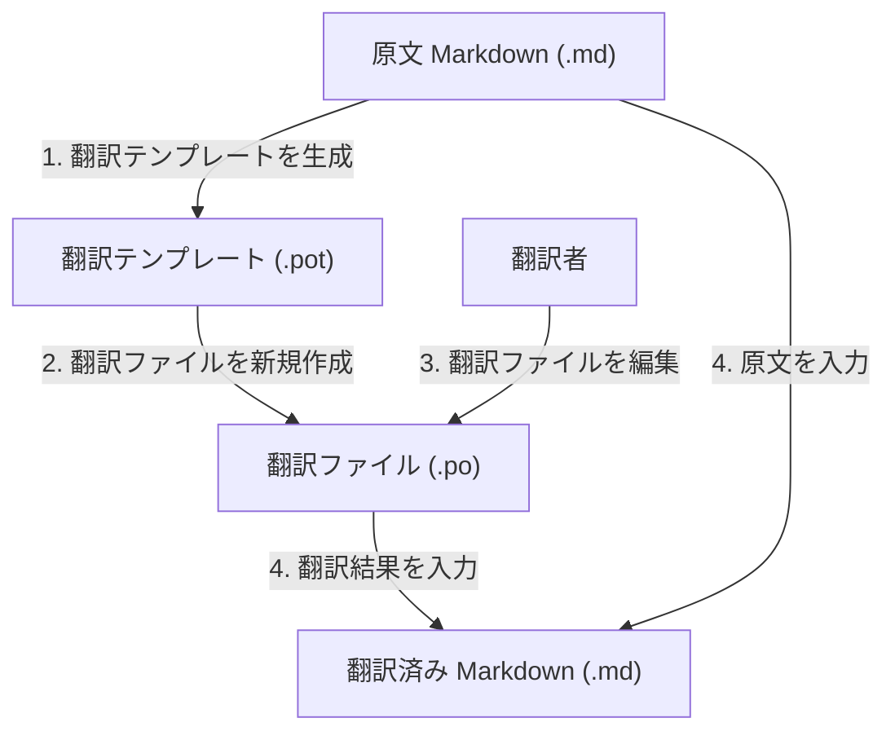
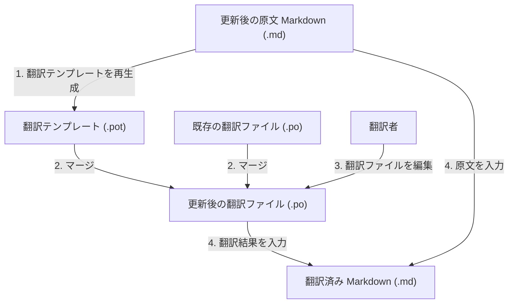

# 提案依頼書（RFP）: Markdown 翻訳フロー支援 CLI ツール「Monde」

## 1. 概要

本書は、Markdown 文書を構造を維持したまま多言語に翻訳するためのフローを支援する CLI ツール「Monde」の開発について、要件と前提条件をまとめたものである。

| 項目 | 内容 |
| --- | --- |
| 正式名称 | Monde |
| コマンド名 | `monde` |
| 種別 | コマンドラインツール（CLI） |
| 発注元 | Vabel |
| 著作権者 | The Monde Authors |
| ライセンス | MIT License |
| ソース管理 | GitHub |

## 2. 背景と目的

Markdown 文書の翻訳では、原文の構造（見出し、リスト、コードブロック、リンクなど）を保ったまま本文だけを訳す必要がある。また、原文が更新されたときに既存の翻訳を活かし、変更された箇所だけを訳し直せることが望ましい。

そこで、gettext の翻訳テンプレート（`.pot`）と翻訳ファイル（`.po`）を介した翻訳フローを Markdown に適用できるツールを開発する。これにより次の状態を目指す。

- 原文の構造を壊さずに翻訳済み Markdown を生成できる
- 原文が更新されても、既存の翻訳を引き継いで差分だけを翻訳できる
- 翻訳作業そのものは、`.po` に対応した既存の翻訳プラットフォームやエディタに任せられる

## 3. 想定する翻訳フロー

### 3.1 新規翻訳フロー

1. 原文 Markdown から翻訳テンプレート（`.pot`）を生成する。
2. 翻訳テンプレートから、言語ごとの翻訳ファイル（`.po`）を新規作成する。
3. 翻訳者が翻訳ファイルを編集する（Monde のスコープ外）。
4. 原文 Markdown と翻訳ファイルから、翻訳済み Markdown を生成する。

### 3.2 原文更新フロー

1. 更新後の原文 Markdown から翻訳テンプレート（`.pot`）を再生成する。
2. 再生成した翻訳テンプレートと既存の翻訳ファイル（`.po`）をマージし、更新後の翻訳ファイルを作成する。
3. 翻訳者が、追加・変更された箇所を中心に翻訳ファイルを編集する（Monde のスコープ外）。
4. 更新後の原文 Markdown と翻訳ファイルから、翻訳済み Markdown を生成する。

## 4. スコープ

### 4.1 対象範囲

- 原文 Markdown からの翻訳テンプレート（`.pot`）の生成
- 翻訳テンプレートからの翻訳ファイル（`.po`）の新規作成
- 翻訳テンプレートと既存の翻訳ファイルのマージ
- 原文 Markdown と翻訳ファイルからの翻訳済み Markdown の生成
- 上記の処理を実行する CLI（`monde` コマンド）
- 日本語のドキュメント（README.md、マニュアルなど）

### 4.2 対象外

- 翻訳ファイル（`.po`）を編集する翻訳作業そのもの（外部の翻訳プラットフォームなどに任せる）

## 5. 機能要件

### 5.1 Markdown の扱い

- 既定では CommonMark 準拠の Markdown を入力とする。
- オプション指定により、他の Markdown 方言にも対応できること。最初に対応する方言は GitHub Flavored Markdown（GFM）とする。
- 翻訳済み Markdown は、原文の文書構造を維持して出力すること。

### 5.2 YAML フロントマター

- Markdown 文書の YAML フロントマターも翻訳対象とする。

### 5.3 gettext 形式ファイル

- 翻訳テンプレート（`.pot`）と翻訳ファイル（`.po`）を読み書きできること。
- 原文更新時に、既存の翻訳を引き継ぐマージができること。

## 6. 非機能要件・技術的制約

| 項目 | 要件 |
| --- | --- |
| 対応プラットフォーム | クロスプラットフォーム（Windows / macOS / Linux を想定） |
| 開発言語 | C（C99） |
| ビルドツール | CMake |
| テストフレームワーク | [Naos](https://github.com/vabelorg/naos) |
| 外部依存 | 追加のインストールが必要な外部ライブラリをツール本体に持ち込まない。Markdown、YAML、PO などのパーサはすべて自前で実装する |
| 設計方針 | 部品ごとに再利用できる単位で設計・実装する（例: コマンドライン引数パーサ、Markdown パーサ、YAML パーサ、PO ファイルパーサ） |
| ドキュメント言語 | 日本語 |

## 7. 成果物

- `monde` のソースコード一式（GitHub リポジトリで管理）
- CMake によるビルド構成
- Naos を用いたテストコード
- 日本語のドキュメント（README.md、利用マニュアルなど）

## 8. 未決事項

以下は現時点で未定のため、提案時に案を示すこと。

- CLI のサブコマンド体系とオプション名（例: テンプレート生成、`.po` 作成、マージ、Markdown 生成の各操作の呼び方）
- 翻訳単位（メッセージ）の分割粒度（段落単位、ブロック単位など）
- YAML フロントマターのうち、どのキーを翻訳対象とするかの指定方法
- GFM 以外に対応する Markdown 方言の候補と優先度
- 対応プラットフォームとコンパイラの具体的な範囲
- スケジュールとマイルストーン
